# Object-Oriented Programming (OOP): Core Concepts & Multi-Language Paradigms

At its core, **Object-Oriented Programming (OOP)** is a way of organizing code by modeling real-world or domain ideas as bundled entities called **objects**. An object bundles two fundamental things:

1. **State (Data):** What the object *knows* or *holds* (properties, fields, attributes).
2. **Behavior (Actions):** What the object *does* or *allows others to do* (methods, functions).

Before OOP, procedural code separated data structures from the functions that mutated them. As systems grew, any function could modify any data structure from anywhere, causing tangled codebases where a single change had unpredictable ripple effects. OOP introduced structured boundaries, ensuring data is managed through well-defined operations.

---

## 1. The Core Building Blocks: Classes, Objects, and Prototypes

Before examining the four pillars of OOP, it is essential to understand how objects are defined and created across different programming languages.

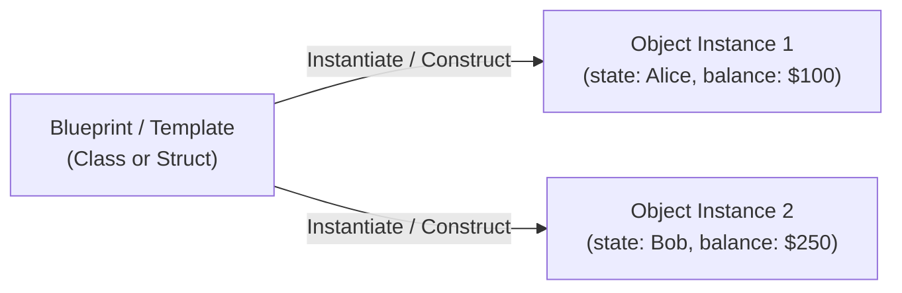

### 1.1 Class vs. Object
* **Class (The Blueprint):** The abstract specification or schema. It defines what fields and methods an object of this type will have, but allocates no runtime state of its own.
* **Object (The Instance):** A concrete realization living in memory. It holds actual values and executes behaviors defined by the blueprint.

### 1.2 Classical vs. Prototypal vs. Compositional Paradigms
Different programming languages implement OOP through distinct mechanisms:

| Paradigm | How It Works | Primary Languages |
| :--- | :--- | :--- |
| **Classical (Class-based)** | Objects are strict instances of classes. Hierarchies are established via class inheritance. | Java, C++, C#, Python |
| **Prototypal** | There are no strict classes at the engine level. Objects clone or delegate directly to other objects via a prototype chain. | JavaScript, TypeScript |
| **Compositional / Struct-based** | No classes or type inheritance. State is held in plain `struct` types; behavior is attached via methods; polymorphism is achieved solely through structural interfaces. | Go, Rust |

---

## 2. The Four Pillars of OOP

Every object-oriented system is built on four core conceptual pillars:

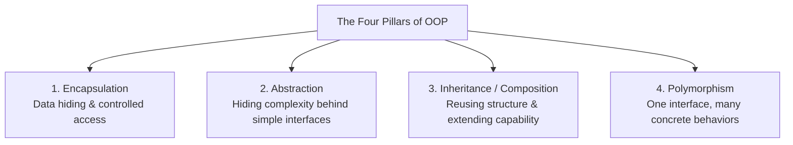

---

## 3. Pillar 1: Encapsulation

**Encapsulation** means bundling data and the methods that operate on that data inside a single boundary, while **restricting direct external access** to internal state.

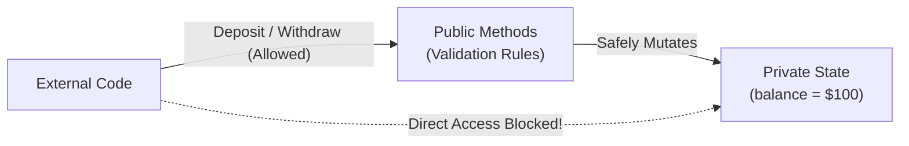

### Why It Matters
Without encapsulation, external code can corrupt internal state:
```
// Dangerous direct mutation without encapsulation:
account.balance = -50000; // Negative balance set without checks!
```
With encapsulation, state modifications pass through guarded methods containing validation logic, invariants, and audit tracking.

### Multi-Language Implementation: Bank Account

#### Java (Access Modifiers: `private`, `public`, `protected`)
Java enforces encapsulation through explicit visibility keywords:

```java
public class BankAccount {
    // Hidden from outside world
    private double balance;

    public BankAccount(double initialBalance) {
        if (initialBalance >= 0) {
            this.balance = initialBalance;
        }
    }

    public void deposit(double amount) {
        if (amount <= 0) {
            throw new IllegalArgumentException("Deposit amount must be positive");
        }
        this.balance += amount;
    }

    public double getBalance() {
        return this.balance;
    }
}
```

#### TypeScript (Private Modifiers & Private Fields `#`)
TypeScript supports both compile-time `private` keywords and runtime ECMAScript `#` private fields:

```typescript
export class BankAccount {
    // ECMAScript runtime-private field (cannot be accessed even via raw JS reflection)
    #balance: number = 0;

    constructor(initialBalance: number) {
        if (initialBalance >= 0) {
            this.#balance = initialBalance;
        }
    }

    public deposit(amount: number): void {
        if (amount <= 0) {
            throw new Error("Deposit amount must be positive");
        }
        this.#balance += amount;
    }

    public get balance(): number {
        return this.#balance;
    }
}
```

#### Go (Package-Level Visibility via Capitalization)
Go does not have classes or `private`/`public` keywords. Instead, identifiers starting with a **lowercase letter** are unexported (private to the package), while **uppercase** identifiers are exported (public):

```go
package banking

import "errors"

// BankAccount struct holds state
type BankAccount struct {
    // balance is lowercase, meaning unexported outside this package
    balance float64
}

func NewBankAccount(initial float64) *BankAccount {
    b := 0.0
    if initial >= 0 {
        b = initial
    }
    return &BankAccount{balance: b}
}

func (a *BankAccount) Deposit(amount float64) error {
    if amount <= 0 {
        return errors.New("deposit amount must be positive")
    }
    a.balance += amount
    return nil
}

func (a *BankAccount) Balance() float64 {
    return a.balance
}
```

---

## 4. Pillar 2: Abstraction

**Abstraction** means hiding internal implementation details and exposing only the essential, high-level interface needed to use an object.

```
Real-World Analogy: Driving a Car
You press the gas pedal to accelerate. You do not need to know the fuel injection timing,
valve clearance, or cylinder combustion ratios to drive. The pedal is the abstraction.
```

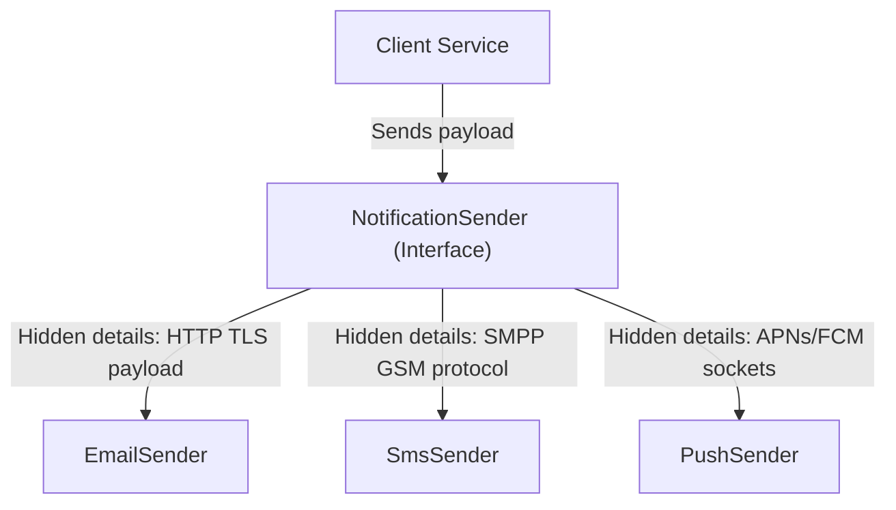

### Why It Matters
Abstraction decouples the consumer of a feature from the provider. If the underlying implementation changes (e.g., migrating an email provider from SendGrid to AWS SES), code relying on the high-level abstraction requires zero modifications.

### Multi-Language Implementation: Notification Service

#### Java (`interface` and `abstract class`)
```java
// The Abstraction
public interface NotificationSender {
    void send(String recipient, String message);
}

// The Concrete Implementation
public class EmailNotificationSender implements NotificationSender {
    @Override
    public void send(String recipient, String message) {
        // Complex SMTP negotiation, MIME header creation, and TLS handshake happen here
        System.out.println("Connecting to SMTP server... Sending email to " + recipient);
    }
}
```

#### TypeScript (`interface`)
```typescript
// The Abstraction
export interface NotificationSender {
    send(recipient: string, message: string): Promise<void>;
}

// The Concrete Implementation
export class EmailNotificationSender implements NotificationSender {
    async send(recipient: string, message: string): Promise<void> {
        // Connect to email API, sign headers, handle retries
        console.log(`Delivering email to ${recipient}: ${message}`);
    }
}
```

#### Go (Implicit Interfaces)
In Go, interfaces are satisfied **implicitly**. A type does not declare that it `implements` an interface; if its method set matches the interface signature, Go treats it as satisfying the interface automatically:

```go
package notification

import "fmt"

// The Abstraction
type Sender interface {
    Send(recipient string, message string) error
}

// The Concrete Implementation
type EmailSender struct {
    SmtpHost string
}

// Send implements the Sender interface without any explicit "implements" keyword
func (e *EmailSender) Send(recipient string, message string) error {
    fmt.Printf("Delivering email via %s to %s: %s\n", e.SmtpHost, recipient, message)
    return nil
}
```

---

## 5. Pillar 3: Inheritance vs. Composition

### 5.1 Inheritance ("Is-A" Relationship)
Inheritance allows a child class to inherit fields and methods from a parent class, extending or overriding them.

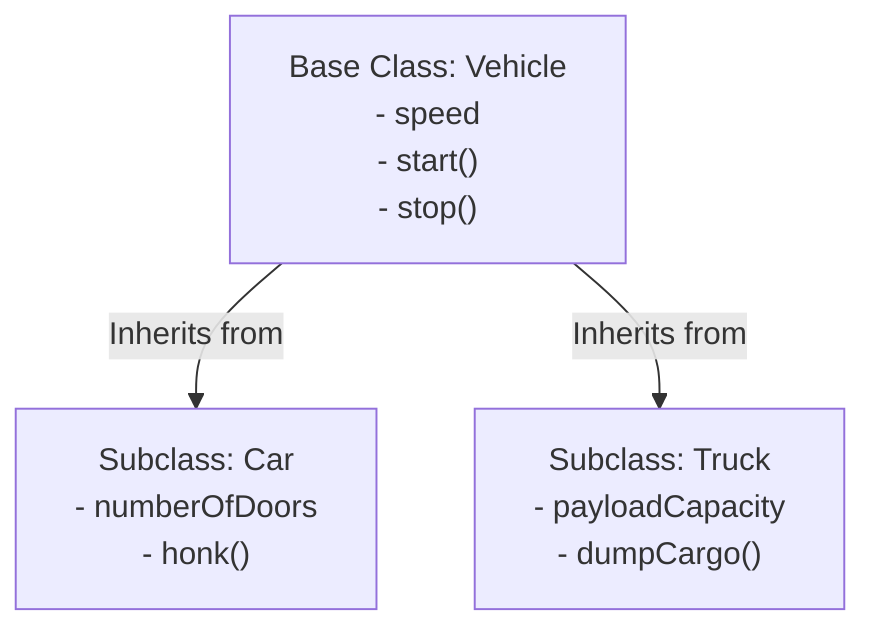

### 5.2 The Peril of Deep Inheritance: The Fragile Base Class Problem
While inheritance is intuitive, deep hierarchies create rigid coupling. If a base class changes an internal method, subclasses several levels down can break silently.

```
Classic Flaw: The Diamond Problem
Class A
├── Class B (overrides foo)
├── Class C (overrides foo)
└── Class D (inherits from BOTH B and C)
Which foo() does D execute? (Ambiguity!)
```
Most modern languages (Java, TypeScript, Go) prohibit multiple class inheritance to avoid this ambiguity.

### 5.3 The Golden Rule: Prefer Composition Over Inheritance ("Has-A")
Instead of declaring that a class *is* another class, compose objects by having them *hold references* to specialized components:

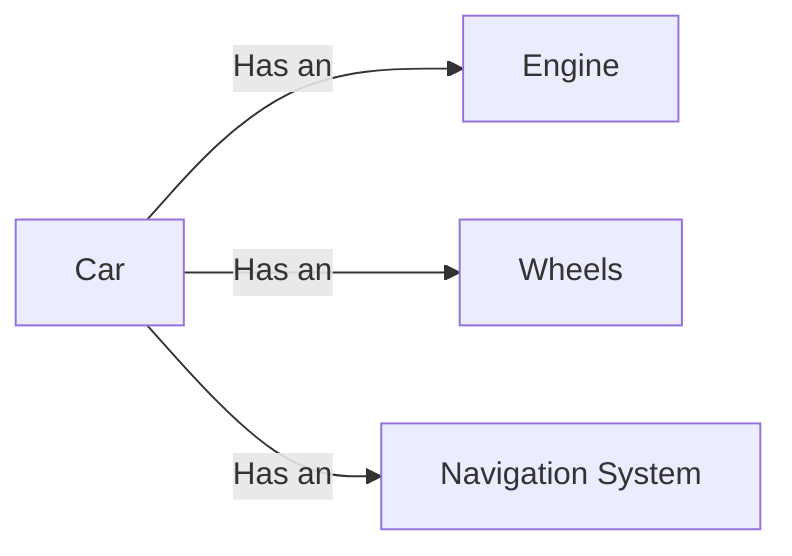

### Multi-Language Implementation

#### Java (Class Inheritance)
```java
// Base class
public class Vehicle {
    protected int speed;

    public void accelerate(int amount) {
        this.speed += amount;
    }
}

// Derived class
public class ElectricCar extends Vehicle {
    private int batteryLevel;

    public void charge(int amount) {
        this.batteryLevel = Math.min(100, this.batteryLevel + amount);
    }
}
```

#### TypeScript (Class Inheritance & Method Overriding)
```typescript
export class Vehicle {
    protected speed: number = 0;

    public start(): void {
        console.log("Vehicle engine started.");
    }
}

export class ElectricCar extends Vehicle {
    // Method Overriding with super
    public override start(): void {
        super.start();
        console.log("High-voltage battery engaged.");
    }
}
```

#### Go (Struct Embedding / Composition - Zero Class Inheritance)
Go has **no inheritance keyword (`extends`)**. Instead, it uses **composition via struct embedding**:

```go
package transport

import "fmt"

type Engine struct {
    Horsepower int
}

func (e Engine) Start() {
    fmt.Printf("Engine running with %d HP.\n", e.Horsepower)
}

// Car embeds Engine directly (Composition)
type Car struct {
    Engine // Embedded struct: methods are promoted to Car!
    Doors  int
}

func Example() {
    c := Car{
        Engine: Engine{Horsepower: 350},
        Doors:  4,
    }
    // Promoted method call: behaves cleanly like inheritance without rigid hierarchy
    c.Start()
}
```

---

## 6. Pillar 4: Polymorphism

**Polymorphism** (from Greek: "many forms") is the ability for different types to respond to the **same operation in their own unique way**.

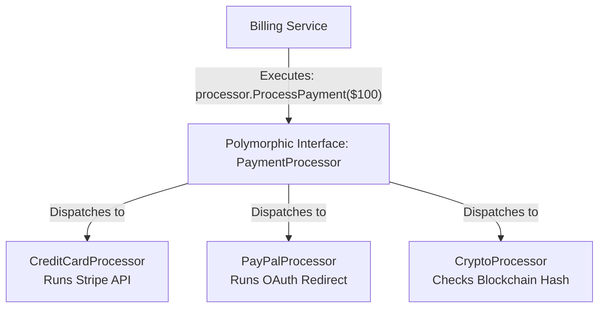

### 6.1 Static vs. Dynamic Polymorphism

```
+------------------------------------+------------------------------------+
| Static Polymorphism (Compile-Time) | Dynamic Polymorphism (Runtime)     |
+------------------------------------+------------------------------------+
| Method Overloading & Generics      | Method Overriding & Interfaces     |
| Resolved at compile time.          | Resolved at runtime via vtables.   |
| Example: add(int, int) vs          | Example: paymentProcessor.pay()    |
|          add(double, double)       | where concrete type varies.        |
+------------------------------------+------------------------------------+
```

### Multi-Language Implementation: Payment Gateway

#### Java (Runtime Interface Polymorphism)
```java
public interface PaymentProcessor {
    boolean process(double amount);
}

public class StripePaymentProcessor implements PaymentProcessor {
    @Override
    public boolean process(double amount) {
        System.out.println("Charging $" + amount + " via Stripe credit card gateway.");
        return true;
    }
}

public class PayPalPaymentProcessor implements PaymentProcessor {
    @Override
    public boolean process(double amount) {
        System.out.println("Directing user to PayPal wallet for $" + amount);
        return true;
    }
}

// The caller does not know or care which processor is passed:
public class CheckoutService {
    public void checkout(PaymentProcessor processor, double total) {
        processor.process(total); // Dispatches polymorphically!
    }
}
```

#### TypeScript (Structural Polymorphism / Duck Typing)
TypeScript's type system is **structural**, not nominal. If an object has the right shape (methods and parameters), it satisfies the interface even without explicitly mentioning it:

```typescript
export interface PaymentProcessor {
    process(amount: number): boolean;
}

export class StripeProcessor implements PaymentProcessor {
    process(amount: number): boolean {
        console.log(`Processing $${amount} via Stripe.`);
        return true;
    }
}

// Pure object matching the interface signature (Structural Typing):
const customProcessor = {
    process(amount: number): boolean {
        console.log(`Custom ledger charge: $${amount}`);
        return true;
    }
};

function executePayment(processor: PaymentProcessor, amount: number) {
    processor.process(amount);
}

executePayment(new StripeProcessor(), 100);
executePayment(customProcessor, 250); // Valid TypeScript!
```

#### Go (Duck-Typed Dynamic Polymorphism)
Go achieves clean runtime polymorphism through its structural interface model:

```go
package checkout

import "fmt"

type PaymentProcessor interface {
    Process(amount float64) bool
}

type StripeService struct {
    ApiKey string
}

func (s *StripeService) Process(amount float64) bool {
    fmt.Printf("Charged $%.2f via Stripe using key %s\n", amount, s.ApiKey)
    return true
}

type CryptoService struct {
    WalletAddress string
}

func (c *CryptoService) Process(amount float64) bool {
    fmt.Printf("Transferred $%.2f to wallet %s\n", amount, c.WalletAddress)
    return true
}

// Execute accepts any type that implements Process(float64) bool
func Execute(p PaymentProcessor, amount float64) {
    p.Process(amount)
}
```

---

## 7. Summary Comparison Matrix: How Languages Implement OOP

| Feature | Java | TypeScript | Go |
| :--- | :--- | :--- | :--- |
| **Core Paradigm** | Classical (Strict Class-based) | Prototypal + Class syntax | Compositional (Struct-based) |
| **Inheritance Model** | Single class inheritance (`extends`) | Single class inheritance (`extends`) | **None**; struct embedding (composition) |
| **Interface Typing** | **Nominal:** Must explicitly declare `implements` | **Structural:** Satisfied if shape matches | **Structural:** Satisfied implicitly by method signatures |
| **Encapsulation Mechanism** | Keywords: `private`, `protected`, `public` | Keywords: `private` or runtime `#field` | Case convention: `lowerCase` (package) vs `UpperCase` (public) |
| **Polymorphism Vector** | Abstract classes, Interfaces, Overriding | Interfaces, Structural types | Interfaces |
| **Operator Overloading** | Prohibited | Prohibited | Prohibited |

---

## 8. Real-World Software Engineering Scenarios

To see how OOP shapes day-to-day production code, let us examine concrete architectural scenarios from both **Backend Distributed Systems** and **Frontend UI Engineering**.

---

### Scenario 1: Backend Middleware Pipeline & Extensible Rate Limiting

In modern backend architectures (Express, Spring Boot, Gin, NestJS), HTTP requests pass through an ordered pipeline of filters or middleware before reaching a domain handler.

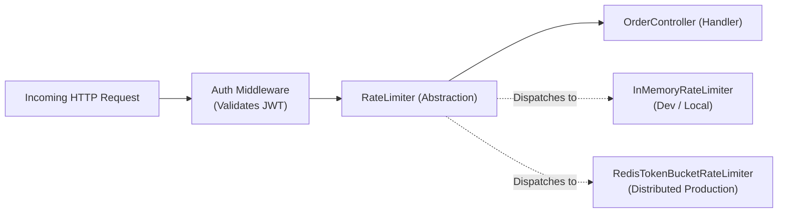

#### How the Pillars Solve This Problem:
1. **Abstraction & Polymorphism:** The HTTP server depends on a generic `RateLimiter` interface (`Allow(clientIP) bool`). The controller never knows whether rate limits are tracked in local process memory or a remote Redis cluster.
2. **Encapsulation:** The internal token bucket math, TTL keys, and Redis connection pools are private. The application cannot accidentally reset or tamper with another client's request counters.

#### Implementation (TypeScript / Backend):
```typescript
// 1. Abstraction
export interface RateLimiter {
    isAllowed(clientIp: string): Promise<boolean>;
}

// 2. Concrete Implementation A: Fast in-memory token bucket for development / tests
export class InMemoryRateLimiter implements RateLimiter {
    #requestCounts = new Map<string, { count: number; resetAt: number }>();
    readonly #limit = 100;
    readonly #windowMs = 60_000;

    async isAllowed(clientIp: string): Promise<boolean> {
        const now = Date.now();
        const record = this.#requestCounts.get(clientIp);

        if (!record || now > record.resetAt) {
            this.#requestCounts.set(clientIp, { count: 1, resetAt: now + this.#windowMs });
            return true;
        }

        if (record.count >= this.#limit) {
            return false;
        }

        record.count++;
        return true;
    }
}

// 3. Concrete Implementation B: Distributed Redis rate limiter for production clusters
export class RedisRateLimiter implements RateLimiter {
    constructor(private readonly redisClient: any, private readonly limit: number) {}

    async isAllowed(clientIp: string): Promise<boolean> {
        // Atomic Redis INCR + EXPIRE via Lua script
        const count = await this.redisClient.incr(`ratelimit:${clientIp}`);
        if (count === 1) {
            await this.redisClient.expire(`ratelimit:${clientIp}`, 60);
        }
        return count <= this.limit;
    }
}

// 4. Decoupled Middleware (Polymorphic Consumer)
export function createRateLimitMiddleware(limiter: RateLimiter) {
    return async (req: any, res: any, next: any) => {
        const allowed = await limiter.isAllowed(req.ip);
        if (!allowed) {
            return res.status(429).json({ error: "Too many requests. Please slow down." });
        }
        next();
    };
}
```

---

### Scenario 2: Backend Database Repository Pattern & Unit Testing

In production backends, domain services should never directly construct raw SQL statements or couple themselves to a specific database driver. Doing so makes unit testing painful because running tests requires a live, spinning database.

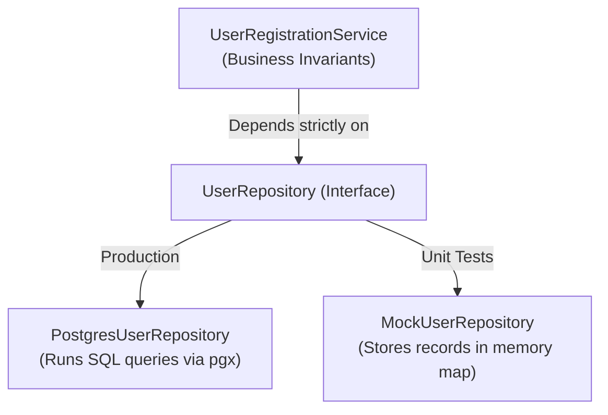

#### How the Pillars Solve This Problem:
1. **Dependency Inversion (D in SOLID):** High-level business rules (`UserRegistrationService`) depend on an abstract interface (`UserRepository`), not a physical PostgreSQL connection.
2. **Polymorphic Test Fakes:** In CI/CD unit tests, we inject an in-memory repository fake that runs in **under 2 milliseconds**, completely eliminating flaky database test containers.

#### Implementation (Go / Backend):
```go
package user

import (
	"errors"
	"fmt"
)

type User struct {
	ID    string
	Email string
}

// 1. Abstraction (Repository Interface)
type Repository interface {
	Save(u User) error
	FindByEmail(email string) (*User, error)
}

// 2. Production Implementation: PostgreSQL Database
type PostgresRepository struct {
	DBConnectionString string
}

func (p *PostgresRepository) Save(u User) error {
	// Runs INSERT INTO users (id, email) VALUES ($1, $2)
	fmt.Printf("Writing to PostgreSQL database: %s\n", u.Email)
	return nil
}

func (p *PostgresRepository) FindByEmail(email string) (*User, error) {
	// Runs SELECT id, email FROM users WHERE email = $1
	return nil, nil // Assume user not found
}

// 3. Test Implementation: In-Memory Fake (Zero DB needed!)
type InMemoryRepository struct {
	users map[string]User
}

func NewInMemoryRepository() *InMemoryRepository {
	return &InMemoryRepository{users: make(map[string]User)}
}

func (m *InMemoryRepository) Save(u User) error {
	m.users[u.Email] = u
	return nil
}

func (m *InMemoryRepository) FindByEmail(email string) (*User, error) {
	u, exists := m.users[email]
	if !exists {
		return nil, errors.New("not found")
	}
	return &u, nil
}

// 4. Domain Service (Pure business logic)
type RegistrationService struct {
	repo Repository
}

func NewRegistrationService(r Repository) *RegistrationService {
	return &RegistrationService{repo: r}
}

func (s *RegistrationService) Register(id, email string) error {
	existing, _ := s.repo.FindByEmail(email)
	if existing != nil {
		return errors.New("email already taken")
	}
	return s.repo.Save(User{ID: id, Email: email})
}
```

---

### Scenario 3: Frontend UI Design System (Component Hierarchy & Form Controls)

In frontend web applications (React, Vue, Angular, Design Systems), user interfaces are composed of reusable UI components that share visual behavior, state, and accessibility properties.

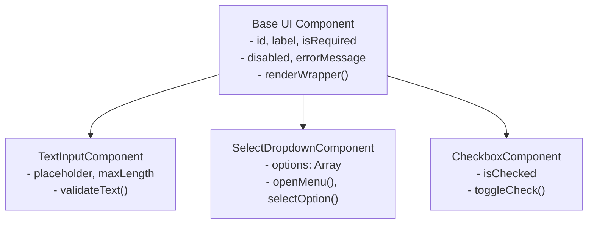

#### How the Pillars Solve This Problem:
1. **Encapsulation:** The internal DOM state (e.g., whether a dropdown dropdown menu is currently open or focused, raw keyboard navigation event listeners) is hidden inside the component. Parent forms only care about the clean output: `value` and `onChange`.
2. **Composition (Compound Components):** A complex modal or form does not inherit from hundreds of nested classes. Instead, it is composed of smaller, focused objects: `<Modal>` has a `<ModalHeader>`, `<ModalBody>`, and `<ModalFooter>`.
3. **Polymorphic Form Validation:** The form orchestrator validates every control through a uniform interface: `validate(): ValidationResult`.

#### Implementation (TypeScript / Frontend):
```typescript
// 1. Base Abstraction for any Form Field
export interface FormField<T> {
    getValue(): T;
    setValue(newValue: T): void;
    validate(): string | null; // Returns error message or null if valid
}

// 2. Concrete Text Input Component
export class TextField implements FormField<string> {
    #value: string;
    #required: boolean;

    constructor(initialValue: string = "", required: boolean = true) {
        this.#value = initialValue;
        this.#required = required;
    }

    getValue(): string {
        return this.#value;
    }

    setValue(newValue: string): void {
        this.#value = newValue.trim();
    }

    validate(): string | null {
        if (this.#required && this.#value.length === 0) {
            return "This field is required.";
        }
        return null;
    }
}

// 3. Concrete Number Range Component
export class NumberRangeField implements FormField<number> {
    #value: number;
    #min: number;
    #max: number;

    constructor(initial: number, min: number, max: number) {
        this.#value = initial;
        this.#min = min;
        this.#max = max;
    }

    getValue(): number {
        return this.#value;
    }

    setValue(newValue: number): void {
        this.#value = newValue;
    }

    validate(): string | null {
        if (this.#value < this.#min || this.#value > this.#max) {
            return `Value must be between ${this.#min} and ${this.#max}.`;
        }
        return null;
    }
}

// 4. Polymorphic Form Orchestrator
export class FormValidator {
    #fields: FormField<any>[] = [];

    registerField(field: FormField<any>): void {
        this.#fields.push(field);
    }

    // Validates every input polymorphically without knowing concrete HTML types!
    validateAll(): { isValid: boolean; errors: string[] } {
        const errors: string[] = [];

        for (const field of this.#fields) {
            const err = field.validate();
            if (err) {
                errors.push(err);
            }
        }

        return {
            isValid: errors.length === 0,
            errors,
        };
    }
}
```

---

### Scenario 4: Frontend State Management (Store & Observer Pattern)

In frontend state managers (e.g. Redux, Zustand, Pinia, Event Emitters), application state must be protected from random mutation while notifying subscribed UI components when relevant state slices change.

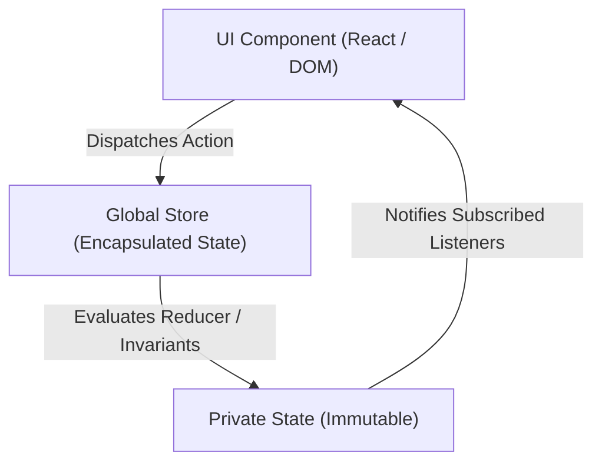

#### How the Pillars Solve This Problem:
1. **Encapsulation:** External UI components cannot run `store.state.currentUser = null` directly. All state mutations are channeled through explicit action dispatchers or reducer functions that maintain historical invariants.
2. **Polymorphic Observers:** Any UI subscriber (charts, navigation bars, analytics trackers) implements a simple `Listener` contract: `onStateChange(newState)`. The store broadcasts updates polymorphically without coupling to any visual framework.

#### Implementation (TypeScript / Store Pattern):
```typescript
export interface Listener<T> {
    (state: T): void;
}

export class ObservableStore<T> {
    // Encapsulated state: invisible to external tampering
    #state: T;
    #listeners: Set<Listener<T>> = new Set();

    constructor(initialState: T) {
        this.#state = Object.freeze({ ...initialState });
    }

    public getState(): T {
        return this.#state;
    }

    // Polymorphic subscription mechanism
    public subscribe(listener: Listener<T>): () => void {
        this.#listeners.add(listener);
        // Returns an unsubscribe cleanup callback
        return () => {
            this.#listeners.delete(listener);
        };
    }

    // Guarded mutation pipeline
    public update(updater: (currentState: T) => T): void {
        const nextState = Object.freeze(updater(this.#state));
        this.#state = nextState;
        
        // Broadcasts state changes to all subscribers
        for (const listener of this.#listeners) {
            listener(this.#state);
        }
    }
}
```

---

## 9. Key Takeaways

1. **OOP is a mental model, not syntax:** OOP is about separating concerns into units with cohesive state and guarded behavior.
2. **Encapsulation protects invariants:** Internal fields should be shielded from arbitrary mutation.
3. **Abstraction reduces cognitive load:** Consumers interact with high-level contracts, not volatile internal wiring.
4. **Composition beats inheritance:** Build complex systems by assembling small, interchangeable components rather than maintaining deep, brittle class trees.
5. **Polymorphism decouples systems:** Write code against generic contracts so new behaviors can be plugged in without rewriting client logic.
6. **Real-world engineering thrives on abstraction boundaries:** Whether decoupling backend rate limiters from Redis or isolating frontend form validators from DOM controls, OOP primitives prevent system-wide ripple effects when requirements evolve.

---

⬅️ **[Back to TOC](README.md)** | **[Next: 02. SOLID Principles ➡️](02_SOLID_Principles.md)**
