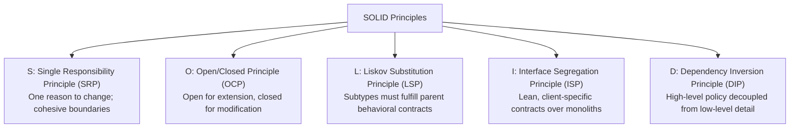
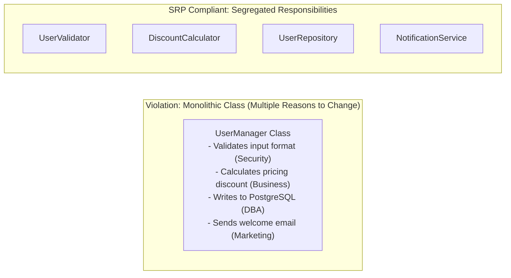
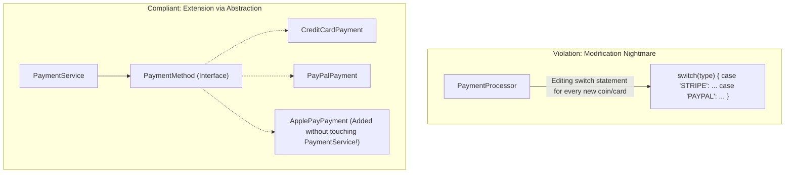
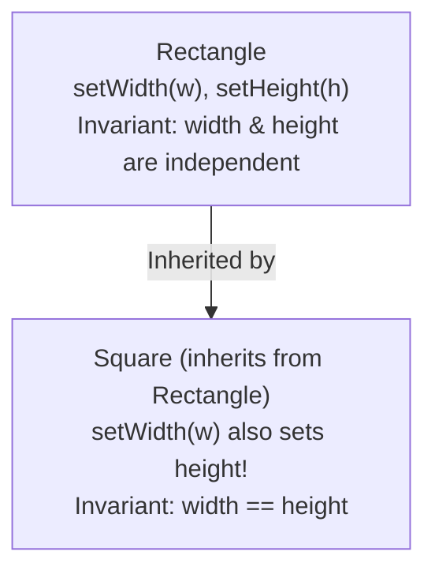
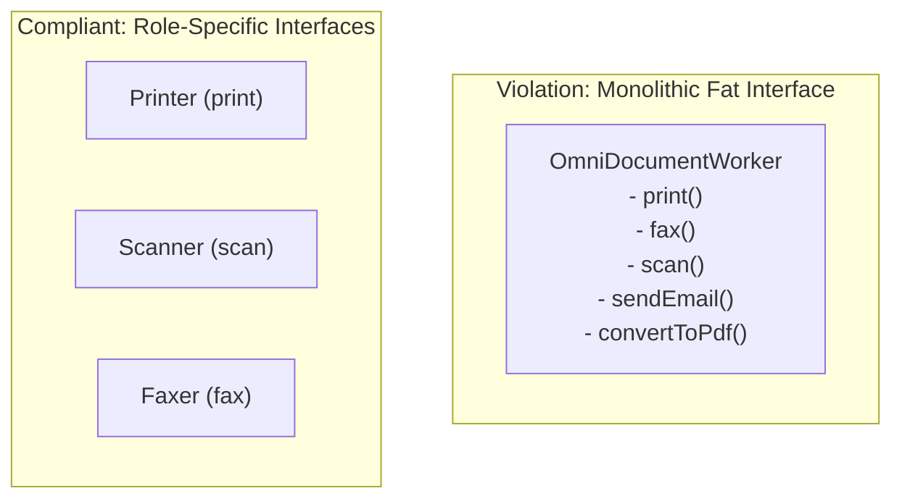
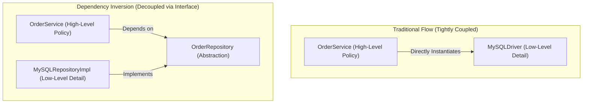
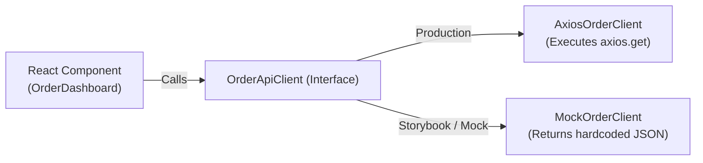
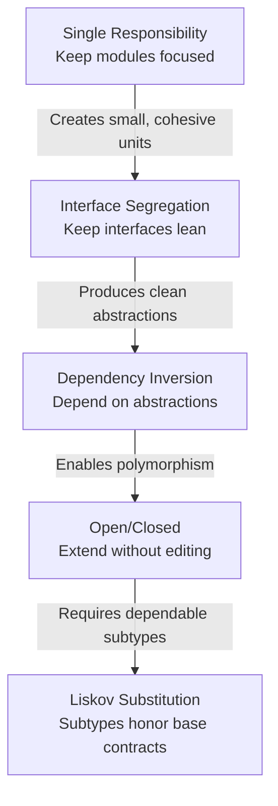
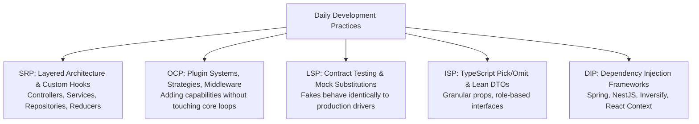

# SOLID Principles: Architectural Design for Resilient Software

In software engineering, writing code that simply "works" is only the first step. Systems must continuously evolve to accommodate shifting business requirements, third-party API changes, new payment gateways, and evolving database architectures. When software lacks disciplined design boundaries, every bug fix or feature addition causes cascading failures across unrelated modules—a symptom known as **Software Rot**.

Introduced by Robert C. Martin (Uncle Bob) in the early 2000s, the **SOLID** principles are five foundational design guidelines for structuring classes, functions, modules, and components. While originally formulated in the context of classical object-oriented languages (like Java and C++), SOLID represents **universal architectural principles** that apply equally across modern backend microservices, Go services, Node.js runtimes, and modern frontend frameworks (**React**, **Angular**, **Next.js**).

---

## 1. Overview of the Five Principles



| Letter | Principle | Architectural Intent | Primary Benefit |
| :---: | :--- | :--- | :--- |
| **S** | **Single Responsibility Principle** | A module should be responsible to one, and only one, actor or business function. | High cohesion; minimal blast radius during changes. |
| **O** | **Open/Closed Principle** | Software entities should be open for extension, but closed for modification. | Add new features without editing or breaking stable, battle-tested code. |
| **L** | **Liskov Substitution Principle** | Subtypes must be substitutable for their base types without altering program correctness. | Prevents silent bugs and broken runtime assumptions in polymorphism. |
| **I** | **Interface Segregation Principle** | Clients should not be forced to depend upon methods they do not use. | Eliminates unnecessary coupling and bloat in consumer code. |
| **D** | **Dependency Inversion Principle** | High-level modules should not depend on low-level modules; both should depend on abstractions. | Swappable infrastructure, easy unit testing, and isolated domain logic. |

---

## 2. Single Responsibility Principle (SRP)

> **"A class should have one, and only one, reason to change."**

A more precise formulation: **A module should be responsible to one, and only one, actor** (e.g., a Finance Director, a Marketing Lead, or a Security Auditor).

When a single class or component manages multiple responsibilities—such as calculating business metrics, executing database queries, and rendering user interface components—changes requested by one department risk breaking functionality relied upon by another.



---

### 2.1 Backend Scenario: User Registration Flow

#### The Violation: The "God Object"
```typescript
// VIOLATION: Has at least 4 reasons to change!
export class UserService {
    async registerUser(email: string, passwordHash: string) {
        // Reason 1: Validation format changes
        if (!email.includes("@")) {
            throw new Error("Invalid email");
        }

        // Reason 2: Database schema or SQL driver changes
        const db = await getDatabaseConnection();
        await db.query("INSERT INTO users (email, password) VALUES ($1, $2)", [email, passwordHash]);

        // Reason 3: Marketing/Email provider changes (e.g., SendGrid to AWS SES)
        const smtpClient = new SmtpClient();
        await smtpClient.sendMail({
            to: email,
            subject: "Welcome!",
            body: "<h1>Welcome to our platform</h1>", // Reason 4: HTML formatting changes
        });
    }
}
```

#### The Solution: Decomposed Cohesive Responsibilities
```typescript
// 1. Dedicated validation policy
export class UserValidator {
    validate(email: string): void {
        const emailRegex = /^[^\s@]+@[^\s@]+\.[^\s@]+$/;
        if (!emailRegex.test(email)) {
            throw new Error("Invalid email format");
        }
    }
}

// 2. Dedicated persistence abstraction
export interface UserRepository {
    save(email: string, passwordHash: string): Promise<void>;
}

// 3. Dedicated communication abstraction
export interface WelcomeEmailSender {
    sendWelcome(email: string): Promise<void>;
}

// 4. Orchestrating Service: One responsibility—orchestrating the business workflow
export class UserRegistrationUseCase {
    constructor(
        private readonly validator: UserValidator,
        private readonly repository: UserRepository,
        private readonly emailSender: WelcomeEmailSender
    ) {}

    async execute(email: string, passwordHash: string): Promise<void> {
        this.validator.validate(email);
        await this.repository.save(email, passwordHash);
        await this.emailSender.sendWelcome(email);
    }
}
```

---

### 2.2 Frontend Scenario: React Component Architecture

In React, the Single Responsibility Principle is applied by separating **Data Fetching / State Management (Container/Hook)** from **Visual Presentation (Presentational Component)**.

#### The Violation: Mixed Concerns in One Component
```tsx
// VIOLATION: Component fetches network data, manages loading state,
// processes business analytics, and renders raw HTML markup all in one place.
export function UserProfile({ userId }: { userId: string }) {
    const [user, setUser] = useState<any>(null);
    const [loading, setLoading] = useState(true);

    useEffect(() => {
        fetch(`/api/users/${userId}`)
            .then((res) => res.json())
            .then((data) => {
                setUser(data);
                setLoading(false);
                // Analytics tracking side effect
                window.gtag?.("event", "view_profile", { user_id: userId });
            });
    }, [userId]);

    if (loading) return <div>Loading...</div>;

    return (
        <div className="card">
            <h1>{user.name}</h1>
            <p>{user.email}</p>
        </div>
    );
}
```

#### The Solution: Custom Hook + Presentational Component
```tsx
// 1. Responsibility: Data fetching and state lifecycle (Custom Hook)
export function useUserProfile(userId: string) {
    const [user, setUser] = useState<User | null>(null);
    const [loading, setLoading] = useState(true);

    useEffect(() => {
        let isMounted = true;
        userService.getById(userId).then((data) => {
            if (isMounted) {
                setUser(data);
                setLoading(false);
            }
        });
        return () => { isMounted = false; };
    }, [userId]);

    return { user, loading };
}

// 2. Responsibility: Pure visual rendering (Zero network/analytics knowledge)
export function UserProfileCard({ user, loading }: { user: User | null; loading: boolean }) {
    if (loading || !user) return <div className="spinner">Loading user...</div>;

    return (
        <article className="user-card">
            <h2>{user.name}</h2>
            <p>{user.email}</p>
        </article>
    );
}

// 3. Container Component: Glues the hook to the presentation
export function UserProfileContainer({ userId }: { userId: string }) {
    const { user, loading } = useUserProfile(userId);
    return <UserProfileCard user={user} loading={loading} />;
}
```

---

### 2.3 Angular Scenario: Services vs. Components

Angular strictly enforces SRP by design:
* **Components (`@Component`):** Exclusively handle the view layout, user gestures, and template bindings.
* **Services (`@Injectable`):** Handle HTTP networking, WebSocket state, and business domain calculations.

```typescript
// Angular SRP: Service owns HTTP transport; Component owns template presentation
@Injectable({ providedIn: 'root' })
export class OrderDataService {
    constructor(private http: HttpClient) {}

    fetchOrders(): Observable<Order[]> {
        return this.http.get<Order[]>('/api/orders');
    }
}

@Component({
    selector: 'app-order-list',
    template: `
        <ul>
            <li *ngFor="let order of orders$ | async">{{ order.title }}</li>
        </ul>
    `
})
export class OrderListComponent implements OnInit {
    orders$!: Observable<Order[]>;

    constructor(private orderData: OrderDataService) {}

    ngOnInit(): void {
        this.orders$ = this.orderData.fetchOrders();
    }
}
```

---

## 3. Open/Closed Principle (OCP)

> **"Software entities (classes, modules, functions) should be open for extension, but closed for modification."**

* **Open for extension:** You can introduce completely new behaviors as business needs evolve.
* **Closed for modification:** You do not alter existing, tested, production-running source code to add those new behaviors.



---

### 3.1 Backend Scenario: Dynamic Discount Calculations

#### The Violation: The Endless `switch` Statement
Every time marketing introduces a new discount tier (e.g., `BlackFridayDiscount`), the engineer must edit `DiscountCalculator.ts`. If they introduce a typo, all existing discounts break!

```typescript
// VIOLATION: Modifying the function every time a new discount type arrives
export function calculateDiscount(type: string, total: number): number {
    if (type === "STANDARD") {
        return total * 0.05;
    } else if (type === "VIP") {
        return total * 0.20;
    } else if (type === "BLACK_FRIDAY") {
        return total * 0.50; // Modified existing code!
    }
    return 0;
}
```

#### The Solution: Strategy Pattern via Polymorphism
```typescript
// 1. The Stable Abstraction
export interface DiscountStrategy {
    calculate(total: number): number;
}

// 2. Concrete Extensible Strategies
export class StandardDiscount implements DiscountStrategy {
    calculate(total: number): number {
        return total * 0.05;
    }
}

export class VipDiscount implements DiscountStrategy {
    calculate(total: number): number {
        return total * 0.20;
    }
}

// New discount added seamlessly without modifying any existing classes:
export class BlackFridayDiscount implements DiscountStrategy {
    calculate(total: number): number {
        return total * 0.50;
    }
}

// 3. Core Engine: Completely closed for modification!
export class CheckoutCalculator {
    computeFinalPrice(total: number, strategy: DiscountStrategy): number {
        return total - strategy.calculate(total);
    }
}
```

---

### 3.2 Frontend Scenario: React Compound Components & Render Props

In UI engineering, components must often support new layout variants without stuffing dozens of boolean flags (`isCompact`, `hasIcon`, `isSidebar`) into the props interface.

#### The Violation: "Prop Soup" Component
```tsx
// VIOLATION: Adding boolean flags for every new requirement violates OCP
export function Button({ label, isSecondary, isIcon, isFloating, hasDropdown }: ButtonProps) {
    if (isFloating) return <button className="fab">{label}</button>;
    if (hasDropdown) return <div className="dropdown"><button>{label}</button></div>;
    return <button className={isSecondary ? "sec" : "pri"}>{label}</button>;
}
```

#### The Solution: Open for Extension via Composition (Slots & Children)
```tsx
// COMPLIANT: Open to arbitrary icons, badges, and menus without modifying Button core
interface ButtonProps extends React.ButtonHTMLAttributes<HTMLButtonElement> {
    variant?: "primary" | "secondary" | "danger";
    leftIcon?: React.ReactNode;
    children: React.ReactNode;
}

export function Button({ variant = "primary", leftIcon, children, ...rest }: ButtonProps) {
    return (
        <button className={`btn btn-${variant}`} {...rest}>
            {leftIcon && <span className="btn-icon">{leftIcon}</span>}
            <span className="btn-text">{children}</span>
        </button>
    );
}

// Usage: Extended with new SVG icons and tooltips without touching Button.tsx!
<Button variant="primary" leftIcon={<UploadIcon />}>
    Upload File
</Button>
```

---

## 4. Liskov Substitution Principle (LSP)

> **"Subtypes must be substitutable for their base types without altering program correctness."**

Formulated by Turing Award laureate Barbara Liskov in 1987: If $S$ is a subtype of $T$, then objects of type $T$ may be replaced with objects of type $S$ without altering any of the desirable properties of the program (correctness, performance, or behavior).

### 4.1 The Classic Paradox: The Square-Rectangle Problem

In elementary geometry, a Square is a Rectangle with equal sides. However, modeling this relationship through class inheritance violates object-oriented behavioral contracts:



#### The Code Demonstration of the Violation:
```typescript
class Rectangle {
    protected width: number = 0;
    protected height: number = 0;

    setWidth(w: number) { this.width = w; }
    setHeight(h: number) { this.height = h; }
    getArea(): number { return this.width * this.height; }
}

class Square extends Rectangle {
    override setWidth(w: number) {
        this.width = w;
        this.height = w; // Forced synchronization
    }
    override setHeight(h: number) {
        this.width = h;
        this.height = h;
    }
}

// Client function assuming Rectangle invariants:
function resizeAndVerify(rect: Rectangle) {
    rect.setWidth(5);
    rect.setHeight(10);
    // Invariant expectation: Area should be 5 * 10 = 50
    if (rect.getArea() !== 50) {
        throw new Error("LSP VIOLATION: Area is " + rect.getArea()); // Square fails: returns 100!
    }
}
```

---

### 4.2 The 4 Invariants of Liskov Substitution

When overriding methods or implementing interfaces, child classes must abide by four mathematical rules:

```
1. Contravariance of Arguments:
   A subclass cannot demand narrower or more restrictive parameter types than its parent.

2. Covariance of Return Types:
   A subclass can return a more specific subtype, but never a broader type.

3. Preconditions Cannot Be Strengthened:
   If the base method accepts all positive integers, the subclass cannot throw an error
   demanding integers greater than 100.

4. Postconditions Cannot Be Weakened:
   If the base method guarantees that balance >= 0 upon exit, the subclass cannot
   leave balance in a negative state.
```

---

### 4.3 Production Scenario: Read-Only Storage Engines

#### The Violation: Throwing `UnsupportedOperationException`
```typescript
// Base abstraction
interface StorageDriver {
    read(key: string): Promise<string>;
    write(key: string, data: string): Promise<void>;
}

// VIOLATION: S3ArchiveDriver is read-only and breaks the write contract!
class S3ArchiveDriver implements StorageDriver {
    async read(key: string): Promise<string> {
        return "archive content";
    }

    async write(key: string, data: string): Promise<void> {
        throw new Error("Cannot write to cold archive! Operation forbidden.");
    }
}

// Client function that breaks when passed S3ArchiveDriver:
async function backupData(storage: StorageDriver) {
    await storage.write("backup.json", "{ ... }"); // Crashes unexpectedly at runtime!
}
```

#### The Solution: Segregate Read and Write Contracts
```typescript
// Substituted with granular interfaces (Combines LSP and ISP)
interface ReadableStorage {
    read(key: string): Promise<string>;
}

interface WritableStorage {
    write(key: string, data: string): Promise<void>;
}

class S3ArchiveDriver implements ReadableStorage {
    async read(key: string): Promise<string> { return "archive content"; }
}

class LocalDiskDriver implements ReadableStorage, WritableStorage {
    async read(key: string): Promise<string> { return "local data"; }
    async write(key: string, data: string): Promise<void> { /* write to disk */ }
}
```

---

## 5. Interface Segregation Principle (ISP)

> **"Clients should not be forced to depend upon interfaces that they do not use."**

Large, bloated interfaces ("Fat Interfaces") create unnecessary coupling. When an interface defines 20 distinct methods, any client implementing that interface is forced to write dummy implementations or throw errors for methods it does not need.



---

### 5.1 Backend Scenario: Authentication Providers

#### The Violation: The All-in-One Auth Provider
```typescript
// VIOLATION: Fat interface forces every auth provider to implement everything
export interface AuthenticationProvider {
    loginWithPassword(user: string, pass: string): Promise<Token>;
    loginWithOAuth(token: string): Promise<Token>;
    loginWithPasskey(challenge: string): Promise<Token>;
    verifySmsOtp(phone: string, otp: string): Promise<boolean>;
}

// An API Key Provider only validates raw headers, but is forced to stub out 3 methods:
export class ApiKeyAuthProvider implements AuthenticationProvider {
    async loginWithPassword() { throw new Error("Not supported"); }
    async loginWithOAuth() { throw new Error("Not supported"); }
    async loginWithPasskey() { throw new Error("Not supported"); }
    async verifySmsOtp() { throw new Error("Not supported"); }
}
```

#### The Solution: Segregated, Composable Interfaces
```typescript
// 1. Role-specific small contracts
export interface PasswordAuthenticator {
    loginWithPassword(user: string, pass: string): Promise<Token>;
}

export interface OAuthAuthenticator {
    loginWithOAuth(provider: string, token: string): Promise<Token>;
}

export interface ApiKeyAuthenticator {
    verifyApiKey(key: string): Promise<boolean>;
}

// 2. Concrete providers implement ONLY what they support
export class InternalEmployeeAuth implements PasswordAuthenticator, OAuthAuthenticator {
    async loginWithPassword(user: string, pass: string): Promise<Token> { /* ... */ }
    async loginWithOAuth(provider: string, token: string): Promise<Token> { /* ... */ }
}

export class MachineToMachineAuth implements ApiKeyAuthenticator {
    async verifyApiKey(key: string): Promise<boolean> { /* ... */ }
}
```

---

### 5.2 Frontend Scenario: Component Prop Segregation in React

A common anti-pattern in React is passing a giant entity object into a child component that only displays a username and an avatar:

```tsx
// VIOLATION: Passing the entire User entity (50 fields) to an Avatar component
interface User {
    id: string;
    username: string;
    avatarUrl: string;
    billingAddress: Address;
    creditCardTokens: string[];
    internalSecurityRoles: string[];
    // ... 40 other properties
}

// Bad: Component depends on the entire User object
export function UserAvatar({ user }: { user: User }) {
    return ;
}
```

* **Why this hurts production:**
  1. Testing `UserAvatar` requires mocking all 50 properties of `User`.
  2. If the billing or permission schema changes, `UserAvatar` may be forced to recompile or update its types.
  3. You cannot reuse `UserAvatar` for a guest or bot that does not possess billing attributes!

```tsx
// COMPLIANT: Component requests only the minimal interface it consumes
interface AvatarProps {
    avatarUrl: string;
    username: string;
}

export function UserAvatar({ avatarUrl, username }: AvatarProps) {
    return ;
}
```

---

## 6. Dependency Inversion Principle (DIP)

> **"1. High-level modules should not depend on low-level modules. Both should depend on abstractions."**  
> **"2. Abstractions should not depend on details. Details should depend on abstractions."**

In traditional procedural programming, high-level business policies directly call low-level database drivers, filesystem APIs, or network clients. When a low-level detail changes (e.g., switching from MySQL to DynamoDB), the core business policy must be rewritten.

**Dependency Inversion inverts this arrow of dependency**:



---

### 6.1 Backend Scenario: NestJS / Spring Boot Dependency Injection (DI)

```typescript
// 1. Abstraction (Contract defined by the Domain)
export interface PaymentGateway {
    charge(amountInCents: number, currency: string): Promise<{ transactionId: string }>;
}

// 2. Low-Level Detail: Stripe Implementation
@Injectable()
export class StripePaymentGateway implements PaymentGateway {
    async charge(amountInCents: number, currency: string) {
        // Calls Stripe SDK
        return { transactionId: "ch_stripe_99120" };
    }
}

// 3. High-Level Policy: Order Checkout
@Injectable()
export class CheckoutService {
    // Injected with abstraction; zero direct reference to Stripe SDK!
    constructor(@Inject('PAYMENT_GATEWAY') private readonly gateway: PaymentGateway) {}

    async completeCheckout(orderId: string, amount: number) {
        // Business logic...
        const result = await this.gateway.charge(amount * 100, "USD");
        console.log(`Order ${orderId} charged successfully: ${result.transactionId}`);
    }
}
```

---

### 6.2 Frontend Scenario: Decoupling Next.js / React from HTTP Clients

Frontend applications frequently swap HTTP libraries (e.g., native `fetch`, `axios`, or React Query caching layers). If every UI component directly executes `axios.get('/api/orders')`, migrating to a new network layer requires editing hundreds of files.



#### Implementation via React Context / Dependency Injection:
```tsx
// 1. Abstraction
export interface UserApiClient {
    getUser(id: string): Promise<{ id: string; name: string }>;
}

// 2. React Context acting as the Dependency Injection container
const ApiContext = React.createContext<UserApiClient | null>(null);

export const useUserApi = () => {
    const client = useContext(ApiContext);
    if (!client) throw new Error("useUserApi must be used within an ApiContext.Provider");
    return client;
};

// 3. High-level Component depends strictly on the abstraction
export function UserProfileHeader({ userId }: { userId: string }) {
    const api = useUserApi(); // Decoupled!
    const [name, setName] = useState("");

    useEffect(() => {
        api.getUser(userId).then((u) => setName(u.name));
    }, [userId, api]);

    return <h1>Hello, {name}</h1>;
}
```

---

## 7. The Synergy: How SOLID Principles Reinforce Each Other

The SOLID principles are not five isolated rules; they form an interlocking, mutually supporting engineering ecosystem:



* **SRP** ensures classes are small and focused.
* **ISP** ensures the interfaces defining those classes are equally small and focused.
* **DIP** ensures consumers depend on those lean interfaces rather than volatile concrete classes.
* **OCP** leverages those interfaces to plug in new implementations without editing stable code.
* **LSP** guarantees that any newly plugged-in implementation can be substituted safely without crashing the system.

---

## 8. Summary & Senior Code Review Checklist

Use this checklist during architecture reviews, pull request audits, and system refactoring:

* [ ] **SRP:** Does this class or component have more than one reason to change? If the database schema changes, does it force changes to presentation or validation code?
* [ ] **OCP:** Can I add a new payment method, auth provider, or UI theme by adding a *new file*, or am I forced to edit an existing `switch` statement or giant `if-else` chain?
* [ ] **LSP:** Does any derived subclass throw `NotSupportedException` or alter the expected range/invariants of its parent class?
* [ ] **ISP:** Does any consumer or mock test implement dummy stub methods simply to satisfy a bloated interface?
* [ ] **DIP:** Do high-level domain workflows directly instantiate `new PostgresClient()` or `fetch()` inside their constructors, or are dependencies injected via interfaces?

---

## 9. How We Actually Use SOLID in Daily Software Development

In real-world engineering, developers rarely say *"I am now going to apply the Single Responsibility Principle."* Instead, SOLID manifests as **industry-standard engineering practices, design patterns, folder structures, and testing strategies** that production teams use every day.



---

### 1. SRP in Daily Development: Layered Architecture & Modular Folders
In daily work, SRP is the reason we structure backends and frontends into distinct layers rather than dumping logic into one file:
* **The Controller / Route Handler:** Owns only HTTP validation, query parameter parsing, and status codes (`200`, `400`, `404`).
* **The Domain Service / Use Case:** Owns only business invariants (e.g., "A user cannot withdraw more than their account balance").
* **The Repository / Data Access Object:** Owns only database interaction (`SELECT`, `INSERT`, `UPDATE`).
* **In Frontend (React / Vue / Svelte):** Custom hooks (`useAuth`, `useCart`) own state and network synchronization; presentational components own only JSX/HTML styling. When UI design changes, zero business logic files are touched.

### 2. OCP in Daily Development: Middleware Chains, Strategy Maps, & Feature Plugins
In production systems, requirements expand continuously. We use OCP to avoid modifying battle-tested core pipelines:
* **Express / Gin / Spring Middleware:** Adding authentication, request logging, or Prometheus metrics is done by appending a middleware function into the pipeline array (`app.use(newLogger)`), never by rewriting route controllers.
* **Payment & Auth Strategies:** Registering a new OAuth provider (GitHub, Google, Apple) or payment method (Stripe, Klarna, PayPal) is done via strategy lookup maps:
  ```typescript
  // Core factory is closed for modification; new strategies are registered dynamically:
  const paymentStrategies: Record<string, PaymentStrategy> = {
      stripe: new StripeStrategy(),
      paypal: new PayPalStrategy(),
      apple_pay: new ApplePayStrategy(), // Added simply as a new map entry
  };
  ```
* **Frontend Compound Components:** Component libraries (Radix UI, Headless UI, Shadcn) let developers insert arbitrary children, custom icons, and tooltips via slots without adding boolean props to the base component.

### 3. LSP in Daily Development: Reliable Test Mocks & Driver Swapping
LSP ensures that swapping out a production component with a test double or alternative engine never causes silent runtime breakage:
* **In-Memory Test Fakes:** In CI/CD pipelines, we substitute a `PostgresDatabase` with an `InMemoryDatabase` fake. LSP guarantees that the fake preserves the exact behavioral contracts, constraints, and error scenarios of the real database, allowing unit tests to run in milliseconds.
* **Cloud Infrastructure Swapping:** Swapping an `S3FileStorage` adapter with a `GoogleCloudStorage` or `LocalDiskStorage` adapter in local development works transparently because all adapters honor the base storage contract.

### 4. ISP in Daily Development: Granular TypeScript Types, Lean Props, & DTOs
In day-to-day coding, ISP is what keeps APIs and component interfaces clean and maintainable:
* **TypeScript Utility Types (`Pick`, `Omit`):** Instead of passing complete database models into functions, we carve out precise slices:
  ```typescript
  // Component requests only what it actually renders, avoiding bloated dependencies:
  type UserPreviewProps = Pick<User, "id" | "username" | "avatarUrl">;
  ```
* **Role-Based Client Interfaces:** Microservices expose specific interfaces to specific callers rather than one monolithic RPC definition, preventing breaking changes across unrelated teams.

### 5. DIP in Daily Development: Dependency Injection & Inversion of Control (IoC)
DIP is the foundational architecture of enterprise backend frameworks and modern frontend apps:
* **Framework DI (NestJS, Spring Boot, Angular):** Classes never instantiate their own dependencies via `new DatabaseClient()`. Instead, dependencies are injected into constructors (`constructor(private readonly db: DatabaseClient)`). This enables instant swapping of environments (Local, Staging, Production).
* **React Context / Custom Providers:** Top-level providers (`<AuthProvider>`, `<ThemeProvider>`, `<QueryClientProvider>`) inject services down the UI component tree without "prop drilling" through 15 intermediate component layers.

---

### Daily Engineering Summary Matrix

| Principle | Where You See It Every Day | What Happens When Ignored |
| :--- | :--- | :--- |
| **SRP** | Controllers vs. Services vs. Repositories; Custom Hooks vs. Components. | "God classes" 3,000 lines long; editing a button breaks payment calculations. |
| **OCP** | Middleware arrays (`app.use`), Strategy lookup tables, React `children` slots. | Giant 50-case `switch` statements; fear of adding features because old tests fail. |
| **LSP** | Test fakes and mocks, multi-cloud storage adapters, polymorphically handled DTOs. | Subclasses throwing `throw new Error("Not implemented")` causing production runtime crashes. |
| **ISP** | Focused interfaces, React prop destructuring, TypeScript `Pick<T, K>`. | Fat interfaces requiring 20 dummy stub methods; components re-rendering unnecessarily. |
| **DIP** | Constructor injection in NestJS/Spring, `@Injectable` in Angular, React Context. | Code tightly bound to local filesystems or hardcoded database drivers; untestable code. |

---

⬅️ **[Previous: 01. Object-Oriented Programming (OOP)](01_Object_Oriented_Programming.md)** | 🏠 **[Back to TOC](README.md)** | **[Next: 03. Memory Management & Garbage Collection ➡️](03_Memory_Management.md)**
