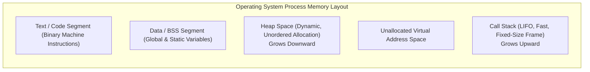
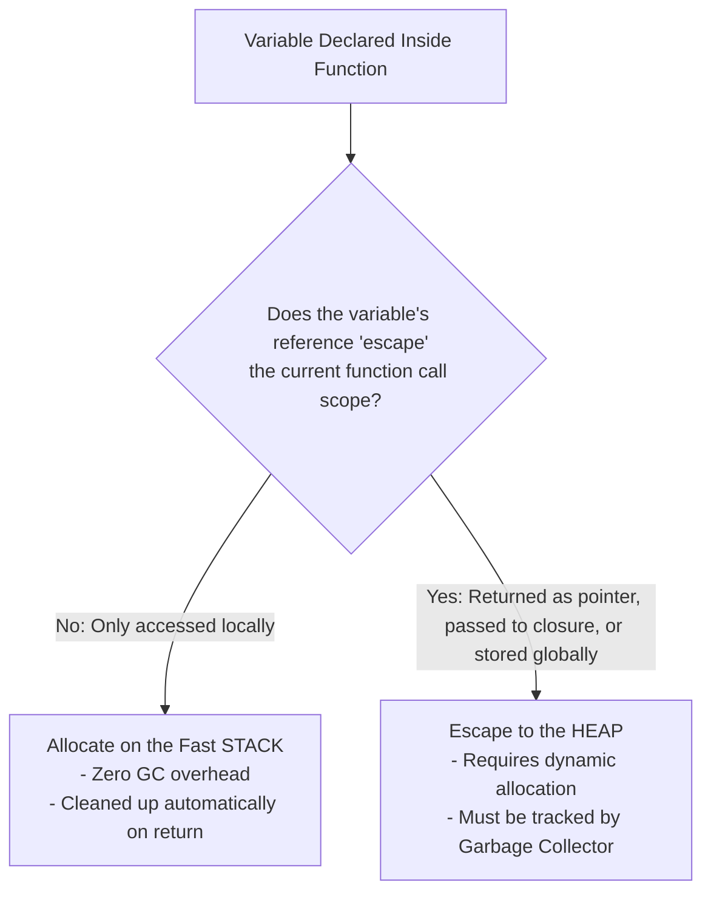
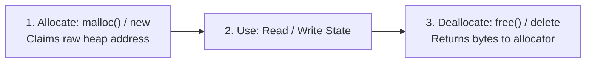
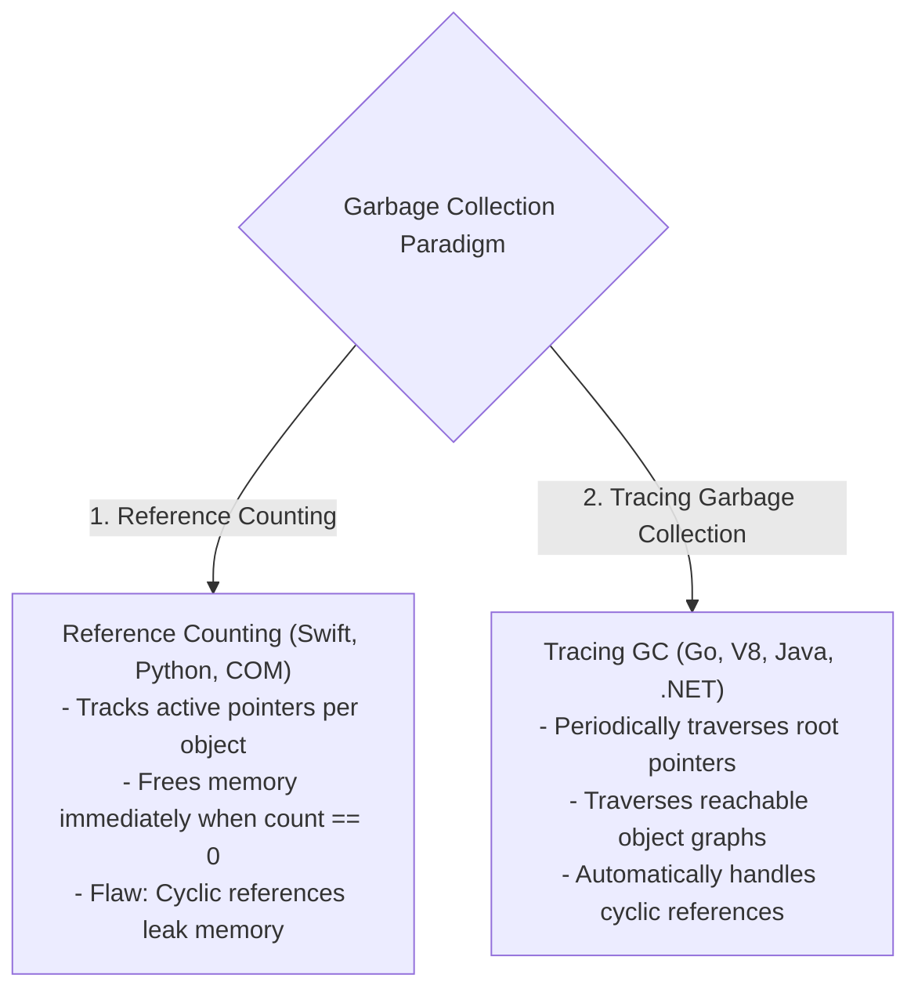
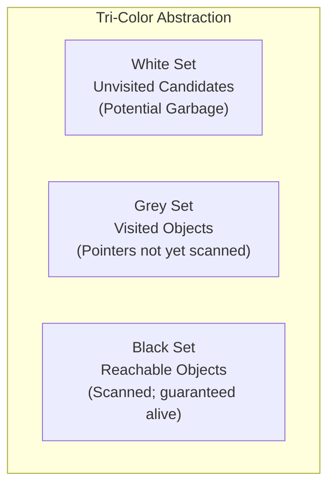
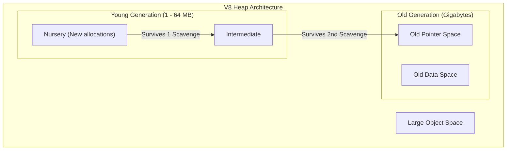
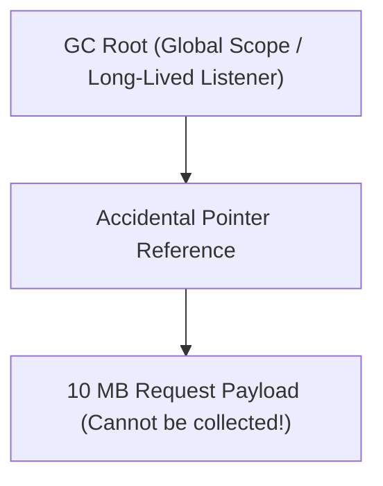
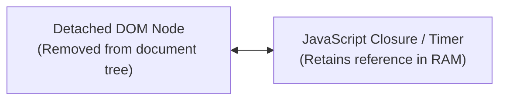

# Memory Management & Garbage Collection: Foundations & Production Realities

In modern computing, memory is not infinite. Every integer, object instance, closure, database connection buffer, and network socket consumes physical bytes in Random Access Memory (RAM). How a programming language allocates, tracks, and frees these bytes dictates the **latency, throughput, operational cost, and reliability** of software systems.

In distributed backend services and high-performance applications, memory mismanagement rarely manifests as a simple crash on startup. Instead, it appears as **gradual memory leaks**, **unpredictable latency spikes from Garbage Collection (GC) pauses**, or catastrophic **Out-Of-Memory (OOM) kills** during peak production traffic.

This guide explores the foundational physics of memory, the mechanics of manual vs. automated memory management, garbage collection algorithms in **C++**, **Go**, and **JavaScript/TypeScript (V8)**, and real-world memory leak scenarios across backend microservices and frontend client apps.

---

## 1. The Anatomy of Memory: Stack vs. Heap

When an operating system launches a process, it assigns it a virtual address space divided into distinct segments:



```
Low Memory Addresses:  [ Code / Text ] -> [ Global Data ] -> [ Heap (v) ]
                                                                 |
                                                          [ Free Space ]
                                                                 |
High Memory Addresses:                                       [ Stack (^) ]
```

---

### 1.1 The Stack: LIFO, Automatic, Sub-Nanosecond Allocation
The **Stack** stores local variables, primitive values, function call frames, and CPU return pointers.
* **How It Works:** Operates strictly on a **Last-In, First-Out (LIFO)** basis. When a function is called, the CPU moves its Stack Pointer down to reserve a contiguous block of bytes called a **Stack Frame**. When the function returns, the CPU simply moves the Stack Pointer back up.
* **Performance:** Blazing fast. Allocation is a single CPU instruction (e.g. `sub rsp, 32`).
* **Deallocation:** 100% automatic. Zero garbage collection or manual cleanup needed; popping the stack frame instantly invalidates the memory.
* **Limitations:** Fixed size per thread (typically 1 MB–8 MB in OS threads, or 2 KB–8 KB in Go goroutines). Allocating an oversized array on the stack triggers a **Stack Overflow**.

---

### 1.2 The Heap: Dynamic, Flexible, Fragmented
The **Heap** is a large, unorganized pool of memory used for data whose size, lifetime, or structure cannot be known at compile time.
* **How It Works:** Memory is allocated dynamically at runtime (e.g. `malloc()` in C, `new` in C++/Java/JS, or escaping pointers in Go). The operating system or runtime memory allocator (e.g., jemalloc, tcmalloc) finds a contiguous free chunk in the heap and returns its physical memory address (pointer).
* **Performance:** Significantly slower than stack allocation. The allocator must traverse internal free lists, manage lock contention across threads, and handle heap fragmentation.
* **Deallocation:** Complex. The runtime cannot simply pop a pointer because objects on the heap can outlive the function that created them. This requires either **manual destruction** or an **automated Garbage Collector**.

---

### 1.3 Stack vs. Heap Comparison

| Architectural Dimension | The Stack | The Heap |
| :--- | :--- | :--- |
| **Allocation Mechanism** | CPU Stack Pointer adjustment (LIFO). | Memory allocator free-list search / OS `brk`/`mmap`. |
| **Allocation Latency** | Sub-nanosecond ($\approx 1\text{ CPU cycle}$). | Tens to hundreds of nanoseconds. |
| **Lifetime** | Tied strictly to the function call frame scope. | Dynamic; persists until explicitly freed or garbage collected. |
| **Data Size** | Small, fixed size known at compile time. | Arbitrary, dynamic size (gigabytes). |
| **Access Pattern** | Contiguous physical memory; near 100% L1/L2 CPU cache hit rate. | Dispersed physical addresses; frequent CPU cache misses. |
| **Failure Mode** | Stack Overflow (infinite recursion, massive buffers). | Out of Memory (OOM), memory leaks, heap fragmentation. |

---

## 2. Escape Analysis: How Compilers Choose Stack or Heap

Modern optimizing compilers (especially in **Go** and **Java/GraalVM**) use a technique called **Escape Analysis** to determine whether an object can be safely allocated on the fast stack instead of the heap.



### Escape Analysis in Go
In Go, using the `&` address-of operator does **not** mean an object goes to the heap. The Go compiler runs escape analysis during compilation:

```go
package main

type Account struct {
    ID      int
    Balance float64
}

// Case 1: Does NOT escape -> Allocated on the STACK
func CreateLocalAccount() float64 {
    acc := Account{ID: 1, Balance: 100.0}
    return acc.Balance // Returns a copy of the value; acc never escapes!
}

// Case 2: ESCAPES to the HEAP
func CreateHeapAccount() *Account {
    acc := Account{ID: 2, Balance: 250.0}
    return &acc // Returns a pointer! acc escapes current stack frame to the HEAP.
}
```

You can inspect the Go compiler's escape decisions directly in the terminal:
```bash
go build -gcflags="-m" main.go
# Output:
# ./main.go:14:9: &acc escapes to heap
# ./main.go:13:2: moved to heap: acc
```

---

## 3. Manual Memory Management: The C / C++ Paradigm

In languages without a garbage collector (C, C++, Rust), developers maintain explicit control over every byte of heap memory.



### 3.1 The Dangers of Manual Memory Management

While manual memory management yields maximum wire-speed performance and zero GC latency pauses, a single programming flaw causes severe vulnerabilities:

```
1. Memory Leak:
   malloc() without free() -> Heap gradually exhausts all available RAM until the OS terminates the process.

2. Dangling Pointer / Use-After-Free:
   free(ptr) executed, but the program continues to read or write ptr -> Undefined behavior, memory corruption, or remote code execution exploits.

3. Double Free:
   free(ptr) called twice on the same memory address -> Corrupts allocator internal tracking trees.

4. Buffer Overflow:
   Writing 100 bytes into a 64-byte allocated buffer -> Overwrites adjacent memory headers or function return pointers on the stack.
```

---

### 3.2 Modern C++ Defense: RAII & Smart Pointers
Modern C++ (C++11 and beyond) largely eliminates raw `malloc()` and `delete` through **RAII (Resource Acquisition Is Initialization)** and **Smart Pointers**:

```cpp
#include <iostream>
#include <memory>

class DatabaseConnection {
public:
    DatabaseConnection() { std::cout << "Socket Connected\n"; }
    ~DatabaseConnection() { std::cout << "Socket Closed automatically!\n"; }
};

void processRequest() {
    // std::unique_ptr: Owns the resource exclusively.
    // When processRequest exits, the destructor runs AUTOMATICALLY! Zero leaks.
    std::unique_ptr<DatabaseConnection> conn = std::make_unique<DatabaseConnection>();
} // <-- conn goes out of scope here; memory and socket freed instantly
```

* **`std::unique_ptr`:** Single-owner smart pointer. Zero runtime memory overhead compared to a raw pointer. Disallows copying; enforces transfer of ownership via `std::move`.
* **`std::shared_ptr`:** Shared-ownership via **Reference Counting**. Multiple owners hold references; when the last reference count drops to zero, the object is destroyed.
* **`std::weak_ptr`:** Non-owning observer that prevents reference cycles in `std::shared_ptr`.

---

## 4. Automated Memory Management: Garbage Collection Models

In managed languages (Go, JavaScript, TypeScript, Java, Python), developers do not manually free memory. A background runtime subsystem called the **Garbage Collector (GC)** periodically identifies unused memory and returns it to the free pool.

Two primary garbage collection models exist:



---

### 4.1 Reference Counting vs. Tracing GC

```
Reference Counting:
[Object A] (ref_count = 2) <--- [Pointer 1], [Pointer 2]
Pointer 1 deleted -> ref_count = 1
Pointer 2 deleted -> ref_count = 0 -> DESTROY OBJECT IMMEDIATELY!

The Cyclic Reference Bug:
[Object A] ------points to-----> [Object B]
    ^                                 |
    +-----------points to-------------+
Even if no outside code can reach A or B, their ref_counts remain 1! Memory leaks forever unless cyclic detectors run.
```

---

## 5. Language Deep Dive: Go's Low-Latency Garbage Collector

Go was built specifically for scalable network services. Its garbage collector is architected with a singular priority: **sub-millisecond Stop-The-World (STW) latency**.

Go uses a **Concurrent Tri-Color Mark-and-Sweep** collector backed by a **Write Barrier**:



### 5.1 How the Tri-Color Algorithm Works
1. **Initial State:** At the start of a GC cycle, all objects in the heap are placed in the **White Set**.
2. **Roots Scanning:** The GC scans roots (global variables, local variables on all active goroutine stacks). All objects directly reachable from roots are moved to the **Grey Set**.
3. **Concurrent Marking:** While application goroutines continue executing, the GC worker threads pick objects from the Grey Set:
   * It scans the object's outgoing pointers.
   * Any White objects it points to are moved to the Grey Set.
   * The scanned object itself is moved to the **Black Set**.
4. **The Write Barrier:** Because user application threads are mutating memory concurrently during marking, an application might link a White object directly to a Black object. A compiler-injected **Write Barrier** catches this and colors the White object Grey, preventing it from being accidentally deleted!
5. **Sweeping:** When the Grey Set is empty, all remaining **White objects** are unreachable garbage. The sweeper reclaims their memory.

```
Why Go's GC Pauses are < 1 Millisecond:
- Marking runs CONCURRENTLY with your application goroutines.
- Stop-The-World (STW) pauses occur only briefly to enable the write barrier and finish stack scans.
- STW times in Go are typically under 100 microseconds (0.1 ms).
```

### 5.2 Tuning Go GC: `GOGC` and `GOMEMLIMIT`
* **`GOGC` (Target Heap Growth Ratio):** Sets the percentage of heap growth before the next GC triggers (default: `GOGC=100`, meaning GC triggers when the heap doubles).
* **`GOMEMLIMIT` (Hard Memory Cap):** Introduced in Go 1.19. Prevents container Out-Of-Memory (OOM) crashes by aggressively triggering GC when total process memory approaches the specified ceiling (e.g. `GOMEMLIMIT=1800MiB` in a 2 GB Kubernetes Pod).

---

## 6. Language Deep Dive: V8 Engine (Node.js & TypeScript / JavaScript)

JavaScript and TypeScript execute within engines like Google's **V8** (powering Node.js, Chrome, Deno, and Electron).

V8's memory management is rooted in the **Weak Generational Hypothesis**:
> **The Generational Hypothesis:** The vast majority of allocated objects die very young (e.g. temporary strings, loop variables, request-scoped buffers). Objects that survive multiple GC cycles tend to live for a very long time.

To exploit this, V8 splits the heap into two distinct generations:



---

### 6.1 Young Generation: The Scavenger (Minor GC)
* **Strategy:** Semi-space copying collector (**Cheney's algorithm**).
* The Young Generation is split into two halves: **From-Space** and **To-Space**.
* New allocations land in the From-Space.
* When From-Space fills up, the **Scavenger** runs:
  1. It copies only the *surviving* objects into the To-Space, packing them contiguously (automatic zero-cost defragmentation!).
  2. The roles of From-Space and To-Space are swapped.
* **Cost:** Extremely fast ($1\text{ ms} - 5\text{ ms}$) because it only inspects surviving objects, ignoring the $95\%$ of objects that already died.
* **Promotion:** Objects that survive two consecutive Minor GC runs are promoted to the **Old Generation**.

---

### 6.2 Old Generation: Major GC (Mark-Sweep-Compact)
For long-lived objects, copying them back and forth in memory would be excessively slow. V8 uses **Major GC**:
1. **Marking:** Traverses the entire object graph starting from global objects and DOM roots.
2. **Sweeping:** Adds dead objects to free-lists for future allocations.
3. **Compacting:** Relocates live objects to eliminate fragmented "holes" in memory.
* **Latency Management:** Full Major GC pauses on gigabyte heaps historically froze applications for 100 ms–1,000 ms. Modern V8 uses **Incremental Marking** and **Concurrent Sweeping**, breaking marking into tiny $1\text{ ms}$ slices interleaved with JavaScript execution.

---

## 7. Real-World Memory Leaks in Backend Services

In garbage-collected runtimes (Node.js, Go), a "memory leak" does not mean memory is lost in C-style dangling pointers. It means **unused objects remain accidentally reachable from a root pointer**, preventing the garbage collector from reclaiming them.



---

### Leak Scenario 1: The Global Cache / Map without Eviction (Node.js / Go)

#### The Bug:
A backend engineer builds an in-memory cache using a raw dictionary or map to store user session data or rate-limit counts:

```typescript
// DEADLY BACKEND MEMORY LEAK (Node.js)
const cache = new Map<string, any>(); // Global Map lives forever!

export function handleUserRequest(userId: string, data: any) {
    // Every request appends a new key, but keys are NEVER deleted!
    cache.set(userId, { data, timestamp: Date.now() });
    
    // Process request...
}
```
* **What Happens:** Under production traffic of 10,000 requests per minute, the `Map` accumulates millions of entries. Memory consumption steadily climbs linearly until Kubernetes kills the pod with `OOMKilled (Exit Code 137)`.
* **The Production Fix:** Never use an unbounded primitive `Map` as a cache. Always use an **LRU (Least Recently Used) Cache** with a hard limit on maximum entries or explicit TTL eviction (e.g. `lru-cache` in Node.js, or Redis).

---

### Leak Scenario 2: Unclosed Event Emitters & Persistent Listeners (Node.js)

#### The Bug:
Attaching an event listener to a long-lived or singleton object from inside a short-lived request handler:

```typescript
// Singleton global service
import { globalEventEmitter } from "./events";

export function handleIncomingHttpRequest(req: any, res: any) {
    const hugeContext = { buffer: Buffer.alloc(5 * 1024 * 1024), id: req.id }; // 5 MB

    // FATAL LEAK: Listener references hugeContext via closure!
    // globalEventEmitter lives forever, retaining the closure and hugeContext!
    globalEventEmitter.on("system_event", () => {
        console.log("Processed event for: " + hugeContext.id);
    });

    res.send("OK");
}
```
* **Why Node.js Leaks:** Every HTTP request adds a new closure function to `globalEventEmitter`. Even after the HTTP response completes, the event emitter still holds a reference to the closure, which holds a reference to the 5 MB buffer. 200 requests leak 1 Gigabyte of RAM!
* **The Production Fix:** Always remove listeners using `.removeListener()` or `.once()`, or use `AbortSignal`:
  ```typescript
  globalEventEmitter.once("system_event", handler);
  ```

---

### Leak Scenario 3: Goroutine Leaks in Go (Blocked Channels)

In Go, a leaked goroutine is the most common cause of memory exhaustion. A goroutine whose execution is blocked forever will **never be garbage collected**, and its stack ($2\text{ KB} - 8\text{ KB}$) plus all heap variables it references remain pinned in memory forever.

```go
// DEADLY GOROUTINE LEAK (Go)
func QueryFastestDatabase(query string) string {
    // Unbuffered channel!
    ch := make(chan string)

    // Spawn 2 parallel queries to two replica databases
    go func() { ch <- queryReplica1(query) }()
    go func() { ch <- queryReplica2(query) }()

    // Return whichever finishes first:
    return <-ch 
    // FATAL BUG: The slower replica goroutine attempts to write to ch,
    // but nobody is reading from ch anymore!
    // The slower goroutine BLOCKS FOREVER. It will NEVER terminate or be freed!
}
```
* **The Production Fix:** Use a **buffered channel** so the slower goroutine can drop its value into the buffer and exit immediately without blocking:
  ```go
  ch := make(chan string, 2) // Buffer size 2 allows both workers to write without blocking!
  ```

---

## 8. Real-World Memory Leaks in Frontend Client Apps

Frontend Single-Page Applications (SPAs built with React, Vue, Angular) run in browser tabs for hours or days without refreshing. Memory leaks gradually degrade client device responsiveness and crash mobile browser tabs.



---

### Leak Scenario 4: The Uncleaned `setInterval` & Event Listener (React)

```tsx
// DEADLY REACT LEAK
export function StockTicker() {
    const [price, setPrice] = useState(0);

    useEffect(() => {
        // Interval runs every second
        const id = setInterval(() => {
            fetchStockPrice().then(setPrice);
        }, 1000);

        // FATAL BUG: Missing cleanup return function!
        // When the user navigates away and StockTicker unmounts,
        // setInterval continues running forever in the background!
    }, []);

    return <div>Live Price: {price}</div>;
}
```
* **The Production Fix:** Always return an explicit teardown callback in lifecycle hooks:
  ```tsx
  useEffect(() => {
      const id = setInterval(updatePrice, 1000);
      return () => clearInterval(id); // Cleans up timer on unmount!
  }, []);
  ```

---

### Leak Scenario 5: Detached DOM Trees
A **Detached DOM Node** occurs when an HTML element is removed from the visible DOM tree via `removeChild()` or framework rendering, but a JavaScript variable or event listener still retains a reference to it.
* Because the JS variable holds the element, and the element holds references to its parent/child tree, **the entire detached DOM subtree is retained in memory** by the browser engine.

---

## 9. Profiling & Detecting Leaks in Production

### 9.1 Diagnosing Node.js Memory Leaks
1. **The Core Metric:** Monitor `process.memoryUsage().heapUsed` and `rss` (Resident Set Size). If memory grows monotonically in a "sawtooth that never drops", a leak exists.
2. **Generating Heap Snapshots:**
   ```bash
   node --inspect server.js
   ```
   * Open Chrome DevTools $\rightarrow$ **Memory Tab** $\rightarrow$ **Take Heap Snapshot**.
   * Compare Snapshot 1 (baseline) against Snapshot 2 (after running 1,000 requests using `autocannon` or `k6`).
   * Filter by **Objects allocated between Snapshot 1 and 2**. Look for `(closure)`, `Array`, or `Object` retaining paths.

### 9.2 Diagnosing Go Memory with `pprof`
Go includes native, zero-overhead profiling tools built directly into the runtime:

```go
import _ "net/http/pprof"

func main() {
    go func() {
        http.ListenAndServe("localhost:6060", nil) // Exposes pprof endpoints
    }()
    // ...
}
```

Inspect live memory usage in real time:
```bash
# Capture heap profile and analyze interactively
go tool pprof http://localhost:6060/debug/pprof/heap
(pprof) top10
(pprof) list MyFunctionName
```

---

## 10. Master Comparison Matrix: Memory Across Languages

| Feature | C++ | Go | JavaScript / TypeScript (V8) |
| :--- | :--- | :--- | :--- |
| **Management Model** | **Manual / RAII** (`unique_ptr`, `shared_ptr`) | **Automated Tracing GC** | **Automated Generational Tracing GC** |
| **GC Algorithm** | None (Deterministic destructors) | Concurrent Tri-Color Mark-and-Sweep | Young: Scavenger; Old: Mark-Sweep-Compact |
| **Latency Characteristics** | Zero GC pauses ($0\text{ ms}$) | Sub-millisecond ($<0.5\text{ ms}$) | Micro-pauses ($1\text{ ms}-10\text{ ms}$) |
| **Memory Overhead** | **Lowest:** Exactly what you allocate | **Low:** Lean runtime, compact headers | **High:** V8 hidden classes, shape descriptors |
| **Stack Allocation** | Explicit (default for non-pointers) | Automatic via Compiler Escape Analysis | Internal primitives; objects escape to heap |
| **Common Leak Vector** | Missing `free()`, circular `shared_ptr` | Blocked goroutines, unevicted maps | Forgotten timers, global closures, detached DOM |

---

## 11. Senior Engineering Memory Checklist

Review this checklist before shipping services to production:

* [ ] **Escape Analysis Minded:** In performance-critical Go routines, avoid passing pointers unnecessarily if values can live on the stack.
* [ ] **Bounded In-Memory Stores:** Every cache has an explicit eviction policy (LRU) and a maximum size limit; no naked global maps.
* [ ] **No Leaked Goroutines / Threads:** Every spawned worker thread or goroutine has an explicit termination path, timeout context, or buffered channel.
* [ ] **Cleaned Lifecycle Listeners:** In Node.js and React, every event listener, timer, and WebSocket subscription registers an unbind/teardown callback.
* [ ] **Hard Memory Caps Configured:** Container environments define explicit memory limits with headroom (e.g. `GOMEMLIMIT=1600MiB` on a 2 GB Pod, or Node `--max-old-space-size=1536`).
* [ ] **Continuous Telemetry:** Application dashboards monitor Heap Used, Heap Total, RSS, and GC Pause Duration P99 metrics in real time.

---

⬅️ **[Previous: 02. SOLID Principles](02_SOLID_Principles.md)** | 🏠 **[Back to TOC](README.md)** | **[Next: 04. Error Handling & Debugging ➡️](04_Error_Handling_And_Debugging.md)**
