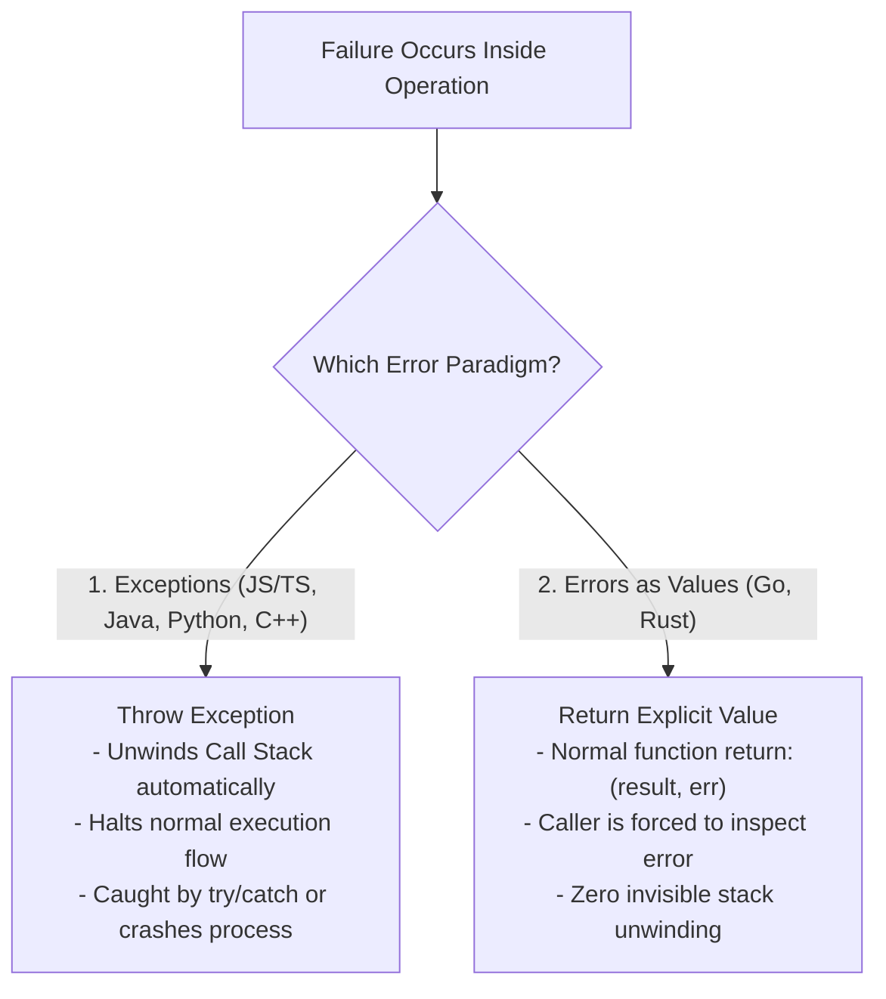
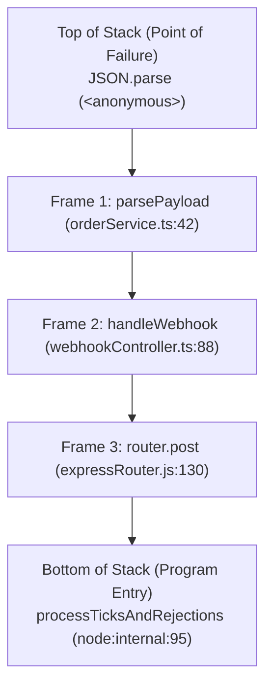
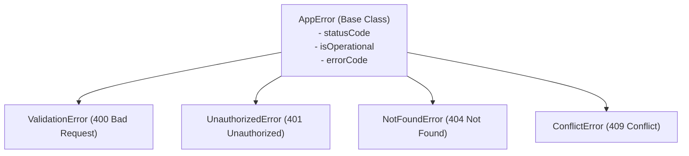
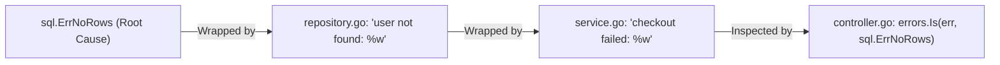
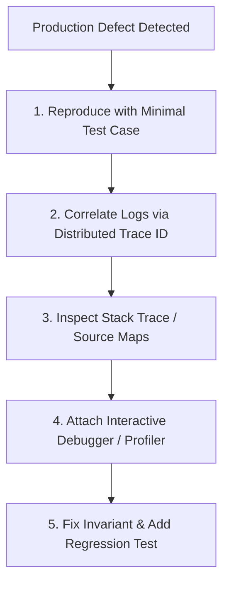

# Error Handling: Exceptions, Debugging, & Reading Stack Traces

In computer systems, failures are not exceptional; they are an inevitable operational certainty. Network sockets drop, disk volumes fill to 100% capacity, downstream payment microservices time out, concurrent database transactions deadlock, and corrupted JSON payloads arrive from third-party webhooks.

How software handles these failures determines whether a system **degrades gracefully with clear diagnostics** or **crashes catastrophically with silent data corruption**.

This guide explores the architectural fundamentals of error handling: **Exceptions vs. Explicit Values**, how to dissect and read complex **Stack Traces**, modern debugging techniques, and production-grade failure handling patterns in **JavaScript / TypeScript** and **Go**.

---

## 1. The Two Paradigms: Exceptions vs. Errors as Values

Modern programming languages manage errors through two fundamentally opposing philosophical models:



---

### 1.1 Exceptions (JavaScript & TypeScript)
In the **Exception Model**, when a failure occurs, the code `throw`s an exception object. 
* **Mechanism:** The runtime immediately halts forward execution of the current function and begins **unwinding the call stack**, searching upward through parent frames for an enclosing `try / catch` block.
* **Invisible Control Flow:** Functions between the `throw` statement and the `catch` statement are interrupted invisibly. If a developer forgets to wrap code in a `try / catch`, the exception bubbles to the top of the event loop, triggering an `UncaughtException` and terminating the Node.js process.
* **The Ergonomic Benefit:** Removes repetitive boilerplate when handling failures across deep layers of business logic.
* **The Cost:** Can obscure code paths; functions do not declare which exceptions they might throw in their type signatures (unchecked exceptions).

```typescript
// JavaScript / TypeScript: Exception Paradigm
function parseConfig(rawJson: string): Config {
    // If JSON is malformed, JSON.parse THROWS an exception.
    // Execution stops right here; the line below never runs!
    const parsed = JSON.parse(rawJson);
    return new Config(parsed);
}

try {
    const config = parseConfig("{ invalid json }");
} catch (err: unknown) {
    // Stack unwinding halts here
    console.error("Caught error:", err);
}
```

---

### 1.2 Errors as Values (Go)
Go deliberately rejects exceptions for standard control flow (it reserves `panic` strictly for truly unrecoverable programmer bugs, such as nil-pointer dereferences or index-out-of-bounds).
* **Mechanism:** Functions that can fail return an **error as an explicit return value** alongside their normal result, conventionally as the last return parameter: `(Result, error)`.
* **Zero Hidden Control Flow:** Execution never jumps invisibly. A caller must explicitly check `if err != nil` before proceeding.
* **The Ergonomic Benefit:** Absolute predictability. Every failure point is visible directly in the source code.
* **The Cost:** Verbosity (`if err != nil` repeated frequently throughout codebases).

```go
package main

import (
    "encoding/json"
    "fmt"
)

// Go: Errors as Explicit Values
func ParseConfig(rawJson []byte) (*Config, error) {
    var cfg Config
    // json.Unmarshal returns an error value; it NEVER throws an exception!
    err := json.Unmarshal(rawJson, &cfg)
    if err != nil {
        // Return nil value alongside the error; caller must inspect it
        return nil, fmt.Errorf("failed to parse configuration: %w", err)
    }
    return &cfg, nil
}

func main() {
    cfg, err := ParseConfig([]byte("{ invalid json }"))
    if err != nil {
        fmt.Println("Handled error explicitly:", err)
        return
    }
    fmt.Println("Config loaded:", cfg)
}
```

---

### 1.3 Side-by-Side Architectural Comparison

| Dimension | Exceptions (JS / TS / Java / Python) | Errors as Values (Go / Rust) |
| :--- | :--- | :--- |
| **Control Flow** | Non-local jump; unwinds stack frames invisibly. | Standard linear control flow via explicit return values. |
| **Type Contract** | Unchecked in TS/JS (not visible in function signature). | Explicitly enforced by compiler type signature `(T, error)`. |
| **Performance Overhead** | High when thrown (capturing stack traces, frame unwinding). | Negligible (standard pointer or interface return on stack). |
| **Unhandled Behavior** | Bubbles to root; crashes process (`UnhandledPromiseRejection`). | Program continues, but developer handles zero-value/nil explicitly. |
| **Idiomatic Philosophy** | "Ask for forgiveness later" (catch where appropriate). | "Plan for failure immediately at the call site." |

---

## 2. Reading and Dissecting Stack Traces

A **Stack Trace** is an architectural snapshot of the CPU call stack at the exact millisecond an error occurred or an exception was instantiated. It lists the active function frames in reverse chronological order: from the point of failure back to the entry point of the program.



---

### 2.1 Anatomy of a Node.js / TypeScript Stack Trace

Consider this production crash log from a Node.js backend:

```text
TypeError: Cannot read properties of undefined (reading 'price')
    at OrderCalculator.calculateTotal (/app/dist/services/OrderCalculator.js:48:29)
    at CheckoutService.processOrder (/app/dist/services/CheckoutService.js:112:35)
    at async /app/dist/controllers/OrderController.js:64:21
    at async Layer.handle [as handle_request] (/app/node_modules/express/lib/router/layer.js:95:5)
    at async next (/app/node_modules/express/lib/router/route.js:144:13)
```

#### How a Senior Engineer Reads This:
1. **The Error Type & Message (`Line 1`):**  
   `TypeError: Cannot read properties of undefined (reading 'price')`  
   * What happened: Code attempted to access `.price` on an object reference that resolved to `undefined` (e.g. `item.price` where `item` was undefined).
2. **The Culprit Frame (`Line 2`):**  
   `at OrderCalculator.calculateTotal (/app/dist/services/OrderCalculator.js:48:29)`  
   * The failure occurred inside the method `calculateTotal` on **line 48, column 29**. This is where the code crashed.
3. **The Call Chain (`Lines 3–4`):**  
   * `calculateTotal` was invoked by `CheckoutService.processOrder` at line 112.
   * `processOrder` was called by `OrderController` at line 64.
4. **The Framework Machinery (`Lines 5–6`):**  
   * Calls originating inside `/node_modules/express/...` represent framework plumbing. In 99% of debugging sessions, you ignore node_modules frames and focus entirely on your own application code frames.

#### The Source Map Problem in TypeScript
Notice that the stack trace points to `/app/dist/.../OrderCalculator.js` (the compiled JavaScript output), **not** the original TypeScript file (`OrderCalculator.ts`).
* **The Solution:** In production Node.js runtimes, always enable **Source Maps**:
  ```bash
  node --enable-source-maps dist/index.js
  ```
  With source maps enabled, Node.js automatically translates runtime offsets back to the exact `.ts` file and line numbers:
  `at OrderCalculator.calculateTotal (/app/src/services/OrderCalculator.ts:32:15)`

---

### 2.2 Anatomy of a Go Stack Trace & Panic Dump

When an unhandled panic occurs in Go, the runtime dumps the stack of every active goroutine:

```text
panic: runtime error: invalid memory address or nil pointer dereference
[signal SIGSEGV: segmentation violation code=0x1 addr=0x0 pc=0x10a2f4c]

goroutine 42 [running]:
main.(*PaymentGateway).Charge(0x0, 0xc0000a2050, 0x64)
	/app/services/payment.go:28 +0x3c
main.ProcessCheckout(0xc00009e080, 0x64)
	/app/services/checkout.go:54 +0x88
created by main.handleIncomingRequests in goroutine 1
	/app/server.go:92 +0x114
```

#### How to Dissect This:
1. **The Signal / Error:** `invalid memory address or nil pointer dereference`  
   A method was called on a `nil` pointer reference (equivalent to `NullPointerException`).
2. **The Active Goroutine:** `goroutine 42 [running]`  
   The crash did not happen on the main thread; it happened inside background worker goroutine 42.
3. **The Method Receiver:** `main.(*PaymentGateway).Charge(0x0, ...)`  
   Notice the first argument: `0x0`! In Go, method receivers are passed as the first parameter. A pointer value of `0x0` proves that the `*PaymentGateway` instance itself was `nil` when `.Charge()` was invoked!
4. **The Origin:** `created by main.handleIncomingRequests in goroutine 1`  
   Identifies which goroutine spawned the worker that crashed.

---

## 3. Real-World Error Handling in JavaScript & TypeScript

### 3.1 The Custom Error Hierarchy (Domain Errors)
A critical mistake in backend Node.js applications is throwing generic built-in errors: `throw new Error("User not found")`. This forces upstream HTTP handlers to parse strings to decide what HTTP status code to return.

Production applications build a **Structured Domain Error Hierarchy**:



#### Production Implementation:
```typescript
// Base Abstract Operational Error
export abstract class AppError extends Error {
    abstract readonly statusCode: number;
    abstract readonly errorCode: string;

    constructor(message: string, public readonly isOperational: boolean = true) {
        super(message);
        // Restores correct prototype chain when targeting ES5/ES6
        Object.setPrototypeOf(this, new.target.prototype);
        // Captures clean stack trace, omitting constructor call
        Error.captureStackTrace(this, this.constructor);
    }
}

// Concrete Domain Errors
export class NotFoundError extends AppError {
    readonly statusCode = 404;
    readonly errorCode = "RESOURCE_NOT_FOUND";

    constructor(resource: string, id: string | number) {
        super(`${resource} with identifier ${id} was not found.`);
    }
}

export class ConflictError extends AppError {
    readonly statusCode = 409;
    readonly errorCode = "RESOURCE_CONFLICT";

    constructor(message: string) {
        super(message);
    }
}
```

---

### 3.2 Operational Errors vs. Programmer Errors
In backend services, errors fall into two distinct operational categories:

```
+------------------------------------+------------------------------------+
| Operational Errors (Expected)      | Programmer Errors (Unexpected Bugs)|
+------------------------------------+------------------------------------+
| - Invalid user input (400)         | - TypeError (cannot read of null)  |
| - Expired JWT token (401)          | - SyntaxError, ReferenceError      |
| - DB duplicate key collision (409) | - Passing string instead of object |
| - External API rate limit (429)    | - Unhandled Promise rejection      |
| Action: Catch, return clean JSON,  | Action: LOG stack trace to SIEM,   |
|         keep the process RUNNING.  | RESTART process gracefully!        |
+------------------------------------+------------------------------------+
```

> **The Golden Law of Programmer Errors:** Never attempt to keep a Node.js process running after an unhandled programmer error (`uncaughtException`). An unhandled TypeError means memory or internal state is corrupted. Log the stack trace immediately and allow the process supervisor (Kubernetes, PM2, Docker) to restart the container cleanly.

---

### 3.3 The Express / Fastify Centralized Error Middleware

Never scatter `try / catch` blocks across every single HTTP route handler just to format HTTP responses. Use **Centralized Error Handling Middleware**:

```typescript
import { Request, Response, NextFunction } from "express";
import { AppError } from "./errors";

export function globalErrorHandler(
    err: Error,
    req: Request,
    res: Response,
    next: NextFunction
) {
    // Case 1: Known Operational Domain Error
    if (err instanceof AppError) {
        return res.status(err.statusCode).json({
            status: "error",
            code: err.errorCode,
            message: err.message,
        });
    }

    // Case 2: Unknown Programmer Bug or Third-Party Crash
    // Log FULL stack trace internally for engineering triage
    console.error("FATAL UNEXPECTED ERROR 💥:", {
        message: err.message,
        stack: err.stack,
        url: req.originalUrl,
        method: req.method,
    });

    // Send generic, sanitized message to client (Never leak raw stack traces to users!)
    return res.status(500).json({
        status: "error",
        code: "INTERNAL_SERVER_ERROR",
        message: "An unexpected error occurred. Please contact support.",
    });
}
```

---

## 4. Real-World Error Handling in Go

### 4.1 Error Wrapping & Stack Context (`fmt.Errorf` with `%w`)
Historically, Go errors were plain strings (`errors.New("not found")`). If a database query failed 5 layers deep, the top-level handler received `record not found` without any context on what entity failed or which function broke.

Introduced in Go 1.13, **Error Wrapping** allows attaching contextual messages while preserving the underlying root-cause error:



#### Code Implementation:
```go
package main

import (
    "database/sql"
    "errors"
    "fmt"
)

// Repository Layer: Wraps root database error with %w
func GetUserByID(db *sql.DB, id int) (*User, error) {
    row := db.QueryRow("SELECT id, name FROM users WHERE id = $1", id)
    var u User
    if err := row.Scan(&u.ID, &u.Name); err != nil {
        if errors.Is(err, sql.ErrNoRows) {
            // %w wraps the sentinel error so upstream callers can inspect it
            return nil, fmt.Errorf("user repository: user %d: %w", id, sql.ErrNoRows)
        }
        return nil, fmt.Errorf("user repository query failed: %w", err)
    }
    return &u, nil
}

// Service Layer: Inspects wrapped errors using errors.Is()
func ProcessOrder(db *sql.DB, userID int) error {
    _, err := GetUserByID(db, userID)
    if err != nil {
        // Check if the root cause was ErrNoRows anywhere in the wrap chain!
        if errors.Is(err, sql.ErrNoRows) {
            return fmt.Errorf("validation error: invalid customer: %w", err)
        }
        return fmt.Errorf("internal billing error: %w", err)
    }
    return nil
}
```

---

### 4.2 Inspecting Concrete Error Types with `errors.As()`
When you need to extract structured fields from a specific error type (e.g. HTTP status codes, retry-after headers, or validation fields), use `errors.As()`:

```go
package main

import (
    "errors"
    "fmt"
)

// Custom structured error type
type APIError struct {
    StatusCode int
    Message    string
}

func (e *APIError) Error() string {
    return fmt.Sprintf("API Error (%d): %s", e.StatusCode, e.Message)
}

func CallThirdPartyGateway() error {
    return &APIError{StatusCode: 429, Message: "Rate limit exceeded"}
}

func main() {
    err := CallThirdPartyGateway()
    if err != nil {
        var apiErr *APIError
        // errors.As unwraps the error chain to find if an *APIError exists:
        if errors.As(err, &apiErr) {
            fmt.Printf("Detected upstream HTTP %d! Backing off...\n", apiErr.StatusCode)
            return
        }
        fmt.Println("Generic error:", err)
    }
}
```

---

### 4.3 Safe Panics and Crash Prevention via `recover()`
In Go, if a goroutine panics, it crashes the **entire process** unless caught. In web servers, a single malformed HTTP request should never crash the server for all other users.

Use a deferred `recover()` middleware:

```go
package middleware

import (
    "fmt"
    "net/http"
    "runtime/debug"
)

// PanicRecoveryMiddleware catches unexpected runtime panics and returns HTTP 500
func PanicRecoveryMiddleware(next http.Handler) http.Handler {
    return http.HandlerFunc(func(w http.ResponseWriter, r *http.Request) {
        defer func() {
            if rec := recover(); rec != nil {
                // Print the panic value and complete stack trace to stderr
                fmt.Printf("PANIC RECOVERED: %v\nStack Trace:\n%s\n", rec, debug.Stack())

                // Return clean response to the client
                w.WriteHeader(http.StatusInternalServerError)
                w.Write([]byte(`{"error": "Internal server crash avoided"}`))
            }
        }()

        next.ServeHTTP(w, r)
    })
}
```

---

## 5. Professional Debugging Techniques

When software breaks in production, senior engineers rely on systematic diagnostic workflows rather than random code modifications.



---

### 5.1 Interactive Debugging: Breakpoints, Step Over, & Watches
Adding `console.log()` or `fmt.Println()` statements is slow, requires rebuilding containers, and pollutes git histories. Use **Interactive Debuggers**:

* **Breakpoints:** Pause execution at a specific line of code. Inspect local variable values, the call stack, and heap state at that exact millisecond.
* **Step Over (`F10`):** Execute the current line and advance to the next line in the same function.
* **Step Into (`F11`):** Enter inside the function being called on the current line to inspect its internals.
* **Step Out (`Shift + F11`):** Complete execution of the current function and pause in the calling parent frame.
* **Conditional Breakpoints:** Pause execution **only when a condition evaluates to true**:
  ```
  Breakpoint on line 42: Condition: userId == "user_target_9012"
  ```
  *(Prevents pausing 100,000 times during batch processing!)*

#### Attaching VS Code / Chrome Inspector to Node.js:
Launch your service with the inspector flag:
```bash
node --inspect=0.0.0.0:9229 dist/server.js
```
Open Chrome $\rightarrow$ `chrome://inspect` $\rightarrow$ Click **Inspect** to debug your remote container live with source-level breakpoints!

#### Debugging Go with Delve (`dlv`):
Delve is the standard debugger for Go:
```bash
dlv debug main.go
(dlv) break services/order.go:42
(dlv) continue
(dlv) print myVariable
```

---

### 5.2 Distributed Tracing & Correlation IDs
In a microservice ecosystem (Client $\rightarrow$ API Gateway $\rightarrow$ Order Service $\rightarrow$ Payment Service $\rightarrow$ Database), an error that manifests in the database often originated from a malformed payload at the API Gateway.

Without correlation, finding the relevant logs across 5 different services is impossible:


* **The Invariant:** Every incoming HTTP request or message queue event is assigned an immutable **Correlation ID (Trace ID)** (UUIDv4/UUIDv7).
* Every log line printed by every service must include this ID.
* When a user reports an error code, searching that single Trace ID in your log aggregator (Datadog, Splunk, Elastic) displays the **complete end-to-end journey of the request across all microservices**.

---

## 6. Master Reference: Error Handling Anti-Patterns

| Anti-Pattern | What It Looks Like | Why It Destroys Production | Senior Engineering Remedy |
| :--- | :--- | :--- | :--- |
| **Silent Error Swallowing** | `try { ... } catch (e) {}` | Errors vanish silently; system enters corrupted state with zero diagnostic trace. | Always log the error or re-throw an operational domain error. |
| **Leaking Raw Stacks to Users** | Returning `err.stack` directly in HTTP 500 JSON payloads. | Exposes database passwords, file paths, and framework versions to attackers. | Sanitize errors in global middleware; log stack internally, return generic message. |
| **The "Catch-All & Ignore"** | `catch (e) { return null; }` | Masks real network and database outages as "empty results". | Distinguish between `NotFound` (valid null) and `TimeoutException` (error). |
| **Blind Retries on Non-Idempotent Calls** | Retrying payment processing in an unhandled catch block. | Charges customers multiple times during network hiccups. | Only retry operations that are strictly **idempotent** with exponential backoff. |
| **String-Matching Error Inspection** | `if (err.message.includes("duplicate"))` | Extremely fragile. If database driver wording changes, error handling logic breaks. | Use structured error codes (`err.code === '23505'`) or `errors.Is()`. |

---

## 7. Summary & Production Error Checklist

Audit your application services against this production resilience checklist:

* [ ] **Explicit Domain Hierarchy:** Application defines structured domain errors (`NotFoundError`, `ValidationError`) with explicit HTTP status codes.
* [ ] **Sanitized Client Responses:** User-facing HTTP responses never leak raw stack traces, file system paths, or database schemas.
* [ ] **Source Maps Active in Production:** Node.js / TypeScript deployments enable `--enable-source-maps` for readable, source-level line numbers in logs.
* [ ] **Error Context Preserved:** Go services wrap errors with `%w` and `fmt.Errorf()` to provide end-to-end contextual breadcrumbs.
* [ ] **Crash Prevention via Recovery:** HTTP servers and background workers wrap goroutines in `recover()` or top-level try/catch to isolate worker crashes.
* [ ] **Distributed Trace IDs Propagated:** Every request carries a `X-Correlation-ID` header injected into all structured logs and downstream RPCs.
* [ ] **Centralized Exception Monitoring:** Unhandled exceptions and crash events automatically alert engineering teams via Sentry, Datadog, or Bugsnag.

---

⬅️ **[Previous: 03. Memory Management & Garbage Collection](03_Memory_Management.md)** | 🏠 **[Back to TOC](README.md)**
