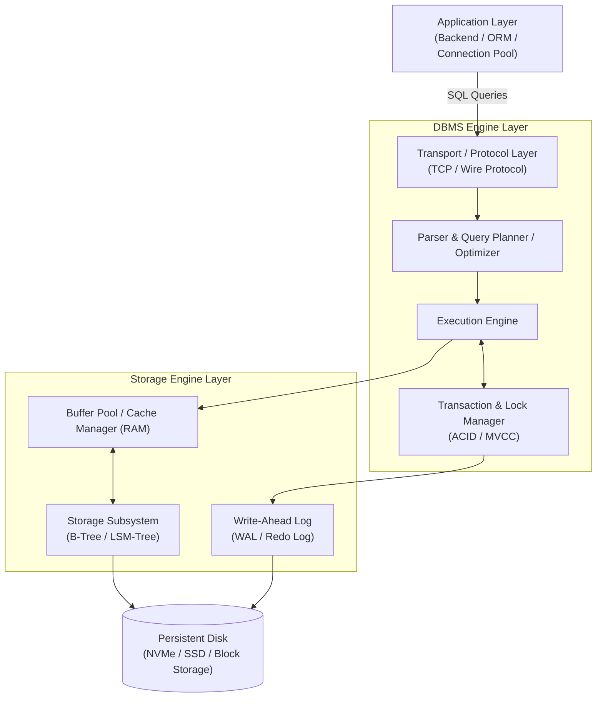
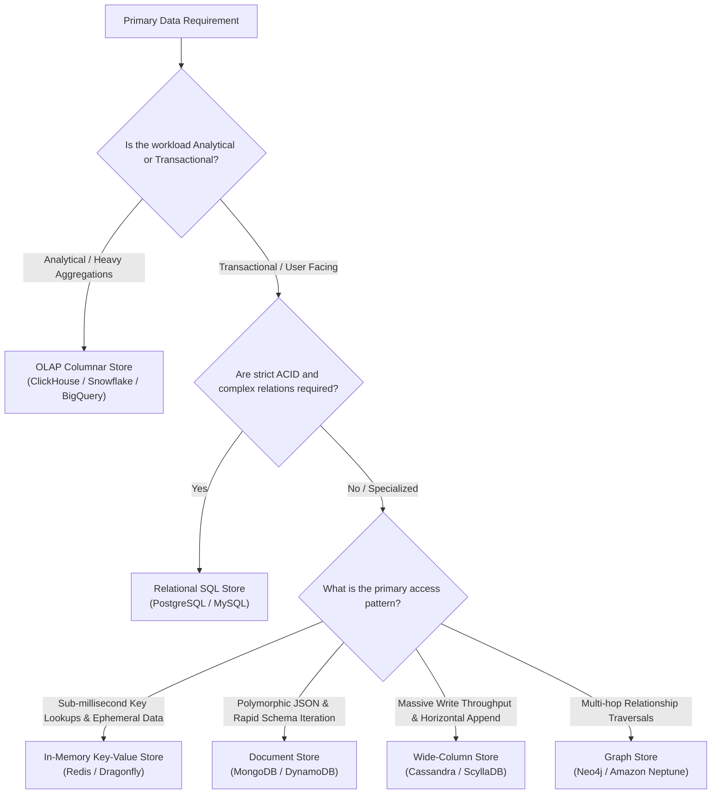

# Chapter 01: Database Fundamentals

> **Engineering Principle:**
> As backend engineers, most production bugs, outages, and performance bottlenecks do not stem from application business logic—they stem from how data is stored, queried, locked, and retrieved. Designing scalable systems requires understanding what happens under the hood of a database.

---

## Table of Contents
1. [What is a Database vs. a DBMS?](#1-what-is-a-database-vs-a-dbms)
2. [Database Architecture: Application, DBMS Engine, & Storage Engine](#2-database-architecture-application-dbms-engine--storage-engine)
3. [Data Models: Structured, Semi-Structured, & Unstructured](#3-data-models-structured-semi-structured--unstructured)
4. [Relational (SQL) vs. Non-Relational (NoSQL)](#4-relational-sql-vs-non-relational-nosql)
5. [Workload Patterns: OLTP vs. OLAP](#5-workload-patterns-oltp-vs-olap)
6. [Database Selection Framework: Choosing the Right DB for the Job](#6-database-selection-framework-choosing-the-right-db-for-the-job)
7. [Summary & Mental Model Checklist](#7-summary--mental-model-checklist)

---

## 1. What is a Database vs. a DBMS?

### Plain English
*   **Database (DB):** The actual collection of data organized on a persistent storage medium or memory (e.g., binary files containing user records).
*   **Database Management System (DBMS):** The software suite that manages, queries, protects, and governs access to that database (e.g., PostgreSQL, MySQL, MongoDB).

### Computer Science & System Design POV
A raw database is just bytes on durable media (block storage / SSD / NVMe). Writing custom application code to read/write raw files directly fails at scale due to:
*   **Concurrency:** Multiple threads writing to the same file cause race conditions, torn writes, and data corruption.
*   **Durability & Crash Recovery:** If the server loses power midway through writing a block, data is corrupted unless managed by atomic commit protocols.
*   **Query Optimization:** Searching through raw files requires full linear scans ($O(N)$) unless structured indexes and query planners exist.

A **DBMS** is a multi-threaded system providing an abstraction over raw storage:
1.  **Declarative Query Interface:** (e.g., SQL) You specify *what* data you need; the DBMS calculates *how* to retrieve it efficiently.
2.  **Concurrency Control:** Isolates concurrent transactions using locks, latches, or MVCC (Multi-Version Concurrency Control).
3.  **Fault Tolerance:** Guarantees durability via Write-Ahead Logging (WAL) or transaction journals.
4.  **Buffer Management:** Caches hot disk pages in RAM to minimize expensive physical disk I/O.

```
+-------------------------------------------------------------------+
|                        Client Application                         |
+-------------------------------------------------------------------+
                                  |
                           (Query / Wire Protocol)
                                  v
+-------------------------------------------------------------------+
|                   DBMS (e.g., PostgreSQL Engine)                  |
|  - Query Parser & Optimizer                                       |
|  - Transaction & Lock Manager                                     |
|  - Buffer Pool Manager (RAM)                                      |
+-------------------------------------------------------------------+
                                  |
                           (POSIX I/O / fsync)
                                  v
+-------------------------------------------------------------------+
|                 Database (Raw Files on Disk / SSD)                |
|  - Table Heaps, Indexes (B-Tree/LSM), Write-Ahead Logs (WAL)      |
+-------------------------------------------------------------------+
```

---

## 2. Database Architecture: Application, DBMS Engine, & Storage Engine

In production engineering, a database consists of distinct decoupled architectural layers:



### The 3 Core Layers:

1.  **Application Layer:**
    *   Initiates connections (often managed via a connection pool like PgBouncer or HikariCP to prevent connection exhaustion).
    *   Issues queries over TCP using proprietary wire protocols (e.g., Postgres Frontend/Backend protocol, MySQL wire protocol).
2.  **DBMS Engine (Compute / Execution Layer):**
    *   **Parser & Lexer:** Validates SQL syntax and converts queries into an Abstract Syntax Tree (AST).
    *   **Query Optimizer:** Evaluates index statistics to generate execution plans (cost-based optimizer), selecting Index Scan, Bitmap Scan, or Sequential Scan.
    *   **Transaction Manager:** Coordinates ACID guarantees, tracks active transactions, assigns transaction IDs, and resolves deadlocks.
3.  **Storage Engine (I/O & Persistence Layer):**
    *   Responsible for writing data to disk and reading it back efficiently.
    *   **Buffer Pool / Page Cache:** Keeps frequently accessed $8\text{ KB}$ or $16\text{ KB}$ disk pages in memory to reduce physical disk I/O.
    *   **Storage Data Structure:** Organizes records on disk (e.g., B-Tree in PostgreSQL/InnoDB, LSM-Tree in RocksDB/Cassandra).
    *   **Write-Ahead Log (WAL):** Appends every transaction sequentially to disk before modifying actual data pages, ensuring crash recovery.

---

## 3. Data Models: Structured, Semi-Structured, & Unstructured

| Type | Definition | Schema Enforcement | Examples | Best Suited For |
| :--- | :--- | :--- | :--- | :--- |
| **Structured** | Highly organized data conforming to a rigid tabular model (rows & columns). | **Schema-on-Write:** Schema is validated before writing. | PostgreSQL, MySQL, SQLite | Financial ledgers, user accounts, e-commerce orders, relational entities. |
| **Semi-Structured** | Data containing self-describing tags or hierarchical key-value pairs without a rigid tabular layout. | **Schema-on-Read:** Schema is interpreted when reading; writes are flexible. | MongoDB (BSON), JSON/XML documents, DynamoDB | Product catalogs with varying attributes, polymorphic payloads, event logs. |
| **Unstructured** | Raw bytes with no pre-defined conceptual model or internal indexable structure. | None at the database level. | Video, audio, PDFs, blobs in AWS S3 / MinIO | Media streaming, ML training datasets, file storage, backups. |

> **Architectural Guardrail:**
> Never store unstructured binary blobs (images, large PDFs, video streams) inside a relational or document database. Store blobs in **Object Storage** (e.g., S3, GCS) and store only their metadata and URI references in the database.

---

## 4. Relational (SQL) vs. Non-Relational (NoSQL)

### Relational (SQL)
*   **Core Philosophy:** Data integrity first. Models real-world entities and their mathematical relationships using relational algebra.
*   **Storage Paradigm:** Normalized tables with strict primary keys and foreign keys.
*   **Scaling Vector:** Primarily **Vertical Scaling** (larger CPU, RAM, NVMe). Horizontal scaling is achieved via Read Replicas (read scaling) or distributed sharding layers (Citus, Vitess).
*   **Guarantees:** Strong ACID (Atomicity, Consistency, Isolation, Durability).

### Non-Relational (NoSQL)
*   **Core Philosophy:** Horizontal scalability, partition tolerance, and write performance over relational constraints.
*   **NoSQL Families:**
    1.  **Document Stores (e.g., MongoDB, Couchbase):** Stores semi-structured JSON/BSON documents. Ideal for nested objects and hierarchical trees.
    2.  **Key-Value Stores (e.g., Redis, AWS DynamoDB):** Fast $O(1)$ lookups by primary partition key.
    3.  **Wide-Column / Column-Family Stores (e.g., Apache Cassandra, ScyllaDB):** Sparse multi-dimensional sorted maps optimized for high write throughput across distributed nodes.
    4.  **Graph Databases (e.g., Neo4j):** Nodes, edges, and properties optimized for deep multi-hop relationship traversals (fraud detection, knowledge graphs).

### Direct Comparison

| Feature | Relational (SQL) | Non-Relational (NoSQL) |
| :--- | :--- | :--- |
| **Data Relationships** | First-class citizens via `JOIN` operations. | Denormalized; joins handled at application level or avoided. |
| **Transactions** | Multi-row, multi-table ACID transactions out-of-the-box. | Single-document/row ACID; distributed transactions are costly or eventual. |
| **Scalability** | Vertical scale-up; complex scale-out. | Designed ground-up for horizontal scale-out (sharding). |
| **Query Flexibility** | Highly expressive SQL with aggregations, window functions, and joins. | Optimized around specific query access patterns (access paths). |

---

## 5. Workload Patterns: OLTP vs. OLAP

Every backend system processes one (or both) of two fundamentally different database workloads:

```
[ Clients / Mobile / Web ]
           |
      (Low Latency CRUD)
           v
+-----------------------+                ETL / Change Data Capture
|     OLTP Database     | -------------------------------------> +------------------------+
|  (PostgreSQL / MySQL) |           (Debezium / Flink / Airflow) |     OLAP Warehouse     |
|   Row-Oriented Engine |                                        | (Snowflake / ClickHouse|
+-----------------------+                                        | Columnar-Oriented Engine
                                                                 +------------------------+
                                                                             |
                                                                   (Complex Analytics)
                                                                             v
                                                                 [ BI / Data Scientists ]
```

### OLTP (Online Transaction Processing)
*   **Target:** Day-to-day operational transactions.
*   **Queries:** High-frequency, low-latency ($<10\text{ ms}$), simple reads and writes touching a few rows at a time (e.g., `SELECT * FROM users WHERE id = 42;`, `UPDATE balance SET ...`).
*   **Storage Layout:** **Row-oriented** storage. Entire rows are stored contiguously in memory and on disk. This makes reading and updating individual records efficient.

### OLAP (Online Analytical Processing)
*   **Target:** Business intelligence, historical analytics, and reporting.
*   **Queries:** Low-frequency, long-running queries scanning millions or billions of rows to compute aggregations (e.g., `SELECT avg(spent), country FROM orders GROUP BY country;`).
*   **Storage Layout:** **Column-oriented** storage (e.g., ClickHouse, Snowflake, BigQuery, Parquet). Values of the same column are stored contiguously, enabling high compression ratios and avoiding scanning unneeded columns.

### Comparison Table

| Attribute | OLTP | OLAP |
| :--- | :--- | :--- |
| **Primary Goal** | Real-time transaction processing | Complex analytical reporting |
| **Read Pattern** | Point queries and small range scans by index | Full column scans over millions of rows |
| **Write Pattern** | Frequent real-time atomic updates, inserts, deletes | Batch bulk inserts (append-only) |
| **Data Layout** | Row-oriented | Column-oriented |
| **Latency SLA** | Milliseconds ($1 - 20\text{ ms}$) | Seconds to minutes |
| **Examples** | PostgreSQL, MySQL, SQLite, MongoDB | ClickHouse, Snowflake, DuckDB, Google BigQuery |

> **System Design Warning:**
> Never run heavy analytical aggregation queries directly on your primary OLTP database. It exhausts the database Buffer Pool and CPU, causing cascading latency spikes on user-facing transactions. Offload analytics to a read replica or an OLAP warehouse via CDC (Change Data Capture).

---

## 6. Database Selection Framework: Choosing the Right DB for the Job

In system design interviews and production architecture, never choose a database because it is "popular." Choose based on **workload characteristics**, **access patterns**, and **consistency requirements**.



### Step-by-Step Decision Matrix

1.  **Default to Relational (PostgreSQL):**
    *   If you don't know your exact future access patterns, start with PostgreSQL.
    *   PostgreSQL handles structured data, supports ACID, has mature tooling, and handles JSONB indexing cleanly.
2.  **Choose Key-Value (Redis) when:**
    *   Latency must be sub-millisecond ($<1\text{ ms}$).
    *   Data is ephemeral, transient, or acts as a cache, session store, or distributed lock.
3.  **Choose Document Store (MongoDB) when:**
    *   Your domain entities are self-contained documents (e.g., e-commerce product catalogs).
    *   Schema changes rapidly between records and you do not require cross-document foreign-key joins.
4.  **Choose Wide-Column (Cassandra) when:**
    *   You have write-heavy time-series, telemetry, or messaging data (e.g., IoT metrics, chat activity).
    *   You need multi-region, masterless, zero-downtime horizontal scaling across dozens of nodes.
5.  **Choose OLAP (ClickHouse / Snowflake) when:**
    *   You need to aggregate billions of rows (e.g., clickstream logs, financial reporting).

---

## 7. Summary & Mental Model Checklist

As a backend engineer, keep these golden rules in your mental cache:

* [x] **A DBMS is an operating system for your data:** It manages memory (buffer pool), CPU (query planning & concurrency), and disk (storage engine & WAL).
* [x] **Separate Compute from Storage:** Understand how queries are parsed and executed versus how bytes are laid out on disk.
* [x] **Respect Workload Separation:** Keep OLTP (low-latency transactional) isolated from OLAP (heavy analytical aggregations).
* [x] **Polyglot Persistence:** Modern production architectures rarely use a single database. They combine relational databases (source of truth), caches (low latency), search engines (Elasticsearch for full-text), and data warehouses (analytics).

---

⬅️ **[Previous: N/A]** | 🏠 **[Back to TOC](README.md)** | **[Next: 2. Data Modeling & Schema Design ➡️](02_Data_Modeling_And_Schema_Design.md)**
