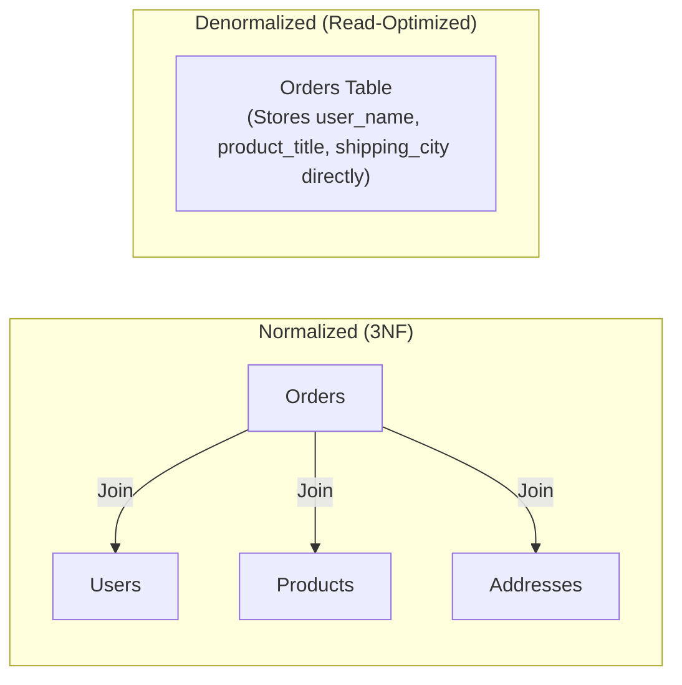

# Chapter 02: Data Modeling & Schema Design

> **Engineering Principle:**
> Code can be refactored in an afternoon, but a poorly designed database schema will haunt a company for years. Schema changes on tables with hundreds of millions of rows are high-risk operations involving locks, data migrations, and replication lag. Getting the data model right early is a hallmark of a senior backend engineer.

---

## Table of Contents
1. [Entities, Attributes, and Relationships](#1-entities-attributes-and-relationships)
2. [Keys: Primary Keys and Foreign Keys](#2-keys-primary-keys-and-foreign-keys)
3. [Natural Keys vs. Surrogate Keys](#3-natural-keys-vs-surrogate-keys)
4. [Relationship Cardinality: 1:1, 1:N, and M:N](#4-relationship-cardinality-11-1n-and-mn)
5. [Constraints and Data Integrity](#5-constraints-and-data-integrity)
6. [Normalization: 1NF, 2NF, and 3NF](#6-normalization-1nf-2nf-and-3nf)
7. [Denormalization and Its Trade-Offs](#7-denormalization-and-its-trade-offs)
8. [Concrete Real-World Scenarios: When to Normalize vs. Denormalize](#8-concrete-real-world-scenarios-when-to-normalize-vs-denormalize)
9. [Schema Evolution and Zero-Downtime Migrations](#9-schema-evolution-and-zero-downtime-migrations)
10. [Soft Deletes vs. Hard Deletes](#10-soft-deletes-vs-hard-deletes)
11. [Audit Fields and Audit Trails](#11-audit-fields-and-audit-trails)
12. [Summary & Production Checklist](#12-summary--production-checklist)

---

## 1. Entities, Attributes, and Relationships

Every data modeling effort begins with translating real-world business domains into formal database primitives:

*   **Entity:** A discrete business object or concept that possesses independent existence (e.g., `User`, `Order`, `Payment`). In a relational database, an entity maps to a **Table**; in document databases, to a **Collection**.
*   **Attribute:** A property, trait, or data element that describes an entity (e.g., `email`, `created_at`, `status`). This maps to a **Column** (or field).
*   **Relationship:** How two or more entities interact or depend on each other (e.g., a `User` places an `Order`).

```
+-------------------------------------------------------+
|                       USER                            |  (Entity)
+-------------------------------------------------------+
| - id: UUID                                            |  (Attribute - Identifier)
| - email: VARCHAR(255)                                 |  (Attribute)
| - created_at: TIMESTAMPTZ                             |  (Attribute)
+-------------------------------------------------------+
                           |
                           | places (1 : N)
                           v
+-------------------------------------------------------+
|                      ORDER                            |  (Entity)
+-------------------------------------------------------+
| - id: UUID                                            |
| - user_id: UUID                                       |  (Foreign Reference)
| - total_amount: DECIMAL(12, 2)                        |
| - status: VARCHAR(32)                                 |
+-------------------------------------------------------+
```

---

## 2. Keys: Primary Keys and Foreign Keys

Before defining relationship cardinalities or building table schemas, you must understand how databases identify records and enforce referential integrity.

### 2.1 Primary Key (PK)
A column (or set of columns) that uniquely identifies each row in a table.
*   **Invariants:** Must be strictly `UNIQUE` and `NOT NULL`.
*   **Physical Storage:** The storage engine automatically builds a unique index (typically a B-Tree) on the primary key. In clustered index engines (e.g., MySQL InnoDB), rows are physically ordered on disk by this primary key. In heap-based engines (e.g., PostgreSQL), the primary key index points to physical tuple IDs (`ctid`).

### 2.2 Foreign Key (FK)
A column that references the primary key of another table, establishing a referential integrity constraint.
*   **The Foreign Key Indexing Trap:** Most databases (including PostgreSQL and MySQL) **do not** automatically build an index on foreign key columns. If you execute:
    ```sql
    DELETE FROM users WHERE id = 10;
    ```
    The engine must verify whether child rows in `orders` reference `user_id = 10`. Without an explicit index on `orders(user_id)`, this forces a full table scan on `orders`, acquiring table-level share locks and stalling concurrent writes.

> **Production Rule:** Always build an explicit B-Tree index on every Foreign Key column.

```sql
CREATE INDEX idx_orders_user_id ON orders(user_id);
```

---

## 3. Natural Keys vs. Surrogate Keys

```
+------------------------------------+------------------------------------+
|            Natural Key             |           Surrogate Key            |
+------------------------------------+------------------------------------+
| Exists in the real world           | Synthetically generated by DB/app  |
| (e.g., SSN, Email, ISBN, VIN)      | (e.g., Auto-increment ID, UUIDv7)  |
| Changes when business rules change | Immutable, meaningless identifier  |
+------------------------------------+------------------------------------+
```

### Deep Dive Comparison

| Dimension | Natural Key (e.g., Email, SSN) | Surrogate Key (e.g., BIGINT, UUIDv7) |
| :--- | :--- | :--- |
| **Storage Overhead** | Variable length, often large (`VARCHAR`). B-Tree index pages become bloated. | Compact (8 bytes for `BIGINT`, 16 bytes for `UUID`). |
| **Immutability** | Low. People change email addresses; tax IDs can be reissued. Cascading updates across FKs are expensive. | Completely immutable. Internal ID never changes. |
| **Security & Privacy** | Exposes PII directly in URLs, logs, and foreign key tables. | Opaque. Does not leak sensitive data. |
| **Join Performance** | Slower string comparisons. | Fast, single-cycle integer or fixed-width 128-bit comparisons. |

### Surrogate Key Strategies: Auto-Increment vs. UUIDv4 vs. UUIDv7

1.  **Auto-Increment (`BIGSERIAL` / `BIGINT AUTO_INCREMENT`):**
    *   *Pros:* Compact (8 bytes), monotonically increasing, optimal for B-Tree insertion (no page splits).
    *   *Cons:* Predictable (susceptible to enumeration attacks: `GET /users/1`, `/users/2`), impossible to generate safely across distributed multi-region databases without cross-node coordination.
2.  **Random UUIDv4:**
    *   *Pros:* Globally unique across distributed nodes without coordination.
    *   *Cons:* Completely random 128-bit value. Inserting random values into a B-Tree causes severe **B-Tree page fragmentation** and cache thrashing as pages must be repeatedly rewritten to disk.
3.  **Time-Ordered UUIDv7 (Modern Standard):**
    *   *Pros:* Combines a 48-bit Unix epoch millisecond timestamp with random bits. It is both globally unique across distributed systems and **monotonically increasing**. B-Trees insert records cleanly at the right edge without page fragmentation.

---

## 4. Relationship Cardinality: 1:1, 1:N, and M:N

With keys established, cardinality defines how many records in Table A can relate to records in Table B.

### 4.1 One-to-One (1:1)
Each record in Table A relates to at most one record in Table B, and vice versa.

*   **Example:** `User` and `UserProfile` (or `UserSecuritySettings`).
*   **Implementation:** Place the primary key of Table A as a foreign key in Table B with a `UNIQUE` constraint.
*   **Why split into two tables?**
    *   **Vertical Partitioning:** Isolating rarely accessed, large columns (e.g., bio, avatar blob metadata) keeps the primary `users` table lean in the database buffer pool.
    *   **Security Isolation:** Sensitive compliance data (e.g., MFA secrets, tax IDs) can reside in a separate table with restricted access control policies.

```sql
CREATE TABLE users (
    id BIGSERIAL PRIMARY KEY,
    email VARCHAR(255) NOT NULL UNIQUE
);

CREATE TABLE user_profiles (
    user_id BIGINT PRIMARY KEY REFERENCES users(id) ON DELETE CASCADE,
    bio TEXT,
    website VARCHAR(255)
);
```

### 4.2 One-to-Many (1:N)
A single record in Table A can relate to multiple records in Table B, but each record in Table B points back to exactly one record in Table A.

*   **Example:** An `Author` has many `Books`; an `Order` has many `OrderItems`.
*   **Implementation:** Store the Primary Key of Table A as a Foreign Key inside Table B.

```sql
CREATE TABLE orders (
    id BIGSERIAL PRIMARY KEY,
    user_id BIGINT NOT NULL REFERENCES users(id),
    created_at TIMESTAMPTZ NOT NULL DEFAULT NOW()
);

CREATE TABLE order_items (
    id BIGSERIAL PRIMARY KEY,
    order_id BIGINT NOT NULL REFERENCES orders(id) ON DELETE CASCADE,
    product_id BIGINT NOT NULL,
    quantity INT NOT NULL CHECK (quantity > 0),
    unit_price DECIMAL(10, 2) NOT NULL
);
```

### 4.3 Many-to-Many (M:N)
Multiple records in Table A can relate to multiple records in Table B.

*   **Example:** `Students` and `Courses`, `Users` and `Roles`, `Articles` and `Tags`.
*   **Implementation:** Relational databases cannot represent M:N directly between two tables. An intermediate **Junction Table** (also known as an associative or bridge table) is required.
*   **Key Design Rule:** The junction table should have a composite primary key `(student_id, course_id)` to prevent duplicate links and automatically index queries from both directions.

```sql
CREATE TABLE students (
    id BIGSERIAL PRIMARY KEY,
    name VARCHAR(100) NOT NULL
);

CREATE TABLE courses (
    id BIGSERIAL PRIMARY KEY,
    title VARCHAR(200) NOT NULL
);

CREATE TABLE enrollments (
    student_id BIGINT NOT NULL REFERENCES students(id) ON DELETE CASCADE,
    course_id BIGINT NOT NULL REFERENCES courses(id) ON DELETE CASCADE,
    enrolled_at TIMESTAMPTZ NOT NULL DEFAULT NOW(),
    PRIMARY KEY (student_id, course_id)
);
```

---

## 5. Constraints and Data Integrity

Constraints are declarative rules enforced by the database storage engine. Never rely solely on application-level validation; concurrent application instances, background workers, or ad-hoc scripts can easily write corrupted data if the database does not enforce constraints.

```
Application Layer Validation: Fast, good for UX feedback (400 Bad Request)
             ↓
Database Constraints: The ultimate barrier of data truth (Enforced atomically)
```

### Essential Constraints:
1.  **`NOT NULL`:** Prevents null pointer errors and eliminates three-valued SQL logic (`TRUE`, `FALSE`, `UNKNOWN`).
2.  **`UNIQUE`:** Enforces distinct values across the table using an underlying unique index.
3.  **`CHECK`:** Validates domain logic at the row level:
    ```sql
    CHECK (price >= 0),
    CHECK (status IN ('PENDING', 'PROCESSING', 'COMPLETED', 'FAILED'))
    ```
4.  **`FOREIGN KEY` Referencing Actions:**
    *   `ON DELETE RESTRICT` (Default): Rejects deletion of parent if child records exist.
    *   `ON DELETE CASCADE`: Automatically deletes all child records when parent is deleted. Use with extreme caution on high-volume tables.
    *   `ON DELETE SET NULL`: Sets child FK to `NULL` (requires child column to be nullable).

---

## 6. Normalization: 1NF, 2NF, and 3NF

Normalization is the systematic process of organizing fields and tables to minimize **data redundancy** and avoid **update, insert, and delete anomalies**.

```
Raw Unnormalized Data
         ↓
  1NF: Eliminate repeating groups & ensure atomic values
         ↓
  2NF: Eliminate partial functional dependencies (relies on whole PK)
         ↓
  3NF: Eliminate transitive functional dependencies (no non-key determines non-key)
```

### 6.1 First Normal Form (1NF)
*   **Rule:** Every column must hold atomic (indivisible) values. No repeating groups or arrays stored as comma-separated strings.
*   **Violation:** Storing `'reading, hiking, coding'` in a single `hobbies` column.
*   **Resolution:** Split into a separate `user_hobbies` table with one row per hobby.

### 6.2 Second Normal Form (2NF)
*   **Rule:** Must be in 1NF, and **every non-key column must depend on the entire primary key**, not just a subset of it (applies to composite primary keys).
*   **Violation:** In a table with composite primary key `(order_id, product_id)`:
    *   Columns: `order_id`, `product_id`, `quantity`, `product_name`.
    *   `product_name` depends only on `product_id`, not on `order_id`.
*   **Resolution:** Move `product_name` to a dedicated `products` table.

### 6.3 Third Normal Form (3NF)
*   **Rule:** Must be in 2NF, and **no non-key column may depend on another non-key column** (no transitive dependencies). Every attribute must depend on "the key, the whole key, and nothing but the key."
*   **Violation:** In an `orders` table:
    *   Columns: `order_id` (PK), `customer_id`, `customer_zip_code`, `customer_city`.
    *   `customer_city` depends on `customer_zip_code`, which is not a primary key.
*   **Resolution:** Extract zip code and city to a separate `locations` or `customers` table.

---

## 7. Denormalization and Its Trade-Offs

While 3NF guarantees zero redundant data, it comes at a cost: **complex multi-table `JOIN` operations**. At high scale, joins require substantial CPU, memory, and disk I/O.

**Denormalization** is the intentional, strategic re-introduction of redundancy to optimize read throughput.



### Normalization vs. Denormalization Trade-Off Matrix

| Dimension | Normalized (3NF) | Denormalized |
| :--- | :--- | :--- |
| **Write Performance** | Fast. Writes update a single record in one place. | Slower. Updates must be replicated across all duplicated occurrences. |
| **Read Performance** | Slower. Requires expensive `JOIN` operations. | Blazing fast. Single table lookup without joins. |
| **Data Consistency** | Guaranteed by design. No stale data. | High risk of inconsistency if application updates one place but misses another. |
| **Storage Cost** | Minimal disk footprint. | Higher disk footprint due to duplicate columns. |
| **Ideal Workload** | High-write OLTP environments. | High-read systems, caching tiers, data warehouses (OLAP). |

---

## 8. Concrete Real-World Scenarios: When to Normalize vs. Denormalize

One of the most frequent system design interview questions is: *"When should I keep tables normalized, and when should I intentionally denormalize?"* Here are direct real-world scenarios:

### Scenario A: Banking / Ledger Balance (Keep Strictly Normalized - 3NF)
*   **Context:** You are building an account ledger or payment gateway.
*   **Choice:** **Strictly Normalized (3NF).**
*   **Why:** If user email, address, or currency accounts are duplicated across transactions, a user updating their profile could leave transaction rows pointing to outdated addresses or accounts. Write operations must guarantee absolute ACID consistency without anomalies.
*   **Architecture Rule:** In financial systems, consistency and auditability trumps read latency every time.

### Scenario B: E-Commerce Historical Snapshots (Intentionally Denormalize)
*   **Context:** An e-commerce user places an order for a laptop costing \$1,200.
*   **The Trap of Pure Normalization:** If you only store `product_id` on the `order_items` table and join with `products` on read, what happens when the merchant updates the laptop price to \$1,400 next week? The customer's historical receipt retroactively changes to \$1,400!
*   **Denormalized Solution:** Intentionally store `unit_price`, `product_title`, and `shipping_address` directly inside `order_items` and `orders` at the moment of checkout.
*   **Architecture Rule:** Historical snapshots require immutability through denormalization.

### Scenario C: Social Media Counter Feeds (Denormalize for Read Throughput)
*   **Context:** A post on Instagram or X has millions of likes and comments.
*   **The Trap of Pure Normalization:** Calculating the like count on every timeline scroll:
    ```sql
    SELECT count(*) FROM post_likes WHERE post_id = 99812;
    ```
    If 50,000 users load the feed every second, executing millions of index scans to count rows will saturate the database CPU and disk I/O.
*   **Denormalized Solution:** Add a denormalized `likes_count INT DEFAULT 0` column directly on the `posts` table. Increment atomically via Redis counter or background async jobs.
*   **Architecture Rule:** When read-to-write ratio exceeds $100:1$ and queries require expensive aggregations (`COUNT`, `SUM`), store precomputed denormalized counters.

### Scenario D: Real-Time User Profile in High-Traffic Feeds
*   **Context:** Displaying author name and avatar alongside 50 posts on a timeline feed.
*   **Normalized Approach:** Query 50 posts, then run `JOIN users ON posts.user_id = users.id`.
*   **When to Stay Normalized:** When the database query plan shows sub-millisecond execution because `user_id` is indexed and cached in the buffer pool.
*   **When to Denormalize:** When user lookups span across distributed database shards (where cross-shard joins are impossible). Store `author_name` and `author_avatar_url` in the `posts` document directly, and handle avatar updates via asynchronous background workers.

---

## 9. Schema Evolution and Zero-Downtime Migrations

In early development, dropping and recreating a database is trivial. In production systems serving active traffic, running:
```sql
ALTER TABLE orders ADD COLUMN status VARCHAR(50) DEFAULT 'PENDING' NOT NULL;
```
can take an exclusive table lock (`ACCESS EXCLUSIVE` in PostgreSQL), blocking every incoming read and write query for minutes or hours, causing an outage.

### The Expand/Contract (Parallel Run) Pattern
To modify schemas without downtime:

```
Step 1: EXPAND
Add new column/table alongside old one (keep old intact).

Step 2: DUAL WRITE
Application writes to both old and new columns; reads from old.

Step 3: BACKFILL
Asynchronous background worker migrates historical records.

Step 4: SWITCH READS
Application reads from new column; writes continue to both.

Step 5: CONTRACT
Application stops using old column; remove old column safely.
```

### Critical Rules for Production Migrations:
1.  **Never add a column with a non-null default without caution:**
    *   In modern Postgres (>= 11), adding a column with constant default does not rewrite the table. In older versions or MySQL, it rewrites every row on disk.
2.  **Add indexes concurrently:**
    *   In PostgreSQL, `CREATE INDEX` locks out writes. Always use:
        ```sql
        CREATE INDEX CONCURRENTLY idx_orders_created_at ON orders(created_at);
        ```
3.  **Always set lock timeouts:**
    *   Prevent migration scripts from hanging behind long-running queries:
        ```sql
        SET lock_timeout = '2s';
        ALTER TABLE users ADD COLUMN phone VARCHAR(20);
        ```

---

## 10. Soft Deletes vs. Hard Deletes

When a user deletes a resource, how should the database handle it?

```
Hard Delete:
DELETE FROM users WHERE id = 42;  --> Rows permanently removed from disk pages.

Soft Delete:
UPDATE users SET deleted_at = NOW() WHERE id = 42;  --> Row remains, marked inactive.
```

### Comparison Matrix

| Consideration | Hard Delete | Soft Delete |
| :--- | :--- | :--- |
| **Audit & Recovery** | Gone forever unless restored from backup. | Instantly recoverable (`SET deleted_at = NULL`). |
| **Data Size & Index Bloat**| Keeps tables and indexes lean. | Table and indexes grow indefinitely over time. |
| **Query Complexity** | Simple queries. | Every query must remember `WHERE deleted_at IS NULL`. |
| **Unique Constraints** | Standard unique constraints work naturally. | Broken! A user signs up, soft-deletes, and re-registers with the same email. |
| **Compliance (GDPR)** | Complies directly with "Right to be Forgotten". | Violates GDPR if personally identifiable information (PII) is kept indefinitely. |

### Solving the Soft Delete Unique Constraint Problem
Use **Partial Indexes**:

```sql
CREATE TABLE users (
    id BIGSERIAL PRIMARY KEY,
    email VARCHAR(255) NOT NULL,
    deleted_at TIMESTAMPTZ DEFAULT NULL
);

-- Unique index applies only to active records
CREATE UNIQUE INDEX uq_users_active_email ON users(email) 
WHERE deleted_at IS NULL;
```

---

## 11. Audit Fields and Audit Trails

High-reliability engineering requires knowing who modified what and when.

### 11.1 Standard Base Audit Fields (Every Table)
Every production table should include four baseline metadata columns:

```sql
CREATE TABLE accounts (
    id BIGSERIAL PRIMARY KEY,
    name VARCHAR(100) NOT NULL,
    
    -- Audit Columns
    created_at TIMESTAMPTZ NOT NULL DEFAULT NOW(),
    updated_at TIMESTAMPTZ NOT NULL DEFAULT NOW(),
    created_by BIGINT REFERENCES users(id),
    updated_by BIGINT REFERENCES users(id)
);
```

### 11.2 Immutable Audit Log (Change Data Log)
When compliance, finance, or security requires tracking historical changes (e.g., bank account balance shifts):

*   Never overwrite previous states without an audit trail.
*   Implement an **append-only audit log table**:

```sql
CREATE TABLE account_audit_log (
    audit_id BIGSERIAL PRIMARY KEY,
    account_id BIGINT NOT NULL,
    operation VARCHAR(10) NOT NULL, -- 'INSERT', 'UPDATE', 'DELETE'
    changed_by BIGINT NOT NULL,
    old_data JSONB,
    new_data JSONB,
    changed_at TIMESTAMPTZ NOT NULL DEFAULT NOW()
);
```

This can be captured automatically using database triggers, or at the infrastructure level via **Change Data Capture (CDC)** tools like Debezium reading directly from the database Write-Ahead Log.

---

## 12. Summary & Production Checklist

Before shipping a database schema to production, review this senior engineer checklist:

* [ ] **Primary Key:** Every table has an explicit, immutable primary key (`BIGINT` or `UUIDv7`).
* [ ] **Foreign Key Indexes:** Every foreign key column has a corresponding B-Tree index.
* [ ] **Integrity Constraints:** Business rules (`NOT NULL`, `CHECK`, `UNIQUE`) are enforced by the database, not just application code.
* [ ] **Normalization Level:** Schema is normalized to 3NF unless an intentional, documented denormalization decision is justified by read benchmarks.
* [ ] **Migration Safety:** All migrations use non-blocking patterns (`CREATE INDEX CONCURRENTLY`, `lock_timeout`, Expand/Contract).
* [ ] **Soft Delete Strategy:** If soft deletes are used, unique constraints use partial indexes (`WHERE deleted_at IS NULL`).
* [ ] **Auditability:** Core tables include `created_at` and `updated_at` with time-zone awareness (`TIMESTAMPTZ`).

---

⬅️ **[Previous: 1. Database Fundamentals](01_Database_Fundamentals.md)** | 🏠 **[Back to TOC](README.md)** | **[Next: 3. Database Internals ➡️](03_Database_Internals.md)**
