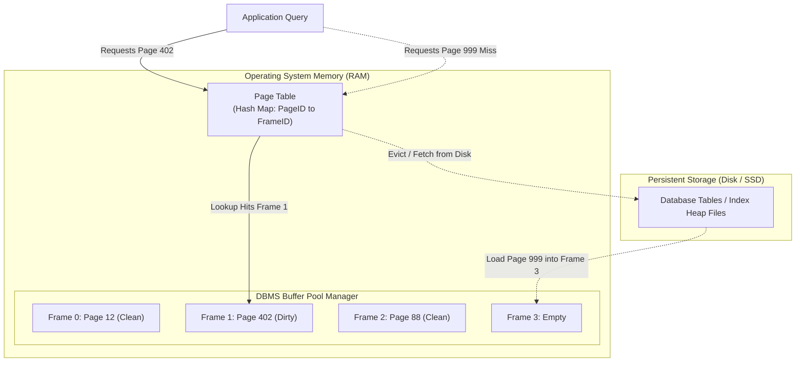
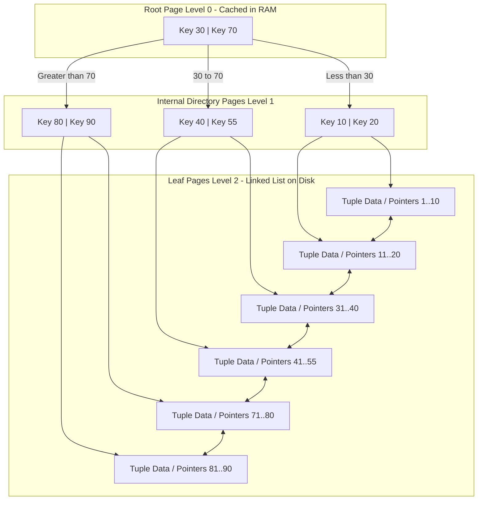
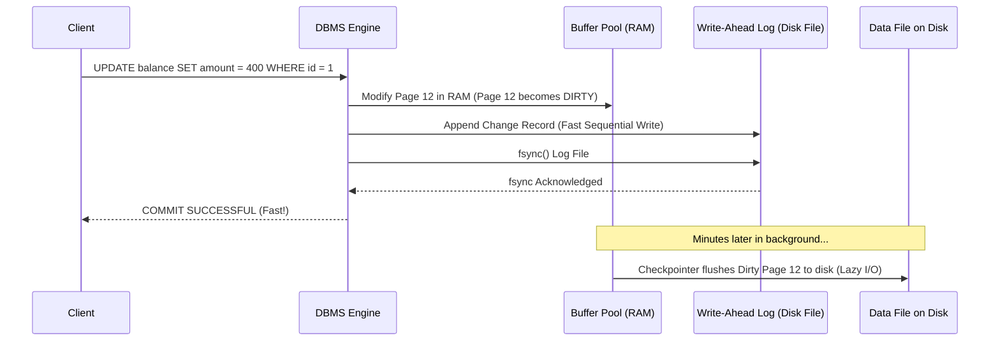
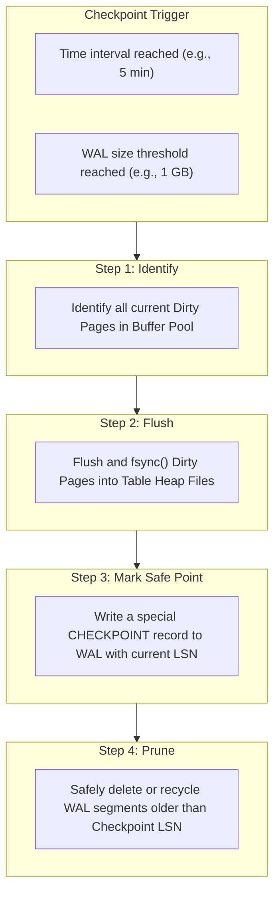

# Chapter 03: Database Internals

> **Core Concept:**
> A database is not magic. Under the hood, it is a software system designed around computer hardware: CPU registers, volatile RAM, and persistent disk storage. To understand database performance, we must understand how data travels between memory and physical disk blocks.

---

## Table of Contents
1. [The Physical Reality: Why Databases Cannot Treat Disk Like RAM](#1-the-physical-reality-why-databases-cannot-treat-disk-like-ram)
2. [How Databases Store Data: Pages, Blocks, Records, and Slotted Pages](#2-how-databases-store-data-pages-blocks-records-and-slotted-pages)
3. [Memory, Disk, and Buffer Pool Management](#3-memory-disk-and-buffer-pool-management)
4. [Storage Engines and Their Responsibilities](#4-storage-engines-and-their-responsibilities)
5. [Indexing Fundamentals: Why Indexes Exist and How B+ Trees Work](#5-indexing-fundamentals-why-indexes-exist-and-how-b-trees-work)
6. [Durability and Atomicity: Write-Ahead Logging (WAL)](#6-durability-and-atomicity-write-ahead-logging-wal)
7. [Checkpoints, Dirty Pages, and Crash Recovery](#7-checkpoints-dirty-pages-and-crash-recovery)
8. [Database Process Architecture: Multi-Process vs. Multi-Threaded](#8-database-process-architecture-multi-process-vs-multi-threaded)
9. [The Complete Life of a Query: Deep Dive into the Read Path vs. Write Path](#9-the-complete-life-of-a-query-deep-dive-into-the-read-path-vs-write-path)
10. [Summary and Production Mental Models](#10-summary-and-production-mental-models)

---

## 1. The Physical Reality: Why Databases Cannot Treat Disk Like RAM

To understand why database engines are designed the way they are, we have to look at the physical hardware constraints every system operates under:

```
+-------------------------------------------------------------+
| Layer               Access Latency         Human Scale      |
+-------------------------------------------------------------+
| CPU Registers       ~0.5 ns                1 heartbeat      |
| L1/L2/L3 Cache      ~1 - 10 ns             A few seconds    |
| Main Memory (RAM)   ~50 - 100 ns           ~2 minutes       |
| NVMe SSD (Flash)    ~10,000 - 50,000 ns    ~1 day           |
| Spinning HDD        ~5,000,000 ns (5ms)    ~4 months        |
+-------------------------------------------------------------+
```

### The Core Conflict
1. **RAM is fast but volatile:** If power drops, data in RAM disappears immediately. RAM is also significantly more expensive per gigabyte than disk.
2. **Disk is durable and cheap, but slow:** Disks operate in **fixed block sizes** (typically 4 KB sectors on SSDs and HDDs). A disk controller cannot read or write a single 10-byte string; it reads and writes entire blocks.
3. **Sequential I/O vs. Random I/O:** 
   * **Sequential Write:** Appending data sequentially to the end of a file lets the storage drive stream bytes at full hardware bus speeds (gigabytes per second).
   * **Random Write:** Jumping around to update arbitrary rows across a huge file forces the drive controller to locate, erase, and rewrite flash blocks, drastically slowing down throughput.

A database management system (DBMS) is software built to bridge this gap: it allows applications to read and write records rapidly in RAM while ensuring data safely and sequentially lands on persistent disk.

---

## 2. How Databases Store Data: Pages, Blocks, Records, and Slotted Pages

### 2.1 The Hierarchy: Blocks, Pages, and Records
To understand database storage, let us break down the terminology from the physical hardware up to the application:

```
+-------------------------------------------------------------------------+
| Level 1: Application Record (Row)                                       |
| e.g. User row: id=42, name="Carol", email="carol@test.com" (~80 bytes)  |
+-------------------------------------------------------------------------+
                                    |
                                    v
+-------------------------------------------------------------------------+
| Level 2: Database Page (e.g. 8 KB in PostgreSQL, 16 KB in MySQL InnoDB) |
| A fixed-size container that packs dozens or hundreds of records together|
+-------------------------------------------------------------------------+
                                    |
                                    v
+-------------------------------------------------------------------------+
| Level 3: OS / Hardware Disk Block (usually 4 KB)                        |
| The physical unit that NVMe/SSD controllers read and write atomically   |
+-------------------------------------------------------------------------+
```

* **Hardware Block (Sector):** The minimum chunk the physical storage hardware can read or write (typically 4 KB).
* **Database Page:** The fundamental unit of data transfer between disk and RAM used by the database engine. In PostgreSQL and SQLite, a page is 8 KB (2 hardware blocks). In MySQL InnoDB, a page is 16 KB (4 hardware blocks).
* **Record (Tuple / Row):** The actual business data you insert. One page holds many records.

### Why do databases use Pages instead of reading individual records?
If you query:
```sql
SELECT name FROM users WHERE id = 42;
```
Even though you only asked for 1 user (roughly 80 bytes of data), the database engine **never** reads 80 bytes from disk. Hardware controllers cannot fetch 80 isolated bytes. The database engine always reads the **entire 8 KB page** containing that row into memory.

This design relies on the **Principle of Locality**: if an application accesses user 42, it will likely access adjacent records or indexes soon after. Reading an entire page at once amortizes expensive disk read latency.

```
Table File on Disk (e.g. users.db)
+----------------+----------------+----------------+----------------+
|  Page 0 (8 KB) |  Page 1 (8 KB) |  Page 2 (8 KB) |  Page 3 (8 KB) | ...
+----------------+----------------+----------------+----------------+
```

---

### 2.2 Inside an 8 KB Page: The Slotted-Page Layout
A database page must store records of **variable lengths** (e.g., someone's name might be 4 characters, while another person's bio is 500 characters). 

If you store records end-to-end, what happens when a record is updated and grows larger, or when a record in the middle is deleted?
* If you shift all records to fill the hole, you have to rewrite the entire page and update all indexes pointing to those records.
* If you leave empty gaps, the page quickly becomes fragmented and unusable.

To solve this, modern databases (PostgreSQL, SQLite, MySQL) use the **Slotted-Page Architecture**:

```
+-----------------------------------------------------------------------+
|                             PAGE HEADER                               |
|  - Page LSN (Log Sequence Number for recovery)                        |
|  - Free Space Pointers (start of free space, end of free space)       |
|  - Checksum and Flags                                                 |
+-----------------------------------------------------------------------+
| Slot Pointer 1 (offset: byte 8120, length: 72 bytes)                  |
| Slot Pointer 2 (offset: byte 8010, length: 110 bytes)                 |
| Slot Pointer 3 (offset: byte 7850, length: 160 bytes)                 |
| ---> Array of slot pointers grows DOWNWARD                            |
+-----------------------------------------------------------------------+
|                                                                       |
|                       UNALLOCATED FREE SPACE                          |
|                                                                       |
+-----------------------------------------------------------------------+
| <--- Actual record data grows UPWARD from bottom                      |
| [Record 3: id=44, name="Alice", ...]  (Bytes 7850 to 8009)            |
| [Record 2: id=43, name="Bob", ...]    (Bytes 8010 to 8119)            |
| [Record 1: id=42, name="Carol", ...]  (Bytes 8120 to 8191)            |
+-----------------------------------------------------------------------+
```

#### How the Slotted Page Works:
1. **Pointers grow down, records grow up:**
   * At the top of the page, an array of lightweight **Slot Pointers** (item IDs) grows downward.
   * At the bottom of the page, the actual raw **Record Data** grows upward.
   * In the middle sits the unallocated free space. When the two boundaries meet, the page is full.
2. **Stable Record Identifiers (Tuple IDs / Row IDs):**
   * Outside of this page, other tables and indexes reference records using a simple pair: `(PageNumber, SlotIndex)`.
   * For example, Record 2 is referenced as `(Page 4, Slot 2)`.
   * If Record 2 is updated and expands, the database can move its raw bytes anywhere in the bottom of Page 4. As long as **Slot Pointer 2** is updated to point to the new byte offset, the external address remains strictly `(Page 4, Slot 2)`. Secondary indexes do not need to be updated.
3. **Defragmentation:** When a record is deleted, its slot pointer is marked dead. When the page fills up, the engine slides surviving records together to reclaim contiguous space without changing any slot numbers.

---

### 2.3 Record Layout: How a Row is Encoded in Bytes
Inside the record bytes, a database stores more than just column values:

```
+---------------+----------------+-------------------+----------------------+
| Record Header | Null Bitmap    | Fixed-Width Data  | Variable-Width Data  |
| (Metadata)    | (1 bit/column) | (e.g. INT, BIGINT)| (e.g. VARCHAR, TEXT) |
+---------------+----------------+-------------------+----------------------+
```
* **Record Header:** Stores transaction visibility information (which transaction created this row, which transaction deleted/updated it).
* **Null Bitmap:** If a table has 20 columns and 5 are `NULL`, the database does not write 5 sets of empty bytes. Instead, it sets bits in a tiny bitmask (e.g., `00101...`). If a column's bit is 0, the engine skips reading that column, saving disk and memory space.
* **Alignment Padding:** Modern CPUs read memory fastest when 4-byte integers align on 4-byte boundaries and 8-byte integers align on 8-byte boundaries. The storage engine inserts small padding bytes between columns to match CPU memory alignment.

---

## 3. Memory, Disk, and Buffer Pool Management

Because physical disk operations take milliseconds while RAM operations take nanoseconds, databases keep a large chunk of system memory dedicated to caching pages. This region is called the **Buffer Pool** (PostgreSQL calls it `shared_buffers`; MySQL InnoDB calls it `innodb_buffer_pool_size`).



### 3.1 The Page Table (Hash Map)
The Buffer Pool maintains an in-memory hash table:
* **Key:** `PageID` (e.g., File 2, Page 402)
* **Value:** `FrameID` (the slot in RAM holding that page)

When a query needs to read data:
1. It looks up the PageID in the Page Table.
2. **Buffer Hit:** If the page is already in RAM, the engine returns a memory pointer immediately. Latency: around 100 nanoseconds.
3. **Buffer Miss:** If the page is not in RAM, the engine pauses, issues a read system call (`pread()`) to load 8 KB from disk into an available buffer frame in RAM, registers it in the Page Table, and proceeds. Latency: around 100 microseconds to 5 milliseconds.

### 3.2 Clean vs. Dirty Pages
* **Clean Page:** The 8 KB data in RAM matches what is currently written on the physical disk. It can be evicted from RAM at any moment without losing data.
* **Dirty Page:** An update or insert modified the page in RAM. The memory copy is newer than the disk copy. It **must be flushed to disk** before that RAM frame can be overwritten.

### 3.3 Buffer Eviction: LRU vs. CLOCK
When the Buffer Pool is completely full and a query needs to load a new page from disk, which page in RAM gets evicted?

1. **Standard LRU (Least Recently Used):**
   * Drops the page that hasn't been accessed for the longest time.
   * **The Flaw (Scan Pollution):** If an analyst runs a one-off query like `SELECT * FROM large_table;` scanning 100 GB of cold historical data, standard LRU will flush out all your hot user profiles and frequently queried rows from RAM.
2. **The CLOCK Sweep Algorithm (Used in PostgreSQL):**
   * Buffer frames are arranged in a conceptual circle, like the face of a clock, each having a usage count (from 0 to 5).
   * A "hand" rotates through the frames.
   * If a frame's usage count is greater than 0, the hand decrements it and moves to the next frame.
   * If the usage count is 0, that frame is selected for eviction.
   * One-time table scans only set the count to 1, meaning they get evicted quickly, preserving hot pages that have counts of 3, 4, or 5.

---

## 4. Storage Engines and Their Responsibilities

A database engine is split into two main layers:
1. **The Query Layer:** Parses SQL, validates tables, optimizes query plans, and manages connection protocols.
2. **The Storage Engine:** Directly interfaces with RAM and disk blocks.

```
+-----------------------------------------------------------------------------------+
| Architecture       Primary Data Structure    Optimization Target    Examples      |
+-----------------------------------------------------------------------------------+
| Read-Optimized     B+ Tree                   Low-latency point &    PostgreSQL,   |
| (In-Place Update)                            range reads            MySQL InnoDB, |
|                                                                     SQLite        |
+-----------------------------------------------------------------------------------+
| Write-Optimized    LSM-Tree                  High-throughput,       Cassandra,    |
| (Append-Only)      (Log-Structured           append-only writes     RocksDB,      |
|                    Merge-Tree)                                      ScyllaDB      |
+-----------------------------------------------------------------------------------+
```

The Storage Engine is responsible for four key jobs:
* **Storage Layout:** Formatting and organizing pages on disk.
* **Indexing:** Building and navigating lookup trees (B+ Trees) or LSM-Trees.
* **Concurrency:** Locking rows and managing memory latches so threads do not overwrite each other.
* **Recovery:** Writing transaction logs so the database recovers cleanly after a crash.

---

## 5. Indexing Fundamentals: Why Indexes Exist and How B+ Trees Work

### 5.1 What is an Index and Why Do We Need One?
Imagine a phonebook containing 10 million names. If the names were listed in completely random order, and you wanted to find "Carol Smith", you would have to start on page 1 and read every single entry until you found her.
In computer science, reading every entry from start to finish is called a **Sequential Scan** (linear search, running in `O(N)` time).

If a database table has 10 million rows stored across 100,000 pages on disk, a query without an index:
```sql
SELECT * FROM users WHERE email = 'carol@test.com';
```
forces the database to load all 100,000 pages from disk into RAM to check each row. This takes seconds or even minutes.

An **Index** is a separate, sorted auxiliary data structure that acts like the alphabetical index at the back of a textbook:
* It stores only the indexed column (e.g., `email`) along with a pointer to the exact physical page and slot where that row lives: `(PageID, SlotIndex)`.
* Instead of scanning 100,000 pages, the database searches the small index, finds the exact location in 2 or 3 steps (`O(log N)` time), and loads only that single 8 KB page.

---

### 5.2 Why Not Use Binary Search Trees?
You might wonder: *We already learned Binary Search Trees (BST), AVL Trees, and Red-Black Trees in basic computer science. Why don't databases use them for indexing on disk?*

In a binary search tree, every node has at most **2 children**:

```
        (50)
       /    \
     (25)   (75)
    /    \
  (10)   (30)
```

For 10 million records, a balanced binary search tree has a height of:
$$\log_2(10,000,000) \approx 24 \text{ levels}$$

If this tree is stored on disk, every node lives on a different disk page. To find a single record, the database must jump through 24 different nodes:
$$24 \text{ levels} \times 5 \text{ ms per disk seek} = 120 \text{ milliseconds}$$
Taking 120 ms for a single point lookup is unacceptable for high-throughput databases. Binary trees are designed for CPU cache and RAM, not block-based disk storage.

---

### 5.3 The Solution: High Fan-Out Multi-Way Trees (B-Trees)
To make tree lookups fast on disk, databases use **B-Trees**. 

Instead of giving each node only 2 children, a B-Tree gives each node **hundreds of children** to match the size of a database page. The number of children a node can point to is called the **Fan-Out** ($B$).

Because an 8 KB page has plenty of room, a single index page can easily store 200 to 500 keys and child pointers:

```
                          [ Key 20 | Key 50 | Key 80 ]
                         /         |        |         \
                       /           |        |           \
                     v             v        v             v
             [Child Page 1] [Child Page 2] [Child Page 3] [Child Page 4]
             (Keys < 20)    (Keys 20-50)   (Keys 50-80)   (Keys > 80)
```

With a fan-out of 300:
* **Level 0 (Root):** 1 page $\rightarrow 300$ keys
* **Level 1:** 300 pages $\rightarrow 90,000$ keys
* **Level 2:** 90,000 pages $\rightarrow 27,000,000$ keys

With a fan-out of 300, a B-Tree can index **27 million records in just 3 levels**. Because the root page and first level are small, they stay permanently cached in RAM. Finding any row among 27 million records requires **at most 1 physical disk read**!

---

### 5.4 The Standard: Why Databases Use B+ Trees
Most relational databases (including PostgreSQL, MySQL InnoDB, SQLite, and Oracle) do not use standard B-Trees; they use an optimized variation called the **B+ Tree**.



### The 2 Big Advantages of B+ Trees over Standard B-Trees:

1. **Higher Fan-Out in Internal Nodes:**
   * In a standard B-Tree, every node stores both the search key and the actual row data (or tuple pointer). This takes up space, which reduces the number of keys you can fit in an 8 KB page.
   * In a B+ Tree, non-leaf nodes (internal nodes) store **only routing keys and child page pointers**. All actual data pointers are pushed down to the leaf nodes. This maximizes fan-out, keeping the tree exceptionally flat.
2. **Linked Leaf Pages for Fast Range Scans:**
   * In a standard B-Tree, running a range query like:
     ```sql
     SELECT * FROM users WHERE age BETWEEN 20 AND 30;
     ```
     requires jumping up and down across tree branches repeatedly.
   * In a B+ Tree, **all leaf pages are linked together in a doubly linked list**. The database navigates down to the leaf page for `20` once, and then simply walks horizontally across the linked list of pages until it hits `31`. Range scans execute at sequential memory speed.

---

## 6. Durability and Atomicity: Write-Ahead Logging (WAL)

### The Problem of Directly Writing Data to Disk
Imagine a bank transfer transaction where user Alice sends \$100 to Bob:
1. Alice's balance row (stored on Page 12) must be decremented.
2. Bob's balance row (stored on Page 89) must be incremented.
3. The transaction ledger (stored on Page 400) must record the transfer.

These three 8 KB pages live in completely different locations on disk. If the database tried to update all three pages directly on disk when the user clicked "Submit":
1. It would require multiple slow, random disk writes.
2. If power fails after writing Page 12, but before writing Page 89, Alice's money disappears, and Bob never receives it. The database is now corrupted.

### The Solution: Write-Ahead Logging (WAL)
> **The Fundamental Rule of WAL:**
> No data page may be written to disk until the log record describing the update has first been written and safely synced (`fsync`) to disk.

Instead of writing entire 8 KB pages randomly across the disk, the database writes a compact, sequential record describing only the delta change to an append-only file called the **Write-Ahead Log (WAL)**:

```text
[LSN 1042] TX 501: Page 12 Offset 40 - Subtracted 100 from Alice (400)
[LSN 1043] TX 501: Page 89 Offset 20 - Added 100 to Bob (200)
[LSN 1044] TX 501: COMMIT
```



### Why WAL Makes Databases Fast:
1. **Sequential vs. Random I/O:** Appending a small 60-byte log entry sequentially to the end of a log file operates at the maximum physical speed of your storage device.
2. **Immediate Confirmation:** When your application receives a `COMMIT SUCCESSFUL` response, the actual table data pages on disk **have not been updated yet**. The update exists safely in memory and in the sequential WAL file on disk.

---

## 7. Checkpoints, Dirty Pages, and Crash Recovery

If the database keeps writing changes only to the WAL, two serious problems will occur:
1. The WAL file will grow indefinitely until the disk is completely full.
2. If the server crashes, rebooting will take hours because the database must replay every single transaction from day one.

### The Checkpointer Process
To prevent this, a background process called the **Checkpointer** runs periodically (e.g., every 5 minutes, or whenever the WAL file reaches a configured size threshold like 1 GB).



### Crash Recovery: The ARIES Algorithm
If the server loses power or crashes, what happens when it boots back up?

The database executes crash recovery (using the industry-standard **ARIES** algorithm):
1. **Analysis Phase:** It scans the WAL forward starting from the last known **Checkpoint** record to find which transactions were in-flight and which pages were dirty when the crash occurred.
2. **Redo Phase (Roll Forward):** It replays all logged changes from the log start point forward to restore the system state to the exact moment of the crash.
3. **Undo Phase (Roll Back):** It walks backward through the log to reverse changes made by transactions that never issued a `COMMIT` before the crash.

---

## 8. Database Process Architecture: Multi-Process vs. Multi-Threaded

When clients connect to a database over the network, how does the operating system process their requests? Databases generally follow one of two architectures:

```
Multi-Process Architecture (e.g., PostgreSQL)
+---------------------------------------------------------------+
| Postmaster (Parent Daemon)                                    |
|   |--- Backend Process 1 (Forked OS Process per Client Conn)  |
|   |--- Backend Process 2 (Forked OS Process per Client Conn)  |
|   |--- Checkpointer / WAL Writer (Background OS Processes)    |
|                                                               |
|   Shared Memory Segment (IPC / mmap):                         |
|   [ Buffer Pool | Lock Table | WAL Buffers ]                  |
+---------------------------------------------------------------+

Multi-Threaded Architecture (e.g., MySQL InnoDB, SQL Server)
+---------------------------------------------------------------+
| Single Database OS Process                                    |
|   |--- Thread 1 (Client Connection)                           |
|   |--- Thread 2 (Client Connection)                           |
|   |--- Thread 3 (Background Flusher)                          |
|                                                               |
|   Native Process Virtual Address Space:                       |
|   [ Buffer Pool | Lock Table | Connection Memory ]            |
+---------------------------------------------------------------+
```

### Direct Comparison

| Feature | Multi-Process (PostgreSQL) | Multi-Threaded (MySQL, Oracle) |
| :--- | :--- | :--- |
| **Fault Isolation** | High. If a client worker crashes on a segfault, it cannot corrupt memory in other client connections. | Lower. A memory corruption bug or crash in one thread can take down the entire database instance. |
| **Memory Footprint** | Higher. Each forked process consumes 5 to 10 MB of private memory space. | Lower. Threads share the same address space; memory overhead per connection is small (~256 KB). |
| **Context Switching** | Higher cost for the OS kernel when scaling to thousands of connections. | Cheaper thread context switching within the same process space. |
| **Architectural Need** | **Requires external connection poolers** (e.g., PgBouncer) to cap connections around hundreds. | Can handle thousands of idle connections more gracefully out-of-the-box. |

---

## 9. The Complete Life of a Query: Deep Dive into the Read Path vs. Write Path

To see all these internal components working together, let us trace the path of both a read query and a write query through the engine.

### 9.1 The Read Path
Query: `SELECT email FROM users WHERE id = 105;`

```
1. Client -> Sends SQL query text over a TCP socket.
2. Transport Layer: Accepts the packet, checks authentication, and routes to a Backend Worker.
3. Parser & Lexer: Checks SQL syntax and converts the string into an Abstract Syntax Tree (AST).
4. Catalog / Metadata Check: Verifies that the table 'users' and column 'email' exist and that the user has read permissions.
5. Query Optimizer:
   - Evaluates table statistics.
   - Finds a unique B+ Tree index on 'id'.
   - Produces an execution plan: "Index Scan using users_pkey on users".
6. Execution Engine:
   - Asks the Index Subsystem: "Find the tuple pointer for id = 105".
   - B+ Tree traverses Root Page -> Intermediate Page -> Leaf Page.
   - Index leaf yields the physical Tuple Pointer: (Page 14, Slot 3).
7. Buffer Pool Lookup:
   - The engine checks the Buffer Pool Page Table for Page 14.
   - If Page 14 is in RAM: Buffer Hit!
   - If Page 14 is not in RAM: The engine issues pread() to disk, loading Page 14 into a free Buffer Pool frame.
8. MVCC Visibility Check:
   - Inspects the tuple header at (Page 14, Slot 3).
   - Confirms that the row is visible to the current transaction.
9. Projection & Network Return:
   - Extracts the 'email' bytes from the record.
   - Formats the network result packet and sends it across the TCP socket to the client.
```

---

### 9.2 The Write Path
Query: `UPDATE users SET email = 'alice@new.com' WHERE id = 105;`

```
1. Client -> Sends UPDATE query over TCP.
2. Parser & Optimizer: Locates target row via Index Scan at (Page 14, Slot 3).
3. Lock Manager:
   - Acquires an Exclusive Row-Level Lock on id = 105.
   - Concurrent updates to id = 105 will now block waiting for this transaction to finish.
4. Pinning Page in Memory:
   - Buffer Manager pins Page 14 in RAM (pins prevent the page from being evicted by the clock sweep).
   - Acquires an exclusive memory latch on Page 14's buffer frame.
5. Write to WAL Buffer:
   - Creates a WAL record: "UPDATE users on Page 14 Slot 3 from old to new value".
   - Appends the change record to the in-memory WAL buffer.
6. Mutate Page in RAM:
   - Updates the row on Page 14 in RAM.
   - Marks Page 14 as DIRTY.
   - Updates Page 14's header with the new Log Sequence Number (LSN).
   - Releases the memory latch on Page 14.
7. Commit Phase:
   - Client sends 'COMMIT'.
   - The DBMS issues fsync() on the WAL buffer to write the log record to physical disk.
   - WAL write succeeds on disk!
8. Unlock & Release:
   - Releases the row lock on id = 105.
   - Sends 'UPDATE 1 / COMMIT OK' back to the client.
9. Asynchronous Flush (Lazy):
   - Notice: Page 14 is STILL dirty in RAM!
   - Minutes later, the Checkpointer flushes Page 14 from RAM into the table file on disk.
```

---

## 10. Summary and Production Mental Models

Understanding database internals changes how you write queries and design systems:

1. **Random Reads are Bottlenecked by I/O:** If a query reads 1,000 rows scattered across 1,000 different 8 KB pages, the database must touch 8 MB of scattered memory or disk space. Storing related data contiguously minimizes page touches.
2. **Commit Latency is WAL fsync Latency:** If your transactions feel slow, check your storage device's `fsync` throughput. A slow disk cannot append WAL records quickly.
3. **Indexes are Not Free:** Every index is a separate B+ Tree stored on disk. When you run an `INSERT` or `DELETE`, the engine must update the table page **plus** every single index page on that table, writing additional WAL records for each.
4. **Connection Counts Matter:** In multi-process engines like PostgreSQL, each idle connection consumes real OS memory and CPU scheduling overhead. Use connection poolers to keep active backend processes aligned with CPU core counts.

---

⬅️ **[Previous: 2. Data Modeling & Schema Design](02_Data_Modeling_And_Schema_Design.md)** | 🏠 **[Back to TOC](README.md)** | **[Next: 4. Transactions & ACID ➡️](04_Transactions_And_ACID.md)**
