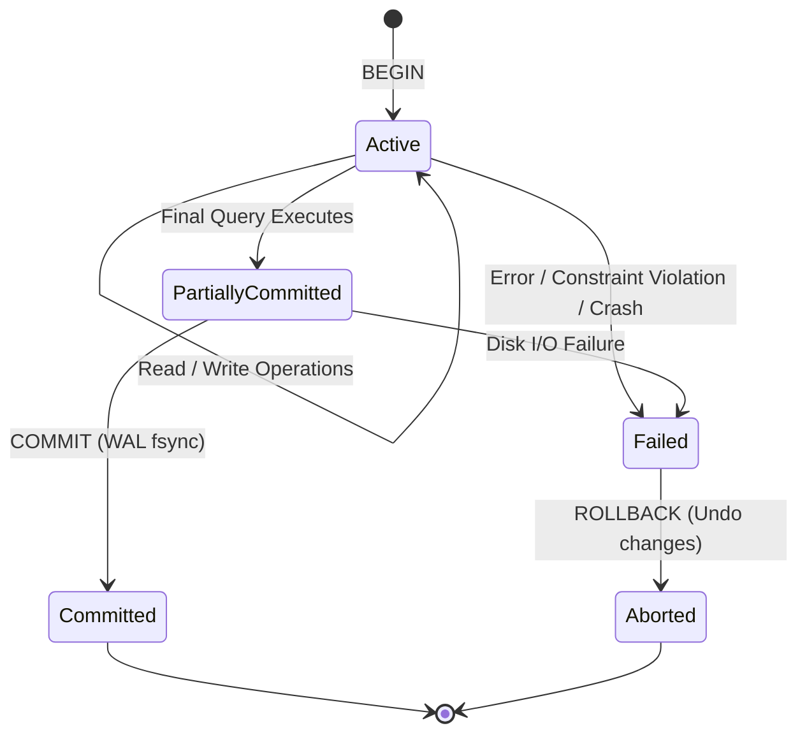
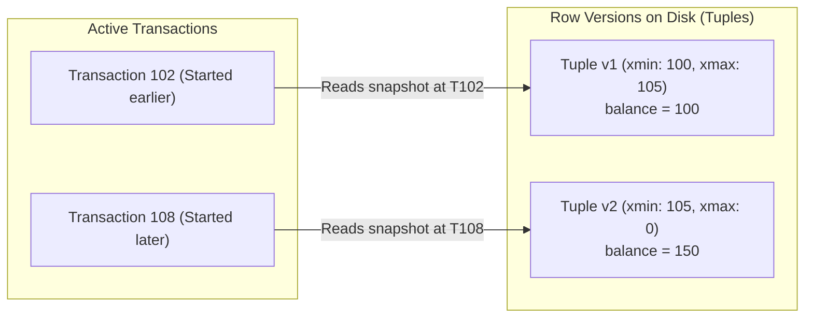
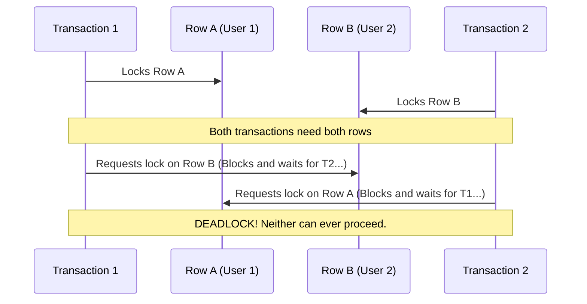

# Chapter 04: Transactions & ACID

> **Core Concept:**
> In computer science, a system without transactions is a system that cannot tolerate concurrency or hardware failures. Whenever multiple users update shared state at the same time, or when a network cable disconnects midway through an operation, transactions are the mathematical foundation that prevent data corruption, double-spending, and partial writes.

---

## Table of Contents
1. [What is a Transaction?](#1-what-is-a-transaction)
2. [The ACID Guarantees Explained](#2-the-acid-guarantees-explained)
3. [Transaction Boundaries: BEGIN, COMMIT, and ROLLBACK](#3-transaction-boundaries-begin-commit-and-rollback)
4. [Read Phenomena and Concurrency Anomalies](#4-read-phenomena-and-concurrency-anomalies)
5. [The SQL Standard Isolation Levels](#5-the-sql-standard-isolation-levels)
6. [Advanced Anomalies: Lost Updates and Write Skew](#6-advanced-anomalies-lost-updates-and-write-skew)
7. [Concurrency Control: Pessimistic vs. Optimistic (PCC vs. OCC)](#7-concurrency-control-pessimistic-vs-optimistic-pcc-vs-occ)
8. [Multi-Version Concurrency Control (MVCC)](#8-multi-version-concurrency-control-mvcc)
9. [Deadlocks and Lock Contention](#9-deadlocks-and-lock-contention)
10. [The Danger of Long-Running Transactions](#10-the-danger-of-long-running-transactions)
11. [Summary & Production Checklist](#11-summary--production-checklist)

---

## 1. What is a Transaction?

### Plain English
Imagine you are buying a book online:
1. The store deducts \$20 from your bank account.
2. The store decrements the book's stock inventory by 1.

What happens if step 1 succeeds, but the inventory server crashes before step 2 finishes? If these two steps run as independent actions, the store takes your money, but the order is never created.

A **Transaction** is a logical container that bundles multiple database operations into a single, indivisible unit of work: **either all operations succeed together, or all of them are completely undone as if they never happened.**

### Computer Science Perspective
A transaction is a state transition from one valid database state to another:

$$S_{\text{initial}} \xrightarrow{\text{ Transaction }} S_{\text{final}}$$

If any constraint is violated, or if any instruction fails midway, the database engine executes a state rollback:

$$S_{\text{initial}} \xrightarrow{\text{ Failure }} S_{\text{initial}}$$

No intermediate, partial, or corrupted states are ever exposed to other users or written permanently to disk.

---

## 2. The ACID Guarantees Explained

ACID is an acronym representing the four foundational guarantees that a reliable database provides:

```
+---+---------------+-------------------------------------------------------------+
| A | Atomicity     | All operations succeed, or all roll back (All-or-Nothing).  |
| C | Consistency   | State transitions always satisfy all schema invariants.    |
| I | Isolation     | Concurrent transactions do not interfere with each other.   |
| D | Durability    | Once committed, data survives power failures and crashes.   |
+---+---------------+-------------------------------------------------------------+
```

### 2.1 Atomicity ("All or Nothing")
* **Concept:** A transaction cannot be partially executed. If a transaction contains 5 `UPDATE` statements and the server crashes on statement 4, statements 1, 2, and 3 are automatically reversed upon reboot.
* **How the Engine Implements It:** Uses the **Write-Ahead Log (WAL)** or **Undo Logs**. Every modification records both the old value and the new value. If a rollback is triggered, the engine walks backward through the undo log to restore original values.

### 2.2 Consistency ("Preserving Invariants")
* **Concept:** The database must transition only between valid states. Any transaction must preserve all explicit schema constraints (`FOREIGN KEY`, `CHECK`, `NOT NULL`, `UNIQUE`) and application business rules.
* **Example:** If a bank table has a rule `CHECK (balance >= 0)`, any transaction that attempts to subtract more money than an account holds will fail, and the entire transaction will abort.

### 2.3 Isolation ("Concurrent Execution Safety")
* **Concept:** Even though hundreds of transactions run concurrently on multi-core CPUs, the database executes them in a way that produces the same result as if they had run strictly one after another (sequentially).
* **How the Engine Implements It:** Uses **Locks, Latches, or MVCC (Multi-Version Concurrency Control)** to prevent concurrent transactions from reading or writing uncommitted or conflicting records.

### 2.4 Durability ("Survivability of Committed Data")
* **Concept:** Once a transaction receives a successful `COMMIT` confirmation, its data is guaranteed to never be lost, even if an engineer pulls the power cord from the server a microsecond later.
* **How the Engine Implements It:** The database issues a synchronous flush (`fsync`) of the transaction's WAL records to persistent physical disk before returning a success message to the client.

---

## 3. Transaction Boundaries: BEGIN, COMMIT, and ROLLBACK

A transaction has clear, explicit lifecycle boundaries:

```sql
-- 1. Begin the transaction boundary
BEGIN;

-- 2. Execute SQL operations
UPDATE accounts SET balance = balance - 100 WHERE id = 1;
UPDATE accounts SET balance = balance + 100 WHERE id = 2;

-- 3. Confirm and persist permanently
COMMIT;
```



### Explicit vs. Autocommit Transactions
* **Autocommit Mode (Default in most DB drivers):** Every individual SQL query (`INSERT`, `UPDATE`, `DELETE`) is treated as its own single-statement transaction with an implicit `BEGIN` and `COMMIT`.
* **Explicit Mode:** You manually declare `BEGIN` (or `START TRANSACTION`) and finish with `COMMIT` or `ROLLBACK`. Multiple queries run inside the same atomic boundary.

> **Production Rule:** Never put slow external API calls (e.g., Stripe API, email service, external HTTP requests) inside a database transaction block. If the third-party API takes 3 seconds to respond, your database holds locks and keeps transaction slots open for 3 full seconds, starving other queries.

---

## 4. Read Phenomena and Concurrency Anomalies

When transactions run concurrently without adequate isolation, three classic read phenomena can occur:

### 4.1 Dirty Read (Reading Uncommitted Garbage)
* **What Happens:** Transaction A modifies a row but has not committed yet. Transaction B reads that uncommitted row. Transaction A then aborts and rolls back. Transaction B is now operating on data that technically never existed!

```
Transaction A                       Transaction B
------------------------------------------------------
BEGIN;
UPDATE users SET age = 30 
WHERE id = 1; (uncommitted)
                                    BEGIN;
                                    SELECT age FROM users WHERE id = 1;
                                    --> Returns 30! (DIRTY READ)
ROLLBACK;
(age reverts to 25)
                                    Transaction B continues with age 30!
```

### 4.2 Non-Repeatable Read (Fuzzy Read)
* **What Happens:** Transaction A reads a row. Transaction B then updates or deletes that same row and commits. Transaction A reads the row again and sees different values (or finds the row missing).

```
Transaction A                       Transaction B
------------------------------------------------------
BEGIN;
SELECT balance FROM accounts 
WHERE id = 1; --> Returns $100
                                    BEGIN;
                                    UPDATE accounts SET balance = $500 
                                    WHERE id = 1;
                                    COMMIT;
SELECT balance FROM accounts 
WHERE id = 1; --> Returns $500!
(Values changed within the same transaction)
```

### 4.3 Phantom Read
* **What Happens:** Transaction A queries a *range* of rows matching a condition. Transaction B *inserts* a new row that matches that condition and commits. Transaction A runs the same range query again and discovers "phantom" rows that were not there before.

```
Transaction A                       Transaction B
------------------------------------------------------
BEGIN;
SELECT count(*) FROM orders 
WHERE status = 'PENDING';
--> Returns 5 rows
                                    BEGIN;
                                    INSERT INTO orders (status) 
                                    VALUES ('PENDING');
                                    COMMIT;
SELECT count(*) FROM orders 
WHERE status = 'PENDING';
--> Returns 6 rows! (PHANTOM ROW)
```

---

## 5. The SQL Standard Isolation Levels

To balance data correctness against high concurrency throughput, SQL defines **4 Standard Isolation Levels**. Higher isolation provides greater safety but reduces concurrency:

```
Low Isolation (High Concurrency, Low Safety)
       |
       |  1. Read Uncommitted
       |  2. Read Committed  (Default in PostgreSQL, Oracle, SQL Server)
       |  3. Repeatable Read (Default in MySQL InnoDB)
       |  4. Serializable
       v
High Isolation (Low Concurrency, Absolute Safety)
```

### The ANSI SQL Isolation Matrix

| Isolation Level | Dirty Reads Allowed? | Non-Repeatable Reads Allowed? | Phantom Reads Allowed? | Primary Implementation Mechanism |
| :--- | :--- | :--- | :--- | :--- |
| **Read Uncommitted** | **Yes** | **Yes** | **Yes** | Reads without acquiring shared read locks. |
| **Read Committed** | **No** | **Yes** | **Yes** | Fresh snapshot taken at each statement; short-lived read locks. |
| **Repeatable Read** | **No** | **No** | **Yes\*** | Snapshot taken once at start of transaction; multi-versioning. |
| **Serializable** | **No** | **No** | **No** | Strict Two-Phase Locking (2PL) or Serializable Snapshot Isolation (SSI). |

*\*Note: In MySQL InnoDB, Repeatable Read also prevents Phantom Reads using Next-Key Locking. In PostgreSQL, Repeatable Read also prevents standard Phantom Reads via snapshot isolation.*

---

## 6. Advanced Anomalies: Lost Updates and Write Skew

The ANSI SQL standard only classified Dirty, Non-Repeatable, and Phantom reads. Modern database engineering recognizes two more critical anomalies that occur under concurrent writes:

### 6.1 The Lost Update Anomaly
This happens when two transactions execute a classic **Read-Modify-Write** pattern simultaneously:

```
Time   Transaction A                     Transaction B
-------------------------------------------------------------------
T1     SELECT stock FROM items (Reads 10)
T2                                       SELECT stock FROM items (Reads 10)
T3     stock = 10 - 1 = 9
T4                                       stock = 10 - 2 = 8
T5     UPDATE items SET stock = 9;
T6                                       UPDATE items SET stock = 8;
```
* **Result:** Transaction A's update is completely overwritten and lost! 3 items were purchased, but the stock decreased by only 2.
* **How to Prevent It:**
  1. **Atomic Updates:** `UPDATE items SET stock = stock - 1 WHERE id = 1;`
  2. **Pessimistic Locking:** `SELECT stock FROM items WHERE id = 1 FOR UPDATE;`

---

### 6.2 Write Skew (The Snapshot Isolation Trap)
Write skew occurs under Snapshot Isolation / Repeatable Read when two transactions read overlapping datasets, make decisions based on what they read, and update disjoint data that together violates an invariant.

**The On-Call Doctor Example:**
* **Business Rule:** A hospital must have at least 1 doctor actively on-call at all times.
* Currently on call: Dr. Alice and Dr. Bob (Total on-call = 2).

```
Transaction A (Dr. Alice wants to leave)    Transaction B (Dr. Bob wants to leave)
----------------------------------------------------------------------------------
BEGIN (Repeatable Read);                    BEGIN (Repeatable Read);
SELECT count(*) FROM doctors                SELECT count(*) FROM doctors 
WHERE on_call = true;                       WHERE on_call = true;
--> Count is 2 (Safe to leave)              --> Count is 2 (Safe to leave)

UPDATE doctors SET on_call = false          UPDATE doctors SET on_call = false 
WHERE name = 'Alice';                       WHERE name = 'Bob';

COMMIT;                                     COMMIT;
```
* **Result:** Both transactions commit successfully because Alice updated Alice's row and Bob updated Bob's row (no row lock conflict!). However, now **zero doctors are on call**, violating the hospital invariant.
* **How to Prevent It:** Only true **Serializable** isolation (or explicit table locking / constraint tables) prevents write skew.

---

## 7. Concurrency Control: Pessimistic vs. Optimistic (PCC vs. OCC)

When multiple users attempt to modify the same record, how does the system coordinate them?

```
+------------------------------------+------------------------------------+
| Pessimistic Concurrency Control    | Optimistic Concurrency Control     |
+------------------------------------+------------------------------------+
| Assumes conflicts are COMMON       | Assumes conflicts are RARE         |
| Locks data up-front before editing | Checks for conflicts at commit time|
| Queries wait in queues             | Fast execution, but aborts on clash|
+------------------------------------+------------------------------------+
```

### 7.1 Pessimistic Concurrency Control (PCC)
Use this when contention is high (e.g., flash sales, airline seat booking).

You lock the row immediately when reading it, preventing anyone else from modifying it until your transaction finishes:

```sql
BEGIN;
-- Acquires an exclusive row lock (FOR UPDATE)
SELECT balance FROM accounts WHERE id = 42 FOR UPDATE;

-- Other concurrent transactions trying to lock id=42 will pause and wait here

UPDATE accounts SET balance = balance - 50 WHERE id = 42;
COMMIT; -- Lock is released
```

### 7.2 Optimistic Concurrency Control (OCC)
Use this when reads heavily outnumber writes and conflicts are infrequent (e.g., editing a user wiki profile).

No database locks are held during editing. Instead, the table includes a `version` number or timestamp column:

```sql
-- Step 1: Read the record and its current version
SELECT id, title, content, version FROM articles WHERE id = 10;
-- Returns: version = 4

-- Step 2: Application edits the content in memory...

-- Step 3: When saving, check if version changed
UPDATE articles 
SET content = 'New Text', version = version + 1 
WHERE id = 10 AND version = 4;
```
* If the update affects **1 row**: Success!
* If the update affects **0 rows**: Someone else modified the record while you were editing. The application aborts or reloads the newest data and prompts the user.

---

## 8. Multi-Version Concurrency Control (MVCC)

In early database architectures, readers locked out writers, and writers locked out readers. If an analyst ran a 10-minute report, all user updates were blocked for 10 minutes.

Modern databases solve this using **Multi-Version Concurrency Control (MVCC)**:

> **The Golden Rule of MVCC:**
> **Readers never block writers, and writers never block readers.**

### How MVCC Works (The PostgreSQL Model)
Under MVCC, when a row is updated, the database **does not overwrite the existing row on disk**. Instead, it writes a brand new version (tuple) of the row and marks the old version as superseded.

Every table row includes two hidden metadata fields:
* `xmin`: The transaction ID that created (inserted) this version.
* `xmax`: The transaction ID that deleted or replaced this version (0 if active).

```
Physical Heap File on Disk:
+--------------------------------------------------------------------------+
| Tuple 1: id=1, balance=100, xmin=100, xmax=105 (Replaced by TX 105)       |
+--------------------------------------------------------------------------+
| Tuple 2: id=1, balance=150, xmin=105, xmax=0   (Current active version)  |
+--------------------------------------------------------------------------+
```



### Snapshot Isolation
When Transaction 102 starts, it receives a **Snapshot** (a list of all active transaction IDs at that instant).
* When Transaction 102 reads `accounts`, it sees Tuple 1 because Transaction 105 had not committed when Transaction 102 started.
* Even though Transaction 105 updated the balance to \$150 and committed, Transaction 102 continues to see \$100 smoothly without acquiring any locks.

### The Cost of MVCC: Bloat and Vacuuming
Because old versions are never deleted in-place, dead rows accumulate on disk. 
* In PostgreSQL, a background daemon called **VACUUM** scans pages to reclaim space from dead tuples once no active transaction can see them.
* In MySQL InnoDB, old versions are stored in separate **Undo Logs**, and a purge thread reclaims them.

---

## 9. Deadlocks and Lock Contention

### What is a Deadlock?
A deadlock occurs when two or more transactions are stuck in a circular dependency, each waiting for a lock held by the other:



### Deadlock Detection and Resolution
Databases run a background **Deadlock Detection** thread that periodically inspects the lock wait-for graph:
1. It detects the closed cycle: $T_1 \rightarrow T_2 \rightarrow T_1$.
2. It chooses one transaction as the "victim" (usually the one that has done the least work).
3. It aborts the victim transaction with an error:
   ```text
   ERROR: deadlock detected
   DETAIL: Process 4120 waits for ShareLock on transaction 881...
   ```
4. This releases the victim's locks, allowing the other transaction to finish successfully.

### How to Prevent Deadlocks in Code:
1. **Enforce Consistent Lock Ordering:** Always lock rows in the exact same order across all application code paths (e.g., sort user IDs before updating):
   ```sql
   -- Both transactions lock ID 1 first, then ID 2
   SELECT * FROM users WHERE id IN (1, 2) ORDER BY id FOR UPDATE;
   ```
2. **Keep Transactions Short:** Do not perform computation or network I/O while holding locks.
3. **Use Lock Timeouts:** Set a statement timeout so queries abort cleanly rather than waiting indefinitely:
   ```sql
   SET lock_timeout = '2s';
   ```

---

## 10. The Danger of Long-Running Transactions

A common production issue is allowing database transactions to stay open for minutes or hours (e.g., processing a CSV file row-by-row inside a single transaction).

```
Long-Running Transaction Started at 09:00 AM
  |
  |---> 1. Holds Row & Table Locks: Other queries queue up, exhausting connection pool.
  |---> 2. Prevents MVCC Cleanup: PostgreSQL VACUUM cannot delete any dead tuples 
  |         created after 09:00 AM.
  |---> 3. Table Bloat: Disks fill up rapidly with dead row versions.
  |---> 4. Wraparound Danger: Transaction IDs can exhaust the 32-bit integer limit.
```

### Best Practices:
* **Batch Large Writes:** If updating 1,000,000 rows, update in batches of 5,000 in separate transactions with small pauses between batches.
* **Keep Read-Only Work in Read Transactions:** If a job only reads, do not hold transaction locks.
* **Configure Idle In Transaction Timeouts:**
  ```sql
  -- Kill connections that stay idle inside an open transaction
  SET idle_in_transaction_session_timeout = '30s';
  ```

---

## 11. Summary & Production Checklist

Before deploying code that touches database transactions, review this checklist:

* [ ] **Minimal Boundaries:** Transactions only wrap database statements, with zero external network or HTTP API calls inside.
* [ ] **Appropriate Isolation Level:** Use `Read Committed` by default; use `Repeatable Read` or `Serializable` only where specific business rules require it.
* [ ] **Deadlock Ordering:** Any code that updates multiple records locks them in a deterministic, sorted order.
* [ ] **Lost Update Protection:** Read-modify-write patterns use atomic updates (`SET balance = balance - 10`) or explicit locks (`FOR UPDATE`).
* [ ] **Timeouts Configured:** `statement_timeout`, `lock_timeout`, and `idle_in_transaction_session_timeout` are set on all database connection pools.
* [ ] **Batch Processing:** Bulk updates or migrations are chunked into smaller batches to prevent table bloat and connection starvation.

---

⬅️ **[Previous: 3. Database Internals](03_Database_Internals.md)** | 🏠 **[Back to TOC](README.md)** | **[Next: 5. Database Concurrency & Locking ➡️](05_Database_Concurrency_And_Locking.md)**

