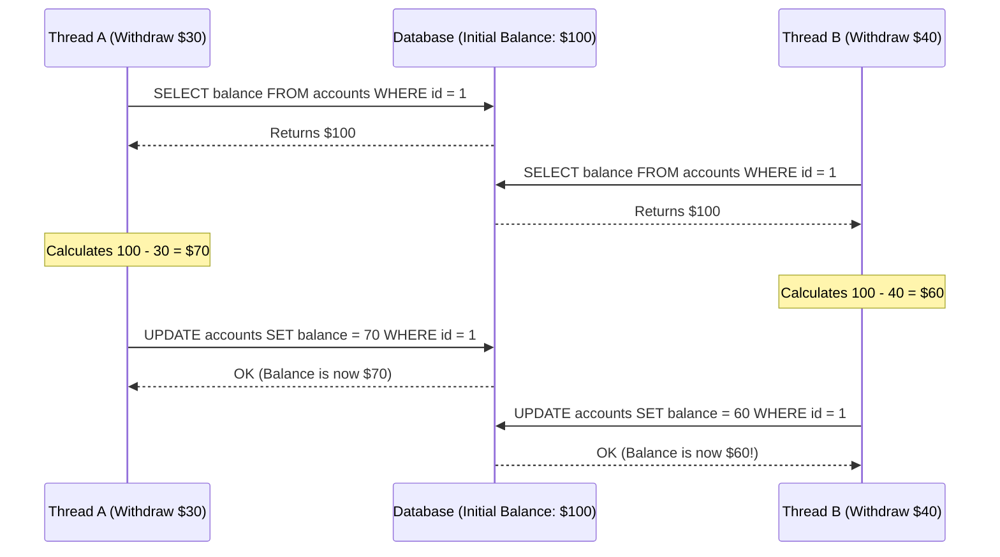
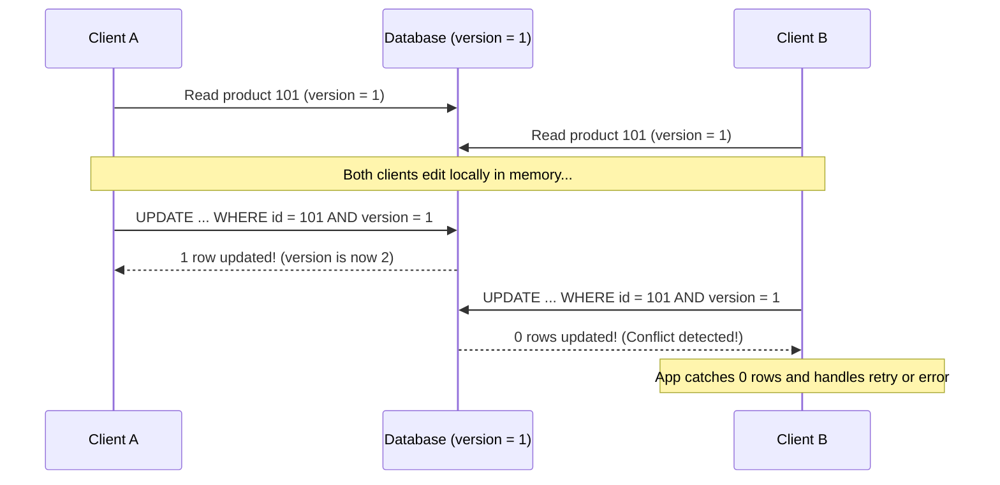
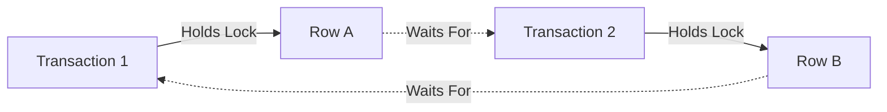
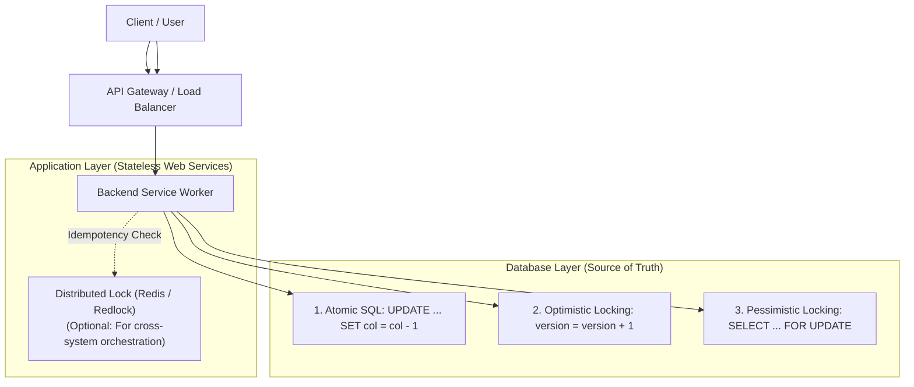

# Chapter 05: Database Concurrency & Locking

> **Core Concept:**
> A database that runs queries one at a time on a single CPU core is simple, but cannot scale. Real-world systems run hundreds or thousands of simultaneous client queries against the same tables, disk pages, and memory buffers. **Database Concurrency** is the science of allowing massive parallel execution while guaranteeing that concurrent readers and writers never corrupt shared data.

---

## Table of Contents
1. [The Challenge: Concurrent Reads and Writes](#1-the-challenge-concurrent-reads-and-writes)
2. [Locking Granularity: Row-Level vs. Table-Level Locking](#2-locking-granularity-row-level-vs-table-level-locking)
3. [Lock Types: Shared (S) vs. Exclusive (X) Locks](#3-lock-types-shared-s-vs-exclusive-x-locks)
4. [Intent Locks and Lock Escalation](#4-intent-locks-and-lock-escalation)
5. [Race Conditions in Applications](#5-race-conditions-in-applications)
6. [Defense 1: Atomic Database Updates](#6-defense-1-atomic-database-updates)
7. [Defense 2: Optimistic Locking with Version Columns](#7-defense-2-optimistic-locking-with-version-columns)
8. [Defense 3: Pessimistic Locking (SELECT FOR UPDATE)](#8-defense-3-pessimistic-locking-select-for-update)
9. [Deadlock Detection, Graphs, and Prevention](#9-deadlock-detection-graphs-and-prevention)
10. [Handling Concurrent Requests Safely: Real-World Architecture](#10-handling-concurrent-requests-safely-real-world-architecture)
11. [Summary & Production Checklist](#11-summary--production-checklist)

---

## 1. The Challenge: Concurrent Reads and Writes

When thousands of users interact with a backend service simultaneously, multiple requests inevitably target the exact same database records at the same instant.

Without explicit concurrency mechanisms, three fundamental conflicts arise:

```
1. Read-While-Write (Dirty / Inconsistent Reads)
   Thread A updates multiple columns of a user profile.
   Thread B reads mid-update, seeing half-new, half-old data.

2. Write-While-Read (Non-Repeatable Reads)
   Thread A reads an account balance to calculate interest.
   Thread B subtracts money and commits before Thread A finishes.

3. Write-While-Write (Lost Updates & Race Conditions)
   Two users purchase the last available seat on a flight at the exact same millisecond.
```

To resolve these conflicts without serializing all traffic through a single thread, databases employ **Locking Mechanisms** and **Concurrency Control Protocols**.

---

## 2. Locking Granularity: Row-Level vs. Table-Level Locking

Locking granularity defines **how much data** gets locked when a statement executes:

```
+-------------------------------------------------------------------------+
| Database Level Lock (Entire DB is locked - e.g. Backup / Restore)      |
+-------------------------------------------------------------------------+
                                    |
                                    v
+-------------------------------------------------------------------------+
| Table Level Lock (All rows in table locked - e.g. DDL / ALTER TABLE)    |
+-------------------------------------------------------------------------+
                                    |
                                    v
+-------------------------------------------------------------------------+
| Page Level Lock (Locks an entire 8 KB / 16 KB page of rows)             |
+-------------------------------------------------------------------------+
                                    |
                                    v
+-------------------------------------------------------------------------+
| Row Level Lock (Tuple Lock - Locks ONLY the specific row modified)     |
+-------------------------------------------------------------------------+
```

### Granularity Trade-Off Matrix

| Granularity | Concurrency Supported | Memory Overhead | Complexity for DBMS | Primary Use Case |
| :--- | :--- | :--- | :--- | :--- |
| **Table-Level** | **Very Low** (Queries serialize) | **Tiny** (1 lock structure in RAM) | Very Simple | DDL operations (`ALTER TABLE`), SQLite writes. |
| **Page-Level** | **Medium** | **Low** | Moderate | Microsoft SQL Server, index leaf rebalancing. |
| **Row-Level** | **Maximum** (Distinct rows update in parallel) | **High** (Millions of row lock structures in RAM) | Complex (Deadlock detection required) | Standard OLTP (`UPDATE ... WHERE id = 1`). |

### How Modern Engines Handle Row Locks
In modern engines like PostgreSQL, row locks are not stored as bloated memory structures inside the database lock manager. Instead:
* PostgreSQL writes the locking transaction ID directly into the row's header (`xmax`) on the physical page.
* This allows PostgreSQL to lock millions of rows simultaneously without running out of RAM in the lock manager.

---

## 3. Lock Types: Shared (S) vs. Exclusive (X) Locks

At the foundation of all database locking are two primary lock modes:

```
+-------------------------------------------------------------------+
| 1. Shared Lock (S-Lock / Read Lock):                              |
|    - Acquired when READING data.                                  |
|    - Multiple transactions can hold Shared Locks simultaneously.  |
|    - "I am reading this. Others may also read, but no one writes."|
+-------------------------------------------------------------------+
                                 vs.
+-------------------------------------------------------------------+
| 2. Exclusive Lock (X-Lock / Write Lock):                          |
|    - Acquired when WRITING (INSERT, UPDATE, DELETE) data.         |
|    - ONLY ONE transaction can hold an Exclusive Lock.             |
|    - "I am modifying this. No one else may read or write."       |
+-------------------------------------------------------------------+
```

### The Lock Compatibility Matrix
The engine's lock manager uses this strict mathematical matrix:

| Requested Lock \ Existing Lock | No Existing Lock | Shared Lock (S) Held | Exclusive Lock (X) Held |
| :--- | :--- | :--- | :--- |
| **Request Shared (S)** | Granted immediately | **Granted** (Shared) | **BLOCKED** (Must wait) |
| **Request Exclusive (X)** | Granted immediately | **BLOCKED** (Must wait) | **BLOCKED** (Must wait) |

* **Shared + Shared = Compatible:** 50 users can read the same row at the same time.
* **Shared + Exclusive = Conflict:** A writer cannot modify a row currently locked by a reader.
* **Exclusive + Exclusive = Conflict:** Two writers cannot touch the same row simultaneously.

---

## 4. Intent Locks and Lock Escalation

### 4.1 The Hierarchical Locking Problem
Suppose Transaction A holds an **Exclusive Row Lock** on row 5,000 of the `orders` table.
Now, Transaction B comes along and executes:
```sql
LOCK TABLE orders IN EXCLUSIVE MODE;
```
How does the database verify whether it is safe to give Transaction B a table lock?
* **Naive Approach:** The engine scans through all 10,000,000 rows in `orders` checking if any single row has a lock. This full table lock check would destroy performance.

### 4.2 Intent Locks (The Shortcut)
To prevent scanning millions of rows, databases use **Intent Locks** at higher levels (table level) before locking a lower level (row level):

* **Intent Shared (IS):** "I intend to acquire Shared Locks on specific rows inside this table."
* **Intent Exclusive (IX):** "I intend to acquire Exclusive Locks on specific rows inside this table."

```
When Transaction A modifies Row 5,000:
1. It acquires an Intent Exclusive (IX) lock on the ORDERS table.
2. It acquires an Exclusive (X) lock on ROW 5,000.

When Transaction B asks for a full table lock:
- It looks ONLY at the table header: "There is an active IX lock on this table!"
- Transaction B immediately blocks without scanning any rows.
```

### 4.3 Lock Escalation (Where Supported)
In systems that store lock descriptors in fixed memory pools (such as **Microsoft SQL Server**):
* If a single transaction updates 50,000 individual rows, the database creates 50,000 separate row lock objects in memory.
* If memory runs low or lock count exceeds a threshold (typically ~5,000 locks), the database triggers **Lock Escalation**: it replaces the 50,000 individual row locks with a **single full table lock**.
* **The Production Impact:** Suddenly, all other concurrent transactions trying to touch unrelated rows in that table are completely blocked!
* **Note on PostgreSQL:** PostgreSQL **does not** escalate row locks to table locks because row locks are recorded inside the tuple headers on disk pages, not in a finite RAM table.

---

## 5. Race Conditions in Applications

The most common database bugs occur when an application reads a value into its local programming memory, performs a calculation in application code, and writes the result back:

```
[ Application Layer ]                    [ Database Layer ]
   1. Read balance ($100)  <------------  balance = $100
   2. Compute 100 - 30 = 70
   3. Write balance ($70)  ------------>  balance = $70
```

This pattern is called **Read-Modify-Write**. When two concurrent requests run this flow simultaneously, a severe **Race Condition** occurs:



* **The Disaster:** Two withdrawals totaling \$70 took place, but the balance dropped from \$100 to \$60. User A's withdrawal was completely erased (**Lost Update**).
* To handle concurrent requests safely, backend engineers rely on three distinct defense patterns.

---

## 6. Defense 1: Atomic Database Updates

The simplest and fastest defense is to **eliminate the read-modify-write cycle entirely** by pushing the calculation directly down into the database engine.

### The Bad Code (Vulnerable to Race Conditions):
```python
# Application memory read
account = db.query("SELECT balance FROM accounts WHERE id = 1")
new_balance = account.balance - 30

# Separate write
db.execute("UPDATE accounts SET balance = :val WHERE id = 1", val=new_balance)
```

### The Safe Code (Atomic In-Database Calculation):
```sql
UPDATE accounts 
SET balance = balance - 30 
WHERE id = 1 AND balance >= 30;
```

```
Why this is 100% thread-safe:
1. The database acquires an Exclusive Row Lock on id=1.
2. The current balance is read directly from the buffer page in RAM.
3. The condition 'balance >= 30' is evaluated atomically.
4. The subtraction executes, and the row is updated.
5. The lock is released.
```
Any concurrent transaction attempting the same update queues up behind the first transaction's lock and executes against the updated balance.

---

## 7. Defense 2: Optimistic Locking with Version Columns

### When to Use
Use Optimistic Locking when:
* Conflicts are **rare** (e.g., editing a user profile, drafting a blog post).
* You want **maximum read throughput** without holding database locks while users think or type.

### How it Works
1. Add an integer `version` column (or timestamp) to your table:
   ```sql
   CREATE TABLE products (
       id BIGSERIAL PRIMARY KEY,
       name VARCHAR(100),
       stock INT NOT NULL,
       version INT NOT NULL DEFAULT 1
   );
   ```
2. When reading the record, fetch both the data and the current `version`:
   ```sql
   SELECT id, stock, version FROM products WHERE id = 101;
   -- Returns: stock = 5, version = 1
   ```
3. When saving modifications, execute an update that requires the version to match:
   ```sql
   UPDATE products
   SET stock = 4, version = version + 1
   WHERE id = 101 AND version = 1;
   ```
4. **Inspect the Rows Affected count returned by the database driver:**
   * **If rows affected == 1:** The update succeeded. No one touched the row in the meantime.
   * **If rows affected == 0:** A conflict occurred! Another user modified and committed the record first (bumping the version to 2). The application catches this condition and either retries or returns a clean conflict message (`409 Conflict`).



---

## 8. Defense 3: Pessimistic Locking (SELECT FOR UPDATE)

### When to Use
Use Pessimistic Locking when:
* Contention is **high** (e.g., ticket booking systems, flash sales, financial balance checks where retries are unacceptable).
* Aborting and retrying (Optimistic Locking) would waste excessive CPU and network bandwidth under high collision rates.

### How it Works: `SELECT ... FOR UPDATE`
When querying the record, you append `FOR UPDATE`. This instructs the database to immediately place an **Exclusive Row Lock** on the returned row:

```sql
BEGIN;

-- 1. Read and exclusively lock the row
SELECT balance FROM accounts 
WHERE id = 42 
FOR UPDATE;

-- Concurrent transactions trying to read id=42 with FOR UPDATE will pause and wait here.

-- 2. Execute business logic safely
UPDATE accounts 
SET balance = balance - 50 
WHERE id = 42;

-- 3. Release the lock
COMMIT;
```

### Non-Blocking Variations: `NOWAIT` and `SKIP LOCKED`

Under heavy load, waiting for locks can cause connection pool starvation. Modern databases provide two essential clauses:

#### 1. `NOWAIT` (Fail Fast)
If the row is already locked by another transaction, do not wait in a queue; abort immediately:
```sql
SELECT balance FROM accounts WHERE id = 42 FOR UPDATE NOWAIT;
-- If locked, immediately throws: ERROR: could not obtain lock on row in relation "accounts"
```

#### 2. `SKIP LOCKED` (High-Throughput Queue Processing)
Ideal for background worker job queues. If 10 background workers query an `orders` queue table, you do not want all 10 workers waiting for the exact same row:
```sql
-- Worker queries and locks the first available unreserved job:
SELECT id, payload 
FROM job_queue 
WHERE status = 'PENDING' 
ORDER BY id ASC 
LIMIT 1 
FOR UPDATE SKIP LOCKED;
```
* Worker 1 locks Job 1.
* Worker 2 runs the exact same query, silently skips locked Job 1, and immediately claims Job 2.
* Zero lock contention or blocking occurs between workers.

---

## 9. Deadlock Detection, Graphs, and Prevention

### What Causes a Deadlock?
A deadlock occurs when two transactions each hold a lock the other needs to complete:

```
Transaction 1: Holds Lock on User A ---> Needs Lock on User B
Transaction 2: Holds Lock on User B ---> Needs Lock on User A
```
Neither transaction can proceed, and neither can release its existing lock.



### Detection: Wait-For Graphs
The database engine runs an internal background thread that periodically inspects active locks:
1. It builds a directed **Wait-For Graph** where nodes are transactions and edges represent lock dependencies ($T_1 \rightarrow T_2$).
2. It runs cycle-detection algorithms (e.g., Depth-First Search).
3. If a cycle is detected, it terminates one transaction (the "victim") with a deadlock error:
   ```text
   ERROR: deadlock detected
   DETAIL: Process 9102 waits for ExclusiveLock on tuple (14, 2); 
           blocked by process 9104.
   ```
4. Rolling back the victim releases its locks, allowing the other transaction to continue.

### Prevention Strategies

1. **Deterministic Lock Ordering (The Universal Solution):**
   * If every transaction locks rows in the exact same order (e.g., always sorted by ascending primary key), **a circular deadlock is mathematically impossible**:
   ```sql
   -- If transferring money between Account 88 and Account 12:
   -- ALWAYS lock smaller ID first, then larger ID:
   SELECT * FROM accounts WHERE id IN (12, 88) ORDER BY id FOR UPDATE;
   ```
2. **Keep Transactions Minimal:**
   * Acquire locks as late as possible inside the transaction block.
   * Never execute external HTTP API calls, image processing, or heavy computation while holding a database lock.
3. **Lock Timeouts:**
   * Always configure lock timeouts on client connections:
   ```sql
   SET lock_timeout = '3s';
   ```

---

## 10. Handling Concurrent Requests Safely: Real-World Architecture

In modern production systems, concurrency control is a coordinated effort across both application services and database engines:



### Concurrency Strategy Decision Flow

```
Is the operation a simple numeric increment/decrement?
├── YES ──> Use ATOMIC SQL: UPDATE items SET count = count - 1 WHERE id = 1;
└── NO
    └── Are write conflicts frequent?
        ├── NO (Read-Heavy / Low Contention)
        │   └──> Use OPTIMISTIC LOCKING with version column.
        └── YES (High Contention / Flash Sale / Booking)
            └──> Use PESSIMISTIC LOCKING: SELECT ... FOR UPDATE (with deterministic ordering).
```

---

## 11. Summary & Production Checklist

Review this checklist when implementing concurrent data operations:

* [ ] **Atomic First:** Attempt to write operations as single-statement atomic queries before introducing explicit locks.
* [ ] **No Read-Modify-Write in App Code:** Never read a value into application memory, calculate in code, and blindly write back without optimistic or pessimistic protection.
* [ ] **Deterministic Lock Ordering:** Multi-row locks are always sorted by primary key (`ORDER BY id ASC FOR UPDATE`) to prevent deadlocks.
* [ ] **Job Queue Worker Optimization:** Background workers querying job queues use `FOR UPDATE SKIP LOCKED` to prevent worker contention.
* [ ] **Lock Timeouts:** `lock_timeout` is explicitly configured on database connections to fail fast rather than stalling connection pools.
* [ ] **Optimistic Versioning on Shared Resources:** Editable entity tables (wikis, settings, documents) include an integer `version` column.

---

⬅️ **[Previous: 4. Transactions & ACID](04_Transactions_And_ACID.md)** | 🏠 **[Back to TOC](README.md)** | **[Next: 6. Database Performance & Optimization ➡️](06_Database_Performance.md)**

