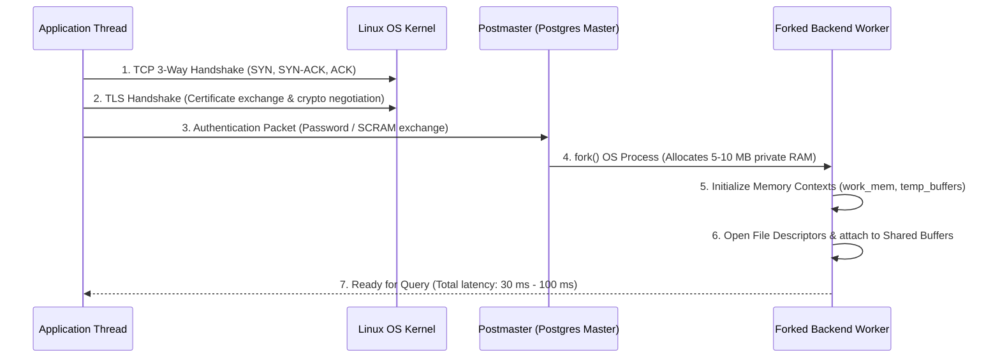
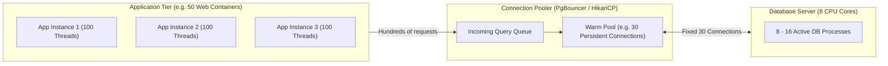
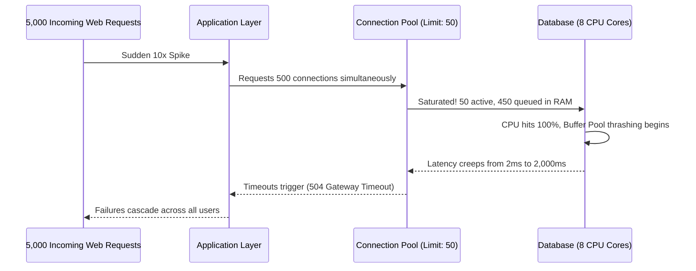

# Chapter 06: Database Performance & Optimization

> **Core Concept:**
> A database does not slow down because it has millions of rows; it slows down when queries exhaust finite physical resources: CPU cores, RAM buffer space, disk I/O bandwidth, and network connection slots. True database performance engineering is the discipline of measuring throughput, eliminating connection overhead, sizing buffer pools, identifying slow queries, and designing bulk batch pipelines to maximize hardware saturation.

---

## Table of Contents
1. [Core Performance Metrics: Latency vs. Throughput](#1-core-performance-metrics-latency-vs-throughput)
2. [Connection Overhead and Process Mechanics](#2-connection-overhead-and-process-mechanics)
3. [Connection Pooling: Architecture and Sizing Formulas](#3-connection-pooling-architecture-and-sizing-formulas)
4. [Database Connection Limits and Saturation](#4-database-connection-limits-and-saturation)
5. [Slow Query Analysis: EXPLAIN, ANALYZE, and Query Profiling](#5-slow-query-analysis-explain-analyze-and-query-profiling)
6. [Cache Hit Ratio and Buffer Pool Health](#6-cache-hit-ratio-and-buffer-pool-health)
7. [System Bottlenecks: CPU, Memory, Disk I/O, and Network](#7-system-bottlenecks-cpu-memory-disk-io-and-network)
8. [Batch Reads and Writes: Eliminating Network Round-Trips](#8-batch-reads-and-writes-eliminating-network-round-trips)
9. [Bulk Data Ingestion: High-Throughput Inserts and Updates](#9-bulk-data-ingestion-high-throughput-inserts-and-updates)
10. [Database Behavior Under Concurrent Traffic Spikes](#10-database-behavior-under-concurrent-traffic-spikes)
11. [Capacity Planning and Benchmarking Methodologies](#11-capacity-planning-and-benchmarking-methodologies)
12. [Performance Master Reference: Comparison & Summary Tables](#12-performance-master-reference-comparison--summary-tables)
13. [Production Checklist](#13-production-checklist)

---

## 1. Core Performance Metrics: Latency vs. Throughput

Every database workload is governed by two complementary metrics:

```
+--------------------------------------------------------------------+
| 1. Latency (Response Time)                                         |
|    - How long does a SINGLE query take to execute from the         |
|      client's perspective?                                         |
|    - Measured in milliseconds (ms) or microseconds (µs).           |
|    - Target: p50 < 2 ms, p95 < 10 ms, p99 < 50 ms.                 |
+--------------------------------------------------------------------+
                                 vs.
+--------------------------------------------------------------------+
| 2. Throughput (Capacity / QPS)                                     |
|    - How many operations can the database complete per unit time?  |
|    - Measured in Queries Per Second (QPS) or Transactions Per      |
|      Second (TPS).                                                 |
|    - Target: Thousands to tens of thousands of QPS per node.       |
+--------------------------------------------------------------------+
```

### The Latency vs. Concurrency Curve (The Saturation Cliff)
As concurrency increases, throughput initially rises linearly while latency remains flat. Eventually, the database hits a physical saturation point (CPU or disk I/O):

```
Throughput (QPS)                             Latency (ms)
      ^                                           ^
      |         /--------\ (Max QPS)              |                      / (Latency Cliff)
      |        /          \                       |                     /
      |       /            \ (Thrashing)          |                    /
      |      /                                    |                   /
      |     /                                     |                  /
      |    /                                      |_________________/ (Normal latency)
      +------------------------->                 +------------------------->
              Active Clients                              Active Clients
```

* **The Saturation Point:** When the number of active queries exceeds available CPU cores or disk I/O queues, queries begin waiting for resources.
* **The Thrashing Phase:** Beyond saturation, throughput actually **drops** while latency spikes exponentially because the OS kernel spends more CPU cycles switching process contexts and resolving memory lock contention than executing queries.

---

## 2. Connection Overhead and Process Mechanics

One of the most frequent causes of database degradation is treating database connections like lightweight HTTP connections.

### What Happens During Connection Creation?
When an application opens a new TCP connection to PostgreSQL:



### The Cost of Establishing a Connection:
1. **Network Latency:** TCP handshake + TLS negotiation takes 2 to 4 network round trips.
2. **CPU & Memory Overhead:** 
   * In PostgreSQL, every connection forks an entire OS process consuming **5 MB to 10 MB** of dedicated RAM.
   * Creating 1,000 direct connections immediately burns **5 GB to 10 GB** of RAM before executing a single query!
3. **Kernel Scheduling Overhead:** The Linux scheduler must juggle 1,000 active processes competing for 8 or 16 CPU cores, causing extreme context-switching overhead.

> **Production Rule:** Never open and close a database connection on every HTTP request. Always maintain a persistent pool of pre-warmed connections.

---

## 3. Connection Pooling: Architecture and Sizing Formulas

A **Connection Pool** sits between your application servers and the database, maintaining a fixed set of long-lived, pre-warmed connections and loaning them out to application threads for milliseconds at a time.



### Types of Pooling
1. **Application-Level Pooler (e.g. HikariCP in Java, SQLAlchemy Pool in Python):**
   * Lives inside the application process memory.
   * Manages connections from that specific app instance to the database.
2. **Infrastructure-Level Pooler (e.g. PgBouncer, ProxySQL):**
   * Sits as an independent proxy between hundreds of application server containers and the database.
   * **Transaction Pooling (PgBouncer):** A connection is only loaned to a client for the duration of a single transaction. As soon as `COMMIT` executes, the connection is instantly recycled for another client, enabling thousands of client containers to share 30-50 actual database connections.

### Sizing the Pool: The Little's Law Sizing Formula
Engineers often mistakenly assume: *"More connections = More performance."* This is false. A database running on an 8-core machine can only physically execute 8 instructions at the exact same nanosecond.

The canonical connection pool sizing formula (developed through PostgreSQL benchmarking and Little's Law) is:

$$\text{Pool Size} = (\text{CPU Cores} \times 2) + \text{Effective Spindle Count (Disk Count)}$$

For a modern server with 16 CPU cores and NVMe SSD storage:

$$\text{Optimal Pool Size} \approx (16 \times 2) + 1 = 33 \text{ connections}$$

* A pool size of **30 to 40 connections** will consistently deliver higher throughput and lower p99 latency than a pool size of 500 connections on the same hardware.

---

## 4. Database Connection Limits and Saturation

Every database server defines a hard connection ceiling:
* In PostgreSQL: `max_connections = 100` (default)
* In MySQL: `max_connections = 151` (default)

### What Happens When Connections Are Saturated?
When traffic spikes and connection pools fill up, one of two things occurs depending on your client configuration:

1. **Connection Rejection (Fail Fast):**
   ```text
   FATAL: remaining connection slots are reserved for non-replication superuser connections
   ```
   The database rejects the request immediately.
2. **Pool Queue Saturation (Cascading Latency):**
   * Applications wait for an available pool slot. If the pool timeout is set to 30 seconds, application threads freeze, web servers run out of HTTP worker threads, and the entire backend platform cascades into an outage.

### Production Connection Protections:
* **Set Pool Timeouts Aggressively:** In HikariCP, set `connectionTimeout = 250ms`. If no connection is free within 250 ms, fail fast rather than stalling application threads.
* **Reserve Administrative Connections:** Always keep `superuser_reserved_connections = 3` so engineers can SSH into the database and diagnose issues even when the server is 100% saturated.

---

## 5. Slow Query Analysis: EXPLAIN, ANALYZE, and Query Profiling

When query latency degrades, guessing the cause is counterproductive. Databases provide built-in execution profilers that show exactly what the storage engine did.

### 5.1 Using EXPLAIN and EXPLAIN ANALYZE
* **`EXPLAIN`:** Runs the query through the optimizer and prints the **estimated** execution plan without running the query.
* **`EXPLAIN ANALYZE`:** Actually **executes** the query, tracking real execution times, buffer page reads, and row counts.

```sql
EXPLAIN (ANALYZE, BUFFERS) 
SELECT * FROM orders WHERE customer_id = 91204;
```

```text
Bitmap Heap Scan on orders  (cost=4.32..120.45 rows=35 width=128) 
                            (actual time=0.082..0.312 rows=40 loops=1)
  Recheck Cond: (customer_id = 91204)
  Buffers: shared hit=8 read=2
  ->  Bitmap Index Scan on idx_orders_customer_id  (cost=0.00..4.31 rows=35 width=0)
                                                   (actual time=0.041..0.041 rows=40 loops=1)
        Index Cond: (customer_id = 91204)
        Buffers: shared hit=2
Planning Time: 0.125 ms
Execution Time: 0.354 ms
```

### How to Read the Execution Plan:
1. **Node Types:**
   * **Seq Scan (Sequential Scan):** Scanned every page in the table from start to finish. Good for tiny tables; terrible for multi-million row tables.
   * **Index Scan:** Traversed the B+ Tree to find the exact tuple pointers and fetched rows directly from disk/RAM.
   * **Index Only Scan:** The query's requested columns were completely covered by the index itself. The engine never had to visit the heap table pages at all (**fastest possible read**).
2. **Buffers Output:**
   * `shared hit=8`: 8 pages (64 KB) were found directly in RAM (Buffer Pool).
   * `shared read=2`: 2 pages (16 KB) had to be physically read from disk.
3. **Rows Estimation Error:**
   * If `rows=35` (estimated) differs drastically from `actual rows=400,000`, your database statistics are out of date. Run `ANALYZE orders;` to refresh planner statistics.

### 5.2 Enabling Automated Slow Query Logging
Never wait for users to report slow queries. Configure the engine to log slow queries automatically:

```ini
# postgresql.conf
log_min_duration_statement = 200 # Log any query taking longer than 200 ms
shared_preload_libraries = 'pg_stat_statements'
```

Using `pg_stat_statements`, you can query the exact queries consuming the most cumulative time across your database:

```sql
SELECT query, calls, total_exec_time, mean_exec_time 
FROM pg_stat_statements 
ORDER BY total_exec_time DESC 
LIMIT 5;
```

---

## 6. Cache Hit Ratio and Buffer Pool Health

In Chapter 03, we learned that the **Buffer Pool** caches database pages in RAM. A database's performance is largely dictated by how often it avoids touching the physical disk.

### The Cache Hit Ratio Metric
The **Cache Hit Ratio** represents the percentage of page requests fulfilled directly from RAM without issuing disk I/O:

$$\text{Cache Hit Ratio} = \frac{\text{Heap Reads from RAM}}{\text{Heap Reads from RAM} + \text{Disk Reads}}$$

### Querying the Cache Hit Ratio in PostgreSQL:
```sql
SELECT 
    sum(heap_blks_hit) / (sum(heap_blks_hit) + sum(heap_blks_read)) AS cache_hit_ratio
FROM pg_statio_user_tables;
```

### Production Thresholds:
* **Target for OLTP Systems:** **> 99%**
* **Warning Sign:** If the cache hit ratio drops below **95%**, your active data working set has outgrown your RAM buffer pool. The database is forced to perform random disk seeks for ordinary queries, causing latency to spike.
* **Resolution:** Increase `shared_buffers` / `innodb_buffer_pool_size`, or add a caching layer (Redis) in front of the database.

---

## 7. System Bottlenecks: CPU, Memory, Disk I/O, and Network

When diagnosing a struggling database, map symptoms directly to hardware resource limits:

```
+---------------+-------------------------------------+-------------------------------------+
| Bottleneck    | Key Metrics to Inspect              | Root Causes                         |
+---------------+-------------------------------------+-------------------------------------+
| **CPU**       | %usr, %sys (top / htop), load avg   | Missing indexes (Seq Scans), heavy  |
|               | exceeding CPU core count.           | aggregations, hash joins, high QPS. |
+---------------+-------------------------------------+-------------------------------------+
| **Memory**    | Buffer hit ratio < 95%, high swap   | Buffer pool undersized, excessive   |
|               | activity (vmstat), OOM killer.      | work_mem per connection.            |
+---------------+-------------------------------------+-------------------------------------+
| **Disk I/O**  | %util (iostat -xz 1), await > 5 ms, | Checkpoints flushing dirty pages,   |
|               | disk queue length (avgqu-sz).       | sequential table scans, slow WAL.   |
+---------------+-------------------------------------+-------------------------------------+
| **Network**   | Bandwidth saturation, TCP retrans,  | Fetching massive payloads (SELECT *),|
|               | connection dropouts.                | uncompressed large JSON/Blobs.      |
+---------------+-------------------------------------+-------------------------------------+
```

---

## 8. Batch Reads and Writes: Eliminating Network Round-Trips

A common architectural mistake is executing multiple simple queries in a loop:

### The Anti-Pattern: N Queries in a Loop (The N+1 Problem)
```python
# 1,000 separate network round-trips!
for user_id in user_ids:
    db.execute("SELECT * FROM users WHERE id = :id", id=user_id)
```
* If network latency between app and DB is **1 ms**, executing 1,000 queries sequentially takes **1,000 ms (1 full second)** purely in wire round-trip time, even if each query takes 0.01 ms on the database engine.

### The Fix: Batching Queries
```sql
-- Exactly 1 network round-trip!
SELECT * FROM users WHERE id IN (101, 102, 103, ...);
```

### Batching Inserts
Similarly, avoid individual single-row inserts:
```sql
-- Bad: 3 separate network round-trips and 3 WAL commits
INSERT INTO logs (msg) VALUES ('Event 1');
INSERT INTO logs (msg) VALUES ('Event 2');
INSERT INTO logs (msg) VALUES ('Event 3');

-- Good: 1 network round-trip and 1 atomic WAL commit
INSERT INTO logs (msg) VALUES 
    ('Event 1'),
    ('Event 2'),
    ('Event 3');
```

---

## 9. Bulk Data Ingestion: High-Throughput Inserts and Updates

When inserting hundreds of thousands or millions of records (e.g. data imports, migrations), standard SQL `INSERT` statements are too slow.

```
+-------------------------------------------------------------------------+
| Standard INSERT: ~1,000 - 3,000 rows/sec                                |
| - SQL parsed and planned per statement.                                 |
| - Transaction overhead and WAL flush per statement.                     |
+-------------------------------------------------------------------------+
                                    vs.
+-------------------------------------------------------------------------+
| Bulk COPY / Load: ~100,000 - 300,000 rows/sec                           |
| - Bypasses SQL parser; streams raw binary tuples directly into pages.   |
| - Single transaction boundary; minimal WAL logging.                     |
+-------------------------------------------------------------------------+
```

### High-Throughput Ingestion Techniques:
1. **Use Streaming Bulk APIs (`COPY` in PostgreSQL):**
   * Bypasses the SQL parser and execution planner entirely, streaming raw CSV or binary records directly into disk pages:
     ```sql
     COPY users (id, name, email) FROM '/data/users.csv' WITH (FORMAT csv);
     ```
2. **Temporarily Drop Indexes and Foreign Keys:**
   * Each inserted row requires updating every single B+ Tree on the table.
   * For massive loads: Drop secondary indexes $\rightarrow$ Execute bulk insert $\rightarrow$ Re-create indexes in parallel (`CREATE INDEX`). Building an index once over sorted, populated data is significantly faster than updating an index millions of times incrementally.
3. **Tune `maintenance_work_mem`:**
   * Allocate more RAM (e.g. 1 GB - 2 GB) for index rebuilding and vacuuming during ingestion scripts.

---

## 10. Database Behavior Under Concurrent Traffic Spikes

When an unexpected traffic surge hits (e.g. Black Friday or breaking news), an unprotected database undergoes a known failure cascade:



### How to Protect the Database:
1. **Queue Before the Database:** Use an asynchronous message queue (e.g. Kafka, RabbitMQ) to buffer write surges. The database processes writes at its own optimal throughput rather than being overwhelmed.
2. **Read Replica Offloading:** Route high-volume, read-only traffic to Read Replicas, preserving the primary database's CPU and memory for writes.
3. **Circuit Breakers:** Implement circuit breakers in backend code. If the database latency exceeds 500 ms for 5 consecutive seconds, fail gracefully or serve cached stale data instead of piling more queries into the queue.

---

## 11. Capacity Planning and Benchmarking Methodologies

Capacity planning is the process of predicting when database hardware will saturate and scaling before outages occur.

### Step-by-Step Benchmarking Methodology:
1. **Never Benchmark Against Production Directly:** Replicate production data scale and hardware in a staging environment.
2. **Use Standardized Load Generation Tools:**
   * **`pgbench`:** The standard benchmarking utility for PostgreSQL, executing concurrent TPC-B transaction scenarios:
     ```bash
     # Initialize a benchmark scale factor of 100 (~10 million rows)
     pgbench -i -s 100 my_database

     # Run a 60-second test with 50 concurrent clients across 4 threads
     pgbench -c 50 -j 4 -T 60 my_database
     ```
   * **`sysbench`:** The industry standard for MySQL and multi-database OLTP benchmarking.
3. **Determine the Maximum Knee of the Curve:**
   * Test with 10, 20, 50, 100, 200, and 500 concurrent connections.
   * Identify the exact client concurrency where throughput peaks before latency degrades. Configure your connection pool max limits to match that peak.

---

---

## 12. Performance Master Reference: Comparison & Summary Tables

To quickly diagnose issues and select appropriate performance optimizations, use these comprehensive reference matrices:

### 12.1 Query Execution Nodes Comparison
Understanding what the query execution engine does under the hood determines how to optimize slow queries:

| Scan / Plan Node | Physical Mechanics | Disk/RAM I/O Profile | Best Used For | Risk / Warning |
| :--- | :--- | :--- | :--- | :--- |
| **Sequential Scan (Seq Scan)** | Reads every physical page in heap from start to finish. | Maximum sequential I/O; can evict hot pages from buffer pool. | Small tables (< 1,000 rows), or reading > 20% of all table rows. | Catastrophic on large tables (`O(N)` scans). |
| **Index Scan** | Navigates B+ Tree to find pointer, then fetches row from heap page. | Random read I/O (B+ Tree page + heap page lookup). | Point lookups (`WHERE id = 42`) and small range scans. | High random I/O if returning thousands of non-contiguous rows. |
| **Index Only Scan** | Fetches all requested columns directly from B+ Tree leaf; skips heap. | Lowest possible I/O; 100% covered by index in RAM/disk. | Covered queries (`SELECT id, status` where both are indexed). | Requires table heap visibility map to be clean (`VACUUM`). |
| **Bitmap Index Scan** | Scans index, builds bitmap of page IDs in RAM, then reads pages in physical order. | Converts random I/O into sequential disk reads. | Queries matching hundreds of rows across multiple combined indexes. | Memory overhead if `work_mem` is too small to hold the bitmap. |

---

### 12.2 Ingestion & Mutation Throughput Comparison
How different data modification strategies perform when inserting 100,000 records:

| Ingestion Strategy | Network Round-Trips | Transaction / WAL Cost | Estimated Throughput | Recommended Use Case |
| :--- | :--- | :--- | :--- | :--- |
| **Single-Row INSERTs in Loop** | 100,000 round-trips | 100,000 individual transactions and WAL flushes | 500 – 1,500 rows/sec | **Never use in production** for bulk operations. |
| **Single-Row INSERTs in 1 Transaction** | 100,000 round-trips | 1 transaction; continuous WAL append | 3,000 – 8,000 rows/sec | Legacy application constraints. |
| **Multi-Row Batch INSERT (1,000/batch)** | 100 round-trips | 100 batch transactions; low WAL overhead | 25,000 – 60,000 rows/sec | Standard OLTP bulk writes from web backend. |
| **Streaming COPY / LOAD DATA** | 1 streaming connection | Bypasses SQL parser; streams binary pages | 100,000 – 300,000+ rows/sec | Data migrations, ETL pipelines, CSV imports. |

---

### 12.3 Connection Architectures Comparison
Selecting the right connection management strategy:

| Metric / Dimension | Raw Unpooled Connections | Application Pooler (HikariCP) | Infrastructure Proxy (PgBouncer) |
| :--- | :--- | :--- | :--- |
| **Connection Overhead** | Extreme (TCP + TLS + fork per request) | Low (Reuses connections per app instance) | Near Zero (Centralized multiplexing) |
| **Memory Cost** | High (5–10 MB per connection in Postgres) | Moderate (Fixed pool per container) | Minimal (Multiplexes 5,000 clients to 30 DB slots) |
| **Scaling Capability** | Fails at ~200 – 300 connections | Scales up to app container limits | Scales to 10,000+ concurrent app clients |
| **Transaction Pooling** | No | No (Session-level only) | **Yes** (Recycles connection on `COMMIT`) |
| **Best Suited For** | Local development only | Monoliths or small container counts (2–10) | Microservices, Kubernetes auto-scaling clusters |

---

### 12.4 System Bottleneck Quick-Diagnosis Matrix
When database alerts fire, map the primary symptom directly to root causes and fixes:

| Bottleneck | Key Monitoring Metric | Primary Root Causes | Immediate Engineering Fix |
| :--- | :--- | :--- | :--- |
| **CPU Saturation** | CPU utilization > 85%, High Load Avg | Missing index causing Sequential Scans; heavy regex/aggregations. | Inspect `pg_stat_statements`, add missing B+ Tree indexes, kill runaway queries. |
| **Memory / Buffer Exhaustion** | Cache Hit Ratio < 95%, High Disk Reads | Working set exceeds Buffer Pool; `shared_buffers` undersized. | Increase database RAM buffer pool; introduce Redis caching tier for hot reads. |
| **Disk I/O Wait** | `%util` = 100%, `await` > 5 ms (iostat) | Unchecked checkpoint flushes; slow WAL disk; massive analytical table scans. | Tune checkpoint intervals; isolate WAL onto dedicated NVMe SSD storage; add read replicas. |
| **Connection Saturation** | `FATAL: remaining connection slots reserved` | Unpooled client connections; microservice auto-scaling surge; slow queries holding pool slots. | Deploy PgBouncer in transaction mode; lower `connectionTimeout`; enforce statement timeouts. |

---

## 13. Production Checklist

Review this checklist to maintain high database performance:

* [ ] **Connection Pool in Place:** Applications connect via a properly sized pool (e.g. HikariCP or PgBouncer), never via unpooled raw connections.
* [ ] **Optimal Pool Sizing:** Pool sizes are calculated based on CPU core counts and disk latency, not arbitrary large numbers: $(\text{CPU Cores} \times 2) + \text{Spindle Count}$.
* [ ] **Slow Query Logging Active:** `log_min_duration_statement` and `pg_stat_statements` are enabled to track query regressions.
* [ ] **Cache Hit Ratio Monitored:** Buffer pool cache hit ratio is monitored continuously and maintained above 99%.
* [ ] **Batch Queries Used:** Loops over queries are replaced with `IN (...)` or multi-row `INSERT` statements.
* [ ] **Indexes on Foreign Keys & Filters:** Columns used in `WHERE`, `JOIN`, and `ORDER BY` clauses are verified with `EXPLAIN (ANALYZE, BUFFERS)`.
* [ ] **Connection and Statement Timeouts Set:** All applications specify connection timeouts (e.g. 250 ms) and statement timeouts (e.g. 2000 ms) to prevent runaway queries from blocking database worker threads.

---

⬅️ **[Previous: 5. Database Concurrency & Locking](05_Database_Concurrency_And_Locking.md)** | 🏠 **[Back to TOC](README.md)** | **[Next: 7. Replication & Read Scaling ➡️](07_Replication_And_Read_Scaling.md)**

