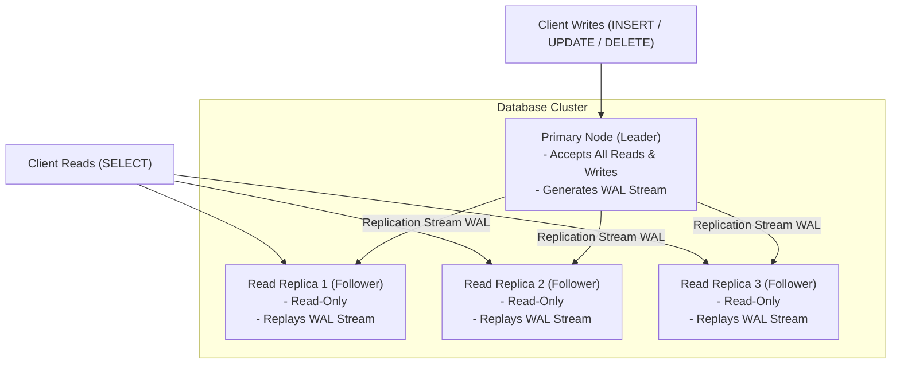
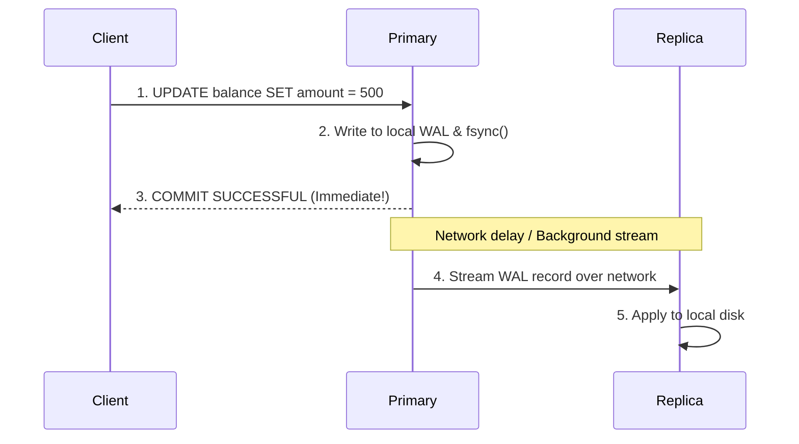
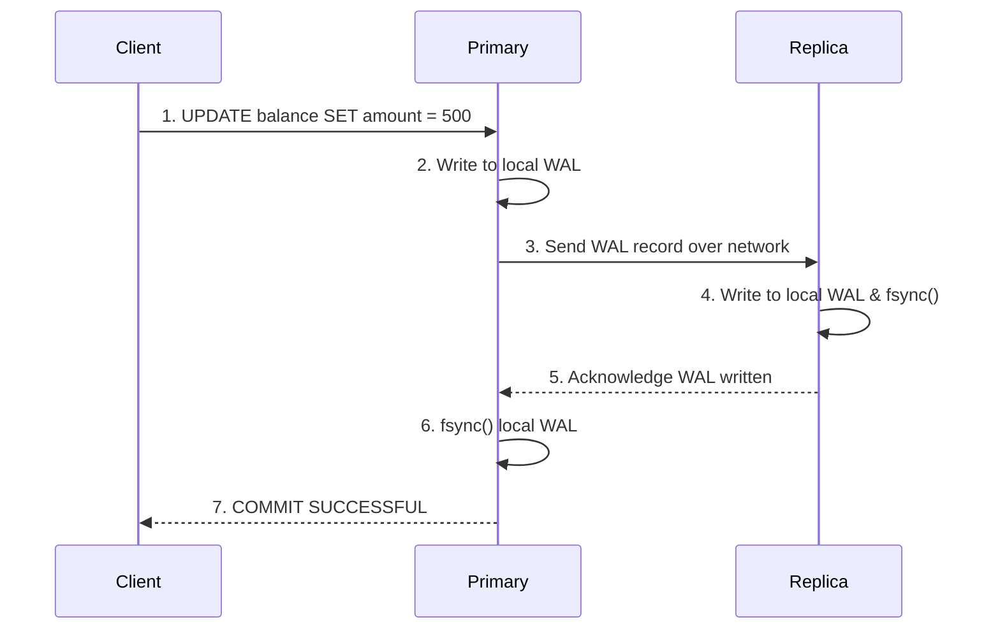
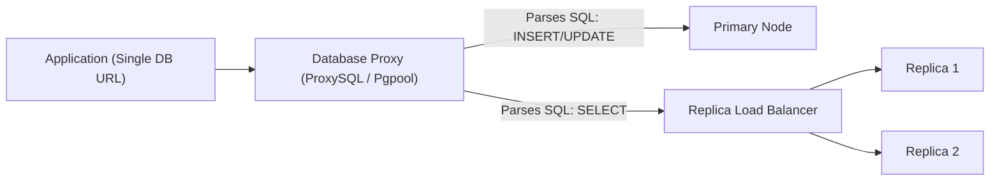
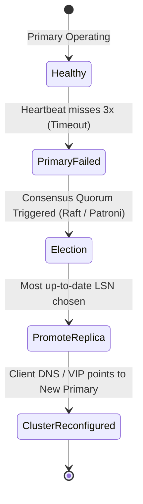

# Chapter 07: Replication & Read Scaling

> **Core Concept:**
> A single database server has two fundamental limits: a hardware ceiling (CPU, RAM, disk I/O) and a single point of failure (if the server hardware burns, the business is offline). **Replication** is the foundational distributed systems technique of copying data across multiple independent physical machines to achieve fault tolerance, high availability, and horizontal read scaling.

---

## Table of Contents

1. [Why Replication is Needed: Availability vs. Scale](#1-why-replication-is-needed-availability-vs-scale)
2. [Primary-Replica Architecture (Leader-Follower)](#2-primary-replica-architecture-leader-follower)
3. [Synchronous vs. Asynchronous Replication](#3-synchronous-vs-asynchronous-replication)
4. [Replication Lag: Physical Causes and Measurements](#4-replication-lag-physical-causes-and-measurements)
5. [Read Scaling and Read Replicas](#5-read-scaling-and-read-replicas)
6. [Read/Write Splitting: Application and Proxy Topologies](#6-readwrite-splitting-application-and-proxy-topologies)
7. [Replica Consistency Anomalies and Mitigations](#7-replica-consistency-anomalies-and-mitigations)
8. [Replication Failure, Recovery, and Catch-Up](#8-replication-failure-recovery-and-catch-up)
9. [Automated Failover, Health Checks, and Consensus](#9-automated-failover-health-checks-and-consensus)
10. [The Split-Brain Problem and Fencing Mechanisms](#10-the-split-brain-problem-and-fencing-mechanisms)
11. [Replication Master Reference: Pros, Cons, and Failure Modes](#11-replication-master-reference-pros-cons-and-failure-modes)
12. [Production Checklist](#12-production-checklist)

---

## 1. Why Replication is Needed: Availability vs. Scale

In production engineering, replication serves two completely different purposes that must never be confused:

```
+--------------------------------------------------------------------+
| 1. High Availability (HA) & Disaster Recovery                      |
|    - Goal: Prevent downtime and eliminate Single Points of Failure |
|      (SPOF).                                                       |
|    - If the primary database crashes, a replica can be promoted    |
|      to primary in seconds without losing committed data.          |
+--------------------------------------------------------------------+
                                 and
+--------------------------------------------------------------------+
| 2. Read Scaling (Horizontal Throughput)                            |
|    - Goal: Relieve CPU and memory pressure on the primary.         |
|    - Most web platforms have a 95:5 or 99:1 read-to-write ratio.   |
|      Distributing read queries across 5 replicas multiplies read   |
|      capacity by 5x.                                               |
+--------------------------------------------------------------------+
```

> **Crucial Invariant:** Replication is **not** a backup strategy! If an engineer runs `DROP TABLE users;` on the primary, that drop statement is replicated to all replicas within milliseconds. You still need point-in-time recovery (PITR) and cold snapshots.

---

## 2. Primary-Replica Architecture (Leader-Follower)

The most widely deployed replication model in relational databases (PostgreSQL, MySQL, SQLite Litestream, Oracle) is **Primary-Replica** (also known as Leader-Follower or Master-Slave).



### The Core Invariants:

1. **Single Source of Truth for Writes:** All mutations (`INSERT`, `UPDATE`, `DELETE`, DDL) **must** go exclusively to the Primary. This eliminates multi-master write conflicts.
2. **Replicas are Strictly Read-Only:** Replicas reject any write attempts.
3. **The Synchronization Pipe:** The primary does not send high-level SQL queries to replicas. Instead, it streams raw binary **Write-Ahead Log (WAL)** records (in Postgres) or **Binlogs** (in MySQL). The replicas run a continuous recovery process, applying those exact byte-level changes to their local disk pages.

---

## 3. Synchronous vs. Asynchronous Replication

How long does a client have to wait when issuing a `COMMIT`? The answer depends entirely on the replication synchronization mode.

```
+-------------------------------------------------------------------------+
| Asynchronous Replication: Fast writes, risk of data loss on crash       |
+-------------------------------------------------------------------------+
| Synchronous Replication: Slower writes, zero data loss guarantee        |
+-------------------------------------------------------------------------+
| Semi-Synchronous Replication: Best of both worlds (Industry Standard)   |
+-------------------------------------------------------------------------+
```

### 3.1 Asynchronous Replication

The primary writes changes to its local WAL, issues `fsync`, confirms `COMMIT OK` to the client immediately, and streams the log records to replicas in the background.



- **Advantage:** Blazing fast commit times. Client latency is completely isolated from replica network hiccups or slow disks.
- **The Fatal Flaw:** If the primary crashes at Step 3 before streaming the record to the replica, and the replica is promoted to primary, **that committed transaction is permanently lost** (RPO > 0).

---

### 3.2 Synchronous Replication

The primary writes to its local WAL, but **stalls the client** and waits until at least one replica confirms that it has received and written the log record to its own disk.



- **Advantage:** **Zero data loss (RPO = 0).** If the primary dies, the replica is guaranteed to hold every committed transaction.
- **The Fatal Flaw:** Every write operation is bottlenecked by the network round-trip time (RTT) between the primary and the replica. If the replica experiences a disk pause or network partition, **all writes on the primary freeze!**

---

### 3.3 Semi-Synchronous Replication (The Production Standard)

To avoid freezing if a replica dies while still preventing data loss:

- You configure a cluster of 3 or 5 nodes.
- The primary waits for acknowledgment from **at least 1 replica** (or a quorum $N/2 + 1$) before confirming the commit.
- If a secondary replica dies, the cluster continues operating smoothly without stalling.

---

## 4. Replication Lag: Physical Causes and Measurements

In asynchronous and semi-synchronous setups, replicas are almost never 100% in sync with the primary. The time difference or byte difference between the primary and the replica is called **Replication Lag**.

```
Primary Current LSN: 0/16B3040  (Byte position on Primary)
Replica Replayed LSN: 0/16A1000  (Byte position on Replica)
-----------------------------------------------------------
Replication Lag in Bytes: 74,816 bytes behind
Replication Lag in Time:  ~250 milliseconds behind
```

### The 4 Physical Causes of Replication Lag:

1. **Network Congestion:** Saturation of the network pipe between primary and replica data centers.
2. **I/O Contention on the Replica:** A heavy reporting query on the replica (e.g. `SELECT count(*) FROM orders`) consumes 100% of the replica's disk I/O, preventing the WAL replay worker from writing incoming changes to disk pages.
3. **Single-Threaded Replay Bottleneck:** Historically, database engines applied replication logs using a single recovery thread. Even if the primary used 64 CPU cores to generate writes, a single-threaded replica replay process could never keep up. Modern engines (PostgreSQL and MySQL 8.0) use parallel worker threads to replay logs across independent tables/schemas.
4. **Large Transactions:** If a transaction updates 5,000,000 rows in a single batch, the primary writes this giant log chunk. The replica cannot apply it incrementally; it must process the entire massive block, causing a visible lag spike.

---

## 5. Read Scaling and Read Replicas

Because read replicas maintain an up-to-date copy of data, they can handle `SELECT` traffic that would otherwise overwhelm the primary.

```
Total Traffic: 10,000 QPS
├── Writes:    500 QPS  ──> Routed to Primary
└── Reads:   9,500 QPS  ──> Distributed evenly across 5 Read Replicas (1,900 QPS each)
```

### The Limits of Read Scaling (The Diminishing Returns Trap)

Beginners often ask: _"Why can't we scale to 100,000 writes/sec by just adding 100 read replicas?"_

- **Read Replicas do NOT scale writes!**
- Every single write that occurs on the primary must be transmitted to and replayed by **every single replica**.
- Adding more replicas increases the primary's network bandwidth overhead (broadcasting WAL streams to 20 nodes).
- To scale writes, you must **Shard / Partition** the database (covered in Chapter 08), not add read replicas.

---

## 6. Read/Write Splitting: Application and Proxy Topologies

How does client traffic know which queries go to the Primary and which go to the Replicas?

### 6.1 Application-Level Routing (Dual Datasources)

The application code maintains two distinct database connection pools:

```python
class UserRepository:
    def __init__(self, write_pool, read_pool):
        self.write_pool = write_pool # Points to Primary
        self.read_pool = read_pool   # Points to Replica Load Balancer

    def update_email(self, user_id, email):
        with self.write_pool.get_connection() as conn:
            conn.execute("UPDATE users SET email = :email WHERE id = :id", email=email, id=user_id)

    def get_user(self, user_id):
        with self.read_pool.get_connection() as conn:
            return conn.execute("SELECT * FROM users WHERE id = :id", id=user_id)
```

- **Pros:** Complete control over query placement.
- **Cons:** Application developers must manually decide which pool to use for every endpoint.

---

### 6.2 Proxy-Level Routing (Transparent Middleware)

A database proxy (such as **ProxySQL** for MySQL or **pgpool-II** for PostgreSQL) sits between application servers and the database cluster:



- **How it Works:** The proxy inspects the first token of the SQL query. If it begins with `SELECT`, it forwards to a replica. If it begins with `INSERT`, `UPDATE`, `DELETE`, or `BEGIN`, it pins the connection to the primary.

---

## 7. Replica Consistency Anomalies and Mitigations

Because replication lag is physically inevitable in asynchronous clusters, reading from replicas introduces severe distributed consistency anomalies:

### 7.1 The "Read-Your-Own-Writes" Anomaly

- **Scenario:** A user updates their profile name from "Alice" to "Alicia". The web app sends the `UPDATE` to the primary. The page refreshes immediately, and the browser issues a `SELECT` that hits a replica lagging by 500 ms.
- **The User Experience:** The user sees their name revert to "Alice"! They click save 5 more times thinking the app is broken.

```
Time   User Action        Backend Target           Data State
-----------------------------------------------------------------------
T1     Click Save         Primary (UPDATE)         name = 'Alicia' (Committed)
T2     Page Reload        Replica (Lag = 500ms)    name = 'Alice'  (Old data!)
```

### Solutions for Read-Your-Own-Writes:

1. **Sticky Routing (User Pinned to Primary Post-Write):**
   - When a user performs a write, store a timestamp or flag in their session cookie / Redis: `last_write_timestamp = NOW()`.
   - For the next **5 to 10 seconds**, route **all** reads for that specific user directly to the Primary.
   - After 10 seconds (exceeding maximum expected replication lag), route reads back to the replicas.
2. **Read Critical Data from Primary:**
   - Financial balances, checkout flows, and authentication checks should always read from the primary.
   - Product catalogs, public blog posts, and analytics feeds can safely read from lagging replicas.

---

### 7.2 The Monotonic Read Anomaly (Time-Traveling Reads)

- **Scenario:** A user refreshes a page twice.
  - Request 1 hits **Replica 1** (Lag = 10 ms). The user sees a new comment.
  - Request 2 hits **Replica 2** (Lag = 800 ms). The comment suddenly vanishes!
- **The User Experience:** Data appears to travel backward in time.
- **Solution:** Use **Sticky Sessions** on the replica load balancer (e.g. hash the user's ID to always route that user to the same replica).

---

## 8. Replication Failure, Recovery, and Catch-Up

What happens when a node in the cluster fails?

### 8.1 Replica Crash and Catch-Up

If a read replica crashes or reboots:

1. The primary continues serving writes and appending records to its WAL.
2. The primary maintains a **Replication Slot** for that replica, tracking the last LSN the replica acknowledged.
3. The primary **retains** WAL segments on disk instead of recycling them.
4. When the replica comes back online, it reconnects, presents its last known LSN, and streams the missing WAL segments sequentially until it catches up.

> **Production Warning (Replication Slot Disk Exhaustion):** If a replica crashes and stays offline for days, the primary will retain WAL files indefinitely to allow it to catch up. Eventually, the primary's disk fills to 100%, causing the primary database to crash! Always configure `max_slot_wal_keep_size` in PostgreSQL to drop dead replicas before disk space is exhausted.

---

## 9. Automated Failover, Health Checks, and Consensus

When the Primary database hardware physically dies, the cluster must promote a healthy replica to become the new Primary.



### The Failover Steps:

1. **Health Detection:** Orchestrators (e.g. **Patroni**, **Orchestrator**, or cloud managers like AWS RDS Aurora) send periodic heartbeats (every 1 second) to the primary.
2. **Failure Confirmation:** If the primary misses 3 consecutive heartbeats, it is declared dead.
3. **Primary Election:** The orchestrators consult a distributed consensus store (**etcd**, **Consul**, or **ZooKeeper**) to pick the replica with the highest Log Sequence Number (the least lag).
4. **Promotion:** The chosen replica exits recovery mode and executes `pg_promote()`, opening itself for writes.
5. **Traffic Redirection:** Virtual IPs (VIP), DNS records, or proxy routing tables are reconfigured to direct all write traffic to the newly promoted primary.

---

## 10. The Split-Brain Problem and Fencing Mechanisms

The most dangerous failure mode in distributed database architecture is **Split-Brain**.

### How Split-Brain Happens:

Imagine a network partition cuts the connection between Data Center 1 (where the Primary lives) and Data Center 2 (where the Replicas live):

```
       [ Data Center 1 ]                      [ Data Center 2 ]
  +------------------------+             +------------------------+
  | Primary Node           |             | Replica 1              |
  | (Still alive, serving  |    NETWORK  | (Thinks Primary is dead|
  | local DC1 clients)     |   PARTITION |  promotes itself to    |
  |                        |    <=====>  |  NEW PRIMARY!)         |
  +------------------------+             +------------------------+
```

- **The Disaster:** You now have **two primary nodes** accepting conflicting writes simultaneously!
- When the network heals, you have two diverging datasets with conflicting primary keys. Merging them automatically is impossible, resulting in permanent data corruption.

### The Solution: Quorum and Node Fencing (STONITH)

#### 1. Majority Quorum ($N/2 + 1$)

A node can only declare itself the new primary if it can communicate with a strict **majority** of the cluster nodes (using consensus algorithms like Raft or Paxos).

- In a 3-node cluster: Majority = 2.
- If DC1 has 1 node and DC2 has 2 nodes, only DC2 can form a quorum and elect a leader. DC1 isolates itself.

#### 2. Node Fencing (STONITH - "Shoot The Other Node In The Head")

Before a replica promotes itself to primary, it must guarantee the old primary is dead:

- **Hardware Fencing:** Send a command to the old primary's remote power distribution unit (IPMI / iLO) to literally cut the power.
- **Network Fencing:** Revoke the old primary's network routes or storage volume access via cloud API calls.

---

---

## 11. Replication Master Reference: Pros, Cons, and Failure Modes

To make sound architectural decisions, engineers must understand not just what replication modes exist, but **why we choose them, what tradeoffs we accept, and how they fail in production**.

### 11.1 Replication Modes: Deep Pros, Cons & Tradeoffs

| Replication Mode | Why We Do This (Core Motivation) | Major Advantages (Pros) | Major Drawbacks (Cons) | Production Failure Modes & Pitfalls |
| :--- | :--- | :--- | :--- | :--- |
| **Asynchronous Replication** | Maximum write performance and decoupling primary write latency from network fluctuations. | - Blazing fast `COMMIT` latency.<br/>- Primary never blocks if replicas die or network drops.<br/>- Works seamlessly over WAN / cross-region links. | - **Data Loss Risk:** Committed transactions on primary not yet replicated to standby will be lost forever if primary crashes (RPO > 0).<br/>- Inevitable replication lag. | - **Silent Failover Data Loss:** Standby promoted after a crash is missing recent orders/payments.<br/>- **Stale Reads:** Users see old data right after page refresh. |
| **Synchronous Replication** | Absolute zero data loss requirement (RPO = 0) for financial and mission-critical state. | - Guaranteed exact consistency.<br/>- Every promoted replica is 100% up-to-date.<br/>- Eliminates data divergence. | - Every write is penalized by round-trip network latency (RTT).<br/>- **Availability Danger:** If the synchronous replica hangs or loses connectivity, **all writes on the primary freeze**. | - **Network Flap Cascading Outage:** Minor packet loss between primary and replica causes app write queues to fill up, exhausting connection pools. |
| **Semi-Synchronous Replication** | The pragmatic compromise: ensure at least one standby holds the data without freezing on single-node failure. | - Prevents data loss if primary dies.<br/>- Does not block if secondary replicas die, as long as 1 node acknowledges. | - Write latency still bounded by the fastest replica's network round-trip.<br/>- Requires at least 3 nodes to maintain a safe quorum. | - **Timeout Fallback Trap:** Many engines (e.g. MySQL) fall back to asynchronous mode after a timeout, silently re-introducing data loss risks. |

---

### 11.2 Read/Write Splitting Topologies: Architecture Comparison

| Routing Architecture | How It Operates | Advantages (Pros) | Drawbacks & Operational Costs (Cons) | What Can Go Wrong in Production |
| :--- | :--- | :--- | :--- | :--- |
| **Application-Level Routing** (Dual Connection Pools) | App code explicitly picks `write_pool` or `read_pool` per repository method. | - Fine-grained granular control.<br/>- Zero extra network proxy hops (sub-millisecond overhead).<br/>- No middleware to maintain. | - Puts cognitive burden on developers.<br/>- High risk of human error (e.g. executing an `UPDATE` in read pool).<br/>- Connection counts multiplied across all app instances. | - **Transaction Scope Leaks:** Starting a transaction on `write_pool` but running a sub-query on `read_pool` seeing an outdated snapshot. |
| **Proxy-Based Routing** (ProxySQL / pgpool-II) | Dedicated proxy sits between app and DB, inspecting SQL strings to route `SELECT` vs mutations. | - Completely transparent to application code.<br/>- Centralized connection pooling and query rewriting.<br/>- Automatic failover redirection. | - Adds an extra network hop (~0.5 – 1 ms latency).<br/>- Complex stateful proxy to configure and monitor.<br/>- Can misroute queries containing side-effects (e.g. `SELECT nextval(...)`). | - **Session Variable Desync:** `SET timezone` or temporary tables created on proxy connection don't exist when next query routes to replica. |

---

### 11.3 Top 5 Production Replication Failure Modes

When managing replicated databases in high-traffic environments, watch out for these recurring production hazards:

```
+----------------------------------------------------------------------------------------------------+
| 1. The Replication Slot Disk-Full Cascade (Disk Bloat)                                             |
|    - Why it happens: A read replica crashes or disconnects. The primary's replication slot        |
|      faithfully retains WAL files on disk so the replica can resume.                              |
|    - The disaster: Primary's disk fills to 100%. The primary crashes and refuses to restart!       |
|    - Prevention: Always configure 'max_slot_wal_keep_size' (e.g. 50 GB) in PostgreSQL.            |
+----------------------------------------------------------------------------------------------------+
| 2. Replay Lag Death Spiral                                                                         |
|    - Why it happens: A replica runs a long-running analytical query (`SELECT count(*)`).           |
|      This locks tables or consumes 100% disk I/O. The WAL replay worker falls behind.              |
|    - The disaster: Lag grows from 10 ms to 45 minutes. Stale reads break user workflows.           |
|    - Prevention: Enable 'hot_standby_feedback' with query cancellation timeouts, or isolate        |
|      analytics onto a dedicated offline replica.                                                   |
+----------------------------------------------------------------------------------------------------+
| 3. Split-Brain Two-Leader Disaster                                                                 |
|    - Why it happens: Transient network partition between primary and standby. Standby assumes     |
|      primary is dead and promotes itself. Primary is still alive serving clients.                  |
|    - The disaster: Conflicting writes occur on both nodes. Data diverges irrecoverably.            |
|    - Prevention: Use strict 3-node consensus quorum (Raft/Patroni) and STONITH fencing.            |
+----------------------------------------------------------------------------------------------------+
| 4. Failover Storm / Connection Stampede                                                            |
|    - Why it happens: Primary crashes. 50 app containers lose connections simultaneously and all    |
|      reconnect to the new primary at the exact same millisecond.                                   |
|    - The disaster: New primary crashes immediately under connection flood (TCP / fork overhead).   |
|    - Prevention: Use PgBouncer in front of DB and exponential backoff with jitter in app retries. |
+----------------------------------------------------------------------------------------------------+
| 5. Schema Migration Replay Delay                                                                   |
|    - Why it happens: An `ALTER TABLE` statement runs on the primary and acquires an exclusive      |
|      lock. When replayed on replicas, it blocks all concurrent read queries.                       |
|    - The disaster: Read traffic on all replicas queues up and times out.                           |
|    - Prevention: Use lock timeouts, concurrent index builds, and non-blocking migration patterns.  |
+----------------------------------------------------------------------------------------------------+
```

---

## 12. Production Checklist

Review this checklist before architecting a replicated database cluster:

- [ ] **Semi-Sync for Zero Data Loss:** High-value systems (payments, auth) use semi-synchronous replication with at least 1 synchronous standby.
- [ ] **Read-Your-Own-Writes Protection:** Implement session-based pinning to the primary for 5-10 seconds after user writes.
- [ ] **Replication Slot Limits:** Configure `max_slot_wal_keep_size` to prevent offline replicas from exhausting primary disk space.
- [ ] **Monitoring Replication Lag:** Set alerts on replication lag in bytes and time (alert if lag > 5 seconds).
- [ ] **Quorum-Based Consensus:** Automated failover is governed by an odd number of consensus nodes (minimum 3 nodes via etcd/Patroni) to prevent split-brain.
- [ ] **Separate HA from Backups:** Do not rely on read replicas as a disaster recovery substitute for point-in-time recovery (PITR) backups.

---

⬅️ **[Previous: 6. Database Performance & Optimization](06_Database_Performance.md)** | 🏠 **[Back to TOC](README.md)** | **[Next: 8. Sharding & Partitioning ➡️](08_Partitioning_And_Sharding.md)**
