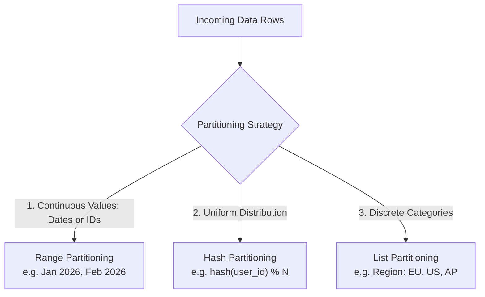
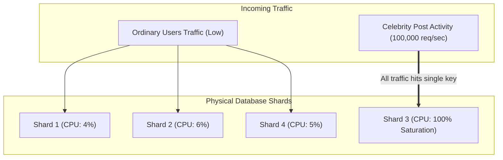
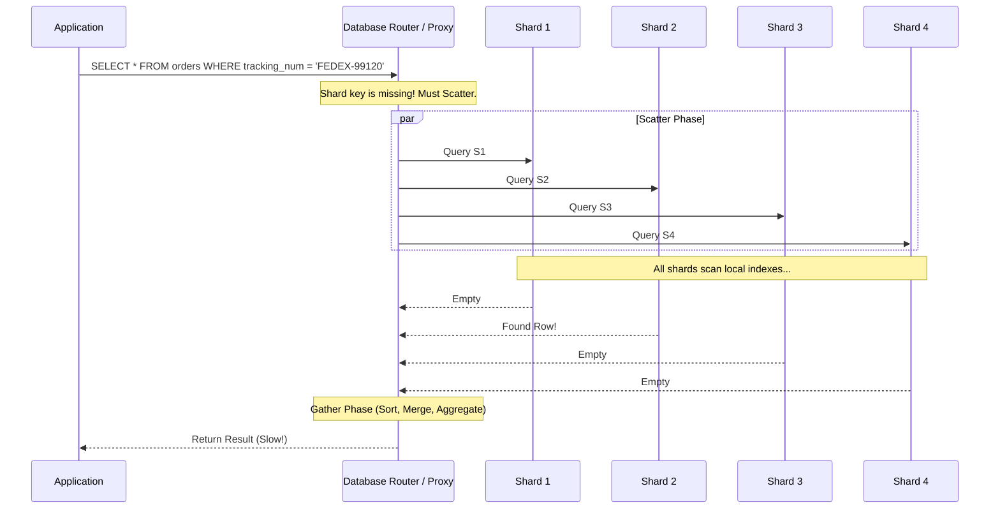
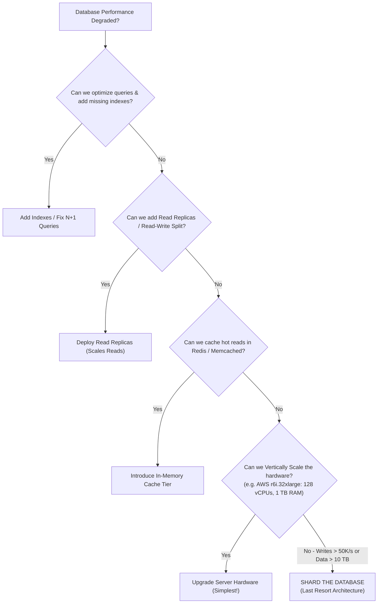

# Chapter 08: Sharding & Partitioning

> **Core Concept:**
> In Chapter 07, we proved that Read Replicas scale read throughput, but **cannot scale write throughput or total storage capacity**. When a single table grows to hundreds of millions of rows, B+ Tree indexes exceed available RAM, and write IOPS saturate the fastest NVMe SSDs. **Partitioning and Sharding** are the techniques used to break massive monolithic datasets into smaller, manageable subsets distributed across disk files or multiple physical database nodes.

---

## Table of Contents
1. [Partitioning vs. Sharding: The Crucial Architectural Difference](#1-partitioning-vs-sharding-the-crucial-architectural-difference)
2. [Vertical vs. Horizontal Partitioning](#2-vertical-vs-horizontal-partitioning)
3. [Partitioning Strategies: Range, Hash, and List](#3-partitioning-strategies-range-hash-and-list)
4. [What is a Shard Key?](#4-what-is-a-shard-key)
5. [Choosing the Right Shard Key: The Cardinality & Uniformity Rule](#5-choosing-the-right-shard-key-the-cardinality--uniformity-rule)
6. [Hot Partitions and Hotspots (The Celebrity Problem)](#6-hot-partitions-and-hotspots-the-celebrity-problem)
7. [Cross-Shard Queries, Scatter-Gather, and Distributed Joins](#7-cross-shard-queries-scatter-gather-and-distributed-joins)
8. [Rebalancing Shards: Consistent Hashing and Virtual Nodes](#8-rebalancing-shards-consistent-hashing-and-virtual-nodes)
9. [Resharding and Zero-Downtime Live Data Migration](#9-resharding-and-zero-downtime-live-data-migration)
10. [The Engineering Reality: When Sharding is Actually Necessary](#10-the-engineering-reality-when-sharding-is-actually-necessary)
11. [Summary & Production Checklist](#11-summary--production-checklist)

---

## 1. Partitioning vs. Sharding: The Crucial Architectural Difference

Engineers often use these terms interchangeably, but they represent two completely different architectural tiers:

```
+------------------------------------+------------------------------------+
| Partitioning (Table Partitioning)  | Sharding (Horizontal Partitioning) |
+------------------------------------+------------------------------------+
| Single Database Instance           | Multiple Physical Database Servers |
| Split across internal disk files   | Split across independent servers   |
| Engine manages routing natively    | Routing handled by Proxy or App    |
| Solves: Table bloat, vacuum, drops | Solves: Write IOPS, RAM, Disk Cap  |
+------------------------------------+------------------------------------+
```

### 1.1 Partitioning (Single Instance)
A single PostgreSQL or MySQL server takes a massive table (e.g. `orders` with 500 million rows) and divides it physically into smaller internal tables (partitions) based on a rule (e.g. 1 partition per month).
* **The Application View:** The application still connects to a single database server and queries `orders`.
* **The Storage View:** The database engine transparently routes reads and writes to specific underlying files (`orders_2026_01`, `orders_2026_02`).

### 1.2 Sharding (Multi-Node Distributed Architecture)
Data is divided horizontally across **multiple distinct, autonomous database servers** (shards), each with its own dedicated CPU, RAM, and storage.
* **The Storage View:** Shard 1 holds Users 1–10M on Server A. Shard 2 holds Users 10M–20M on Server B.
* **The Scaling Vector:** Scales both **storage volume and write throughput linearly**.

---

## 2. Vertical vs. Horizontal Partitioning

```
Original Table: Users
+----+----------+---------------------+-------------------------------+
| ID | Username | Email               | Profile_Bio_And_Large_Blob    |
+----+----------+---------------------+-------------------------------+
| 1  | alice    | alice@example.com   | [ 10 KB Text & Binary Data ]  |
| 2  | bob      | bob@example.com     | [ 15 KB Text & Binary Data ]  |
+----+----------+---------------------+-------------------------------+

                       |
                       +-------------------+
                       |                   |
                       v                   v
Vertical Partitioning (Split Columns)   Horizontal Partitioning (Split Rows)
Table 1: User_Core (Hot Cache)          Shard 1: Users (ID 1 - 100,000)
+----+----------+-------------------+   +----+----------+-------------------+
| ID | Username | Email             |   | ID | Username | Email             |
+----+----------+-------------------+   +----+----------+-------------------+
| 1  | alice    | alice@example.com |   | 1  | alice    | alice@example.com |
+----+----------+-------------------+   +----+----------+-------------------+
                                        Shard 2: Users (ID 100,001 - 200,000)
Table 2: User_Profile (Cold Disk)       +----+----------+-------------------+
+----+------------------------------+   | ID | Username | Email             |
| ID | Profile_Bio_And_Large_Blob   |   +----+----------+-------------------+
+----+------------------------------+   | 2  | bob      | bob@example.com   |
| 1  | [ 10 KB Text & Binary Data ] |   +----+----------+-------------------+
+----+------------------------------+
```

### 2.1 Vertical Partitioning (Column Splitting)
* **Strategy:** Split a wide table with 40 columns into two narrower tables by moving rarely used, large columns (e.g. `bio`, `profile_photo_blob`, `json_metadata`) to a separate auxiliary table.
* **Why it Works:** Narrower tables mean more rows fit on a single 8 KB database page. The **Buffer Pool** holds significantly more hot rows in memory, drastically improving cache hit ratios for common queries.

### 2.2 Horizontal Partitioning (Row Splitting)
* **Strategy:** The schema remains identical, but rows are distributed across different partitions or nodes based on a routing rule.

---

## 3. Partitioning Strategies: Range, Hash, and List

When dividing rows, engines rely on three primary partitioning mathematical strategies:



### 3.1 Range Partitioning
Rows are assigned to partitions based on whether a column value falls within a contiguous range (most commonly dates or numeric ranges).

```sql
-- PostgreSQL Declarative Range Partitioning
CREATE TABLE orders (
    order_id BIGSERIAL,
    customer_id BIGINT NOT NULL,
    order_date DATE NOT NULL,
    total_amount NUMERIC(10, 2)
) PARTITION BY RANGE (order_date);

-- Child Partition Tables
CREATE TABLE orders_2026_q1 PARTITION OF orders
    FOR VALUES FROM ('2026-01-01') TO ('2026-04-01');

CREATE TABLE orders_2026_q2 PARTITION OF orders
    FOR VALUES FROM ('2026-04-01') TO ('2026-07-01');
```

* **Superpower: Partition Pruning:** When executing `WHERE order_date = '2026-02-14'`, the query planner instantly skips all partitions except `orders_2026_q1`.
* **Superpower: Instant Data Dropping:** Deleting 50 million old rows via `DELETE FROM orders WHERE order_date < '2025-01-01'` writes massive WAL logs and causes severe table bloat. With range partitions, you drop years of old data in **0.001 seconds** with zero WAL overhead:

```sql
DROP TABLE orders_2025_q1;
```

---

### 3.2 Hash Partitioning
A hash function is applied to the key (e.g. `MurmurHash3(user_id) % ShardCount`).

```sql
CREATE TABLE users (
    user_id UUID PRIMARY KEY,
    email VARCHAR(255)
) PARTITION BY HASH (user_id);

CREATE TABLE users_part_0 PARTITION OF users FOR VALUES WITH (MODULUS 4, REMAINDER 0);
CREATE TABLE users_part_1 PARTITION OF users FOR VALUES WITH (MODULUS 4, REMAINDER 1);
CREATE TABLE users_part_2 PARTITION OF users FOR VALUES WITH (MODULUS 4, REMAINDER 2);
CREATE TABLE users_part_3 PARTITION OF users FOR VALUES WITH (MODULUS 4, REMAINDER 3);
```

* **Advantage:** Provides an extremely uniform, random spread of rows across nodes.
* **Disadvantage:** Destroys range scans! To query `WHERE user_id BETWEEN 10 AND 50`, you must query every single partition.

---

### 3.3 List Partitioning
Assigns rows to partitions explicitly based on a set of discrete values:

```sql
CREATE TABLE customers (
    id BIGSERIAL,
    country_code VARCHAR(2) NOT NULL,
    name VARCHAR(100)
) PARTITION BY LIST (country_code);

CREATE TABLE customers_eu PARTITION OF customers FOR VALUES IN ('DE', 'FR', 'IT', 'ES');
CREATE TABLE customers_na PARTITION OF customers FOR VALUES IN ('US', 'CA', 'MX');
```
* **Primary Use Case:** Data residency and compliance (GDPR requirements mandating that EU citizen data physically resides in European data centers).

---

## 4. What is a Shard Key?

In a distributed sharded database, the **Shard Key** is the specific column (or composite set of columns) used by the database routing logic to decide which physical server stores a given row.

```
Incoming Request:
INSERT INTO accounts (account_id, company_id, balance) VALUES (918, 42, 500);
                                  ^
                                  | Shard Key: company_id = 42
                                  v
                Router: hash(42) % 3 = Server 2
                                  |
                                  v
                        [ Store on Server 2 ]
```

---

## 5. Choosing the Right Shard Key: The Cardinality & Uniformity Rule

Choosing a shard key is the single most consequential decision in distributed database design. Once a multi-terabyte database is sharded by a key, changing that shard key requires a painful, multi-week live migration.

### The 3 Golden Criteria for a Shard Key:
1. **High Cardinality:** The key must have millions of distinct values. Sharding by `gender` (cardinality: 2) or `account_status` (cardinality: 5) will leave you with only 2 or 5 usable shards.
2. **Uniform Distribution (Write Volume & Storage):** The key must spread write operations and byte volume evenly across all machines.
3. **Query Access Alignment:** The vast majority of application queries **must** filter by this shard key so queries can be routed directly to a single shard (**Single-Shard Query**).

### Real-World Evaluation: E-Commerce Multi-Tenant Platform

| Proposed Shard Key | Cardinality | Uniformity | Query Alignment | Verdict |
| :--- | :--- | :--- | :--- | :--- |
| `country_code` | Very Low (~200) | Terrible (80% traffic in US) | Poor | **DO NOT USE** (Instant Hotspot) |
| `created_at` | High (Milliseconds)| Terrible (All writes hit latest day) | Good for logs only | **DO NOT USE for OLTP** (Write Hotspot)|
| `tenant_id / store_id`| High (Millions) | Good (Except giant enterprises) | Excellent (Tenants query own data)| **RECOMMENDED for B2B SaaS** |
| `user_id` | Very High (100M+) | Excellent (Uniform hash) | Excellent for consumer B2C | **RECOMMENDED for B2C Platforms**|

---

## 6. Hot Partitions and Hotspots (The Celebrity Problem)

Even with a high-cardinality shard key, a system can suffer catastrophic imbalance known as a **Hotspot** (or the "Celebrity / Justin Bieber Problem").

### What Happens:
* Suppose you shard a social media platform by `author_id`.
* User 9102 has 40 followers. Writes and reads for User 9102 are tiny.
* User 1042 is a celebrity with 85,000,000 followers.
* When the celebrity posts a message, millions of users like and comment within 30 seconds.
* **The Disaster:** **Shard 3** (hosting the celebrity's ID) hits 100% CPU, exhausts disk I/O, and crashes, while Shard 1, Shard 2, and Shard 4 sit completely idle at 5% utilization!



### How to Mitigate Hotspots:
1. **Compound Shard Key (Salting):**
   * Append a pseudo-random suffix or timestamp hash to the hot key:
     $$\text{Routing Key} = \text{author\_id} + \text{"\_"} + (\text{random}(1, 10))$$
   * The celebrity's posts and interactions are spread across 10 distinct shards rather than suffocating one.
2. **Dedicated Shards for Super-Tenants:**
   * In enterprise B2B SaaS, detect massive mega-customers (e.g. Walmart, Apple) and isolate them onto their own dedicated physical database cluster.

---

## 7. Cross-Shard Queries, Scatter-Gather, and Distributed Joins

When a query specifies the shard key, routing is trivial:

```sql
-- Single-Shard Targeted Query (Fast: 1 network hop, ~2 ms)
SELECT * FROM orders WHERE customer_id = 90124;
```
The router hashes `90124`, identifies that it lives on Shard 2, and forwards the query directly to Shard 2.

### The Problem: Cross-Shard Queries (Scatter-Gather)
What happens if a query **does not** include the shard key?

```sql
-- Cross-Shard Query! Where does this live?
SELECT * FROM orders WHERE tracking_number = 'FEDEX-99120';
```
Because the database is sharded by `customer_id`, the database router has no idea which server holds that tracking number. It has no choice but to execute **Scatter-Gather**:



* **Latency Impact:** The query latency is equal to the **slowest responding shard** in the entire cluster (tail latency penalty). If one shard is experiencing a CPU spike or disk flush, the entire query blocks.
* **Distributed Joins are Impossible:** You cannot run `JOIN products ON ...` across two tables if they are sharded on different keys across different physical servers without streaming gigabytes of raw data over the network to a central coordinator.

### Production Solution: Global Secondary Indexes (Lookup Tables)
Maintain a small, dedicated lookup table (or key-value cache like Redis):
$$\text{tracking\_number} \longrightarrow \text{customer\_id (Shard Key)}$$
1. App queries lookup table: `'FEDEX-99120'` $\rightarrow$ `customer_id: 90124`.
2. App queries database directly using the shard key: `WHERE customer_id = 90124`.

---

## 8. Rebalancing Shards: Consistent Hashing and Virtual Nodes

Suppose your cluster has 4 shards, and you use basic modulo routing:

$$\text{Shard} = \text{hash}(\text{key}) \pmod 4$$

Now your database runs out of disk space, and you add a 5th shard:

$$\text{Shard} = \text{hash}(\text{key}) \pmod 5$$

* **The Disaster of Modulo Hashing:** Changing the divisor from 4 to 5 changes the result for **almost every single key in the database**. Over **80% of all data** must immediately be moved across the network to different servers!

### The Solution: Consistent Hashing
Consistent Hashing maps both **Database Shards** and **Data Keys** to a circular $360^\circ$ hash ring ($0$ to $2^{32} - 1$):

```
                       Hash Ring (0 to 2^32 - 1)
                              [ Shard A ]
                             /           \
                            /   (Key 1)   \
                           /       *       \
                 [ Shard D ]               [ Shard B ]
                           \               /
                            \   (Key 2)   /
                             \     *     /
                              [ Shard C ]
```

* **Placement Rule:** To store a key, hash the key to a position on the ring. Walk clockwise until you hit the first shard node.
* **Adding a Node:** When **Shard E** is added between Shard A and Shard B, **only the keys between A and E need to move**. The rest of the cluster remains completely untouched! Only $1/N$ of the total keys migrate.

### Virtual Nodes (vnodes)
To prevent physical shards from receiving unequal portions of the ring, each physical machine is assigned **100 to 250 Virtual Nodes** scattered uniformly across the ring (used extensively in Apache Cassandra and DynamoDB).

---

## 9. Resharding and Zero-Downtime Live Data Migration

Migrating petabytes of live user data from 4 shards to 8 shards without taking application downtime requires an **orchestrated dual-write migration pipeline**:

```
Step 1: SPIN UP NEW SHARDS
Provision the 8 target shards alongside the existing 4 source shards.

Step 2: DUAL WRITE
Application writes (INSERT/UPDATE/DELETE) are sent to BOTH the old shards 
and the new shards. (New shards ignore missing historical rows on update).

Step 3: HISTORICAL BACKFILL
Background worker processes batch-copy historical data from old shards 
to new shards without overwriting newer records.

Step 4: DATA VALIDATION & RECONCILIATION
Continuous background comparison stream checks checksums between old and new shards.

Step 5: SWITCH READS
Route all application read traffic to the new 8 shards.

Step 6: CUT OFF OLD WRITES
Stop writing to old shards and decommission the 4 old servers.
```

---

## 10. The Engineering Reality: When Sharding is Actually Necessary

> **Senior Architect Rule:**
> **Do not shard your database until you have exhausted every other architectural alternative.**

Sharding introduces massive operational complexity:
* Distributed cross-shard transactions require Two-Phase Commit (2PC) protocols, which tank throughput.
* Foreign key constraints across shards cannot be enforced by the database engine.
* Schema migrations must be orchestrated across dozens of distinct nodes simultaneously.
* Debugging production issues becomes exponentially more difficult.



### The Thresholds: When You Truly Need Sharding
1. **Write IOPS Saturation:** Your primary database is on the largest physical instance available, and sustained write throughput exceeds what local NVMe drives can persist.
2. **Data Storage Limits:** Table size exceeds 5 to 10 Terabytes, making backups, index rebuilds, and `VACUUM` operations unmanageable on a single volume.

---

## 11. Summary & Production Checklist

Review this checklist before implementing a sharded database:

* [ ] **High Cardinality Shard Key:** Ensure the shard key has millions of distinct values (e.g. `user_id` or `tenant_id`).
* [ ] **Hotspot Protection:** High-volume celebrity keys are salted or isolated on dedicated clusters.
* [ ] **Query Routing Layer:** Queries include the shard key to avoid expensive Scatter-Gather scans across all nodes.
* [ ] **Consistent Hashing Used:** Key-to-shard mapping uses consistent hashing with virtual nodes to minimize data movement during cluster expansion.
* [ ] **No Cross-Shard Transactions:** Application workflows avoid requiring multi-record atomic transactions that span physical shards.
* [ ] **Exhausted Scale-Up:** Vertical hardware scaling, caching tiers, read replicas, and single-node partitioning were benchmarked before committing to distributed sharding.

---

⬅️ **[Previous: 7. Replication & Read Scaling](07_Replication_And_Read_Scaling.md)** | 🏠 **[Back to TOC](README.md)** | **[Next: 9. Database Reliability & Recovery ➡️](09_Database_Reliability_And_Recovery.md)**

