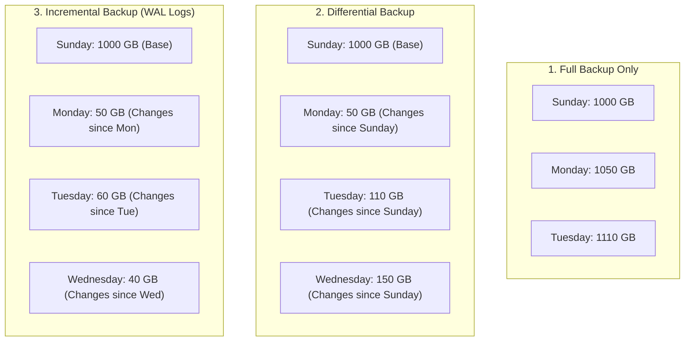
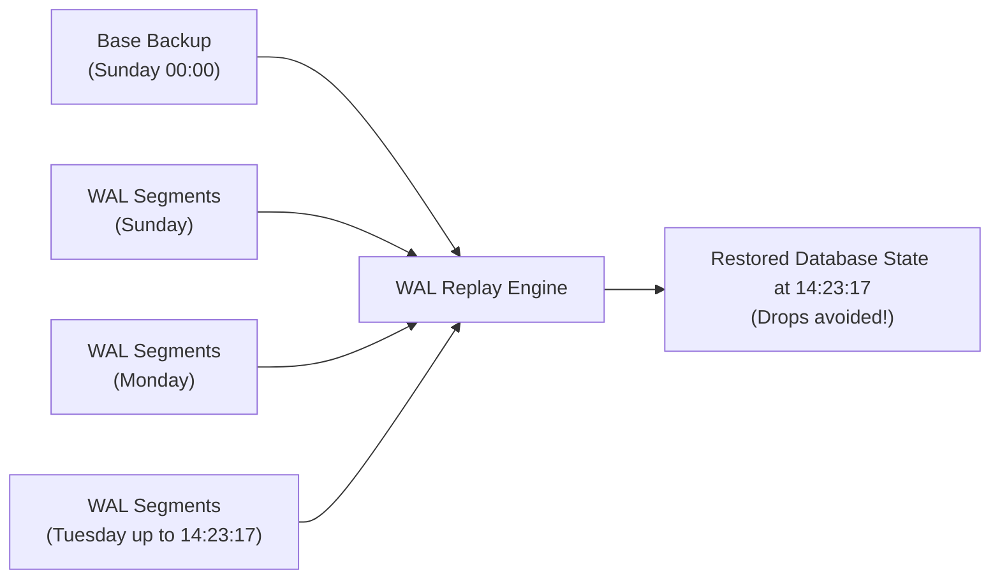
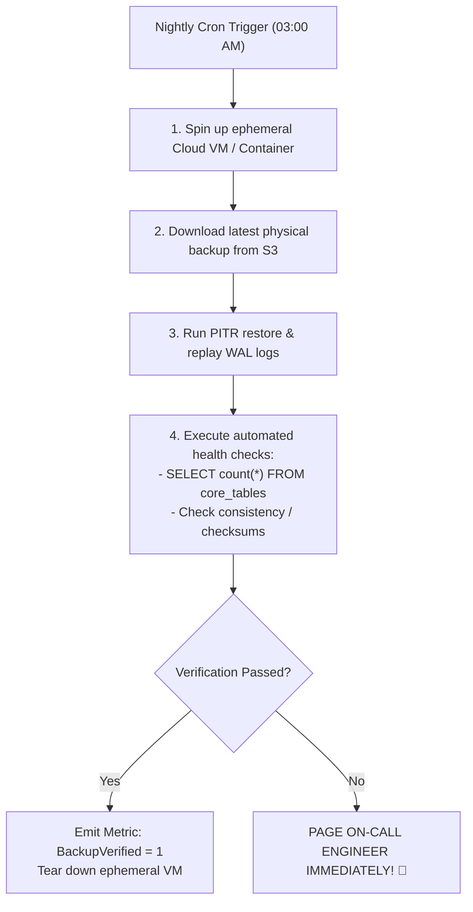

# Chapter 09: Database Reliability, Backups & Disaster Recovery

> **Core Concept:**
> In distributed systems, hardware failures, fiber cuts, datacenter fires, and human errors (accidental drops) are mathematical certainties over a long enough time horizon. A database system is only as reliable as its tested ability to survive catastrophe. **Database Reliability** is the engineering discipline of designing systems around explicit recovery objectives (RPO/RTO), automating failovers, and verifying that every byte of data can be restored to any second in history.

---

## Table of Contents
1. [The Two Recovery Metrics: RPO and RTO](#1-the-two-recovery-metrics-rpo-and-rto)
2. [High Availability (HA) vs. Disaster Recovery (DR)](#2-high-availability-ha-vs-disaster-recovery-dr)
3. [Replication vs. Backups: The Fatal Confusion](#3-replication-vs-backups-the-fatal-confusion)
4. [Backup Types: Full, Differential, and Incremental](#4-backup-types-full-differential-and-incremental)
5. [Physical vs. Logical Backups](#5-physical-vs-logical-backups)
6. [Point-in-Time Recovery (PITR) and Continuous WAL Archiving](#6-point-in-time-recovery-pitr-and-continuous-wal-archiving)
7. [The Untested Backup Trap: Automated Restore Verification](#7-the-untested-backup-trap-automated-restore-verification)
8. [Automated Failover and Primary Election Architecture](#8-automated-failover-and-primary-election-architecture)
9. [Data Corruption: Bit Rot, Torn Pages, and Checksums](#9-data-corruption-bit-rot-torn-pages-and-checksums)
10. [Blast Radius Mitigation: Availability-Zone vs. Multi-Region Failures](#10-blast-radius-mitigation-availability-zone-vs-multi-region-failures)
11. [Summary & Production Checklist](#11-summary--production-checklist)

---

## 1. The Two Recovery Metrics: RPO and RTO

Every business and engineering decision regarding database reliability is defined by two fundamental Service Level Objectives (SLOs):

```
Time ---------------------------------------------------------------------------------------->
               |                              |                                |
        Last Usable Backup             DISASTER STRIKES!              System Fully Restored
               |<---------------------------->|<------------------------------>|
                 Recovery Point Objective        Recovery Time Objective
                         (RPO)                           (RTO)
                  "How much data can              "How long can the
                    we afford to lose?"             business be down?"
```

### 1.1 Recovery Point Objective (RPO)
* **Definition:** The maximum acceptable amount of data loss measured backward in time from the moment of disaster.
* **Question Answered:** *"If the database is destroyed right now, how many minutes or seconds of user transactions are permanently lost?"*
* **Examples:**
  * **Daily Nightly Backups (No WAL Archiving):** $\text{RPO} = 24 \text{ hours}$. If disaster strikes at 11:59 PM, 23 hours and 59 minutes of user transactions are gone forever.
  * **Continuous WAL Archiving (PITR):** $\text{RPO} \le 1 \text{ minute}$ (or near zero).
  * **Synchronous Replication:** $\text{RPO} = 0$ (Zero data loss).

### 1.2 Recovery Time Objective (RTO)
* **Definition:** The maximum acceptable duration of clock time to restore the database to operational status after an outage.
* **Question Answered:** *"How long will our platform be offline before users can execute queries again?"*
* **Examples:**
  * **Manual Database Restoration from S3:** $\text{RTO} = 4 \text{ to } 8 \text{ hours}$ (downloading 2 TB over network, decompressing, and replaying logs).
  * **Automated Multi-AZ Replica Failover:** $\text{RTO} \le 30 \text{ seconds}$.

```
+-------------------+----------------------+--------------------+-------------------------------------+
| Tier              | Target RPO           | Target RTO         | Architecture Required               |
+-------------------+----------------------+--------------------+-------------------------------------+
| Tier 1 (Critical) | RPO = 0              | RTO < 30 seconds   | Semi-Sync Multi-AZ Replica, Patroni |
| Tier 2 (Standard) | RPO < 5 minutes      | RTO < 2 hours      | Continuous WAL Archiving + Warm Stby|
| Tier 3 (Internal) | RPO < 24 hours       | RTO < 24 hours     | Daily Logical Backups to Object Stor|
+-------------------+----------------------+--------------------+-------------------------------------+
```

---

## 2. High Availability (HA) vs. Disaster Recovery (DR)

Engineers often conflate HA and DR, but they address entirely different failure scopes:

```
+------------------------------------+------------------------------------+
| High Availability (HA)             | Disaster Recovery (DR)             |
+------------------------------------+------------------------------------+
| Scope: Single server / rack / AZ   | Scope: Entire AWS Region / Country |
| Target: Hardware crash, disk loss  | Target: Earthquake, fire, fiber cut|
| Mechanism: Automated local replica | Mechanism: Cross-region cold/warm  |
|            failover within seconds |            backup restore or mirror|
| Human Involvement: Zero (Automatic)| Human Involvement: Manual Decision |
+------------------------------------+------------------------------------+
```

* **High Availability (HA):** Keeps the database running when a single node or physical rack fails inside the same geographic data center. Handled automatically via local read replicas and consensus orchestrators (e.g. Patroni, Raft).
* **Disaster Recovery (DR):** The protocol executed when an entire AWS region (e.g. `us-east-1`) experiences a catastrophic grid blackout, flood, or widespread infrastructure collapse.

---

## 3. Replication vs. Backups: The Fatal Confusion

> **The Golden Law of Database Reliability:**
> **Replication is NOT a backup!**

Consider this real-world production disaster scenario:

```mermaid
sequenceDiagram
    participant Dev as Junior Developer / Buggy Script
    participant Primary as Primary Database Node
    participant Replica as Live Synchronous Read Replica

    Dev->>Primary: DROP TABLE customer_payments; (Accidental query!)
    Note over Primary: Primary drops table in 0.002s
    Primary->>Replica: WAL Stream: "Drop customer_payments"
    Note over Replica: Replica executes drop in 0.002s!
    Note over Primary,Replica: BOTH COPIES ARE INSTANTLY DESTROYED!
```

### Why Replication Does Not Protect You:
1. **Human Error:** An accidental `DROP TABLE` or `UPDATE users SET email = null;` replicates to all standby replicas in milliseconds.
2. **Software Bugs & Logic Corruption:** A backend ORM migration script that corrupts data schemas propagates to all replicas instantly.
3. **Malicious Attacks:** Ransomware that encrypts rows on the primary will have those encryptions mirrored to every replica.

**Only an isolated, immutable Backup allows you to rewind time and recover from human or software corruption.**

---

## 4. Backup Types: Full, Differential, and Incremental

Managing backups requires balancing storage cost, backup duration, and restoration time:

```
Day 1 (Sunday):       FULL BACKUP (100% of entire database: 1,000 GB)
Day 2 (Monday):       Changes: 50 GB
Day 3 (Tuesday):      Changes: 60 GB
Day 4 (Wednesday):    Changes: 40 GB
```



### Comparison Matrix

| Strategy | Backup Storage Used | Daily Backup Window (Time) | Restoration Process |
| :--- | :--- | :--- | :--- |
| **Full Backup** | **Huge** (Copies everything daily) | **Slow** (Hours to copy terabytes) | **Fastest:** Restore Sunday Full Backup alone. |
| **Differential** | **Moderate** (Grows every day) | **Moderate** | **Fast:** Restore Sunday Full + Wednesday Differential. |
| **Incremental** | **Minimal** (Only delta bytes) | **Fastest** (Streams tiny log deltas) | **Slower:** Restore Sunday Full + Mon + Tue + Wed logs sequentially. |

---

## 5. Physical vs. Logical Backups

When generating a backup, databases can dump raw disk bytes (Physical) or SQL text (Logical):

```
+------------------------------------+------------------------------------+
| Logical Backup (e.g. pg_dump)      | Physical Backup (e.g. pg_basebackup|
+------------------------------------+------------------------------------+
| Generates human-readable SQL text  | Copies raw 8 KB binary disk pages  |
| e.g. "CREATE TABLE...", "INSERT..."| Bit-for-bit mirror of storage files|
| Speed: SLOW (Runs full query scan) | Speed: FAST (Disk block streaming) |
| Portability: High (Restore to diff | Portability: Low (Requires exact   |
|              major DB versions)    |              same major version/OS)|
| Point-In-Time: NO                  | Point-In-Time: YES (Combine w/ WAL)|
+------------------------------------+------------------------------------+
```

### 5.1 Logical Backup (`pg_dump` / `mysqldump`)
* **How it Works:** The utility opens a client connection to the database and runs a sequential scan across every single table, converting every row into an `INSERT INTO ...` SQL string.
* **Production Trap:** On a 2 TB database, `pg_dump` takes **10 to 20 hours** to execute. During that entire time, it holds open a single long-running read transaction, causing massive MVCC table bloat and cache eviction.
* **Best Suited For:** Small databases (<50 GB), development seeding, or migrating across major PostgreSQL versions (e.g. Postgres 15 $\rightarrow$ Postgres 17).

### 5.2 Physical Backup (`pg_basebackup`, Percona XtraBackup, pgBackRest)
* **How it Works:** Streams the physical underlying data directory files (`base/`, `global/`) directly to storage volumes at NVMe bus speeds.
* **Best Suited For:** All production multi-gigabyte/terabyte workloads. It forms the base foundation for Point-In-Time Recovery.

---

## 6. Point-in-Time Recovery (PITR) and Continuous WAL Archiving

What happens if an engineer accidentally drops a core database table on Tuesday at **14:23:18**?

A standard nightly backup from Monday night leaves you with 14 hours of lost transactions. **Point-In-Time Recovery (PITR)** allows you to restore the database to the exact millisecond before the drop occurred: **14:23:17.999**.

```
Base Physical Backup (Sunday 00:00) 
  + 
Continuous Stream of Archived WAL Log Files (Sunday -> Tuesday)
  = 
Restore to ANY millisecond in history!
```



### The 3 Steps of PITR Architecture:
1. **Continuous WAL Archiving:**
   * In PostgreSQL, configure `archive_mode = on` and `archive_command = 'aws s3 cp %p s3://my-wal-bucket/%f'`.
   * As soon as a 16 MB WAL segment fills up with transaction logs on the primary, it is instantly shipped to durable cloud object storage (e.g. AWS S3).
2. **Weekly Physical Base Backup:**
   * Take a scheduled physical snapshot (`pgBackRest`) once a week.
3. **The Recovery Execution:**
   * When disaster strikes, spin up a new database server.
   * Pull the most recent Base Backup from S3 and unpack it.
   * Configure `recovery_target_time = '2026-10-17 14:23:17.000'`.
   * Start the database: the engine replays WAL segments sequentially from Sunday up to Tuesday 14:23:17, and then stops immediately before the accidental drop command.

---

## 7. The Untested Backup Trap: Automated Restore Verification

> **Senior SRE Principle:**
> **An untested backup does not exist.**

One of the most catastrophic failure modes in software engineering is finding out during a real production disaster that your backups have been corrupted, empty, or un-restorable for the past 6 months.

### Common Real-World Backup Failures:
1. **Silent S3 Permissions Failure:** An IAM credential expired 3 months ago; the backup script threw a silent exit code 0, dumping 0 bytes to S3.
2. **Disk Space Exhaustion on Restore:** The backup image is 3 TB, but the staging recovery server only has 2 TB of local NVMe storage.
3. **Encryption Key Loss:** The backups were encrypted using a KMS key that was deleted or rotated incorrectly.

### Automated Continuous Restore Verification Architecture
Never rely on humans to test backups manually. Build an automated verification pipeline:



---

## 8. Automated Failover and Primary Election Architecture

When the primary hardware physically burns or loses network connectivity, the cluster must fail over to a healthy standby replica without human intervention.

```mermaid
flowchart TD
    subgraph Consensus["Distributed Consensus Tier (3 Nodes)"]
        Consul1["etcd / Consul Node 1"]
        Consul2["etcd / Consul Node 2"]
        Consul3["etcd / Consul Node 3"]
    end

    subgraph Cluster["Database Cluster"]
        Primary["Primary (Leader)<br/>- Holds Lease in etcd"]
        Replica1["Standby Replica 1<br/>(Lag: 0 bytes)"]
        Replica2["Standby Replica 2<br/>(Lag: 12 KB)"]
    end

    Primary <-->|Heartbeat Lease (every 1s)| Consensus
    Replica1 <-->|Monitors Lease| Consensus
    Replica2 <-->|Monitors Lease| Consensus
```

### The Orchestration Lifecycle (e.g. Patroni / Raft):
1. **Lease Heartbeats:** The primary node continuously renews a temporary lease in a distributed key-value store (e.g. **etcd** or **Consul**) every 1 second.
2. **Lease Expiry:** If the primary crashes, it fails to renew its lease. The lease expires after a configured TTL (e.g. 10 seconds).
3. **Consensus Election:** The surviving replicas notice the expired lease and trigger an election.
4. **Selecting the Best Standby:** etcd checks which replica has the highest LSN (least replication lag). In the diagram above, **Replica 1** (0 bytes lag) is selected over Replica 2.
5. **Promotion:** Replica 1 executes `pg_promote()` and opens itself to client writes.
6. **DNS / VIP Routing:** The virtual IP or client proxy shifts write connections to the new primary.

---

## 9. Data Corruption: Bit Rot, Torn Pages, and Checksums

Data on disk is subject to physical corruption at the hardware controller, drive firmware, or kernel layer.

### 9.1 Torn Pages
* **The Problem:** A database page is 8 KB (or 16 KB), but an operating system write block is 4 KB. If the server loses power midway through writing an 8 KB page, the drive successfully writes the first 4 KB, but fails to write the second 4 KB.
* **The Result:** The physical page on disk is now cut in half, containing corrupted, half-written data.
* **The Database Defense:** 
  * **PostgreSQL Full Page Writes (`full_page_writes = on`):** Immediately after a checkpoint, the very first time an 8 KB page is modified in RAM, PostgreSQL writes the **entire 8 KB page image** into the WAL log. During crash recovery, if a torn page is detected on disk, the engine restores the complete page image from the WAL.
  * **MySQL Doublewrite Buffer:** MySQL writes dirty pages to a contiguous doublewrite disk buffer before updating the actual table data files.

### 9.2 Data Checksums (Silent Bit Rot Defense)
* Physical SSD flash cells degrade over time, causing occasional silent bit flips.
* Modern databases support **Data Page Checksums** (`data_checksums = on` in PostgreSQL). Every time an 8 KB page is written to disk, a cryptographic checksum is stamped into the page header.
* When the page is later read from disk into the Buffer Pool, the engine recalculates the checksum. If the bits do not match, it aborts the read immediately rather than allowing corrupted data to pollute RAM or application memory.

---

## 10. Blast Radius Mitigation: Availability-Zone vs. Multi-Region Failures

Reliability engineering requires categorizing failures by **Blast Radius**:

```
+-------------------+-----------------------------+------------------------------------+
| Failure Scope     | Real-World Cause            | Architectural Defense              |
+-------------------+-----------------------------+------------------------------------+
| **Single Node**   | Server kernel panic, OOM    | Local Standby Replica (Seconds)    |
+-------------------+-----------------------------+------------------------------------+
| **Single AZ**     | Datacenter power loss, rack | Multi-AZ Synchronous Replication   |
|                   | network switch failure      | across distinct geographic AZs     |
+-------------------+-----------------------------+------------------------------------+
| **Entire Region** | Hurricane, regional fiber   | Cross-Region Asynchronous WAL      |
|                   | sever, cloud control plane  | Archiving & Asynchronous Replicas  |
+-------------------+-----------------------------+------------------------------------+
```

```mermaid
flowchart TD
    subgraph Region["Primary Cloud Region (e.g. us-east-1)"]
        subgraph AZ1["Availability Zone A"]
            P["Primary DB Node"]
        end
        subgraph AZ2["Availability Zone B"]
            R_AZ["Sync Standby Replica<br/>(RPO = 0, RTO < 30s)"]
        end
    end

    subgraph RemoteRegion["DR Cloud Region (e.g. us-west-2)"]
        subgraph AZ3["Availability Zone C"]
            R_DR["Async Cross-Region Standby<br/>(RPO < 5s, RTO < 10m)"]
        end
        S3["Cold Backup Vault (S3)<br/>Cross-Region Replication"]
    end

    P <-->|Synchronous Replication (Fast LAN)| R_AZ
    P -.->|Async WAN Replication| R_DR
    P -.->|Continuous WAL Archiving| S3
```

### The Architectural Golden Rule:
* **Across AZs (Same Region):** Low network latency (<1 ms round-trip). Use **Synchronous / Semi-Synchronous Replication** to guarantee RPO = 0 and automatic failover.
* **Across Regions (Different Continents):** High network latency (50 ms - 200 ms round-trip). Use **Asynchronous Replication**. Never use cross-region synchronous replication for transactional OLTP workloads, as it will destroy client transaction throughput.

---

## 11. Summary & Production Checklist

Review this reliability checklist for mission-critical databases:

* [ ] **Explicit RPO & RTO Targets:** Defined and documented with business leadership for every tier of application data.
* [ ] **Continuous WAL Archiving (PITR):** Active and shipping log segments to off-site object storage (S3/GCS).
* [ ] **Automated Restore Testing:** An automated script provisions an ephemeral database, restores the latest backup, and validates table row integrity at least once a week.
* [ ] **Multi-AZ HA with Automated Consensus:** Cluster runs an odd number of consensus nodes (e.g. 3 Patroni/etcd nodes) across distinct availability zones.
* [ ] **Full Page Writes Enabled:** Ensure `full_page_writes = on` (Postgres) or Doublewrite Buffer (MySQL) is enabled to defend against torn page power failures.
* [ ] **Data Checksums Enabled:** Initialize database clusters with page checksums enabled to catch silent SSD bit rot.
* [ ] **Retention and Immutability:** S3 backup buckets have Object Lock (WORM - Write Once, Read Many) enabled to protect historical backups against malicious deletion.

---

⬅️ **[Previous: 8. Sharding & Partitioning](08_Partitioning_And_Sharding.md)** | 🏠 **[Back to TOC](README.md)** | **[Next: 10. Data Consistency ➡️](10_Data_Consistency.md)**

