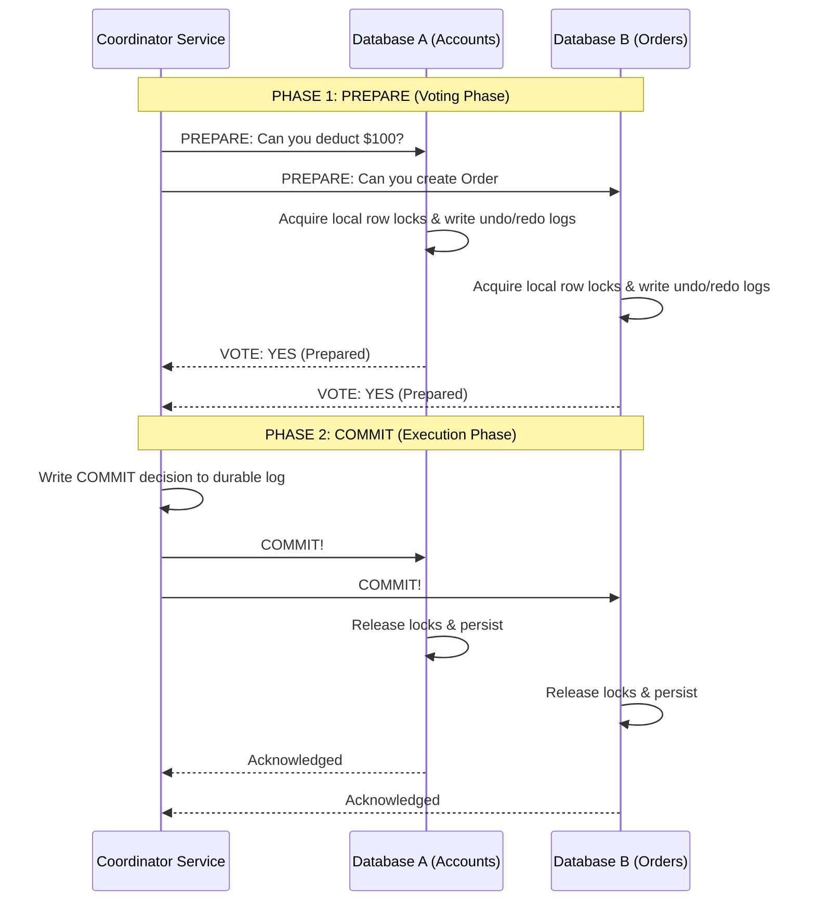
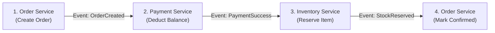
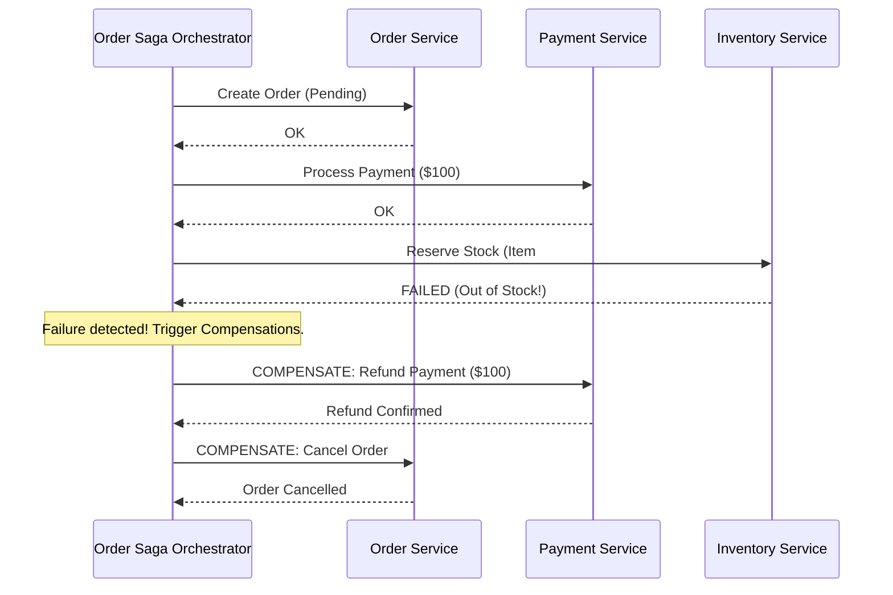
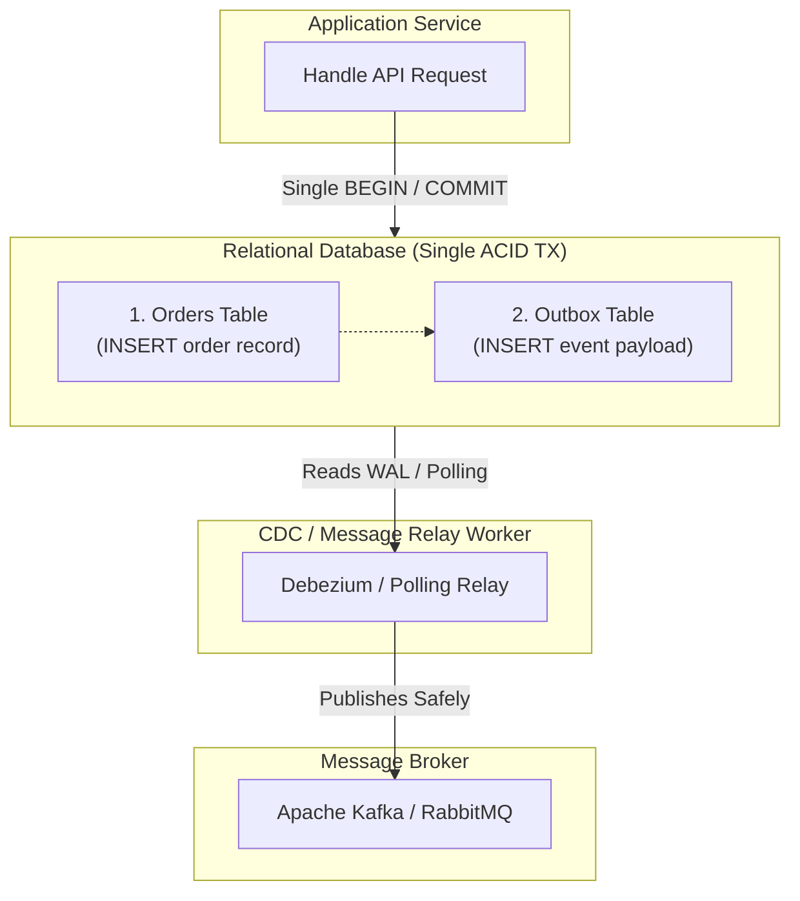
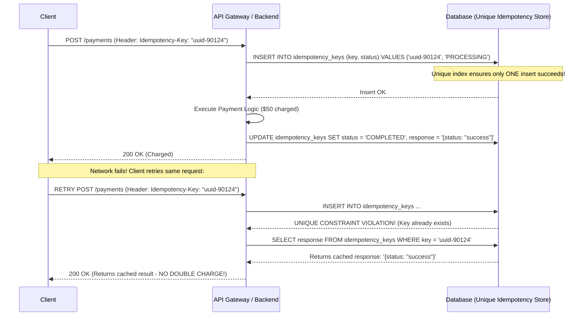
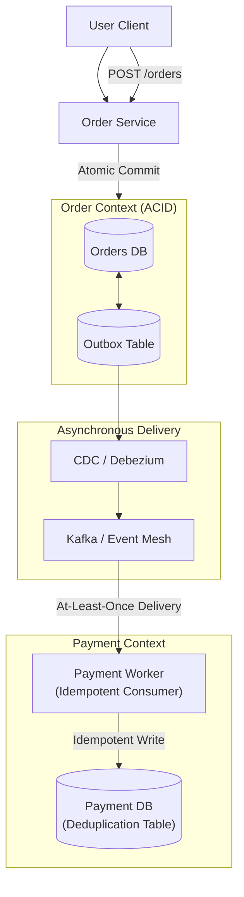

# Chapter 10: Data Consistency in Distributed Systems

> **Core Concept:**
> Inside a single computer, memory ordering and CPU cache coherence guarantee that once a variable is written, any thread reading it sees the update. In a distributed system with multiple microservices, read replicas, and network partitions, this guarantee vanishes. **Distributed Data Consistency** is the mathematical and architectural discipline of ensuring that disparate nodes agree on the true state of data despite asynchronous networks, clock drift, and independent node crashes.

---

## Table of Contents
1. [The Spectrum of Consistency: From Strong to Eventual](#1-the-spectrum-of-consistency-from-strong-to-eventual)
2. [Client-Centric Consistency Models](#2-client-centric-consistency-models)
3. [The CAP Theorem & PACELC Trade-Offs](#3-the-cap-theorem--pacelc-trade-offs)
4. [Distributed Transactions & The Two-Phase Commit (2PC) Protocol](#4-distributed-transactions--the-two-phase-commit-2pc-protocol)
5. [The Saga Pattern: Orchestration vs. Choreography](#5-the-saga-pattern-orchestration-vs-choreography)
6. [Compensating Transactions: Handling Failures Gracefully](#6-compensating-transactions-handling-failures-gracefully)
7. [The Dual-Write Problem & The Transactional Outbox Pattern](#7-the-dual-write-problem--the-transactional-outbox-pattern)
8. [Idempotency: Making Unreliable Networks Safe](#8-idempotency-making-unreliable-networks-safe)
9. [Duplicate Requests and Deduplication Strategies](#9-duplicate-requests-and-deduplication-strategies)
10. [Cross-Service Consistency: Real-World Architecture](#10-cross-service-consistency-real-world-architecture)
11. [Summary & Production Checklist](#11-summary--production-checklist)

---

## 1. The Spectrum of Consistency: From Strong to Eventual

Consistency in distributed systems is not a binary choice; it exists along a spectrum balancing latency, availability, and correctness:

```
Strong Consistency <---------------------------------------------------> Eventual Consistency
(Linearizability)       Sequential      Causal       Read-After-Write   (Weakest)
- Maximum Latency       Consistency     Consistency  Monotonic Reads    - Minimum Latency
- Minimum Availability                                                  - Maximum Availability
```

### 1.1 Strong Consistency (Linearizability)
* **Definition:** A system is linearizable if all operations appear to execute atomically at a specific point in physical time on a single, global copy of data.
* **The Rule:** If Client A writes value $X = 5$ and receives a success confirmation at 10:00:00.000, **no client anywhere in the world** can read an older value ($X = 4$) at 10:00:00.001.
* **Cost:** Requires synchronous consensus (Raft, Paxos, or Multi-Paxos) across nodes. Every read and write incurs network round-trip overhead. If nodes are partitioned, writes must be rejected to prevent stale state.

### 1.2 Eventual Consistency
* **Definition:** If no further mutations occur on an item, all replicas will eventually converge to the same value.
* **The Rule:** Clients can write and read immediately from any local replica. If a replica is lagging behind, the client will read stale data temporarily.
* **Cost:** Application logic must tolerate seeing stale state or handle conflicting concurrent writes (e.g., Last-Write-Wins or Conflict-Free Replicated Data Types - CRDTs).

---

## 2. Client-Centric Consistency Models

When full linearizability is too slow or unavailable, distributed systems provide **Client-Centric Guarantees** that prevent the most confusing user-facing anomalies.

```
+------------------------------------+------------------------------------+
| Consistency Model                  | User Guarantee                     |
+------------------------------------+------------------------------------+
| **Read-After-Write (Read-Your-Own)**| You always see updates you made.   |
| **Monotonic Reads**                | You never see data travel backward.|
| **Monotonic Writes**               | Your writes execute in order.      |
| **Consistent Prefix (Causal)**     | Answers never appear before questions|
+------------------------------------+------------------------------------+
```

### 2.1 Read-After-Write Consistency (Read-Your-Own-Writes)
* **The Anomaly:** A user updates their profile name from "Alice" to "Alicia". The app redirects to the profile page. The browser queries a read replica lagging by 500 ms. The user sees "Alice" and assumes their update failed.
* **The Guarantee:** Once a user submits an update, **that specific user** will always observe their own update on subsequent reads. Other users may continue to see "Alice" until replication catches up.

```mermaid
sequenceDiagram
    participant User
    participant Primary as Primary Node
    participant Replica as Lagging Replica

    User->>Primary: 1. UPDATE profile SET name = 'Alicia';
    Primary-->>User: 2. OK (Write Saved)
    Note over User: Subsequent Read within 5 seconds...
    User->>Primary: 3. SELECT name FROM profile; (Sticky Route to Primary)
    Primary-->>User: 4. Returns 'Alicia' (Consistent!)
    Note over Replica: Other users reading from Replica still see 'Alice' temporarily
```

### 2.2 Monotonic Reads (Time-Traveling Defense)
* **The Anomaly:** A user views an auction item. 
  * Query 1 hits Replica A (lag = 0 ms): Shows price \$150.
  * User refreshes; Query 2 hits Replica B (lag = 2000 ms): Shows price \$120!
* **The Guarantee:** If a client reads state $S_1$, they will never subsequently observe an older state $S_0$.
* **Implementation:** Hash the user's `session_id` to route all queries from that user to the **same physical replica**.

---

## 3. The CAP Theorem & PACELC Trade-Offs

### 3.1 The Reality of the CAP Theorem
The CAP Theorem (Consistency, Availability, Partition Tolerance) states that a distributed data store can simultaneously provide at most two of the three guarantees:

```
             Consistency (C)
                 /     \
                /       \
               /  RDBMS  \
              /  (Local)  \
             /             \
Availability (A) --------- Partition Tolerance (P)
        (DynamoDB/Cassandra)     (Spanner/CockroachDB)
```

> **The Hard Physical Truth:**
> You **cannot** choose "CA". Network partitions (lost packets, severed cables, routing loops) are a physical certainty of physics. Therefore, when a network partition ($P$) occurs, you must choose:
> * **CP (Consistency over Availability):** Reject writes or stall queries until the partition heals to prevent split-brain and stale state.
> * **AP (Availability over Consistency):** Accept reads and writes on all surviving nodes, accepting that data will diverge and must be reconciled later.

### 3.2 The PACELC Theorem (Beyond CAP)
CAP only describes behavior during rare network partitions. What happens during normal operations (99.9% of the time)?

**PACELC states:**
$$\text{If } \mathbf{P} \text{ (Partition) } \longrightarrow \text{Choose } \mathbf{A} \lor \mathbf{C}$$
$$\mathbf{E} \text{ (Else / Normal) } \longrightarrow \text{Trade } \mathbf{L} \text{ (Latency) } \lor \mathbf{C} \text{ (Consistency)}$$

* **PC/EC (e.g., Google Spanner, CockroachDB):** During partitions, chooses Consistency; during normal operations, chooses Consistency (sacrificing latency for synchronous consensus).
* **PA/EL (e.g., Amazon DynamoDB, Apache Cassandra):** During partitions, chooses Availability; during normal operations, chooses low Latency (sacrificing strong consistency via asynchronous replication).

---

## 4. Distributed Transactions & The Two-Phase Commit (2PC) Protocol

When a single business operation must atomically update two independent databases (e.g., PostgreSQL Account DB and MySQL Order DB), local ACID transactions cannot coordinate across network sockets.

The classical computer science solution is **Two-Phase Commit (2PC)**:



### Why 2PC is Avoided in Modern Web Architecture (The Blocking Flaw):
1. **Synchronous Blocking:** Between Phase 1 (Prepare) and Phase 2 (Commit), both databases hold **exclusive row locks**. If the Coordinator crashes midway through Phase 1, DB1 and DB2 remain locked indefinitely, blocking all other transactions!
2. **Extreme Latency:** 2PC requires multiple sequential network round-trips plus forced physical disk `fsync` operations on every participant node.
3. **Availability Killer:** If even one database out of 10 fails to respond, the entire transaction must abort.

---

## 5. The Saga Pattern: Orchestration vs. Choreography

Modern microservices replace heavy, blocking 2PC transactions with **Sagas**:

> **Definition:** A Saga is a sequence of local transactions. Each local transaction updates data within a single service and publishes an event or message. If a step fails, the Saga executes **Compensating Transactions** to undo the preceding steps.

```
Step 1: Order Service creates order (PENDING)
Step 2: Payment Service charges credit card
Step 3: Inventory Service reserves stock
Step 4: Order Service marks order (CONFIRMED)
```

### 5.1 Choreography-Based Saga (Event-Driven)
Services communicate asynchronously via a message broker (e.g., Apache Kafka or RabbitMQ) without a central coordinator:


* **Pros:** Simple for small flows (2–3 steps); loosely coupled.
* **Cons:** Becomes a cyclic dependency nightmare ("event spaghetti") as workflows expand to 10+ services.

---

### 5.2 Orchestration-Based Saga (Command-Driven)
A dedicated central service (the **Saga Orchestrator**, e.g., Temporal, AWS Step Functions) explicitly commands each participant:



* **Pros:** Centralized state machine, explicit error tracking, zero cyclic event dependencies.
* **Cons:** The orchestrator represents an additional architectural component to manage.

---

## 6. Compensating Transactions: Handling Failures Gracefully

Unlike an ACID `ROLLBACK` (which instantly wipes memory and reverts disk pointers), a distributed Saga **cannot truly roll back time**. A credit card has already been charged; an email has already been sent.

A **Compensating Transaction** is an explicit business action designed to semantically neutralize the side effect of an earlier step:

```
+-----------------------------------+-----------------------------------+
| Forward Transaction Action        | Compensating Neutralizing Action  |
+-----------------------------------+-----------------------------------+
| Charge Credit Card \$100          | Issue Refund of \$100             |
| Reserve 1 seat on flight          | Release seat back to inventory    |
| Insert row into Database          | Update status = 'CANCELLED'       |
| Send "Welcome" Email              | Send "Account Setup Failed" Email |
+-----------------------------------+-----------------------------------+
```

### The Invariants of Compensating Transactions:
1. **They must be Idempotent:** If a network timeout occurs while issuing a refund, retrying the refund 5 times must not refund the customer \$500.
2. **They must never fail permanently:** If a compensation fails, it must be retried with exponential backoff until it succeeds, or flagged in a Dead Letter Queue (DLQ) for manual operator intervention.

---

## 7. The Dual-Write Problem & The Transactional Outbox Pattern

One of the most frequent distributed consistency bugs occurs when a service must **update a database AND publish an event to a message broker (Kafka)**:

### The Dual-Write Bug:
```python
def create_order(order_data):
    # Step 1: Database Write
    db.execute("INSERT INTO orders ...")
    
    # Step 2: Network Call to Message Broker
    kafka.send("order-created", order_data) # What if this network call fails?
```
* If Step 1 succeeds and the server crashes before Step 2, the message is never sent. Downstream inventory and shipping services never know the order exists!
* If you reverse the order (publish to Kafka first, then write to DB), the Kafka message goes out, but if the database transaction fails on a constraint, phantom events trigger downstream shipping for an order that does not exist in the database!

---

### The Solution: The Transactional Outbox Pattern
Instead of writing to two independent distributed systems, **write to both inside a single local ACID database transaction**:



### How it Works:
1. The service opens a database transaction.
2. It inserts the order into the `orders` table.
3. In the **exact same transaction**, it inserts the message payload into an `outbox` table.
4. The transaction commits. Both records are guaranteed to exist atomically via local ACID durability.
5. An asynchronous process (such as a polling worker or a **Change Data Capture (CDC)** tool like **Debezium** tailing the database WAL) reads the outbox table and streams the event reliably to Kafka.

---

## 8. Idempotency: Making Unreliable Networks Safe

In a distributed network, network packets can be delayed, duplicated, or dropped.

```
Scenario: Client sends "Charge $50".
1. Database processes charge successfully.
2. The network router drops the TCP ACK packet on the way back to the client.
3. Client times out and thinks: "The request failed! Retrying..."
4. Client sends "Charge $50" again!
```

> **Definition:** An operation is **Idempotent** if applying it multiple times produces the exact same outcome as applying it once:
> $$f(f(x)) = f(x)$$

```
+------------------+------------------+-----------------------------------+
| HTTP Method      | Idempotent?      | Real-World Example                |
+------------------+------------------+-----------------------------------+
| `GET`            | **YES**          | Fetching user details.            |
| `PUT`            | **YES**          | `SET status = 'PAID'`             |
| `DELETE`         | **YES**          | `DELETE FROM items WHERE id = 10;`|
| `POST`           | **NO (Default)** | `balance = balance - 50`          |
+------------------+------------------+-----------------------------------+
```

---

## 9. Duplicate Requests and Deduplication Strategies

To make non-idempotent operations safe over unreliable networks, backend systems use **Idempotency Keys**:



### The 3 Core Requirements of Idempotency Key Design:
1. **Client-Generated UUIDv4 / UUIDv7:** The client must generate the key before making the network request.
2. **Database-Level Unique Constraint:** Do not check existence in memory! Enforce a `UNIQUE` index on `idempotency_key` in the database.
3. **Response Caching & TTL:** Store the serializable JSON response alongside the key with an expiration TTL (e.g., 24 to 48 hours).

---

## 10. Cross-Service Consistency: Real-World Architecture

When designing high-scale distributed systems, strict synchronization across services is replaced by **Eventual Consistency with At-Least-Once Delivery**:



### The 4 Pillars of Cross-Service Consistency:
1. **Local ACID Boundaries:** Keep transactional consistency strictly local to a single microservice's database.
2. **Transactional Outbox:** Bridge local state to the network reliably using CDC tailing the Write-Ahead Log.
3. **At-Least-Once Message Delivery:** Acknowledge messages only after processing finishes.
4. **Idempotent Consumers:** Treat all incoming messages as potential duplicates. Verify idempotency keys before executing state changes.

---

## 11. Summary & Production Checklist

Review this checklist when building distributed data architectures:

* [ ] **No Cross-Service 2PC:** Avoid Two-Phase Commit protocols across independent network services; use asynchronous Sagas instead.
* [ ] **Idempotent Endpoints:** All payment, order, and mutating API endpoints require an `Idempotency-Key` header with database-level unique constraints.
* [ ] **Transactional Outbox for Events:** Never write to a database and message broker in separate steps; use the Transactional Outbox pattern with CDC.
* [ ] **Compensations Designed Up Front:** For every step in a Saga, verify that an idempotent compensating transaction is tested and implemented.
* [ ] **Read-Your-Own-Writes Routing:** Route users to the primary database for 5–10 seconds after any write to eliminate replication lag confusion.
* [ ] **Dead Letter Queues (DLQ):** Every asynchronous consumer has an alertable DLQ for un-processable or permanently failing events.

---

⬅️ **[Previous: 9. Database Reliability & Recovery](09_Database_Reliability_And_Recovery.md)** | 🏠 **[Back to TOC](README.md)** | **[Next: 11. Indexing & Query Optimization ➡️](11_Indexing_And_Query_Optimization.md)**

