# 12. Backend–Database Integration: Architecture & Production Patterns

A high-performance database engine is only as effective as the application tier communicating with it. In production systems, the majority of database outages, latency spikes, and data corruptions do not stem from engine bugs or disk failures; they originate in the **Backend–Database Integration layer**: unindexed ORM queries, connection pool exhaustion, leaky transactions, and unhandled network timeouts.

Bridging the gap between stateless backend application services (Node.js, Go, Python, Java) and stateful relational database clusters requires mastering object-relational mapping, transaction boundary lifecycles, batching protocols, and resilient failure modes.

---

## 1. How an ORM Works Internally

An **Object-Relational Mapper (ORM)** bridges the **Object-Relational Impedance Mismatch**—the fundamental theoretical conflict between the Object-Oriented Paradigm (graphs of stateful objects connected by references/pointers) and the Relational Paradigm (mathematical relations composed of tables, tuples, foreign keys, and set operations).

```
+------------------------------------+------------------------------------+
| Object-Oriented Paradigm           | Relational Paradigm                |
+------------------------------------+------------------------------------+
| Identity: In-memory memory address | Identity: Primary Key values       |
| Relationships: Pointers/References | Relationships: Foreign Key joins   |
| Navigation: Graph traversal        | Navigation: Declarative SQL joins  |
| Polymorphism: Class inheritance    | Polymorphism: Table schemas (flat) |
+------------------------------------+------------------------------------+
```

### 1.1 The Internal Pipeline of an ORM

When you execute a query via an ORM (e.g. Hibernate, SQLAlchemy, Prisma, Entity Framework), the engine executes four distinct phases:

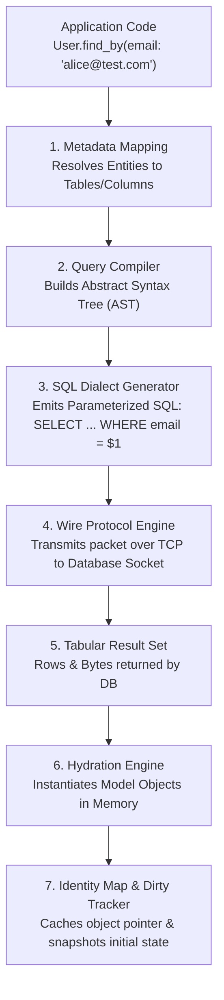

1. **Metadata Mapping:** Inspects annotations, schema files, or reflection to map model attributes to underlying table columns and types.
2. **AST & SQL Compilation:** Converts fluent programmatic method calls into an Abstract Syntax Tree, then compiles that tree into dialect-specific SQL (e.g., PostgreSQL vs. MySQL syntax).
3. **Hydration Engine:** Parses raw wire protocol bytes and transforms tabular rows into fully formed language objects.
4. **Identity Map:** A per-request/per-session cache that ensures each database row is represented by exactly **one** object instance in memory. If two distinct queries load User ID 42 within the same transaction, both return the exact same memory pointer, preventing divergent in-memory state.
5. **Unit of Work & Dirty Checking:** The ORM takes an in-memory snapshot of every loaded entity. When changes are made, the entity is marked "dirty." Upon `commit()`, the Unit of Work calculates the minimal topological diff and flushes pending `INSERT`, `UPDATE`, and `DELETE` commands in the correct foreign-key dependency order.

### 1.2 Architectural Patterns: Active Record vs. Data Mapper

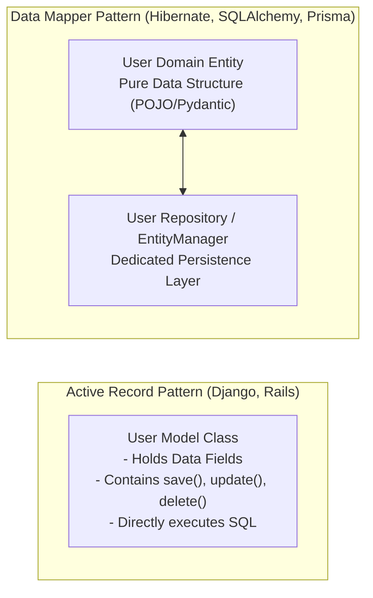

| Dimension | Active Record (e.g. Django, Rails) | Data Mapper (e.g. SQLAlchemy, Hibernate) |
| :--- | :--- | :--- |
| **Philosophy** | "A row is an object; an object is a row." The entity class handles both data and persistence methods (`user.save()`). | Complete decoupling. The domain entity is a plain data object; a separate mapper/repository handles persistence (`repo.save(user)`). |
| **Strengths** | Extremely rapid prototyping; intuitive; low boilerplate for standard CRUD. | Clean Domain-Driven Design (DDD); highly testable; supports complex business logic independent of database schema. |
| **Weaknesses** | Violates Single Responsibility Principle; tightly couples business domain to database tables; difficult to mock in tests. | Higher cognitive overhead; more boilerplate; steep learning curve. |

---

## 2. ORM vs. Query Builders vs. Raw SQL

In production architectures, dogmatically choosing *only* an ORM or *only* raw SQL is an anti-pattern. Mature systems adopt a **layered access model**:

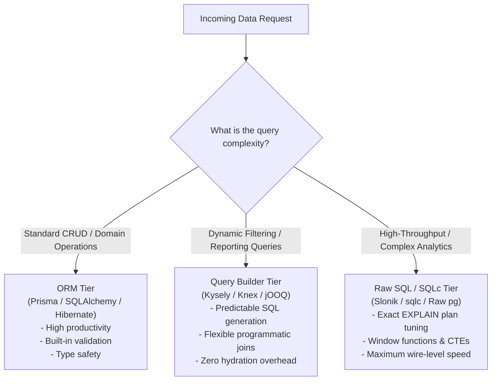

### Comprehensive Comparison Matrix

| Criteria | ORM (e.g. Prisma, Hibernate) | Query Builder (e.g. Kysely, Knex) | Raw SQL / SQLc (e.g. sqlc, Slonik) |
| :--- | :--- | :--- | :--- |
| **Productivity (CRUD)** | **Highest:** Automatically generates standard mutations and relations. | **Medium:** Developer manually constructs select and update clauses. | **Lowest:** Every query, column list, and placeholder written by hand. |
| **Query Predictability** | **Poor:** Hidden joins, unexpected lazy-loading round trips, inefficient subqueries. | **High:** Generated SQL mirrors the programmatic chain 1:1. | **Absolute:** What you write is literally what the engine parses. |
| **Memory Footprint** | **Heavy:** Hydrates hundreds of heavy class instances with dirty-tracking overhead. | **Light:** Returns plain JSON-like associative arrays or tuples. | **Zero Overhead:** Streams raw buffers/tuples directly into memory. |
| **Type Safety** | **High:** Compiler verifies model field names and associations. | **High:** Generates strict TypeScript/Go types from schema definitions. | **Variable:** Requires compile-time code-gen tools like `sqlc` to guarantee type safety. |
| **Complex Joins / CTEs** | **Terrible:** Developers fight the ORM DSL; often produces monstrous SQL. | **Excellent:** Designed to compose subqueries, window functions, and CTEs cleanly. | **Native:** Full access to every engine-specific SQL feature. |

---

## 3. Connection Lifecycle in Backend Applications

Establishing a database connection over TCP/TLS is physically expensive (30 ms–100 ms). If an application creates a new socket connection per HTTP request, database performance collapses.

### 3.1 The Complete Connection Lifecycle

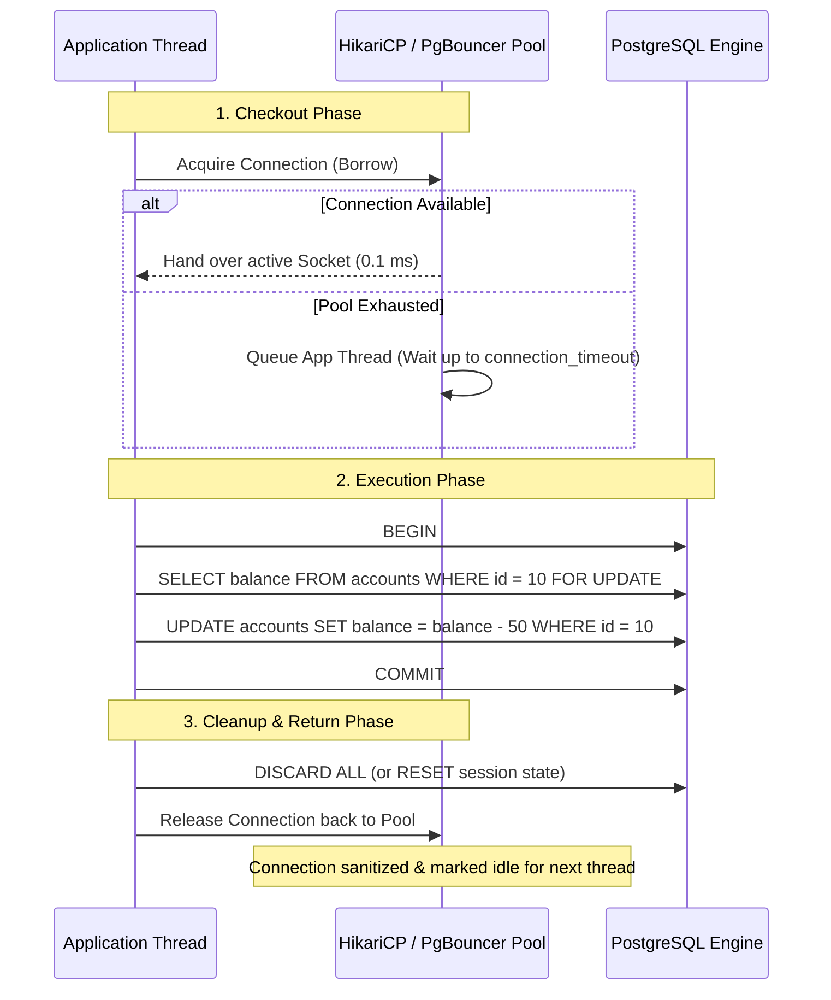

### 3.2 The Deadly Antipattern: Leaked Connections

A **Connection Leak** occurs when an application borrows a connection from the pool but fails to return it due to unhandled exceptions, unclosed cursors, or missing cleanup blocks.

```python
# DEADLY BUG: Leaks connection if db.execute() throws an exception!
def process_order(order_id):
    conn = pool.get_connection()
    conn.execute("UPDATE orders SET status = 'PROCESSING' WHERE id = %s", (order_id,))
    # If a network timeout or parsing bug occurs here, conn is NEVER returned!
    pool.release(conn)

# PRODUCTION STANDARD: Context Manager / RAII guarantees cleanup
def process_order_safe(order_id):
    with pool.get_connection() as conn:
        with conn.transaction():
            conn.execute("UPDATE orders SET status = 'PROCESSING' WHERE id = %s", (order_id,))
    # Regardless of exceptions or returns, the context manager safely releases the connection!
```

---

## 4. Transactions Across Service Methods

In layered enterprise applications, business workflows frequently span multiple domain services. Managing transaction boundaries cleanly without polluting domain logic requires explicit architectural boundaries.

### 4.1 The Unit of Work & Transaction Propagation

When Service A calls Service B, should Service B participate in Service A's existing transaction, or start an isolated independent transaction?

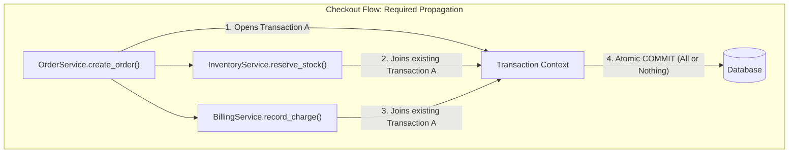

#### Common Propagation Strategies:
1. **REQUIRED (Default):** If an active transaction exists, join it. If none exists, create a new one. (Ensures atomic rollback across services).
2. **REQUIRES_NEW:** Suspend any existing transaction and start a completely new, independent transaction. Useful for logging audit events that **must** persist even if the main business transaction aborts.
3. **MANDATORY:** Must run within an active transaction. Throws an exception if called without one.

### 4.2 The "Long-Running Transaction" Trap
Never execute slow external I/O (e.g. calling Stripe, sending emails, contacting external microservices) inside an open database transaction!

```python
# THE DISASTER PATTERN:
with db.transaction():
    order = db.query("SELECT * FROM orders WHERE id = 1 FOR UPDATE") # Row Locked!
    
    # FATAL ERROR: Network call inside DB transaction!
    # If Stripe takes 5 seconds to respond, this DB connection and row lock are held for 5 seconds.
    # 50 concurrent checkouts will instantly saturate the entire connection pool!
    stripe_response = call_stripe_api(order.amount)
    
    db.execute("UPDATE orders SET status = 'PAID'")

# THE PRODUCTION STANDARD (Decoupled I/O):
# 1. Quick read/lock to mark 'PENDING_PAYMENT'
with db.transaction():
    db.execute("UPDATE orders SET status = 'PENDING' WHERE id = 1")

# 2. Network call executes OUTSIDE database transaction (Zero DB locks held!)
stripe_response = call_stripe_api(amount)

# 3. Quick transaction to record final result
with db.transaction():
    db.execute("UPDATE orders SET status = 'PAID' WHERE id = 1")
```

---

## 5. The N+1 Query Problem & Eager Loading

The **N+1 Query Problem** is the most pervasive performance killer introduced by ORMs. It occurs when an application executes 1 initial query to fetch a parent dataset, followed by **N** separate individual queries to fetch child records for each row.

### 5.1 The Execution Trace

```python
# Naive ORM Code:
users = User.objects.all()[:100] # Query 1: Returns 100 users
for user in users:
    print(user.profile.bio)      # Queries 2 to 101: 100 individual round trips!
```

```
[Query 1]:   SELECT id, name FROM users LIMIT 100;
[Query 2]:   SELECT bio FROM profiles WHERE user_id = 1;
[Query 3]:   SELECT bio FROM profiles WHERE user_id = 2;
...
[Query 101]: SELECT bio FROM profiles WHERE user_id = 100;
Result: 101 network round trips! Latency = 101 * 2ms = 202ms!
```

### 5.2 The Mitigations: Joins vs. Pre-Fetching

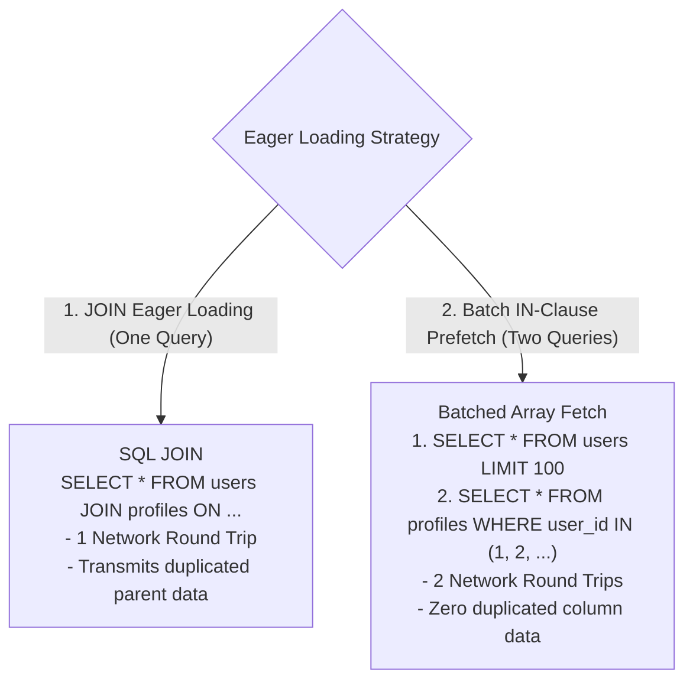

#### Code Implementation:
```python
# 1. Join Eager Loading (SQLAlchemy / Django select_related):
# Uses an SQL INNER/LEFT JOIN in a single statement. Ideal for 1:1 and N:1 relations.
users = session.query(User).options(joinedload(User.profile)).all()

# 2. Batch Pre-Fetching (SQLAlchemy selectinload / Django prefetch_related):
# Executes exactly TWO queries regardless of dataset size. Ideal for 1:N collections.
users = session.query(User).options(selectinload(User.orders)).all()
```

---

## 6. Pagination and Filtering at Scale

### 6.1 The Fallacy of Offset Pagination (`LIMIT ... OFFSET`)
Most beginner tutorials implement pagination using `OFFSET`:
```sql
SELECT * FROM products ORDER BY created_at DESC LIMIT 20 OFFSET 500000;
```

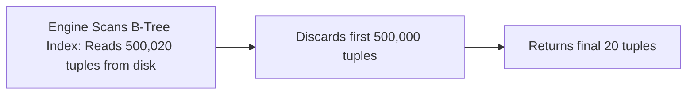

* **Why It Fails:** The database engine cannot jump directly to row 500,000. It must physically scan all 500,000 preceding index entries and table pages, only to discard them. Latency increases linearly ($O(N)$) with depth.
* **Offset Drift (Data Inconsistency):** If a new record is inserted on page 1 while a user navigates to page 2, all items shift down by one. The user sees a duplicated record on page 2.

### 6.2 The Solution: Keyset (Cursor-Based) Pagination
Instead of telling the database how many rows to skip, provide a **seek cursor** representing the exact coordinates of the last observed item:

```sql
-- Keyset Pagination (O(1) B-Tree Seek)
SELECT id, title, created_at, price
FROM products
WHERE (created_at, id) < ('2026-10-18 12:00:00', 98124)
ORDER BY created_at DESC, id DESC
LIMIT 20;
```

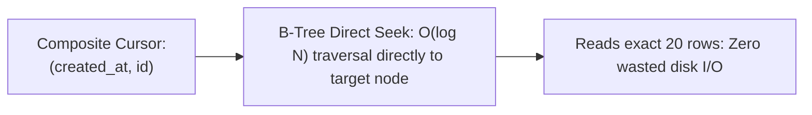

| Dimension | Offset Pagination (`OFFSET N`) | Keyset Pagination (Cursor) |
| :--- | :--- | :--- |
| **Performance** | $O(N)$ — Becomes unusable beyond ~50,000 rows. | $O(1)$ — Sub-millisecond latency at row 100 or row 100,000,000. |
| **Data Stability** | Fragile. Concurrent inserts/deletes cause skipped or duplicate items. | Perfectly stable. Cursors represent immutable points in time. |
| **UI Compatibility** | Supports "Jump to Page 47" buttons. | Infinite scroll or "Next/Previous" buttons only. |
| **Index Prerequisite** | Single column index on sorted field. | Composite index matching the exact cursor tuple: `CREATE INDEX ON products (created_at DESC, id DESC)`. |

---

## 7. Bulk Operations & High-Throughput Ingestion

When importing or updating thousands of records, issuing single-row SQL statements inside a loop is catastrophic:

```
Looping 10,000 Single Inserts:
  10,000 network round trips * 1 ms = 10 seconds of pure network latency!
```

### 7.1 Multi-Row Batched Inserts
Batch inserts combine hundreds of rows into a single statement:
```sql
INSERT INTO sensor_readings (device_id, temp, recorded_at)
VALUES 
    (1, 22.4, NOW()),
    (2, 19.8, NOW()),
    -- ... up to 1,000 rows per statement
    (1000, 21.0, NOW());
```
* **Optimal Batch Size:** In production, batch sizes between **500 and 2,000 rows** yield the best balance between network throughput and packet size limits (preventing max query size / memory allocation errors).

### 7.2 The Ultimate Pipeline: Binary Streaming (`COPY`)
For multi-gigabyte data ingestion, even batched `INSERT` statements incur parsing overhead. PostgreSQL provides the **`COPY` protocol**, which streams raw CSV or binary buffers directly into the table heap, bypassing the SQL parser completely.

```python
# Ingesting 1,000,000 rows in Python using psycopg3's binary COPY
import io

def fast_bulk_load(cursor, records):
    with cursor.copy("COPY sensor_readings (device_id, temp, recorded_at) FROM STDIN") as copy:
        for r in records:
            copy.write_row(r)
    # Throughput: Over 100,000 rows/second persisted to disk!
```

---

## 8. Retry Handling, Idempotency, and Transaction Safety

Distributed networks and high-concurrency databases inevitably produce transient errors:
1. **Deadlock Detected** (`40P01` in PostgreSQL, `1213` in MySQL).
2. **Serialization Failure** (`40001` in Serializable isolation).
3. **Connection Drops** during primary failover or proxy rebalancing.

### 8.1 The Transient Error Retry Algorithm
Transient failures should be automatically retried using **Exponential Backoff with Full Jitter**:

$$t_{\text{sleep}} = \text{random}(0, \; \min(t_{\text{max}}, \; t_{\text{base}} \times 2^{\text{attempt}}))$$

```python
import time, random
from psycopg.errors import SerializationFailure, DeadlockDetected

def execute_with_retry(max_retries=5, base_delay=0.05, max_delay=2.0):
    for attempt in range(max_retries):
        try:
            with pool.get_connection() as conn:
                with conn.transaction():
                    return business_operation(conn)
        except (SerializationFailure, DeadlockDetected) as e:
            if attempt == max_retries - 1:
                raise e # Exhausted retries; bubble error up
            
            # Full Jitter backoff prevents herd storms
            sleep_time = random.uniform(0, min(max_delay, base_delay * (2 ** attempt)))
            time.sleep(sleep_time)
```

> **CRITICAL INVARIANT:** Only retry transactions that are **strictly idempotent**. If your transaction executes external side effects (e.g. charging a payment, firing an email) before failing, retrying the transaction will trigger duplicate charges!

---

## 9. Connection Pool Sizing: Formulas and Production Math

The most common misconception in backend engineering is that *larger connection pools mean faster applications*. In reality, setting connection pool sizes too high degrades throughput and leads to database saturation.

### 9.1 PostgreSQL / HikariCP Pool Sizing Formula
Engineers at PostgreSQL and HikariCP developed the gold-standard sizing formula derived from disk I/O and CPU context-switching limits:

$$\text{Optimal Connections} = (\text{CPU Cores} \times 2) + \text{Effective Spindle Count}$$

* **Example:** An 8-Core database server backed by an enterprise NVMe SSD (effective spindle count = 1):
  $$\text{Optimal Pool Size} = (8 \times 2) + 1 = 17 \text{ to } 20 \text{ Connections}$$

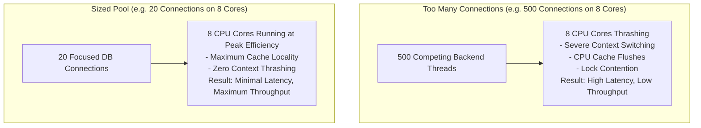

### 9.2 The Sizing Mismatch: Proxy Pooling
If you have 100 microservice containers, each configuring a local pool of 20 connections, your cluster will attempt to open $100 \times 20 = 2,000$ direct connections to PostgreSQL. PostgreSQL will crash due to process memory exhaustion.

* **Solution:** Deploy a dedicated **Connection Proxy (e.g. PgBouncer)** in front of the database:
  * Application containers maintain 2,000 lightweight connections to PgBouncer.
  * PgBouncer multiplexes those requests into a fixed, highly optimized pool of **30 physical connections** to PostgreSQL using **Transaction Pooling**.

---

## 10. Database Access Layers and Repository Patterns

Production software maintains a strict separation of concerns between business domain logic and database operations.

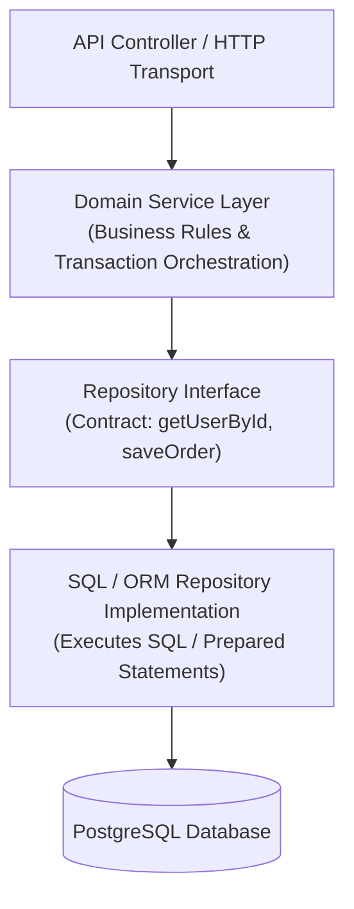

### 10.1 Key Benefits of the Repository Pattern:
1. **Business Logic Isolation:** Domain services never contain raw SQL strings or ORM query-builder chains. They operate strictly on domain models.
2. **Simplified Mocking & Testing:** Unit tests can substitute the database repository with an in-memory dictionary fake, running thousands of domain tests in milliseconds without touching a physical database socket.
3. **Zero Leaks of Data Primitives:** Database-specific exceptions (`PSQLException`, unique constraint codes) are caught inside the repository and translated into clean domain exceptions (`UserAlreadyExistsError`).

---

## 11. Handling Database Errors, Timeouts, and Deadlines

In high-scale architectures, the most dangerous database failure is not an outright crash; it is a **slow database**. A database taking 10 seconds to respond will tie up backend worker threads, quickly exhausting application thread pools and cascading across the entire microservice ecosystem.

### 11.1 The Three Essential Timeout Layers

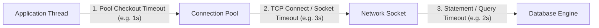

1. **Pool Acquisition Timeout:** If all pool connections are busy, how long should an incoming thread wait before failing fast? (Recommended: **500 ms – 1,000 ms**).
2. **TCP / Network Socket Timeout:** If a network cable is severed or an AWS AZ routing table hangs, how long before the OS socket terminates? (Recommended: **3,000 ms**).
3. **Database Statement Timeout:** Enforced directly by the database engine to terminate runaway rogue queries:
   ```sql
   -- PostgreSQL Session Timeouts
   SET statement_timeout = '2000ms'; -- Aborts any query taking longer than 2s
   SET lock_timeout = '1000ms';      -- Aborts if waiting for a table lock takes longer than 1s
   ```

### 11.2 Context & Deadline Propagation
Modern backend runtimes (Go `context.Context`, Node.js `AbortController`, Java `CompletableFuture`) allow propagating an HTTP request's remaining time budget directly down to the database query:

```go
// Go Context Timeout Propagation
ctx, cancel := context.WithTimeout(r.Context(), 1500*time.Millisecond)
defer cancel()

// If the HTTP client disconnects or 1.5s expires, the query is immediately cancelled!
rows, err := db.QueryContext(ctx, "SELECT * FROM orders WHERE user_id = $1", userID)
```

---

## 12. Graceful Degradation When the Database is Unavailable

When your database cluster undergoes an automated failover (which takes 15–30 seconds) or suffers hardware degradation, your application must **degrade gracefully** rather than throwing raw `500 Internal Server Errors`.

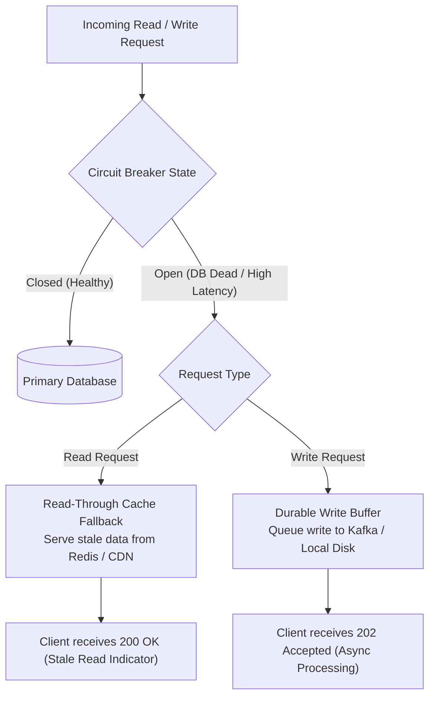

### 12.1 Circuit Breaker Implementation
Track database error rates. If 50% of database queries fail over a rolling 10-second window, **trip the Circuit Breaker to OPEN**:
* Stop bombarding the injured database cluster with queries (allowing it to recover).
* Immediately route reads to fallback caches.
* Transition to **HALF-OPEN** after 30 seconds, testing the database with a single canary query before restoring full traffic.

### 12.2 Durable Write Buffering
For mission-critical write endpoints (e.g. tracking telemetry, analytics, ingestion), if the primary database drops:
1. Intercept the write in an API gateway or backend middleware.
2. Publish the event payload to an in-memory or durable local log (**Kafka**, **RabbitMQ**, or disk-backed SQLite queue).
3. Return `202 Accepted` to the client.
4. When the primary database restores health, background consumer workers drain the queue and persist the records safely.

---

## 13. Master Reference: Integration Anti-Patterns & Solutions

| Anti-Pattern | Production Consequence | Recommended Architectural Remedy |
| :--- | :--- | :--- |
| **N+1 Query Traps** | Hundreds of sequential round trips per request; latency scales linearly with list size. | Eager load using `selectinload` / `prefetch_related` or single `JOIN` statements. |
| **Offset Pagination at Scale** | Database scans and discards millions of rows; high CPU and slow responses. | Implement Keyset / Cursor-based pagination on indexed unique tuples. |
| **Connection Pool Over-Sizing** | 500 connections compete for 8 CPU cores; severe OS context switching; DB saturates. | Size pool to $(\text{Cores} \times 2) + \text{Disk}$; deploy PgBouncer for connection multiplexing. |
| **Long-Running DB Transactions** | External network calls (Stripe/Email) inside transactions lock rows and drain connections. | Isolate external I/O outside transaction boundaries; hold DB locks only for milliseconds. |
| **Missing Query & Lock Timeouts** | Unindexed slow query holds locks indefinitely; pool exhausts; application hangs. | Configure explicit `statement_timeout` and `lock_timeout` at the pool or session level. |
| **Looping Single Inserts** | Ingesting 10,000 items takes 15 seconds due to network round-trip overhead. | Use chunked multi-row inserts (`VALUES (...)`) or the binary `COPY` protocol. |
| **Raw String Interpolation in ORM** | SQL injection vulnerabilities via `.whereRaw()` or `queryRawUnsafe()`. | Enforce strict parameterized query inputs even when writing raw SQL inside ORMs. |
| **Unbounded In-Memory Hydration** | Loading 50,000 ORM entities into RAM exhausts container memory (OOM Crash). | Stream results via server-side cursors or project only necessary scalar columns. |

---

## 14. Summary & Production Integration Checklist

Review this checklist before deploying application services to production:

* [ ] **Strict Connection Lifecycles:** All database connections are acquired and returned using deterministic RAII context managers (`try / finally` or `with`).
* [ ] **Optimized Pool Sizing:** Application connection pools adhere to the $(\text{Cores} \times 2)$ rule; high-concurrency microservices route through a transaction-mode proxy (PgBouncer).
* [ ] **Zero External I/O in Transactions:** Third-party HTTP requests, file uploads, and heavy computations execute strictly outside database transaction blocks.
* [ ] **N+1 Query Detection:** Automated tests or linting tools (e.g. `nplusone`, Bullet, or Prisma query logging) flag un-eager-loaded relationships in CI/CD.
* [ ] **Cursor Pagination on Large Tables:** All list endpoints exceeding 1,000 items utilize Keyset / Cursor pagination with supporting composite B-Tree indexes.
* [ ] **Explicit Timeout Tiers:** Connection pool acquisition timeout ($\le 1\text{s}$), socket read timeout ($\le 3\text{s}$), and database `statement_timeout` ($\le 2\text{s}$) are enforced.
* [ ] **Safe Transient Retries:** Only idempotent transactions are retried on deadlocks or serialization failures, backed by exponential backoff with full jitter.
* [ ] **Bulk Ingestion via COPY:** High-throughput batch ingestion pipelines bypass row-by-row ORM inserts in favor of multi-row batching or binary `COPY`.
* [ ] **Graceful Circuit Breakers:** Application tier implements circuit breakers and fallback caching to preserve read availability during database failovers.

---

⬅️ **[Previous: 11. Database Security](11_Database_Security.md)** | 🏠 **[Back to TOC](README.md)** | **[Next: 13. Database Design in System Design ➡️](13_Database_Design_In_System_Design.md)**
