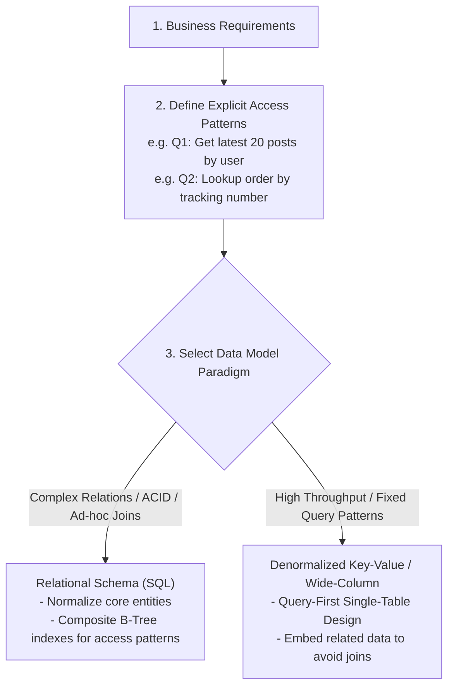
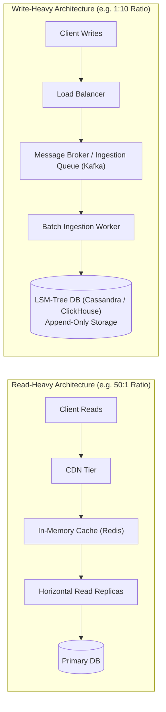
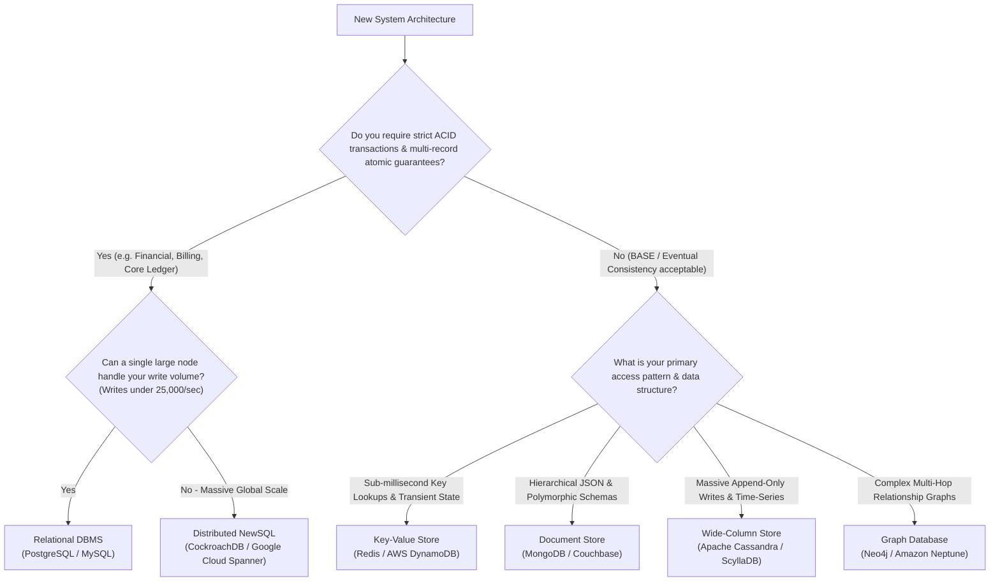
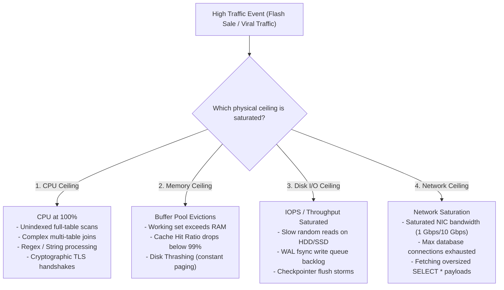
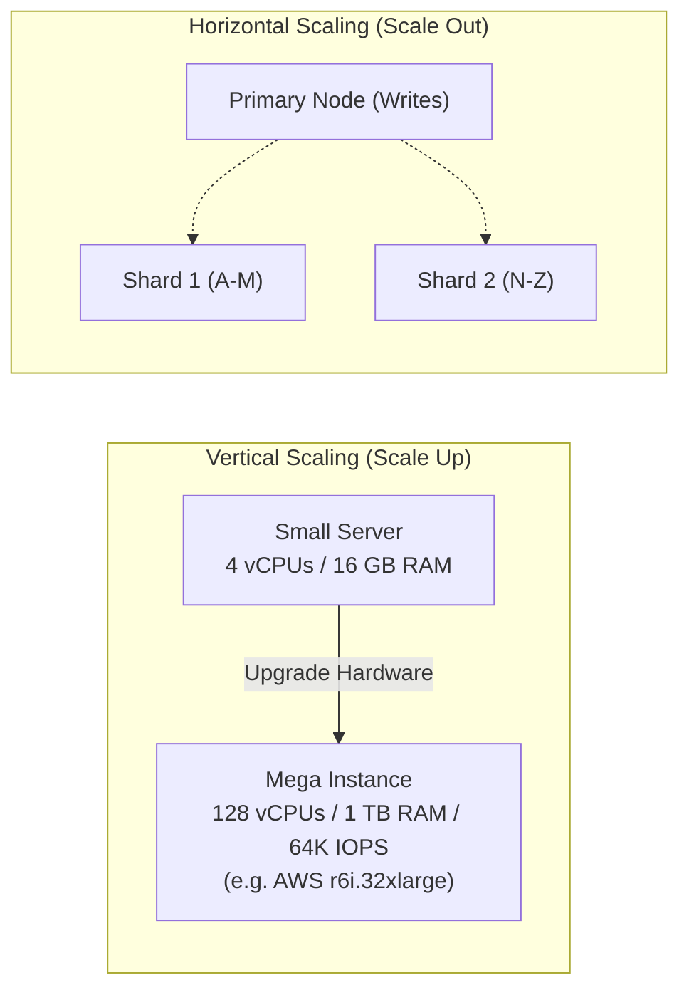
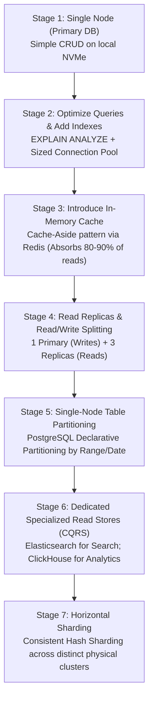
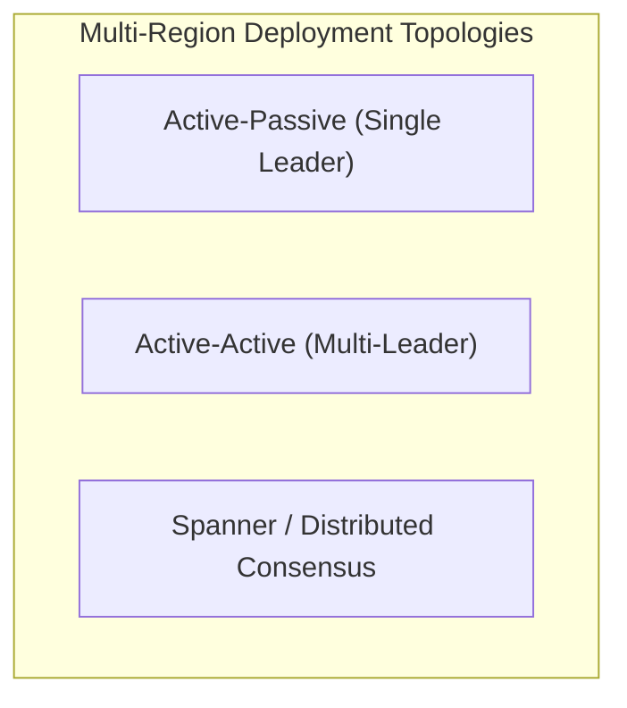
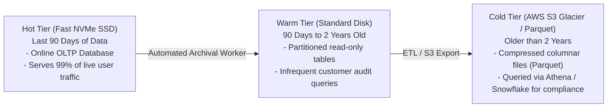
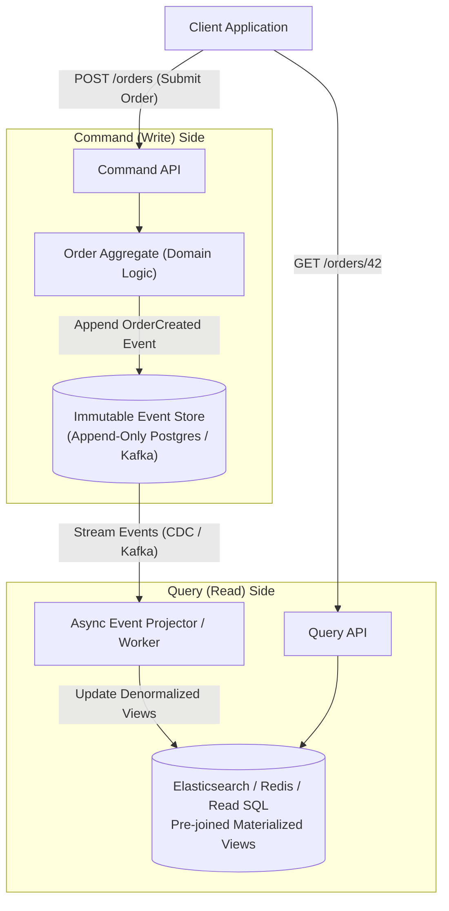

# 13. Database Design in System Design: The Production Blueprint

In large-scale system design, the database is almost always the ultimate bottleneck. Compute instances are stateless and can scale horizontally in seconds behind a load balancer; databases are stateful, bound by physical disk I/O, network sockets, replication lag, and mathematical consistency theorems. 

Designing a database architecture for a distributed system is not about picking the "coolest" technology. It is a rigorous process of translating **access patterns**, **data volumes**, **throughput targets**, and **business invariants** into concrete schemas, storage engines, caching topologies, and partitioning boundaries.

---

## 1. Back-of-the-Envelope Estimation Framework

Before drawing a single table or choosing a database engine, you must calculate four core quantitative parameters:
1. **Write Throughput (TPS / Writes per second)**
2. **Read Throughput (QPS / Reads per second)**
3. **Storage Capacity (1-Year and 5-Year projections)**
4. **Network Bandwidth (Ingress and Egress bytes per second)**

### 1.1 The Standard System Design Constants
Keep these mental math constants handy:

```
Seconds in a day: 86,400 seconds  ≈  10^5 seconds (100,000 for fast estimation)
1 Byte (B)
1 Kilobyte (KB)  = 10^3 Bytes
1 Megabyte (MB)  = 10^6 Bytes  = 1,000 KB
1 Gigabyte (GB)  = 10^9 Bytes  = 1,000 MB
1 Terabyte (TB)  = 10^12 Bytes = 1,000 GB
1 Petabyte (PB)  = 10^15 Bytes = 1,000 TB
```

$$\text{Average QPS} = \frac{\text{Daily Active Users (DAU)} \times \text{Requests per User per Day}}{86,400}$$

$$\text{Peak QPS} = \text{Average QPS} \times \text{Peak Multiplier (typically } 2\times \text{ to } 5\times)$$

---

### 1.2 Step-by-Step Worked Example: Global Photo Sharing Service

Let us calculate the exact database requirements for a high-scale service:
* **Daily Active Users (DAU):** 50 Million ($5 \times 10^7$)
* **Write Pattern:** Each active user posts 2 photos per day.
* **Read Pattern:** Each active user views an average of 40 photos per day.
* **Photo Metadata Record:** 500 Bytes stored in the database (IDs, URLs, timestamps, user ID, tags).

#### 1. Write Throughput Estimation (Database TPS):
$$\text{Total Daily Writes} = 50\text{M users} \times 2 \text{ posts/day} = 100\text{ Million writes/day}$$

$$\text{Average Write TPS} = \frac{100,000,000 \text{ writes}}{86,400 \text{ s}} \approx 1,157 \text{ writes/second}$$

$$\text{Peak Write TPS} (3\times \text{ surge}) \approx 1,157 \times 3 \approx 3,500 \text{ writes/second}$$

#### 2. Read Throughput Estimation (Database QPS):
$$\text{Total Daily Reads} = 50\text{M users} \times 40 \text{ views/day} = 2\text{ Billion reads/day}$$

$$\text{Average Read QPS} = \frac{2,000,000,000 \text{ reads}}{86,400 \text{ s}} \approx 23,148 \text{ reads/second}$$

$$\text{Peak Read QPS} (3\times \text{ surge}) \approx 23,148 \times 3 \approx 70,000 \text{ reads/second}$$

* **Read-to-Write Ratio:** $23,148 : 1,157 \approx 20:1$ (Heavily Read-Dominant).

#### 3. Storage Capacity Estimation:
$$\text{Daily Raw Metadata Storage} = 100\text{M writes} \times 500 \text{ Bytes} = 50,000,000,000 \text{ Bytes} = 50 \text{ GB/day}$$

$$\text{1-Year Raw Storage} = 50 \text{ GB/day} \times 365 \approx 18.25 \text{ TB}$$

$$\text{5-Year Raw Storage} = 18.25 \text{ TB} \times 5 \approx 91.25 \text{ TB}$$

#### 4. The Production Storage Multipliers (The Hidden Reality):
Raw table data is only a fraction of total disk consumption:
1. **B-Tree Indexes:** Indexes on `user_id`, `created_at`, and `photo_id` add **$30\%\text{ to }50\%$** overhead ($+45\text{ TB}$).
2. **Replication Factor ($3\times$):** Primary + 2 Standby Replicas triples storage ($91.25 \text{ TB} \times 3 = 273.75\text{ TB}$).
3. **Operational Headroom ($30\%$):** Disks must never exceed $70\%$ saturation to prevent I/O collapse and allow `VACUUM` / index rebuilds.
$$\text{Total 5-Year Physical Storage Capacity} \approx \frac{(91.25 \text{ TB raw} + 45 \text{ TB indexes}) \times 3}{0.70} \approx 584 \text{ TB}$$

#### 5. Network Bandwidth (Database Metadata Only):
$$\text{Write Ingress} = 1,157 \text{ writes/s} \times 500 \text{ B} \approx 578.5 \text{ KB/s} \approx 4.6 \text{ Mbps}$$

$$\text{Read Egress} = 23,148 \text{ reads/s} \times 500 \text{ B} \approx 11.57 \text{ MB/s} \approx 92.5 \text{ Mbps}$$

---

## 2. Access-Pattern-Driven Schema Design

The single most critical difference between junior and senior system design is the starting point for schema design:

* **Traditional / Academic Approach (Schema-First):** Normalize entities into 3NF, declare tables, and hope the queries run fast.
* **Production System Design (Access-Pattern-First):** Explicitly list the top 5 most frequent read and write queries, identify their latency SLAs, and design the schema specifically to satisfy those access paths in $O(1)$ or $O(\log N)$ index seeks.



### 2.1 Case Study: Normalized SQL vs. Single-Table NoSQL (DynamoDB)

Consider an **Order Management System**:
* **Access Pattern 1 (Write):** Create a new order with 5 line items.
* **Access Pattern 2 (Read):** Fetch an order and all its items by `order_id` in under 5ms.
* **Access Pattern 3 (Read):** List all orders for a `customer_id` ordered by date.

#### Approach A: Relational SQL (PostgreSQL)
Normalized into two tables linked by a foreign key:

```sql
CREATE TABLE orders (
    order_id UUID PRIMARY KEY,
    customer_id UUID NOT NULL,
    status VARCHAR(32) NOT NULL,
    total_amount NUMERIC(10, 2) NOT NULL,
    created_at TIMESTAMPTZ NOT NULL
);

CREATE TABLE order_items (
    item_id UUID PRIMARY KEY,
    order_id UUID REFERENCES orders(order_id) ON DELETE CASCADE,
    product_id UUID NOT NULL,
    quantity INT NOT NULL,
    price NUMERIC(10, 2) NOT NULL
);

-- Satisfying Access Pattern 3: Composite Index
CREATE INDEX idx_orders_customer_date ON orders (customer_id, created_at DESC);
```
* **Pros:** Strict integrity; zero duplicated price data; easily supports new, unexpected analytical queries.
* **Cons:** Satisfying Access Pattern 2 requires a multi-table `JOIN` across foreign keys.

#### Approach B: Single-Table NoSQL Design (Amazon DynamoDB)
In high-scale NoSQL, joins are forbidden at runtime. We store multiple entity types in a **single table** using generic Partition Keys (`PK`) and Sort Keys (`SK`):

```
+--------------------------+--------------------------+----------------------------------------------------+
| Partition Key (PK)       | Sort Key (SK)            | Attributes (Data Payload)                          |
+--------------------------+--------------------------+----------------------------------------------------+
| ORDER#9012               | METADATA                 | { customer: "CUST#42", total: 150.00, status: "OK"}|
| ORDER#9012               | ITEM#001                 | { product: "PROD#88", qty: 2, price: 50.00 }       |
| ORDER#9012               | ITEM#002                 | { product: "PROD#19", qty: 1, price: 50.00 }       |
| CUST#42                  | ORDER#2026-10-18#9012    | { total: 150.00, status: "OK" }                    |
+--------------------------+--------------------------+----------------------------------------------------+
```
* **How Access Pattern 2 is Satisfied:**
  Query with `PK = "ORDER#9012"`. A single network round trip retrieves the order metadata **and** all 5 line items pre-joined in adjacent physical disk slots!

---

## 3. Read-Heavy vs. Write-Heavy Workloads

Systems behave fundamentally differently depending on which side of the I/O ledger dominates.



### Comprehensive Comparison Matrix

| Architectural Vector | Read-Heavy Workload (e.g. Wikipedia, Twitter, E-Commerce) | Write-Heavy Workload (e.g. Uber Telemetry, IoT, Metrics) |
| :--- | :--- | :--- |
| **Typical Ratio** | $10:1 \text{ to } 100:1$ (Reads $\gg$ Writes) | $1:5 \text{ to } 1:100$ (Writes $\gg$ Reads) |
| **Primary Storage Engine** | **B+ Tree Engines** (PostgreSQL, MySQL, InnoDB). Optimized for fast $O(\log N)$ point reads and range scans. | **LSM-Tree Engines** (Cassandra, ScyllaDB, RocksDB, ClickHouse). Optimized for sequential append-only writes. |
| **Primary Bottleneck** | Disk read latency, B-Tree lock contention, connection limits. | Disk write IOPS saturation, WAL fsync latency, table compaction overhead. |
| **Scaling Mechanism** | Multi-tier caching (Redis/Memcached) + Read Replicas with Read/Write Splitting. | Write buffer queues (Kafka), database sharding, batch insertions, time-series partitioning. |
| **Normalization Strategy** | Denormalization is common to avoid expensive multi-table joins at read time. | Write-optimized lean schemas; raw time-stamped events with zero update operations. |

---

## 4. The SQL vs. NoSQL Decision Framework

Do not choose a database based on hype. Use an objective decision tree rooted in transactional requirements, data structure, and operational characteristics:



### The Database Selection Spectrum

```
+----------------------+----------------------+----------------------+----------------------+
| Engine Type          | Best Real-World Uses | Primary Strengths    | Critical Trade-offs  |
+----------------------+----------------------+----------------------+----------------------+
| Relational (RDBMS)   | E-commerce checkout, | ACID guarantees,     | Difficult to scale   |
| (Postgres, MySQL)    | banking, CRM, ERP    | expressive SQL joins | writes horizontally; |
|                      |                      | mature tooling       | rigid schemas.       |
+----------------------+----------------------+----------------------+----------------------+
| Key-Value            | User sessions, auth  | Sub-millisecond      | No complex queries;  |
| (Redis, DynamoDB)    | tokens, leaderboards | latency; simple      | cannot join across   |
|                      |                      | horizontal scaling   | keys.                |
+----------------------+----------------------+----------------------+----------------------+
| Document             | Catalogs, user profiles| Flexible schema;   | Risk of data drift;  |
| (MongoDB)            | content management   | natural mapping to   | multi-document ACID  |
|                      |                      | JSON domain objects  | has high overhead.   |
+----------------------+----------------------+----------------------+----------------------+
| Wide-Column          | Telemetry, sensor logs| Blazing write speed; | Read latency higher; |
| (Cassandra, Scylla)  | chat history, metrics| linear horizontal    | queries strictly tied|
|                      |                      | scale (masterless)   | to primary key hash. |
+----------------------+----------------------+----------------------+----------------------+
| NewSQL               | Global finance,      | Full ACID + linear   | High write latency   |
| (Spanner, Cockroach) | multi-region SaaS    | horizontal scale     | ($50-100ms commit);  |
|                      |                      | globally             | operational cost.    |
+----------------------+----------------------+----------------------+----------------------+
```

---

## 5. Database Bottlenecks Under High Traffic

When a database suffers performance degradation under load, the root cause invariably falls into one of four physical hardware categories:



### Diagnostic Commands & Production Mitigations:
1. **CPU Saturation:**
   * *Diagnostic:* Query `pg_stat_statements` to find queries with highest `total_exec_time`.
   * *Mitigation:* Add missing composite indexes; terminate runaway queries via `statement_timeout`.
2. **Buffer Pool Depletion (RAM):**
   * *Diagnostic:* Check Cache Hit Ratio:
     $$\text{Hit Ratio} = \frac{\text{heap\_blks\_hit}}{\text{heap\_blks\_hit} + \text{heap\_blks\_read}}$$
   * If Hit Ratio $< 99\%$, the database is constantly fetching pages from physical disk. Scale up RAM or add Redis in front.
3. **Disk I/O Bottlenecks:**
   * *Diagnostic:* Check OS `iostat -x 1` for `%util` approaching $100\%$ and high `await` times ($>5\text{ ms}$).
   * *Mitigation:* Upgrade to Provisioned IOPS SSDs (e.g. AWS io2); aggregate writes using multi-row batching.
4. **Connection Exhaustion:**
   * *Diagnostic:* `FATAL: remaining connection slots are reserved for non-superuser connections`.
   * *Mitigation:* Deploy PgBouncer or HikariCP to multiplex thousands of backend threads into a fixed pool of 30 connections.

---

## 6. Vertical Scaling vs. Horizontal Scaling



### The Pragmatic Rule of System Design:
> **Scale vertically as far as physically and economically possible before introducing the architectural nightmare of sharding.**

* **Modern Cloud Capabilities:** Today, you can provision an AWS `r6i.32xlarge` with **128 vCPUs, 1,024 GB of RAM, and 64,000 IOPS** with a single click. A single properly tuned PostgreSQL instance on this hardware can comfortably process **30,000 to 50,000 queries per second**.
* If your application requires 10,000 QPS, **do not shard**. Sharding introduces cross-shard joins, distributed two-phase commits, rebalancing bugs, and operational fragility.

---

## 7. The Evolutionary Scaling Ladder

When scaling a database from 100 users to 100 million users, follow the **7-Stage Scaling Ladder**:



```
+------------------------------------+------------------------------------+
| Stage                              | Typical Scale Supported            |
+------------------------------------+------------------------------------+
| 1. Single Node + Solid Schema      | 0 - 5,000 QPS                      |
| 2. Connection Pool + Clean Indexes | 5,000 - 20,000 QPS                 |
| 3. In-Memory Redis Caching         | 20,000 - 100,000 QPS               |
| 4. Read Replicas (Read/Write Split)| 100,000 - 300,000 QPS (Read-Heavy) |
| 5. Table Partitioning (Single DB)  | 5 TB - 15 TB Storage               |
| 6. CQRS / Specialized Engines      | Massive text search & analytics    |
| 7. Horizontal Sharding             | >50,000 Writes/sec, >20 TB Storage |
+------------------------------------+------------------------------------+
```

---

## 8. Multi-Region Databases: Active-Passive vs. Active-Active

When an application expands globally, it encounters the unbreakable physical speed-of-light barrier:
$$\text{Speed of light in fiber optic glass} \approx 200,000 \text{ km/s} \implies \sim 5 \text{ ms per 1,000 km of round-trip latency}$$
A round trip between London and Sydney physically takes **$\sim 160\text{ ms}$** of pure network transit.



### 1. Active-Passive (Single Leader, Cross-Region Standbys)
* **How It Works:** All writes are routed across the globe to the **Primary Region** (e.g. `us-east-1`). Secondary regions (`eu-west-1`, `ap-southeast-1`) host asynchronous read replicas.
* **Latency:** Local reads in Europe are instant ($<2\text{ ms}$). Writes from Europe take $80\text{ ms}$ (transatlantic round trip).
* **Failure Mode:** If `us-east-1` burns down, a secondary region is promoted to primary. Asynchronous replication lag means some committed writes are permanently lost (RPO $> 0$).
* **Verdict:** Standard, robust architecture for $95\%$ of enterprise software.

### 2. Active-Active (Multi-Leader Replication)
* **How It Works:** Every region hosts an independent leader that accepts local writes immediately. Leaders stream writes asynchronously to each other.
* **Latency:** Blazing fast local writes in every continent ($<5\text{ ms}$).
* **The Fatal Flaw (Write Conflicts):** If User A in London updates their email to `"a@uk.com"` and simultaneously updates it in New York to `"a@us.com"`, both writes succeed locally. When changes cross the Atlantic, **a write conflict occurs**. Resolving this requires Last-Write-Wins (LWW) or Conflict-Free Replicated Data Types (CRDTs), which can silently overwrite data.

### 3. Distributed Linearizable Consensus (Google Cloud Spanner / CockroachDB)
* Uses TrueTime (atomic clocks and GPS receivers) and multi-region Paxos/Raft consensus to execute globally linearizable ACID transactions.
* **The Trade-off:** Zero write conflicts, but every write operation stalls until a majority of global regions acknowledge the transaction ($50\text{ ms} - 150\text{ ms}$ write latency).

---

## 9. Data Retention, Archival, and Tiering

Databases slow down when their tables accumulate hundreds of millions of historical rows that are rarely accessed. High-scale architectures enforce **Automated Data Tiering**:



### Implementation Techniques:
1. **Partition Drop:** If data is partitioned by month (`orders_2026_01`), purging 3-year-old data does not require a catastrophic `DELETE FROM orders WHERE ...` (which bloats PostgreSQL tables and burns disk I/O). Instead, drop the partition instantly:
   ```sql
   DROP TABLE orders_2023_01; -- Completes in 2 milliseconds! Zero WAL bloat!
   ```
2. **Columnar Cold Export:** Export historical data into Apache Parquet format on AWS S3. A 1 Terabyte relational table compresses into **$\sim 150\text{ GB}$** of Parquet files, reducing storage costs by over $85\%$.

---

## 10. Event Sourcing and CQRS

For complex enterprise domains (financial ledgers, order tracking, regulatory tracking), traditional CRUD updates mutate and destroy historical state:
```sql
UPDATE accounts SET balance = 500 WHERE id = 1; -- The old balance is lost forever!
```

### 10.1 Event Sourcing: State as a Stream of Events
Instead of storing the current state, store the **immutable sequence of business events** that led to that state:

```
+------------+--------------------------+------------------------------------------------+
| Event ID   | Event Type               | Event Payload                                  |
+------------+--------------------------+------------------------------------------------+
| 101        | AccountOpened            | { initial_deposit: 100, user: "Alice" }        |
| 102        | FundsDeposited           | { amount: 50 }                                 |
| 103        | FundsWithdrawn           | { amount: 30 }                                 |
+------------+--------------------------+------------------------------------------------+
Current State = Replay(101 -> 102 -> 103) = $120
```

### 10.2 CQRS (Command Query Responsibility Segregation)
Event Sourcing is paired with **CQRS**, cleanly splitting the system into a **Write Model** (optimized for appending events and validating invariants) and a **Read Model** (denormalized views optimized for sub-millisecond querying):



---

## 11. Consistency vs. Availability (CAP & PACELC Applied)

System designers must evaluate the famous **CAP Theorem** (Consistency, Availability, Partition Tolerance) and its modern extension **PACELC**:

> **PACELC Theorem:** If there is a **P**artition, how does your system choose between **A**vailability and **C**onsistency? **E**lse, how does your system trade off **L**atency versus **C**onsistency?

```
+------------------------------------+------------------------------------+
| High Consistency (CP / PC/EC)      | High Availability (AP / PA/EL)     |
+------------------------------------+------------------------------------+
| Target: Financial ledger, banking, | Target: Social media likes, feeds, |
| inventory checkout, ticketing.     | video view counts, chat messages.  |
| Rule: "Never return incorrect      | Rule: "Always accept the request,   |
| data, even if the service errors." | even if data is slightly stale."   |
| Engine: PostgreSQL, CockroachDB.   | Engine: Cassandra, DynamoDB.       |
+------------------------------------+------------------------------------+
```

---

## 12. Real-World Database Architectures (Case Studies)

### Case Study 1: URL Shortener (e.g. TinyURL, Bitly)
* **Access Characteristics:** Read-heavy ($100:1$ ratio). Massive key-value lookups (`short_url` $\rightarrow$ `long_url`).
* **Storage Requirement:** 1 Billion URLs $\times 500\text{ Bytes} = 500\text{ GB}$ (Compact; fits entirely in RAM on modern servers!).
* **Database Selection:**
  * **Cache:** In-memory **Redis** cluster holding hot URLs ($20\%$ of URLs generate $80\%$ of traffic).
  * **Persistent DB:** **NoSQL Key-Value Store (DynamoDB / Cassandra)** or **PostgreSQL** with a single unique B-Tree index on `short_hash`.
  * *No complex joins or relational integrity required.*

---

### Case Study 2: Social Media Timeline (e.g. Twitter / X)
* **Access Characteristics:** Write-heavy on user posts; massive read-heavy fanout on user timelines.
* **The Architecture:**
  * **Tweets Store:** Sharded relational (PostgreSQL) or document database (MongoDB) sharded by `tweet_id` (Snowflake ID containing timestamp).
  * **Timeline Delivery (Fanout-on-Write):** When a user posts, background workers push the `tweet_id` into the **Redis in-memory timeline lists** of all their followers.
  * **Celebrity Exception (Fanout-on-Read):** Users with $>1\text{ Million}$ followers do not fan out on write (which would saturate workers). Their tweets are fetched dynamically at query time and merged into followers' timelines.

---

### Case Study 3: Ride-Hailing Driver Tracking (e.g. Uber)
* **Access Characteristics:** Extreme write-heavy ingestion. Hundreds of thousands of active drivers broadcast GPS coordinates every 4 seconds.
* **Data Nature:** Ephemeral location telemetry. A driver's location from 10 minutes ago is completely irrelevant for dispatching a ride right now.
* **The Architecture:**
  * **Real-Time Location Buffer:** In-memory spatial index using **Redis Geospatial (GEOADD / GEORADIUS)** or custom in-memory quadtrees (Uber's H3 spatial index).
  * **Historical Audit Ledger:** Trip events (`TripStarted`, `TripCompleted`) written to an append-only **Cassandra / Kafka** cluster for invoicing, driver payouts, and dispute resolution.

---

## 13. Master Reference: System Design Database Blueprint

Review this blueprint when selecting database architectures in technical design reviews:

| System Type | Read/Write Pattern | Recommended Database Stack | Primary Scalability Mechanism |
| :--- | :--- | :--- | :--- |
| **E-Commerce Platform** | Read-Heavy Browsing, Strict ACID Checkout | PostgreSQL (Orders/Payments) + Redis (Cart/Sessions) + Elasticsearch (Catalog) | Read Replicas for catalog; Optimistic Locking for inventory reservations. |
| **Real-Time Chat (WhatsApp)** | Ultra Write-Heavy (billions of messages/day) | Apache Cassandra / ScyllaDB + Redis (Presence/PubSub) | Shard on `conversation_id`; Append-only message rows; Local caching. |
| **Streaming Platform (Netflix)** | Ultra Read-Heavy, Global Distribution | AWS DynamoDB (User State) + Cassandra (Playback History) + Global CDN | Multi-region active-active read replicas; Aggressive client-side caching. |
| **Financial Payment Gateway** | Transactional, Zero Loss (RPO=0, RTO under 30s) | Primary-Standby PostgreSQL or Distributed NewSQL (Spanner) | Synchronous multi-AZ replication; Outbox Pattern; Idempotency Keys. |
| **IoT Telemetry Monitoring** | Continuous Write-Heavy Stream | TimescaleDB / ClickHouse / Apache Kafka | Time-based range partitioning; Compression pipelines; Cold S3 tiering. |

---

## 14. Summary & Production Architecture Checklist

Audit your distributed database architecture against this readiness checklist:

* [ ] **Explicit Numerics Calculated:** Write TPS, Read QPS, 5-Year Storage Capacity, and Network Bandwidth are calculated before selecting an engine.
* [ ] **Access-Pattern Driven:** Table schemas and composite indexes reflect the exact top 5 access queries rather than abstract normalization.
* [ ] **Vertical Scaling Evaluated:** The system does not resort to distributed sharding before exhausting modern multi-core vertical hardware capabilities.
* [ ] **Read/Write Decoupled:** Read-heavy architectures leverage in-memory caching tiers (Redis) and horizontal read replicas with sticky write routing.
* [ ] **Write Ceilings Mitigated:** Write-heavy workloads utilize append-only logs, batch ingestion buffers (Kafka), or LSM-Tree engines (Cassandra/ClickHouse).
* [ ] **Connection Limits Protected:** Dedicated proxies (PgBouncer) prevent connection exhaustion and protect CPU cores from scheduling thrash.
* [ ] **Data Tiering Active:** Time-based data archival policies automatically drop or offload historical partitions to cold object storage (S3/Parquet).
* [ ] **Multi-Region Reality Acknowledged:** Multi-region systems explicitly choose between asynchronous Active-Passive standbys or high-latency global linearizable consensus.

---

⬅️ **[Previous: 12. Backend–Database Integration](12_Backend_Database_Integration.md)** | 🏠 **[Back to TOC](README.md)** | **[Next: 14. Advanced Database Topics ➡️](14_Advanced_Database_Topics.md)**

