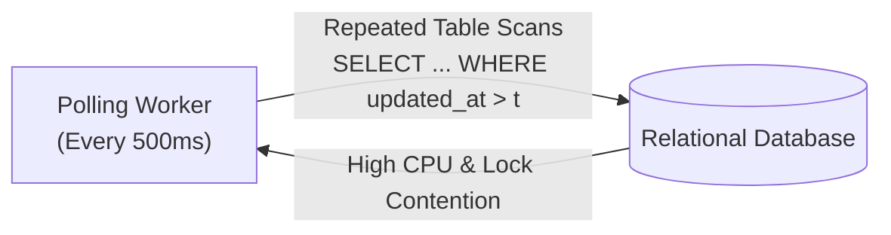
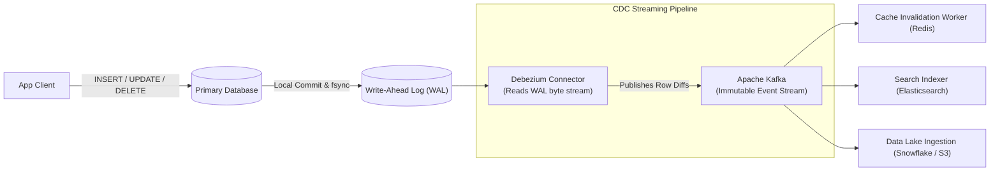
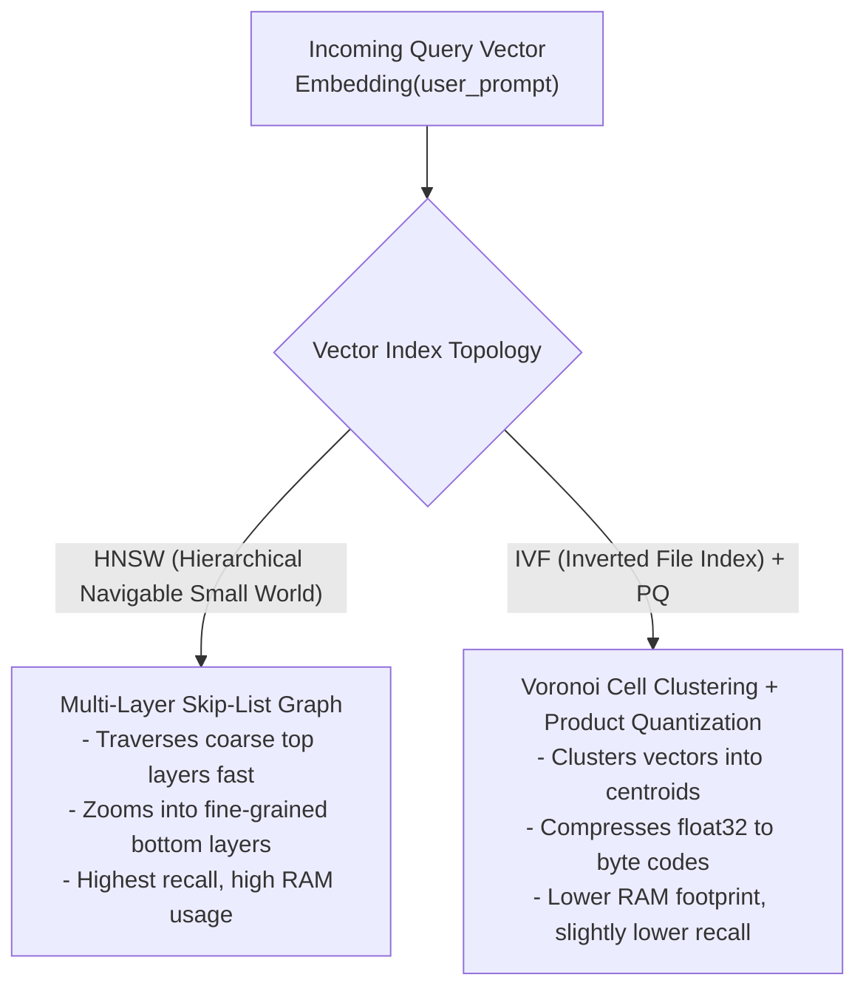
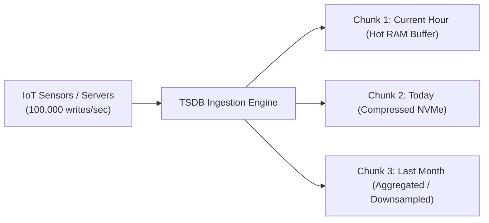
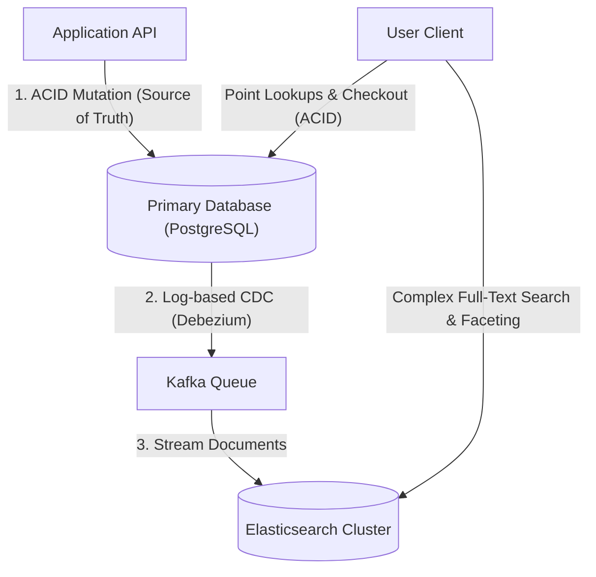
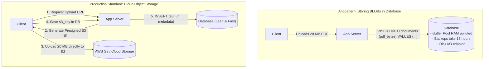
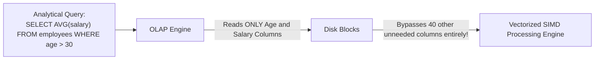
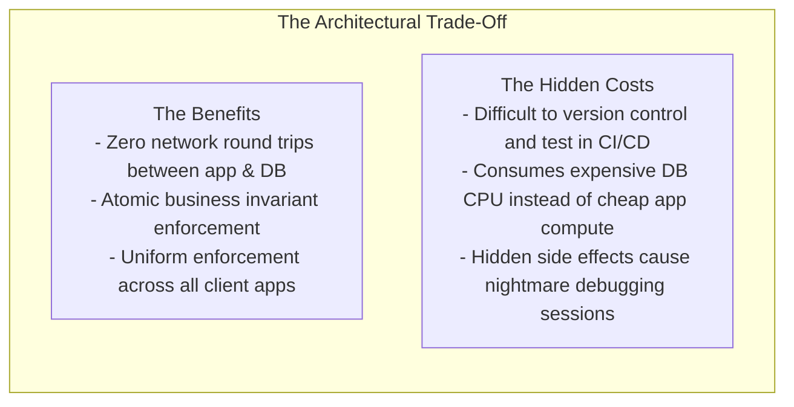
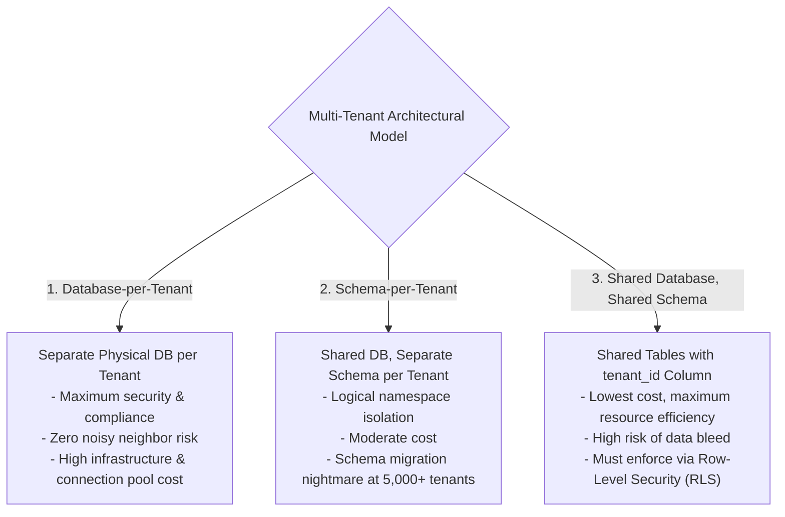
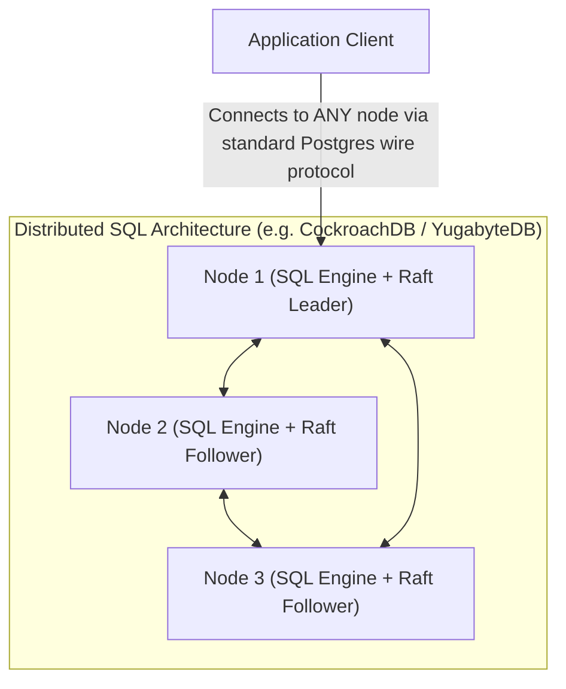

# 14. Advanced Database Topics Worth Knowing

Beyond standard relational tables, transactions, and basic sharding lies a specialized ecosystem of data architectures designed for modern cloud-native systems. As applications scale to millions of users, generic relational engines cannot efficiently solve every problem: full-text searching degrades B-Trees, LLM semantic search requires high-dimensional vector math, IoT telemetry overwhelms row-oriented engines, and multi-tenant SaaS platforms demand strict cryptographic or logical isolation.

This chapter explores the advanced data systems, storage paradigms, and synchronization mechanisms that senior architects deploy to solve specialized, high-scale engineering challenges.

---

## 1. Change Data Capture (CDC)

In distributed event-driven architectures, services frequently need to respond to database state mutations in real time—invalidating caches, indexing documents in Elasticsearch, updating analytics warehouses, or broadcasting WebSocket events.

### 1.1 Why Polling the Database Fails
The naive approach to detecting changes is polling:
```sql
SELECT * FROM orders WHERE updated_at > :last_poll_timestamp;
```



* **Missing Hard Deletes:** A deleted row physically vanishes from the table. `SELECT` queries can never detect rows that no longer exist.
* **Skipped Intermediate States:** If an order status changes from `PENDING` $\rightarrow$ `PROCESSING` $\rightarrow$ `COMPLETED` within a 500 ms polling interval, the poller only observes `COMPLETED`. The intermediate states are permanently lost.
* **Severe Performance Penalty:** Running table scans every few hundred milliseconds burns CPU, evicts hot buffer pool pages, and introduces latency to client queries.

---

### 1.2 Log-Based Change Data Capture
Modern systems use **Log-Based Change Data Capture (CDC)**. Instead of querying tables, a CDC agent (e.g. **Debezium**) attaches directly to the database's internal transaction log (**WAL** in PostgreSQL, **Binlog** in MySQL):



#### Why Log-Based CDC is Superior:
1. **Zero Database Query Overhead:** The CDC engine does not execute SQL queries. It reads the raw sequential binary log files already generated for crash recovery.
2. **100% Fidelity (Every Mutation Captured):** Every intermediate update and hard `DELETE` is recorded in the WAL.
3. **Transactional Ordering Guaranteed:** Events are emitted to Kafka partitions strictly in the exact order they committed to disk.

#### Example: Debezium CDC Event Payload (JSON)
```json
{
  "before": { "order_id": 4012, "status": "PENDING", "amount": 100.00 },
  "after":  { "order_id": 4012, "status": "SHIPPED", "amount": 100.00 },
  "source": { "version": "2.4.0", "connector": "postgresql", "ts_ms": 1776715200000 },
  "op": "u"
}
```

---

## 2. Database Indexes for Full-Text Search

Relational databases store strings in B-Trees. However, B-Trees are fundamentally designed for exact matches (`WHERE email = '...'`) or prefix lookups (`WHERE name LIKE 'Ali%'`). 

If a user searches for a keyword anywhere within a body of text:
```sql
SELECT * FROM articles WHERE content LIKE '%database%'; -- CANNOT USE B-TREE!
```
The database engine has no choice but to execute a **Full Table Scan**, reading every single disk page and running string substring searches across gigabytes of text.

### 2.1 The Inverted Index
To make full-text search fast, engines use an **Inverted Index**. Instead of mapping `Document -> Words`, it maps `Word -> List of Documents containing that word`:

```
Document 1: "PostgreSQL is an advanced relational database."
Document 2: "Relational database systems use B-Tree indexes."

INVERTED INDEX (Posting Lists):
+----------------+-----------------------+
| Token (Stem)   | Document IDs (List)   |
+----------------+-----------------------+
| "advanced"     | [ Doc 1 ]             |
| "b-tree"       | [ Doc 2 ]             |
| "databas"      | [ Doc 1, Doc 2 ]      |
| "index"        | [ Doc 2 ]             |
| "postgresql"   | [ Doc 1 ]             |
| "relat"        | [ Doc 1, Doc 2 ]      |
+----------------+-----------------------+
```

### 2.2 Text Processing Pipeline
Before a sentence enters an inverted index, it passes through three transformation phases:
1. **Tokenization:** Splits raw text into individual word tokens (handling punctuation, hyphens, spaces).
2. **Normalization & Lowercasing:** Converts all characters to lowercase and strips accents (`Café` $\rightarrow$ `cafe`).
3. **Stemming & Stop Word Removal:** Discards meaningless words (`an`, `the`, `is`) and reduces words to their grammatical root using algorithms like the Porter Stemmer (`"running"`, `"runs"` $\rightarrow$ `"run"`).

### 2.3 PostgreSQL Implementation: `tsvector`, `tsquery`, and GIN Indexes
PostgreSQL provides native, production-grade full-text search without requiring external search clusters:

```sql
-- 1. Create a table with a generated search vector column
CREATE TABLE articles (
    id SERIAL PRIMARY KEY,
    title TEXT NOT NULL,
    body TEXT NOT NULL,
    tsv_search TSVECTOR GENERATED ALWAYS AS (
        to_tsvector('english', title || ' ' || body)
    ) STORED
);

-- 2. Build a Generalized Inverted Index (GIN) on the tsvector
CREATE INDEX idx_articles_fts ON articles USING GIN (tsv_search);

-- 3. Execute Sub-Millisecond Search with Ranking:
SELECT id, title, ts_rank(tsv_search, query) AS relevance
FROM articles, to_tsquery('english', 'relational & database') query
WHERE tsv_search @@ query
ORDER BY relevance DESC
LIMIT 10;
```

---

## 3. Vector Databases and Vector Indexing

With the rise of Large Language Models (LLMs), semantic search, and recommendation systems, software engineering has shifted toward processing **Vector Embeddings**—high-dimensional floating-point arrays ($d = 768 \text{ to } 1536$) that capture the semantic meaning of text, images, or audio.

```
"King"  ≈ [  0.82, -0.45,  0.12, ...,  0.94 ]
"Queen" ≈ [  0.81, -0.42,  0.15, ...,  0.91 ]  (High Cosine Similarity!)
"Apple" ≈ [ -0.15,  0.88, -0.63, ..., -0.21 ]  (Low Similarity!)
```

### 3.1 Vector Distance Metrics
To determine how semantically related two vectors $\mathbf{u}$ and $\mathbf{v}$ are, engines calculate mathematical distance:

* **Cosine Similarity:** Measures the angle between two vectors (normalized for length). Gold standard for NLP embeddings:
  $$\cos(\theta) = \frac{\mathbf{u} \cdot \mathbf{v}}{\|\mathbf{u}\| \|\mathbf{v}\|}$$
* **Euclidean Distance ($L_2$ Distance):** Measures straight-line physical distance in $d$-dimensional space.
* **Inner / Dot Product:** Extremely fast on modern CPUs/GPUs using SIMD instructions.

---

### 3.2 The Approximate Nearest Neighbors (ANN) Challenge
Finding the exact closest vector among 10,000,000 embeddings requires calculating the distance against every single record ($O(N \cdot d)$), taking seconds of compute per query.

To achieve sub-10ms response times, vector engines use **Approximate Nearest Neighbors (ANN)** indexing algorithms:



### 3.3 Specialized Vector DBs vs. `pgvector`
* **Dedicated Vector Databases (Pinecone, Qdrant, Milvus, Weaviate):** Built entirely for massive-scale vector search ($>100\text{M}$ vectors). Native distributed clustering, GPU acceleration, and specialized quantization.
* **PostgreSQL Extension (`pgvector`):** Adds a `vector` data type and `HNSW` index directly to PostgreSQL.
  * *The Huge Advantage:* You can join vector similarity results directly with your transactional metadata in a single query!

```sql
-- pgvector in PostgreSQL: Hybrid Relational & Semantic Search
CREATE EXTENSION vector;

CREATE TABLE products (
    id SERIAL PRIMARY KEY,
    name VARCHAR(255) NOT NULL,
    category_id INT NOT NULL,
    embedding VECTOR(1536) -- OpenAI text-embedding-3-small dimension
);

-- Build an HNSW index using Cosine Distance
CREATE INDEX idx_products_embedding ON products 
USING hnsw (embedding vector_cosine_ops)
WITH (m = 16, ef_construction = 64);

-- Hybrid Query: Combine scalar relational filter with semantic vector ranking!
SELECT id, name, 1 - (embedding <=> :query_vector) AS similarity
FROM products
WHERE category_id = 42 -- Traditional SQL index filter
ORDER BY embedding <=> :query_vector -- HNSW vector search
LIMIT 5;
```

---

## 4. Time-Series Databases (TSDB)

Time-series workloads (server monitoring, IoT telemetry, financial stock ticks) exhibit radically unique characteristics compared to standard OLTP:
1. **Append-Only, Ultra-High Volume:** Millions of data points written per second; zero `UPDATE` operations.
2. **Immutable History:** A temperature recorded 5 minutes ago is an unalterable physical fact.
3. **Time-Range Queries:** $99\%$ of queries filter by a recent time window (`WHERE timestamp > NOW() - INTERVAL '1 hour'`) and calculate rollups (`AVG`, `MAX`, `P99`).



### 4.1 Storage Optimizations in Time-Series Engines
Standard relational tables collapse under time-series loads due to index bloat and random I/O. Dedicated TSDBs (e.g. **TimescaleDB**, **InfluxDB**, **ClickHouse**) employ specialized storage techniques:

* **Hypertables & Automatic Time Chunking:** Tables are automatically partitioned into physical sub-tables (chunks) based on time boundaries (e.g., 1 chunk per day). Dropping old data is an instantaneous `DROP TABLE` rather than an expensive row-by-row `DELETE`.
* **Delta-of-Delta Timestamp Compression:** Instead of storing 8-byte timestamps for consecutive measurements, store the *change in the difference between timestamps*. Regular intervals compress down to **single bits**!
* **Gorilla / XOR Float Compression:** Consecutive sensor readings (e.g. `21.40`, `21.42`, `21.41`) share identical floating-point exponent bits. XOR compression stores only the differing mantissa bits, shrinking data by over $90\%$.
* **Continuous Aggregations & Downsampling:** Background workers automatically compute hourly and daily averages, allowing multi-year queries to read pre-aggregated summary tables in milliseconds.

---

## 5. Search Engines vs. Databases

Engineering teams frequently debate: *Why not store all our data in Elasticsearch? It searches fast and accepts JSON!*

Understanding the fundamental trade-offs between a database and a search engine is critical:

```
+------------------------------------+------------------------------------+
| Relational / NoSQL Database        | Purpose-Built Search Engine        |
| (PostgreSQL, MySQL, MongoDB)       | (Elasticsearch, OpenSearch)        |
+------------------------------------+------------------------------------+
| Primary Purpose: System of Record  | Primary Purpose: Text / Analytics  |
| Storage: Slotted Page B+ Tree / WAL| Storage: Lucene Inverted Indexes   |
| Transactions: Strict ACID          | Transactions: None (Document-level)|
| Write Path: Synchronous, safe      | Write Path: Near-Real-Time (NRT)   |
| Update Latency: Instant (<1ms)     | Refresh Latency: 1s buffer flush   |
+------------------------------------+------------------------------------+
```



### Why Search Engines Must Never Be Your Primary Database:
1. **No True ACID Transactions:** Elasticsearch does not support multi-document transactional rollbacks or isolation levels.
2. **Near-Real-Time (NRT) Refresh Lag:** Writes in Elasticsearch are buffered in memory and only become visible to searches after an engine `refresh` interval (default: 1 second). Reading immediately after writing often returns stale data.
3. **Severe Write Amplification & Segment Merges:** Updating a single field in an Elasticsearch document requires marking the old document deleted and re-indexing the entire JSON structure into new immutable Lucene segments. High-concurrency writes trigger heavy CPU segment merging storms.

---

## 6. Object Storage vs. Database Storage

A frequent architectural anti-pattern is storing large binary objects (**BLOBs**—images, PDFs, video clips, machine learning model weights) directly inside database columns (`BYTEA` in Postgres, `LONGBLOB` in MySQL).



### The Invariants of Blob Storage:
1. **Databases are for Structured Metadata:** The database should store only the file path (`s3://bucket/docs/42.pdf`), file size, MIME type, cryptographic checksum (SHA-256), and authorization owner.
2. **Object Storage for Binary Payloads:** Cloud object storage (Amazon S3, Google Cloud Storage, Cloudflare R2, MinIO) is designed specifically for unformatted binary streams: virtually infinite scale, sub-cent per gigabyte pricing, and native integration with Content Delivery Networks (CDNs).
3. **Presigned URLs Bypass Server Bottlenecks:** Applications generate short-lived signed cryptographic URLs. Clients stream gigabytes of raw data directly to S3 without consuming a single byte of application server RAM or database socket bandwidth!

---

## 7. Data Warehouses & Analytical Databases (OLAP)

In [Chapter 1](01_Database_Fundamentals.md), we established the foundational difference between **OLTP** (Row-Oriented) and **OLAP** (Column-Oriented). Here, we explore the deep internal mechanics of modern analytical engines (**Snowflake**, **Google BigQuery**, **ClickHouse**, **Amazon Redshift**).

```
Row-Oriented Layout (OLTP - Postgres):
[Row 1: ID, Age, Salary] [Row 2: ID, Age, Salary] [Row 3: ID, Age, Salary]

Column-Oriented Layout (OLAP - ClickHouse / Snowflake):
[Age Block: 28, 42, 35, 28, 51, ...] 
[Salary Block: 85000, 120000, 95000, 85000, 140000, ...]
```



### 7.1 Why Columnar Engines Are 1,000x Faster for Analytics:
1. **$90\%$ I/O Reduction:** A wide table may contain 50 columns. If an aggregation query needs only 2 columns, an OLAP engine physically reads only those 2 column blocks from disk, skipping the remaining 48 columns entirely.
2. **Massive Columnar Compression:** Because an entire disk block contains identical data types (e.g., millions of integers), columnar data compresses dramatically using **Run-Length Encoding (RLE)** and **Dictionary Encoding** (shrinking data by $5\times\text{ to }10\times$).
3. **Vectorized SIMD Execution:** Modern CPUs feature Single Instruction, Multiple Data (SIMD) registers. A columnar engine loads an array of 512 salary numbers into a single CPU register and sums them in a single clock cycle!

---

## 8. Materialized Views and Incremental Refresh

A standard SQL **View** is merely a stored query. Every time you query a view, the underlying query runs from scratch. 

A **Materialized View** physically executes the query once, computes the result, and writes the output as a concrete table onto disk.

```sql
-- Creating a Materialized View for an Executive Dashboard
CREATE MATERIALIZED VIEW monthly_sales_summary AS
SELECT 
    date_trunc('month', order_date) AS sales_month,
    product_category,
    COUNT(order_id) AS total_orders,
    SUM(total_amount) AS total_revenue
FROM orders
JOIN products ON orders.product_id = products.id
GROUP BY 1, 2;

-- Queries hit the pre-calculated summary table in under 1ms!
SELECT * FROM monthly_sales_summary WHERE sales_month = '2026-10-01';
```

### Refresh Strategies: Full vs. Concurrent vs. Incremental
* **Full Refresh (`REFRESH MATERIALIZED VIEW`):** Re-runs the entire query from scratch and locks the view, blocking read queries during calculation.
* **Concurrent Refresh (`REFRESH MATERIALIZED VIEW CONCURRENTLY`):** Requires a unique index on the materialized view. Computes the diff in a temporary table and applies updates in place, allowing uninterrupted read queries.
* **Incremental View Maintenance (IVM):** The gold standard in advanced databases. The engine uses CDC or trigger diffs to update only the specific summary rows affected by incoming writes, eliminating batch recalculation entirely.

---

## 9. Database Triggers & Stored Procedures: The Architectural Trade-Off

**Stored Procedures** run procedural logic (PL/pgSQL, PL/SQL) directly inside the database process. **Triggers** automatically invoke procedures before or after mutations (`INSERT`, `UPDATE`, `DELETE`).



### Production Guidelines: When to Use vs. Avoid
* **LEGITIMATE Uses for Triggers:**
  * Automated audit timestamp maintenance (`SET updated_at = NOW()`).
  * Immutable forensic auditing (writing old row states to an append-only audit table).
  * Enforcing cross-table mathematical constraints that standard SQL `CHECK` constraints cannot express.
* **PROHIBITED Uses for Triggers:**
  * Orchestrating business logic (e.g. charging a payment, creating user notifications, firing external webhooks).
  * Cascading multi-table trigger chains (where mutating Table A triggers Table B, which cascades to Table C, deadlocking the cluster).

---

## 10. Multi-Tenant Database Design (SaaS Architecture)

When building B2B SaaS software, every enterprise customer (tenant) requires strict data isolation. Choosing the right multi-tenancy model is a foundational system design decision:



### Detailed Multi-Tenancy Comparison

| Architectural Dimension | Database-per-Tenant | Schema-per-Tenant | Shared Database & Shared Schema |
| :--- | :--- | :--- | :--- |
| **Data Isolation** | **Physical (Absolute):** Completely separate database files and users. | **Logical (High):** Separate database namespaces within one cluster. | **Logical (Lowest):** All rows live in the same heap files separated by a `tenant_id`. |
| **Compliance (HIPAA/Gov)**| **Easiest:** Encrypt and isolate individual tenant data independently. | **Moderate:** Requires strict role grants per schema. | **Complex:** Demands rigorous audit proofs that data bleed is impossible. |
| **Infrastructure Cost** | **Highest:** Idle tenants consume private RAM and connection overhead. | **Medium:** Shared memory buffer pool across all schemas. | **Lowest:** Perfect resource sharing and elasticity. |
| **Schema Migrations** | **Painful:** Running DDL across 5,000 separate database instances. | **Difficult:** Running DDL across 5,000 schemas in a single database. | **Instant:** Run DDL once on the shared table schema. |
| **Noisy Neighbor Defense** | **Built-In:** A heavy tenant exhausts only their own compute resources. | **Partial:** Shared CPU and RAM can be starved by one massive tenant. | **Requires Work:** Demands application rate-limiting and connection quotas. |

---

## 11. Distributed SQL Databases (NewSQL)

For decades, engineers faced a painful dilemma:
* Choose **Relational RDBMS (PostgreSQL)** for strict ACID transactions, complex joins, and SQL semantics—but get stuck with a single primary write bottleneck.
* Choose **NoSQL (Cassandra/DynamoDB)** for horizontal scale and multi-region writes—but forfeit transactions, joins, and relational integrity.

**Distributed SQL (NewSQL)** bridges this gap, providing **Full ACID Transactions + Relational SQL + Horizontal Multi-Node Scale**:



### 11.1 The Anatomy of Distributed SQL
1. **Stateless SQL Execution Layer:** Every node in the cluster exposes a standard PostgreSQL-compatible wire protocol. Clients can connect to *any* node and issue queries.
2. **Distributed Key-Value Storage Engine:** Beneath the SQL layer, tables are mapped to sorted key-value pairs (using RocksDB or Pebble) and divided into contiguous byte ranges (chunks of 64 MB).
3. **Consensus Per Range (Raft / Paxos):** Each 64 MB range is replicated across multiple nodes using the Raft consensus algorithm. Writes achieve consensus without requiring a centralized master.
4. **Global Distributed Transactions:** Executes multi-key atomic transactions across distinct physical servers using Two-Phase Commit combined with hybrid logical clocks (HLC) or atomic clocks (Google Spanner's TrueTime).

### 11.2 The Trade-Off: Network Latency
Distributed SQL is not a silver bullet. Because every write transaction requires Raft consensus over network sockets, **single-row write latency is physically higher ($5\text{ ms} - 15\text{ ms}$)** than a local single-node PostgreSQL instance on NVMe ($<1\text{ ms}$). Distributed SQL is designed for systems that have **outgrown single-node write capacity**.

---

## 12. Master Reference Table: Advanced Paradigms

| Architectural Paradigm | Primary Use Case | Leading Technologies | Key Trade-Off to Keep in Mind |
| :--- | :--- | :--- | :--- |
| **Change Data Capture (CDC)** | Event-driven microservices, real-time cache and search index sync. | Debezium, Kafka Connect, AWS DMS | Adds streaming infrastructure complexity (Kafka/Zookeeper) to the stack. |
| **Full-Text Inverted Indexes** | Keyword search, fuzzy matching, relevance ranking. | PostgreSQL FTS, Elasticsearch, OpenSearch | High write amplification; text tokenization consumes significant CPU during writes. |
| **Vector Databases** | LLM semantic retrieval (RAG), recommendation engines. | Qdrant, Pinecone, Milvus, `pgvector` | ANN searches are probabilistic approximations; high RAM usage for HNSW graphs. |
| **Time-Series DB (TSDB)** | High-frequency IoT telemetry, system metrics, financial ticks. | TimescaleDB, InfluxDB, ClickHouse | Unsuitable for random updates; queries must be filtered by time dimensions. |
| **Columnar Stores (OLAP)** | Analytical reporting, multi-billion row aggregations. | ClickHouse, Snowflake, Google BigQuery | Severe performance collapse on single-row point updates or transactional mutations. |
| **Object Storage** | Storing binary files, images, PDFs, backups, large blobs. | AWS S3, Google Cloud Storage, MinIO | High latency ($50\text{ms}-100\text{ms}$); eventual consistency in older architectures; no SQL joins. |
| **Distributed SQL (NewSQL)** | Global ACID transactions, horizontal write-scaling. | CockroachDB, YugabyteDB, Google Spanner | Higher single-query write latency ($5\text{ms}-15\text{ms}$) due to distributed Raft consensus. |

---

## 13. Summary & Senior Architecture Checklist

Review this checklist when integrating advanced data architectures into your system design:

* [ ] **Log-Based CDC Over Polling:** Use log-tailing CDC (Debezium/WAL) instead of running periodic polling queries against production tables.
* [ ] **Keep Blobs Out of the Database:** Store raw files in S3 and persist only immutable URLs and metadata in the database.
* [ ] **Vector Search Strategy Defined:** Use `pgvector` for datasets under 10 million vectors with existing relational data; graduate to dedicated vector databases (Qdrant/Milvus) for massive scale.
* [ ] **Search Engine Invariants Respected:** Never treat Elasticsearch as an authoritative system of record; always pair it with an ACID primary database.
* [ ] **Time-Series Partitioning Configured:** Ensure time-series tables use chunked time partitioning and automated data downsampling.
* [ ] **Multi-Tenancy Isolation Verified:** Shared-schema multi-tenant systems strictly enforce Row-Level Security (RLS) on tenant identifier columns.
* [ ] **Distributed SQL Justified:** Deploy NewSQL (CockroachDB/Spanner) only when transactional write volume genuinely exceeds the physical limits of a vertically scaled primary instance.

---

⬅️ **[Previous: 13. Database Design in System Design](13_Database_Design_In_System_Design.md)** | 🏠 **[Back to TOC](README.md)**
