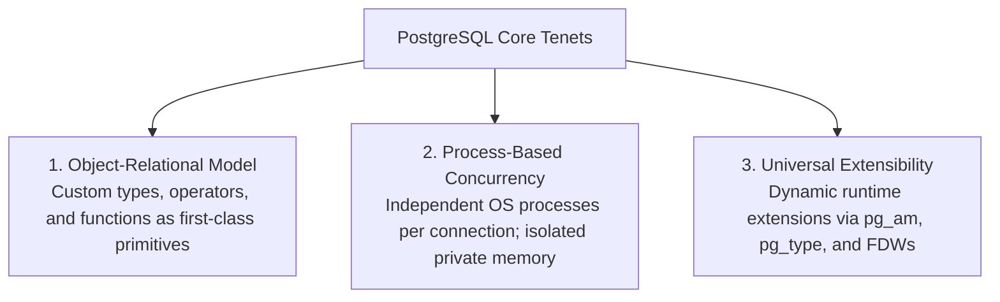
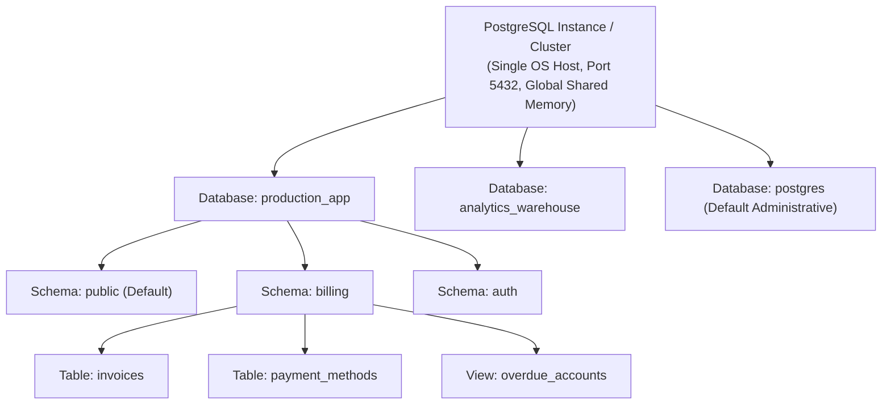
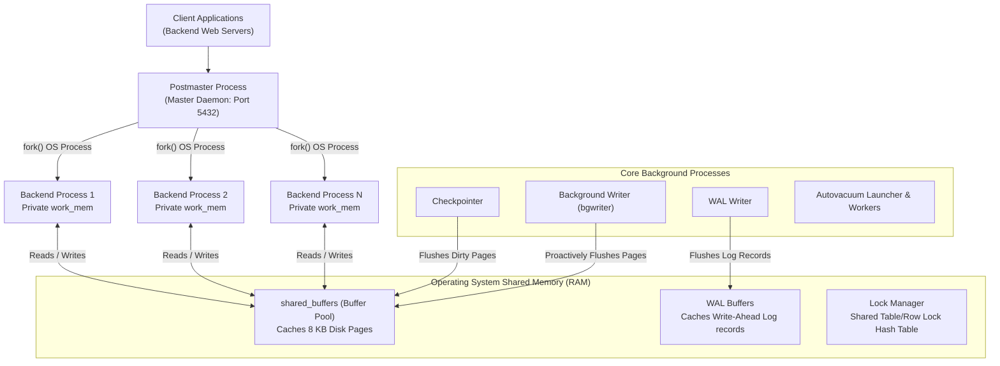
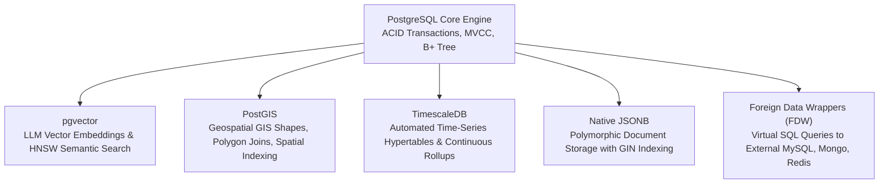
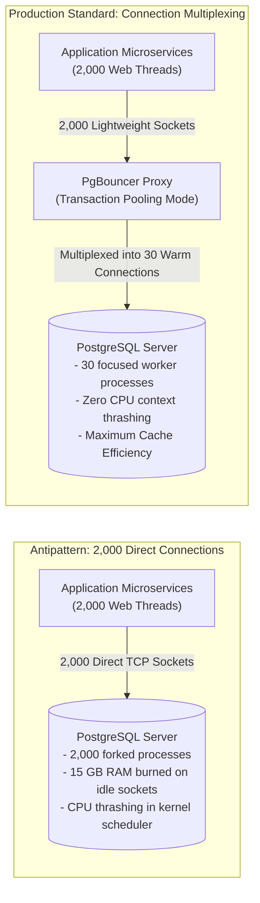

# 01. Introduction to PostgreSQL: Architecture & Foundations

PostgreSQL (commonly referred to simply as **Postgres**) is the world's most advanced open-source Object-Relational Database Management System (ORDBMS). Originating in 1986 under the leadership of Turing Award laureate Michael Stonebraker at UC Berkeley as the successor to Ingres, Postgres was architected from day one with a core engineering philosophy: **absolute data integrity, strict standards compliance, and unbounded extensibility**.

While many databases optimize for speed at the cost of consistency or restrict users to fixed relational models, PostgreSQL provides an extensible catalog-driven runtime. It supports transactional relational operations alongside native semi-structured JSONB documents, geospatial vectors via PostGIS, AI embeddings via `pgvector`, and time-series hypertables—making it the de facto foundational datastore for modern software engineering.

---

## 1. What Makes PostgreSQL Unique?

PostgreSQL is distinguished by three architectural characteristics that set it apart from traditional RDBMS engines:



### 1.1 Object-Relational Database Management System (ORDBMS)
Traditional relational databases (such as MySQL or SQLite) operate strictly on standard ANSI SQL scalar types (integers, strings, floats, timestamps). PostgreSQL is an **Object-Relational** system:
* **User-Defined Types & Operators:** You can create custom complex types, composite records, and define custom algebraic operators (`+`, `<@`, `@@`) that compile directly into the query execution engine.
* **Table Inheritance:** Tables can inherit columns and constraints from parent tables, mirroring object-oriented inheritance.
* **Catalog-Driven Architecture:** Everything in PostgreSQL—from tables and indexes to data types and access methods—is registered as rows inside system catalog tables (`pg_class`, `pg_type`, `pg_proc`, `pg_am`). When you install an extension, you are not hacking binary code; you are registering new types and operators into the system catalog.

### 1.2 Independent Open-Source Governance
Unlike MySQL (owned by Oracle Corporation) or SQL Server (owned by Microsoft), PostgreSQL is governed by the **PostgreSQL Global Development Group**—an independent, vendor-neutral community governed by a strict BSD-style open-source license. No single corporation controls its roadmap, ensuring stability, zero licensing lock-in, and decades of backward-compatible engineering.

---

## 2. PostgreSQL Logical Hierarchy: Cluster, Database, & Schema

Understanding PostgreSQL begins with mastering its logical containment hierarchy:



### 2.1 Instance (Cluster)
A **PostgreSQL Cluster** is a single running collection of PostgreSQL processes managing a single physical on-disk data directory (`$PGDATA`). A cluster shares common background processes (Checkpointer, WAL Writer), common shared memory (`shared_buffers`), and cluster-wide global catalogs (`pg_authid` for users and passwords).

### 2.2 Database
An instance contains one or more independent **Databases**. 
* Databases are logically isolated from one another.
* A client connection connects to **exactly one database** at a time.
* You cannot run cross-database joins natively (`SELECT * FROM db1.table JOIN db2.table` is prohibited; cross-database querying requires the `postgres_fdw` foreign data wrapper).

### 2.3 Schema (Namespace)
Within a single database, objects are organized into **Schemas** (namespaces).
* By default, every database contains a schema named `public`.
* The `search_path` configuration variable determines the order in which schemas are searched when an unqualified table name is referenced:
  ```sql
  SET search_path TO billing, public;
  SELECT * FROM invoices; -- Searches billing.invoices first, then public.invoices
  ```

---

## 3. High-Level Process and Memory Architecture

PostgreSQL is built on a **multi-process architecture** (unlike MySQL, SQL Server, or Oracle, which use multi-threaded models). Every client connection is served by an independent operating system process.



---

### 3.1 The Process Hierarchy

#### 1. The Postmaster (Daemon / Supervisor Process)
The `postmaster` process is the initial root process launched when PostgreSQL boots:
* Binds to network interfaces (default TCP port `5432`) and Unix domain sockets (`/tmp/.s.PGSQL.5432`).
* Performs the initial TLS/SSL handshake and authenticates client credentials against `pg_hba.conf`.
* When authentication succeeds, it calls the OS `fork()` system call to spawn a dedicated **Backend Process** (also named `postgres`) for that specific connection.
* Monitors child processes and initiates crash recovery if any worker dies abnormally.

#### 2. Backend Processes (`postgres` workers)
* One dedicated operating system process per active client socket.
* Runs the complete SQL parsing, planning, optimization, and execution pipeline.
* Has private, unshared memory contexts (`work_mem`, `temp_buffers`).
* Attaches to OS Shared Memory to read and write database pages.

#### 3. Core Background Processes

| Background Process | Primary Responsibility | Production Tuning Metric |
| :--- | :--- | :--- |
| **Checkpointer** | Periodically flushes all dirty pages from `shared_buffers` to physical disk heap files and writes a checkpoint record to WAL. | `checkpoint_completion_target = 0.9`<br/>`max_wal_size = 16GB` |
| **Background Writer (bgwriter)** | Proactively and continuously flushes small batches of dirty pages to disk so backend workers rarely have to block waiting for clean buffers. | `bgwriter_lru_maxpages = 100`<br/>`bgwriter_delay = 20ms` |
| **WAL Writer** | Periodically writes and fsyncs WAL buffers to physical disk segments (`pg_wal/`) to minimize transaction commit stalls. | `wal_writer_delay = 200ms` |
| **Autovacuum Launcher** | Spawns worker processes to remove dead tuple versions left behind by MVCC updates and updates table statistics for the query planner. | `autovacuum = on`<br/>`autovacuum_max_workers = 4` |
| **Stats Collector** | Aggregates cluster-wide execution metrics (row read counts, index scans, cache hit ratios, active session states). | Feeds `pg_stat_activity` and `pg_stat_statements` |

---

### 3.2 Memory Architecture: Shared vs. Process-Private

PostgreSQL strictly segregates memory into two distinct operational tiers:

```
+-------------------------------------------------------------------------------+
|                       TOTAL DATABASE RAM ALLOCATION                           |
+-------------------------------------------------------------------------------+
| 1. SHARED MEMORY (Allocated once at startup, visible to all backends)          |
|    ├── shared_buffers: Caches 8 KB disk pages (Typically 25% of Total RAM)     |
|    ├── wal_buffers: Buffers unwritten WAL records (Typically 16 MB - 64 MB)   |
|    └── Lock Manager: Fast in-memory hash tables for S/X/Intent locks          |
+-------------------------------------------------------------------------------+
| 2. LOCAL PROCESS MEMORY (Allocated on-demand per backend process)             |
|    ├── work_mem: Memory used for in-memory SORT, HASH, and DISTINCT ops       |
|    │   (Allocated PER QUERY OPERATION, not just per connection!)             |
|    ├── maintenance_work_mem: Used for VACUUM, CREATE INDEX, ALTER TABLE      |
|    └── temp_buffers: Caches session-specific temporary tables                 |
+-------------------------------------------------------------------------------+
```

#### The `work_mem` Multiplier Danger:
A dangerous operational trap in PostgreSQL is misunderstanding `work_mem`:
* `work_mem` is **not** a per-connection ceiling; it is a **per-operation ceiling**.
* If a complex analytical query executes 4 `ORDER BY` sorts and 2 `Hash Joins`, that single query can allocate:
  $$\text{Query Memory} = 6 \times \text{work\_mem}$$
* If 100 concurrent queries run simultaneously with `work_mem = 64 MB`, total process memory consumption can exceed:
  $$100 \times 6 \times 64 \text{ MB} = 38.4 \text{ GB of RAM!}$$
* If physical RAM is exhausted, the Linux kernel's Out-Of-Memory (OOM) Killer will forcefully terminate the primary PostgreSQL process, bringing down the entire cluster.

---

## 4. The Physical On-Disk Layout (`$PGDATA`)

All physical files belonging to a PostgreSQL cluster reside within the data directory, configured via the environment variable `$PGDATA` (typically `/var/lib/postgresql/data` or `/var/lib/pgsql/data`).

```
$PGDATA/
├── PG_VERSION          # Plain text file containing major version (e.g. "16")
├── postgresql.conf     # Primary engine configuration (RAM, workers, logging)
├── pg_hba.conf         # Host-Based Authentication rules (client IP & auth method)
├── pg_ident.conf       # Operating system to database username mappings
│
├── base/               # Contains subdirectories for each database (by OID)
│   ├── 1/              # System template database
│   ├── 16384/          # Production database (OID: 16384)
│   │   ├── 2601        # Physical table heap file (1 GB segment)
│   │   ├── 2601.1      # Overflow segment (when table exceeds 1 GB)
│   │   └── 2601_fsm    # Free Space Map (tracks available space inside 8 KB pages)
│
├── global/             # Cluster-wide shared system catalogs (pg_database, pg_authid)
│
├── pg_wal/             # Write-Ahead Log files (16 MB binary segments: 000000010000...)
│
├── pg_stat/            # Permanent statistics files
└── pg_tblspc/          # Symbolic links to external physical disk mounts (Tablespaces)
```

### 4.1 The 1 GB Segment Boundary
PostgreSQL divides large tables and indexes into contiguous **1 Gigabyte physical files** (`filenode`, `filenode.1`, `filenode.2`). This design historically ensured compatibility with filesystems that had 2 GB file size limits and prevents file system corruption if an OS file pointer wraps around.

### 4.2 Tablespaces: Decoupling Storage from Disks
By default, all tables reside within `$PGDATA/base`. **Tablespaces** allow DBAs to place specific databases, tables, or indexes on distinct physical storage devices:

```sql
-- Map an ultra-fast NVMe drive to an index tablespace
CREATE TABLESPACE fast_nvme LOCATION '/mnt/nvme_storage/postgres_indexes';

-- Place hot index on NVMe while keeping table heap on standard SSD
CREATE INDEX idx_orders_customer ON orders (customer_id) TABLESPACE fast_nvme;
```

---

## 5. PostgreSQL as the "Swiss Army Knife" of Modern Data

Historically, software architectures deployed separate, dedicated databases for relational data, document caching, full-text search, time-series metrics, and spatial routing. 

PostgreSQL's dynamic extension model allows it to unify these workloads into a single, ACID-compliant cluster:



### 5.1 Relational + Document Hybrid: The Power of JSONB
PostgreSQL features two native JSON data types:
1. `JSON`: Stored as raw text. Preserves exact whitespace and key order, but must be reparsed on every query ($O(N)$).
2. **`JSONB` (Binary JSON):** Parsed into a decomposed binary tree format on write. Eliminates reparsing overhead and supports **Generalized Inverted Indexing (GIN)**.

```sql
-- Storing polymorphic payload with sub-millisecond indexing
CREATE TABLE events (
    id UUID PRIMARY KEY,
    payload JSONB NOT NULL
);

-- Index EVERY key and value inside the JSONB document using GIN!
CREATE INDEX idx_events_payload ON events USING GIN (payload);

-- Sub-millisecond containment query: Does payload contain this key-value pair?
SELECT * FROM events WHERE payload @> '{"status": "CONFIRMED", "tier": "VIP"}';
```

---

## 6. The Process Model & The PgBouncer Requirement

Because PostgreSQL executes one full OS process per connection, understanding **connection overhead** is fundamental to operating PostgreSQL at scale:



### The Physical Reality of `fork()`
1. **Memory Tax:** Every connection forks a private OS process consuming **$5\text{ MB} - 10\text{ MB}$** of private memory, even when completely idle.
2. **Context-Switching Thrash:** When 1,000 processes compete for 16 CPU cores, the Linux CPU scheduler spends more time context-switching between memory pages and flushing L1/L2/L3 CPU caches than executing actual SQL statements.
3. **The Solution:** Always deploy **PgBouncer** in **Transaction Pooling Mode** in front of production PostgreSQL clusters. 2,000 application threads share a tight pool of **30 to 50 active database backends**, achieving $3\times\text{ to }5\times$ higher sustained transaction throughput.

---

## 7. Essential Diagnostic Tools & System Catalogs

Production engineers inspect and tune PostgreSQL using built-in dynamic telemetry views:

### 7.1 Inspecting Active Connections: `pg_stat_activity`
Displays every active client connection, client IP, query runtime, and lock wait state:

```sql
-- Find all queries running longer than 5 seconds (Potential lock blockers!)
SELECT 
    pid, 
    usename, 
    client_addr, 
    state, 
    now() - query_start AS runtime, 
    query
FROM pg_stat_activity
WHERE state != 'idle' AND (now() - query_start) > INTERVAL '5 seconds'
ORDER BY runtime DESC;
```

### 7.2 Profiling Slow Queries: `pg_stat_statements`
The single most important extension in PostgreSQL. It normalizes queries and records total execution time, call frequency, and disk read counts:

```sql
-- Identify the top 5 queries consuming the most CPU time across the cluster
SELECT 
    query, 
    calls, 
    total_exec_time / 1000 AS total_seconds,
    mean_exec_time AS avg_ms,
    rows
FROM pg_stat_statements
ORDER BY total_exec_time DESC
LIMIT 5;
```

---

## 8. Master Comparison: PostgreSQL vs. Alternative Engines

| Architectural Dimension | PostgreSQL | MySQL (InnoDB) | SQLite | Oracle Database |
| :--- | :--- | :--- | :--- | :--- |
| **Concurrency Architecture** | **Multi-Process** (`fork` per connection) | **Multi-Threaded** (threads within single process) | **In-Process Serverless** (single file lock) | **Multi-Process / Multi-Threaded** |
| **Storage Architecture** | Append-only Heap + Out-of-place MVCC Tuples | Clustered Index (B+ Tree PK) + In-place updates with Undo Log | Single-file B-Tree + Rollback Journal / WAL | Clustered Tables + Undo Segments |
| **Primary Index Structure** | Heap table (Secondary indexes store physical Tuple IDs - TIDs) | Clustered Index (Secondary indexes point to Primary Key) | Clustered Index (B-Tree stores rows directly) | Heap table with ROWID |
| **Extensibility** | **Unmatched** (`pgvector`, PostGIS, custom types/operators) | Limited to built-in types and plugins | Moderate (custom C extensions) | High, but strictly proprietary |
| **ACID Strictness** | Zero tolerance for data coercion; strictly validates types | Lenient defaults (historically coerced invalid dates/types) | Weak type affinity (any type in any column) | Strict enterprise validation |
| **Licensing** | **Open-Source (PostgreSQL License - BSD)** | Open-Source (GPLv2) + Commercial (Oracle) | Public Domain | Commercial Enterprise (Expensive) |

---

## 9. Summary & Architectural Invariants

Keep these foundational invariants in mind as you explore the subsequent deep-dive chapters:

1. **PostgreSQL is Process-Based:** Every connection has private memory. Uncapped connection limits will crash your operating system via memory exhaustion; always pool connections via PgBouncer.
2. **Catalog-Driven Runtime:** Everything is a row in `pg_class` or `pg_type`. Extensibility is native to the database engine.
3. **Out-of-Place MVCC:** Updates do not modify disk bytes in place; they write new tuple versions to the heap and mark old tuples dead, making `VACUUM` an essential operational component.
4. **Strict Isolation by Default:** Databases within an instance cannot join across each other; schemas within a database provide clean logical separation.

---

⬅️ **[Back to PostgreSQL Index](README.md)** | **[Next: 02. Core Storage Architecture & Page Layout ➡️](02_Core_Storage_Architecture.md)**
